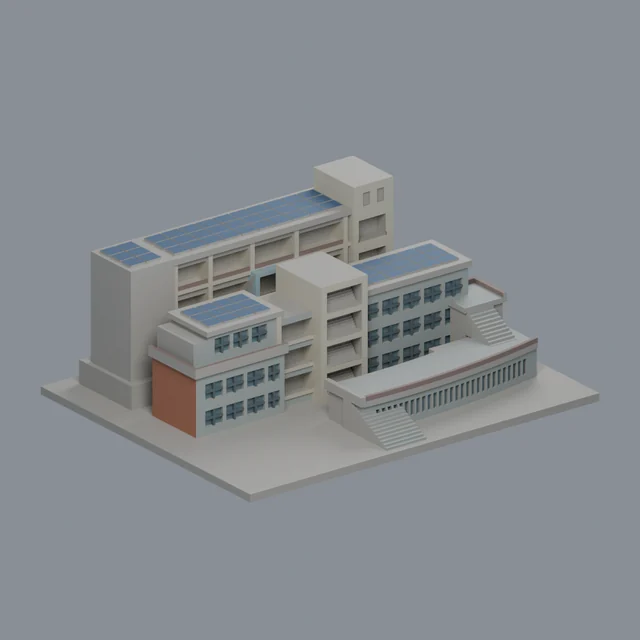
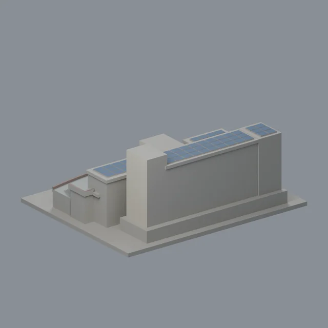
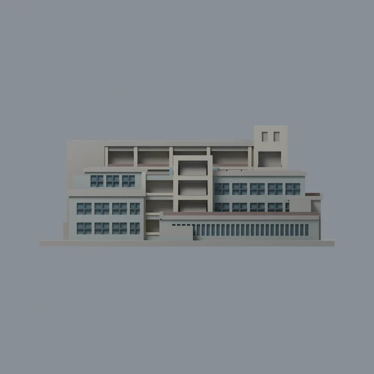
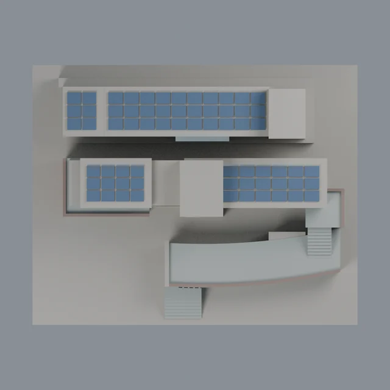

# 國立聯合大學八甲校區人文與社會學院 E1／E2／E3

## 模型預覽

| 模型預覽 | 模型預覽 | 模型預覽 |
| :---: | :---: | :---: |
|  正面與前棟外階 |  背面（未知面保留中性） |  正立面 |
|  頂視 |  |  |

## 現行9材質外觀

[來源界線與四視角](appearance/README.md) · [表面色 3MF](appearance/nuue-appearance.3mf) · [可編輯場景](appearance/scene.blend)

原奶油／冷灰框架、左端磚牆、有限窗凹與光電板頂面配色；深走廊不染成玻璃，淡藍框是混凝土。原加厚欄帶僅褐灰代理，草坪、門窗混合及未知區域不虛構。 原 STL 與歷史 QA 不變；這是外觀改善，不是新增幾何。E1 最低三階的正面階面（共 6 面）沿用現行冷灰。

本組把三棟相鄰建築做成可獨立擺放、共用底板的建築縮景：

- E1：人文與社會學院前棟。保留低矮弧形教室翼、大露台、前方寬階梯及右側第二段上樓階梯。
- E2：人文與社會學院中棟（臺灣語文與傳播學系）。保留三層長翼、左側退台、中央較高的開口樓梯塔與屋頂太陽能板分格。
- E3：人文與社會學院後棟（華語文學系）。保留後方高台上的柱廊、高低屋頂及右端高塔。

這是依官方照片判讀的簡化模型，不是測繪成果、BIM 或精確比例複製。最長邊 150 mm，尺寸約 150 × 120 × 61 mm；各校園模型獨立縮放，不代表彼此使用同一比例。底板只是讓三棟一起列印，不代表三棟是單一館棟。

上方彩色預覽由現行外觀模型渲染，沿用交付的 STL 幾何。

## 檔案

- `model.stl`：封閉、單一連通實體，單位 mm
- `scene.blend`：匯入同一 STL 的可檢視場景；地面、燈光及相機不是列印物件
- `build_model.py`：可修改的參數化建模原始碼
- `render_preview.py`：STL 預覽與 Blender 場景產生器
- `validate_model.py`／`validation.json`：網格驗證工具及結果
- `manifest.json`：館棟組成、列印設計與不確定性
- `requirements.txt`：建模相依套件

## 重建

在本資料夾安裝 requirements.txt 所列 Python 套件後，執行 `python build_model.py`。使用 Blender 4.x 執行 `blender -b -t 6 -P render_preview.py` 產生場景與兩張預覽。執行 `python validate_model.py model.stl --output validation.json` 重新檢查。

## FDM 建議與限制

- 以底板平放，底板厚 3 mm；建議 0.4 mm 噴嘴、0.16–0.20 mm 層高、3 道外牆及約 15% 填充起始測試。
- 欄杆改成約 1.3 mm 厚的低實牆，主要柱子加厚至至少 1.8 mm；窗格中梃約 0.8 mm，與窗洞背板相連。細小屋頂設備、標字、桌椅、植栽及空调沒有複製。
- 太陽能板以黏合屋頂的淺浮雕表示；屋頂斜度已簡化。窗戶用實際凹槽表示，不依賴貼圖。
- 深柱廊、塔樓開口及橋段有懸空處。請在切片器逐層預覽，按需要加支撐，尤其檢查塔樓內部支撐能否取出。
- 曲面、建物間距、平面深度與坡地高差均由照片估算。後側缺乏清晰照片，保持簡化實牆，沒有捏造精確窗格。
- 網格通過檢查不等於實際列印成功；尚未進行實體試印，也未獨立驗證所有可能的幾何自交。

## 官方參考來源

1. [國立聯合大學校園配置](https://www.nuu.edu.tw/p/426-1000-9.php?Lang=zh-tw)
2. [八甲校區地圖](https://www.nuu.edu.tw/var/file/0/1000/img/40/437241410.jpg)
3. [秘書室：人文與社會學院館外觀，相簿 1096](https://secretary.nuu.edu.tw/p/132-1003-1096.php?Lang=zh-tw)
4. [官方廣角照片（1）：三棟前後關係、弧形教室翼與露台](https://secretary.nuu.edu.tw/var/file/3/1003/gallery/96/1096/gallery_1096_402695_25754.jpg)
5. [官方照片（8）：華語文學系、臺灣語文與傳播學系館名與樓梯塔](https://secretary.nuu.edu.tw/var/file/3/1003/gallery/96/1096/gallery_1096_6639094_25755.jpg)

參考照片僅連結至官方來源，未隨模型重新散布。此資料夾不包含對官方照片或校方標誌的授權聲明。

現行大圖可用 [WebP 與原圖像素對照](display/archive-png.json) 校驗。在模型資料夾執行 `python display/verify_webp.py`（需 Pillow）。原四張彩色 PNG 與舊校驗表保留在[固定歷史版本](https://github.com/hplin50643/taiwan-buildings-3d/tree/ebd5aeef32c040412e4da498498c64b354b03097/%E5%A4%A7%E5%B0%88%E6%A0%A1%E9%99%A2/%E5%9C%8B%E7%AB%8B%E8%81%AF%E5%90%88%E5%A4%A7%E5%AD%B8/buildings/bajia-e1-e2-e3-humanities)，不再放在主分支。重繪請在暫存副本執行 `blender -b -t 4 --python-exit-code 1 -P appearance/source/render_current.py`，再以 `--replay-root /path/to/copy` 校對。
