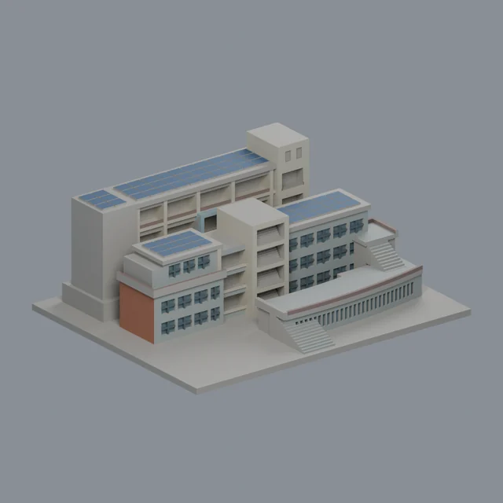
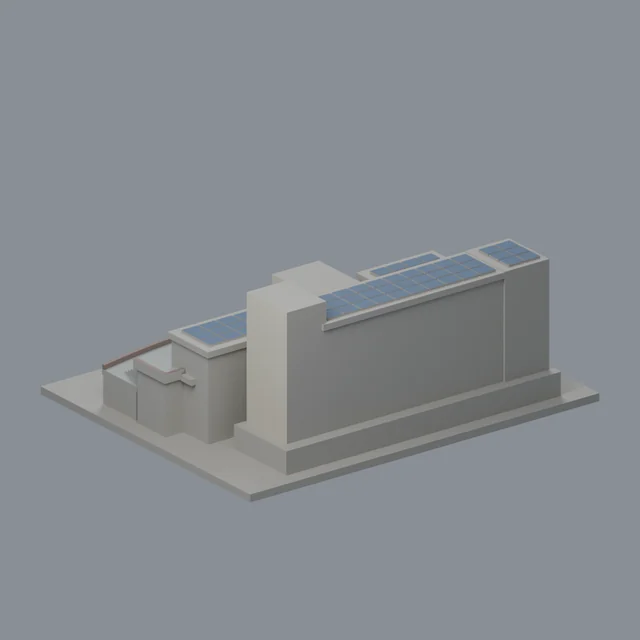
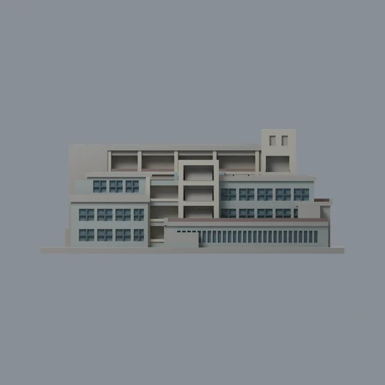
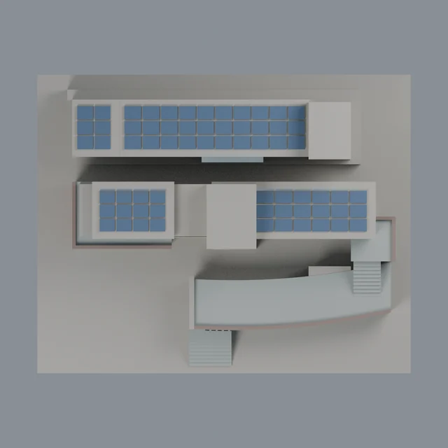

# 聯大八甲 E1／E2／E3 人文與社會學院：現行9材質外觀

沿用原 **6,918 三角面／3,453 頂點**，不改原 STL 位元、座標、面序或幾何；這是既有模型外觀改版，不增加模型包數。

| 模型預覽 | 模型預覽 | 模型預覽 |
| :---: | :---: | :---: |
|  正面與前棟外階 |  背面（未知面保留中性） |  正立面 |
|  頂視 |  |  |

[表面色 3MF](nuue-appearance.3mf) · [可編輯 Blender](scene.blend) · [材質色表](palette.json) · [逐面指派與依據](face-materials.json) · [原 STL](../model.stl)

## 來源與配色邊界

親自核對官方 [人文與社會學院相簿](https://secretary.nuu.edu.tw/p/132-1003-1096.php?Lang=zh-tw) 的完整 [照片 1](https://secretary.nuu.edu.tw/var/file/3/1003/gallery/96/1096/gallery_1096_402695_25754.jpg)、[照片 8](https://secretary.nuu.edu.tw/var/file/3/1003/gallery/96/1096/gallery_1096_6639094_25755.jpg)。EXIF DateTimeOriginal **2025-03-02 15:10:48／2025-03-10 13:44:30**，日期與時區未獨立核實，不代表 2026 現況。來源照片不隨包散布。

- 原 E2 中棟正面採冷灰、樓梯塔外框暖淺色，已見左側下部整片端牆紅磚色。E3 後棟來源左端只有狹窄磚帶，而原面未分開，該端牆保持中性，不擴大染整面紅磚。
- 原 E2 離散窗凹背及 E1 曲面前窗凹背灰藍，既有黏合窗梃深灰；E2 原網格把實景的門、窗與部分實牆簡化成規則小窗，這只是原窗色彩代理，不能宣稱逐扇復原。不補紅門、細玻璃框、空調或字樣。
- E3 寬深凹是混合走廊，不整片當玻璃；樓梯內背也保留中性。既有 E3 前置框採淡藍灰**混凝土色**，不是透明窗。
- 原加厚實欄帶只採褐灰欄杆色代理，並非實景透空細欄；露台和梯踏面灰色，不把整片露台染欄杆色。原模型的階高與通行尺寸不是無障礙或安全認證。
- 僅原獨立光電板頂面藍灰，屋頂底板及板間縫保留中性。未見外側、背牆及跨材質長面保守中性，來源中設備、庭園與鄰棟均未增加。
- 原 STL／面序／座標不變，不增加模型數，不宣稱物理列印成功。

[原幾何與來源限制](../README.md) · [來源覆核](qa/source-review.json)

## 歷史版本的重建與核驗

安裝 [依賴](source/requirements.txt)，Blender 使用 4.3.2。由本資料夾上層提供原 model.stl：

1. `python appearance/source/build_appearance.py`
2. `python appearance/source/verify_exchange.py`
3. `blender -b -t 3 --python-exit-code 1 -P appearance/source/render_appearance.py`
4. `blender -b -t 3 --python-exit-code 1 -P appearance/source/verify_scene.py`

[獨立重建 ZIP](rebuild-source.zip)含原 STL、四支程式及依賴，不含第三方照片；不取代原建模腳本。[逐檔 SHA256](SHA256SUMS)

[交換／拓撲 QA](qa/exchange-validation.json)核對原座標與面序、全部面材質、單連通、有向水密邊、頂點 link 單環、正體積與零退化／重複面；lib3mf 嚴格讀取零警告，實際編輯單材質再存讀，其他材質及面指派不變。SDK 六位小數量化誤差另列。

[Blender 存讀與編輯](qa/scene-validation.json) · [渲染記錄](qa/render-manifest.json) · [獨立重建](qa/rebuild-validation.json)

## 製造限制照舊

尺寸仍為 150 × 120 × 61 mm；原 STL、建模程式、場景及歷史 QA 保留。原層檢與薄特徵檢查本次未重跑，不能由材質 QA 代替。

3MF 是同一網格的表面色，不是九個封閉分色實體、切片專案、噴頭映射或 G-code。切片 GUI、多材料路徑與實體列印未測；柱頭、屋簷、窗框及薄邊仍須評估材料、支撐及拆除風險，沒有保證可印或免支撐。

## 現行材質與重建

僅E1原最低三個正面階面完整域共6面，由未知0改用既有冷灰2（#A0A8A5，roughness .78）。既有灰踏面、原9材質與其他6912面不變。側裙、基座、上14階、平台、E2/E3及欄杆排除。原17粗階、寬17不是實測階數或逐階配準；中間平台、細鼻口、欄杆與接縫未建模，原相交幾何不修正。欄影與白色磨損不是另校準材質。

顏色僅外觀材料家族近似，不是校準色或材種鑑定。公開照片不證明2026現況。原STL、幾何、順序、代表圖與原視角保持；浮點面域差異保留，非宣稱零誤差。歷史QA與製造限制仍適用。
# Official references

- https://secretary.nuu.edu.tw/p/132-1003-1096.php?Lang=zh-tw
- https://secretary.nuu.edu.tw/var/file/3/1003/gallery/96/1096/gallery_1096_402695_25754.jpg
- https://secretary.nuu.edu.tw/var/file/3/1003/gallery/96/1096/gallery_1096_6639094_25755.jpg

Both photos show E1 front stairs; source0 primary.

現版共 9 個顯示材質（含未知中性色）。前節的舊建置流程與 QA 僅供重現歷史版本；現行模型未新增幾何。

本節提及原ZIP/QA/校驗數目屬歷史記錄，不是現版ZIP清單。現版ZIP僅含原STL、必要舊建置與渲染程式、三支現版包裝／驗證程式、requirements-current.txt與本README及授權說明（如原有）。完整來源研究、照片、私人審核與廣泛校驗清單不公開。PUBLIC-MODEL-SHA256SUMS僅核當前交付產品；原QA不替代當前驗證。

現版命令：`python -B appearance/source/build_current.py`、`python -B appearance/source/verify_current.py`、`blender -b -t 4 --python-exit-code 1 --python appearance/source/render_current.py`。依requirements-current.txt安裝必要依賴。直接執行舊builder會重建歷史配色。包裝程式僅執行固定本地舊程式，新增材質時只替換新材質粗糙度運算；寫模型、材質、場景、原視角PNG與當前本地QA。歷史報告先保存再還原；原不存在時只刪該次產生的舊名報告。不進行網路或憑證操作。

現行大圖可用 [WebP 與原圖像素對照](../display/archive-png.json) 校驗。在模型資料夾執行 `python display/verify_webp.py`（需 Pillow）。原四張彩色 PNG 與舊校驗表保留在[固定歷史版本](https://github.com/hplin50643/taiwan-buildings-3d/tree/ebd5aeef32c040412e4da498498c64b354b03097/%E5%A4%A7%E5%B0%88%E6%A0%A1%E9%99%A2/%E5%9C%8B%E7%AB%8B%E8%81%AF%E5%90%88%E5%A4%A7%E5%AD%B8/buildings/bajia-e1-e2-e3-humanities)，不再放在主分支。重繪請在暫存副本執行 `blender -b -t 4 --python-exit-code 1 -P appearance/source/render_current.py`，再以 `--replay-root /path/to/copy` 校對。
