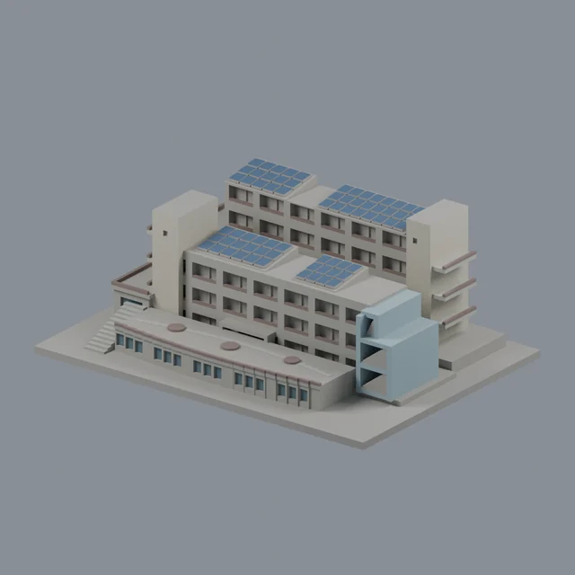
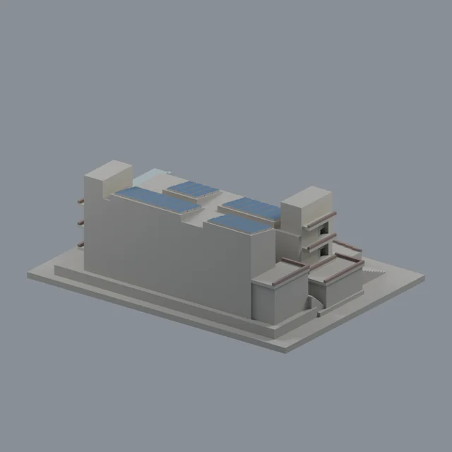
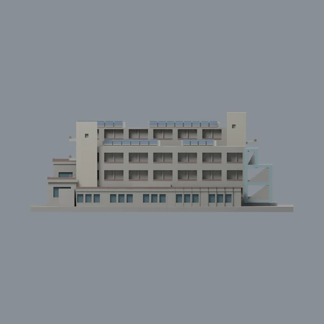
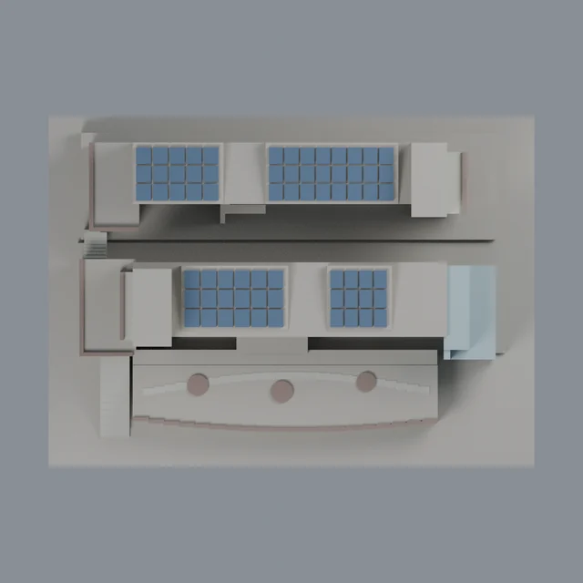

# 國立聯合大學八甲共同教育館舍 G1 前棟＋G2 中棟＋G3 後棟｜現行模型 WebP 預覽

四張均以現行八材質模型重渲染核對，不使用舊單色圖。表格用同視角 WebP 縮圖，點圖可開啟無損原尺寸 WebP。

| 模型預覽 | 模型預覽 | 模型預覽 |
| :---: | :---: | :---: |
|  正面與館舍入口 |  背面（未確認區保留原樣） |  正立面 |
|  頂視 |  |  |

[模型說明](../README.md) · [八材質與來源界線](../appearance/README.md) · [表面色 3MF](../appearance/nuug-appearance.3mf) · [可編輯 Blender](../appearance/scene.blend) · [原 STL](../model.stl) · [展示校驗](SHA256SUMS) · [模型與渲染對照](render-proof.json)

工程模型、來源覆核與重建記錄不變。本版不新增配色或幾何，不是現況色彩測量或試印。[調整前模型說明](https://github.com/hplin50643/taiwan-buildings-3d/blob/8e1d4f712a8bc259415a2480bb6d95d0139d150c/%E5%9C%8B%E7%AB%8B%E8%81%AF%E5%90%88%E5%A4%A7%E5%AD%B8/buildings/bajia-g1-g2-g3-common-education/README.md) · [調整前外觀說明](https://github.com/hplin50643/taiwan-buildings-3d/blob/8e1d4f712a8bc259415a2480bb6d95d0139d150c/%E5%9C%8B%E7%AB%8B%E8%81%AF%E5%90%88%E5%A4%A7%E5%AD%B8/buildings/bajia-g1-g2-g3-common-education/appearance/README.md)

現行大圖可用 [WebP 與原圖像素對照](archive-png.json) 校驗。在模型資料夾執行 `python display/verify_webp.py`（需 Pillow）。原四張彩色 PNG 與舊校驗表保留在[固定歷史版本](https://github.com/hplin50643/taiwan-buildings-3d/tree/ebd5aeef32c040412e4da498498c64b354b03097/%E5%A4%A7%E5%B0%88%E6%A0%A1%E9%99%A2/%E5%9C%8B%E7%AB%8B%E8%81%AF%E5%90%88%E5%A4%A7%E5%AD%B8/buildings/bajia-g1-g2-g3-common-education)，不再放在主分支。重繪請在暫存副本執行 `blender -b -t 4 --python-exit-code 1 -P appearance/source/render_current.py`，再以 `--replay-root /path/to/copy` 校對。
