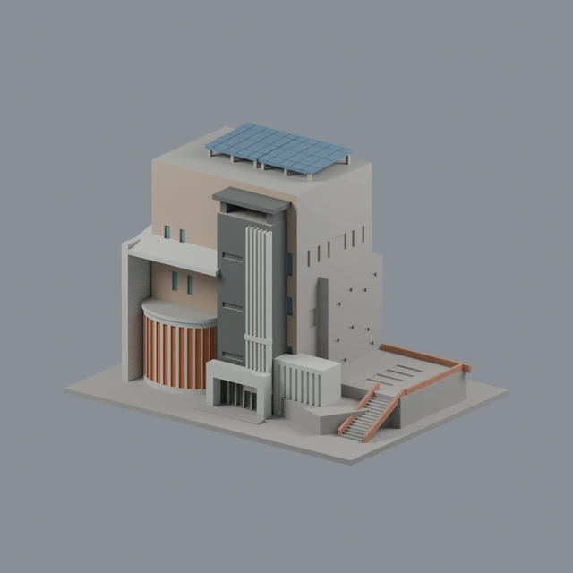
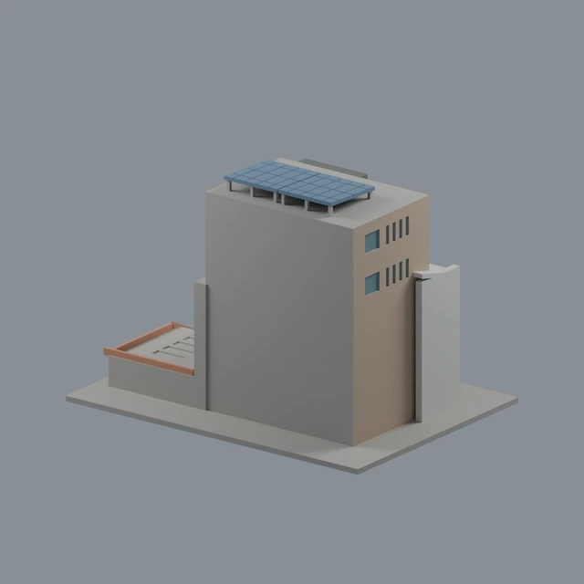
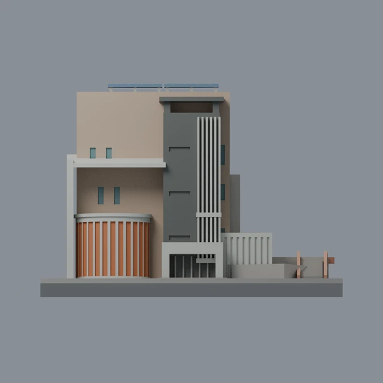
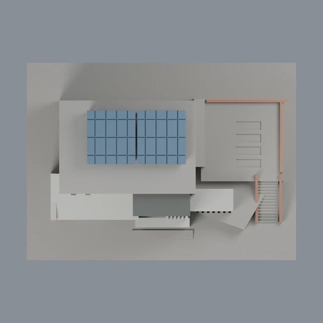

# 國立聯合大學 I1-R1 資訊大樓與國際會議中心低層連通部分

## 模型預覽


| 模型預覽 | 模型預覽 | 模型預覽 |
| :---: | :---: | :---: |
| [](display/front.webp)<br>正面 | [](display/rear.webp)<br>背面 | [](display/elevation.webp)<br>正立面 |
| [](display/top.webp)<br>頂視 |  |  |

## 現行9材質外觀


[來源界線與四視角](appearance/README.md) · [表面色 3MF](appearance/nuui1-appearance.3mf) · [可編輯場景](appearance/scene.blend)

已見淡褐主牆、灰黑塔樓、淺色鰭片與入口、橙色前弧牆和淡磚橘 R1 梯側牆；原弧牆過長凹槽不染全高玻璃，未見背面與右側保持中性，L1 圖書館不在此包範圍。 原 STL 與歷史 QA 不變；這是外觀改善，不是新增幾何。現行 R1 入口最低三階的踏面與階面（12 面）沿用核對範圍；未知背面、右側與非光電板屋頂維持中性。


依官方外觀照片製作的獨立建築縮印模型，含底座 **150 × 110 × 103.9 mm**。照片比例詮釋，未實測，不是與其他館舍共同比例的校園模型。STL 單位為毫米且不含顏色；上方彩色展示來自現行外觀模型。

## 建物範圍與照片判讀

本包是一個列印單元，包含 I1 資訊大樓主體及其東南側 R1 國際會議中心低層外露量體／露台。校方將資訊處 I1、國際會議廳 R1 分列代碼，校史則把三者歸在圖資大樓群。本包不把 R1 再做第二份獨立模型；靠國鼎圖書館 L1 的邊界在照片可見的平台處截斷，完全不包含 L1 橢圓高樓、橢圓屋頂環與玻璃入口。不能把這個模型當成精確地籍分棟界線。

已核對官方圖資相簿 13 張縮圖，並放大 (1)、(2)、(3) 的正面左右斜視；(4) 特寫也核對入口塔與白色直肋。保留棕色方正主體、稀疏側窗、深色直塔及水平窄縫、連續白色直肋、低層半圓立面、大型側框與斜頂、矩形入口門框、右側低露台及外階梯、雙片屋頂太陽能棚。

主樓進深、絕對尺寸、低層 R1 外露部分的平面與標高均為照片估計；不含地下部分及室內會議廳。後立面沒有直接清晰照片，採無窗實牆簡化；屋頂設備、管線、欄杆及景觀植栽省略。R1 露台邊界優先避免與已完成 L1 重複，不宣稱精確銜接可拼成等比例校園。

所有玻璃窗皆以有實心背襯的淺凹窗表示，不含室內格局、設備與安防配置。未附第三方參考照片。

## 預覽與交付


- `model.stl`：單一連通封閉實體
- `build_model.py`：可攜式完整幾何原始碼
- `scene.blend`：可編輯 STL 網格、攝影機、燈光與嵌入原始碼
- `previews/front.png`、`rear.png`、`elevation.png`：保留給單色 STL 幾何檢查，非現行彩色展示
- `validation.json`：原 STL 法向、邊／頂點連結、封閉性、連通體、無獨立內腔殼、尺寸與平底檢查
- `rebuild_check.json`：乾淨資料夾重建後的相同 STL SHA-256
- `scene_check.json`：Blender/STL 逐三角形座標至 0.00001 mm 比對與嵌入原始碼比對
- `evidence.json`、`manifest.json`、`SHA256SUMS`：來源、範圍及交付雜湊

## 列印建議

底座平放，匯入選毫米。可從 0.4 mm 噴嘴、0.16–0.20 mm 層高、3 圈外牆與 10–15% 填充開始調整。

底座厚 2.4 mm；白色直肋厚 1 mm、深約 3 mm；入口框柱厚 3.7 mm；太陽能棚柱 1.4 mm、棚板厚 1.6 mm，露台側牆厚 1.5 mm。入口門額、斜大雨棚及太陽能棚需要檢查局部支撐，支撐拆除時避開直肋。階梯踏步高差約 0.82 mm。

已完成數位網格、原始碼重建與 Blender 幾何一致性檢查，未做實體試印或切片器驗證。局部細節依材料、機器與切片策略調整；不建議直接大幅縮小。

## 重新生成

```sh
python -m pip install -r requirements.txt
python build_model.py
python validate_model.py model.stl --longest-edge 150 --output validation.json
python verify_rebuild.py
blender -b -t 4 -P render_preview.py
blender -b -t 2 -P verify_scene.py
```

Python 從自身資料夾讀寫，不依賴原製作環境路徑或照片。Blender 4.3 或較新版可用。重建會覆寫同名檔案；修改前先備份。

模型三角面數：4,066。STL SHA-256：`d9cf4cdf30717b38c4020395a48a407ad5f97ba61d403871e322fe502021bdd3`。

## 公開來源

查核日期：2026-10-11。

- [現行八甲校園圖：I1、L1 與國際會議廳位置](https://www.nuu.edu.tw/p/426-1000-9.php?Lang=zh-tw)
- [官方圖資大樓相簿](https://secretary.nuu.edu.tw/p/132-1003-1094.php?Lang=zh-tw)
- [資訊處官方建物代碼：I1 與 R1 分列](https://ccenter.nuu.edu.tw/p/412-1007-298.php)
- [校史：圖資大樓包含圖書館、資訊大樓、國際會議中心](https://nuuarchives.nuu.edu.tw/p/16-1097-27990.php?Lang=zh-tw)

現行大圖可用 [WebP 與原圖像素對照](display/archive-png.json) 校驗。在模型資料夾執行 `python display/verify_webp.py`（需 Pillow）。原四張彩色 PNG 與舊校驗表保留在[固定歷史版本](https://github.com/hplin50643/taiwan-buildings-3d/tree/81e9d09714d79e73c4125b37c089d1847d20829f/%E5%A4%A7%E5%B0%88%E6%A0%A1%E9%99%A2/%E5%9C%8B%E7%AB%8B%E8%81%AF%E5%90%88%E5%A4%A7%E5%AD%B8/buildings/bajia-i1-r1-information-conference)，不再放在主分支。重繪請先在暫存副本建立 `appearance/previews`，再執行 `blender -b -t 4 --python-exit-code 1 -P appearance/source/render_current.py`，再以 `--replay-root /path/to/copy` 校對。
