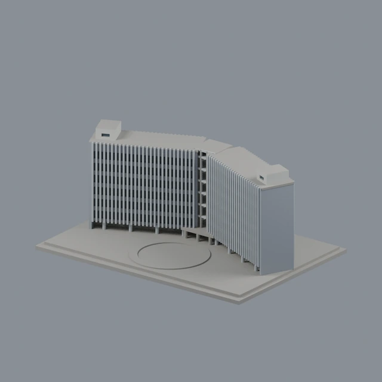
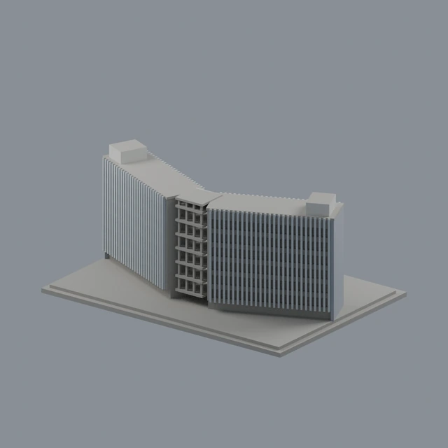
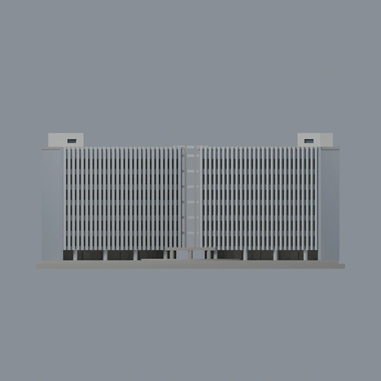
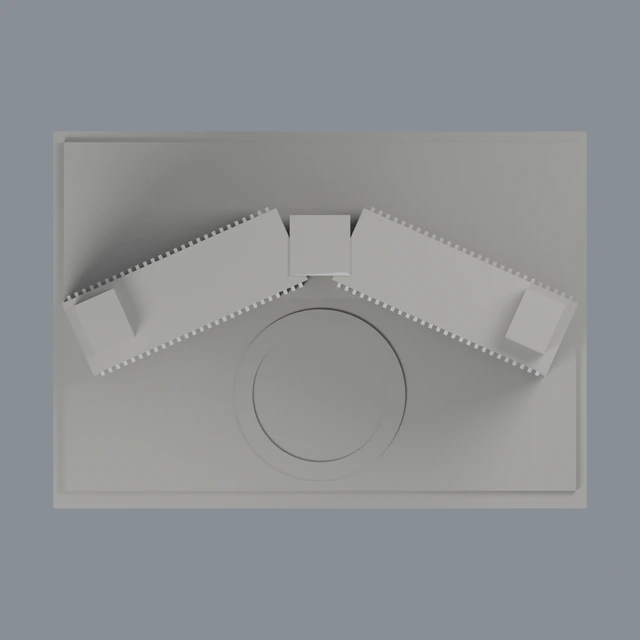

# 國立聯合大學｜八甲 M10 第十宿舍＋M11 第十一宿舍（連通建築群）

## 模型預覽

| 模型預覽 | 模型預覽 | 模型預覽 |
| :---: | :---: | :---: |
|  正面 |  背面 |  正立面 |
|  頂視 |  |  |

## 本次既有後側長肋同族補色（推估）

將兩翼既有 54 根後側長肋的外端與左右垂直表面，共 162 組／3,252 個原三角，延續正面肋的淺灰材 1。原 8,174 個著色面及所有未變更面理由完整保留，六色表不變；原 28,008 面／13,884 點、STL 位元、座標及面序不變。現計數中性 16,582、淺灰肋 9,966、灰紫填牆 752、中灰端牆 44、玻璃代理 628、米白服務量體 36。

選取限定原每根肋三個朝外垂直平面，局部 y=9.75…12.25、z=9.1…59.2 mm；不改頂底、內向背面、主背牆、後窗凹背、屋面或中央連接框架。54 個外端為完整原矩形，每個 50.1 mm²；4 個端外側約 87.225 mm²，104 個其餘側面約 64.185 mm²，是原窗凹切除 6×4.8×0.8 mm² 後的肋側，不把窗凹切面或玻璃混入。未新增、切割或修補幾何。

本輪親看兩張官方 M10／M11 正面空拍，正面長肋呈淺灰，可作同族顏色代理；**兩張都不是背面證據**。後側等距長肋本來就存在於原簡化模型，本次只是依使用者要求做同材質族延伸，並非證明實景後肋的數量、位置或塗色。原照片 EXIF 標示 2025-03-10，但日期時區未獨立核實，不宣稱 2026 現況。原 V 形、等距肋及直線連廊的簡化限制不變，未添加設備或植栽；未實體試印。第三方照片只作私人研究，不入公開包。

新版 QA 在 `appearance/qa-continuous-walls/`，保留歷史 QA 與根 `SHA256SUMS`，本次另列 `PUBLIC-MODEL-SHA256SUMS`。由根目錄執行 `python appearance/source/build_continuous_walls.py`；交換驗證 `python appearance/source/verify_continuous_exchange.py`；渲染 `blender -b --python appearance/source/render_continuous_walls.py`；場景驗證 `blender -b --python appearance/source/verify_continuous_scene.py`。獨立重建 ZIP 含原 STL、原建模程式及有限選取域，不含照片。

## 前版說明與保留限制

## 原始配色依據（六材質）

[來源界線與四視角](appearance/README.md) · [表面色 3MF](appearance/nuum1011-appearance.3mf) · [可編輯場景](appearance/scene.blend)

依正面空拍限定淺灰直肋、灰紫實牆、離散深窗與灰端牆；未見背面及主屋頂中性，服務量體同材質延伸有界，架空層不是玻璃。 原 STL 與歷史 QA 不變；這是外觀改善，不是新增幾何。正面淡色豎板有照片依據；背面同型豎板為延續既有配色的推估，主要背牆與背窗維持中性。

這是依公開官方外觀照片製作的近似建築微縮模型，供觀賞及 FDM 列印。不是校方工程圖、實測復原或統一校園比例。只含外殼造型，不含房間、住戶、門禁、設備配置或第三方照片。

## 身分與範圍
現行八甲地圖分列 M10、M11；官方外觀相簿以第十、十一宿舍合併標題。兩翼與中央連接在空拍照片中可直接核對，故保留為同一完整列印件。

## 尺寸與造型
- 最長邊 150 mm，實際 XYZ 尺寸：150.00 × 106.00 × 65.90 mm（含底座）。
- 單一連通、水密外邊界；實體建築量體與底座相連，不是需要拼合的散件。
- 正面朝 -Y、底座 Z=0；STL 本身沒有單位欄位，匯入時選毫米。
- 張開雙翼與保留的中央連通框架
- 密集豎向遮陽翼片、底層柱廊
- 外側高端牆、屋頂突起量體、淺浮雕圓形前庭

## 估計與簡化
- 這是一件 STL、代表兩個現行校園建物代碼；未任意切斷中間實際連通部分。
- 靠近 M6／圓廳一翼為 M10，較遠一翼為 M11；依官方地圖定位。
- 翼角、進深、窗格數與中央弧面作可列印近似；中央弧面以直段連通框簡化。
- 屋頂僅保留建築量體，不含水槽、設備或管線；不含圓廳及周邊道路細節。

所有模型的尺寸、深度、窗距與屋頂高差皆依外觀比例估計，並無量測尺度。簡化背面可由上方 WebP 直接檢視。預覽色彩只屬材質；STL 不含色彩或貼圖。

## 列印建議
- 底座平放；建議 0.4 mm 噴嘴、0.16–0.20 mm 層高、3 道外牆、10–18% 填充。
- 最小特徵：豎翼片寬 1.0 mm；中央框架立柱 1.05 mm；主柱直徑 2.1 mm；樓板 1.2 mm；附壁窗凹深 0.8 mm。
- 支撐：中央連通框及底層柱廊有開口。中央樓板厚 1.2 mm、最大局部橋接約 15 mm；建議中央框架及底層雨遮使用局部支撐並預先檢查拆除空間。
- 此為 150 mm 獨立微縮件，不建議等比縮小至 100 mm 以下；細節會低於常見噴嘴的可靠表現。
- 實心在此指封閉可切片的量體，不要求 100% 填充。未進行實體試印或切片器驗證；請自行檢查支撐、首層與機台公差。

## 隨附檔案與重建
- model.stl：毫米列印網格
- scene.blend：可編輯 Blender 網格、材質、相機；模型為實際 STL 匯入，非額外裝飾版
- build_model.py：原始參數化造型程式；所有可列印幾何可由此重建
- render_preview.py：由 STL 直接渲染 front.png / rear.png，並儲存 Blender 場景
- requirements.txt：Python 依賴版本
- validate_model.py、validation.json：原始 STL 法向、邊、頂點連結、水密性、連通數、內腔殼等檢查
- rebuild-check.json：再次重建後的 SHA-256 一致性
- blender-geometry-check.json：STL 與 Blender 全部三角面座標一致性
- evidence.json：完整外觀圖說、網址、身份和估計說明
- SHA256SUMS：所有公開檔案雜湊

在獨立 Python 環境執行：

    pip install -r requirements.txt
    python build_model.py
    python validate_model.py model.stl --output validation.json
    blender -b -t 4 -P render_preview.py

建議 Blender 4.x。Python 使用 numpy、trimesh、manifold3d、scipy。重建不依賴原作者資料夾或網路照片。數位檢查通過並不等於實體試印成功。

## 公開來源
查核日：2026-10-11。照片版權歸原權利人；本包不重製參考照片。
- 現行校園地圖與代碼：https://www.nuu.edu.tw/p/426-1000-9.php?Lang=zh-tw
- 官方外觀相簿：https://secretary.nuu.edu.tw/p/132-1003-1118.php?Lang=zh-tw
- 歷史名稱／建物清冊（歷史資料）：https://nuuarchives.nuu.edu.tw/p/16-1097-27990.php?Lang=zh-tw

現行大圖可用 [WebP 與原圖像素對照](display/archive-png.json) 校驗。在模型資料夾執行 `python display/verify_webp.py`（需 Pillow）。原四張彩色 PNG 與舊校驗表保留在[固定歷史版本](https://github.com/hplin50643/taiwan-buildings-3d/tree/81e9d09714d79e73c4125b37c089d1847d20829f/%E5%A4%A7%E5%B0%88%E6%A0%A1%E9%99%A2/%E5%9C%8B%E7%AB%8B%E8%81%AF%E5%90%88%E5%A4%A7%E5%AD%B8/buildings/bajia-m10-m11-dorm-complex)，不再放在主分支。重繪請先在暫存副本建立 `appearance/previews`，再執行 `blender -b -t 4 --python-exit-code 1 -P appearance/source/render_continuous_walls.py`，再以 `--replay-root /path/to/copy` 校對。
