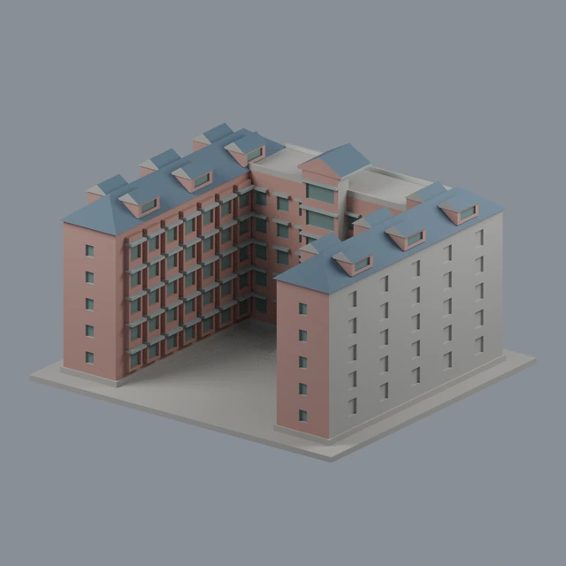
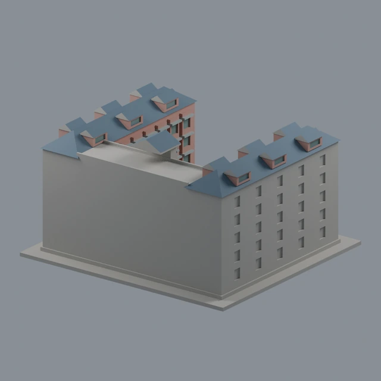
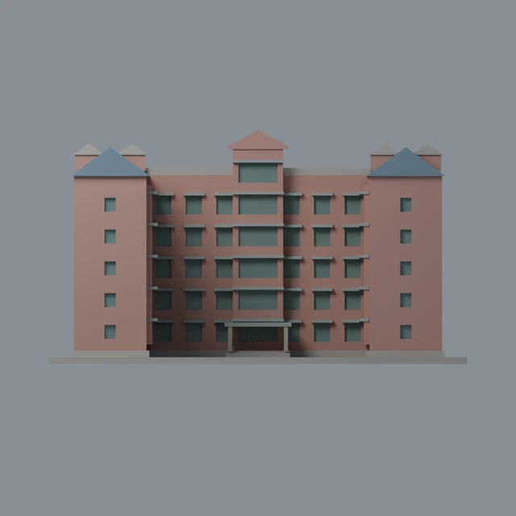
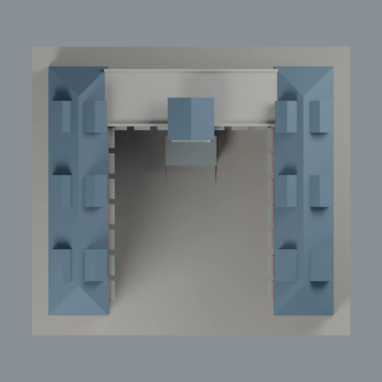

# 八甲校區 M6 第六宿舍｜現行彩色展示

## 模型預覽

| 模型預覽 | 模型預覽 | 模型預覽 |
| :---: | :---: | :---: |
|  正面 |  背面 |  正立面 |
|  頂視 |  |  |

四張全尺寸無失真 WebP 由現行六材質 Blender 場景核對重繪，點擊縮圖可放大。包含既有的兩個中塔右側灰色檐口三角面及較早四個背女兒牆著色面。不延伸至相反邊、未知長牆或屋瓦；幾何與原有材質均未變更。

[現行彩色 Blender](../gable-fascia-20261120/scene.blend) · [彩色 3MF](../gable-fascia-20261120/model-colored.3mf) · [STL](../model.stl) · [渲染驗證](render-proof.json) · [本頁校驗](SHA256SUMS)

[原模型與限制](../README.md) · [最新補色來源與證據](../gable-fascia-20261120/README.md)。原生模型、重建基準與歷史 QA 不變。未實體試印。

[現行 WebP 像素與歷史 PNG 對照](archive-png.json)：舊 PNG 是檐口補色前的場景，不是現行大圖的轉檔來源；舊圖與舊校驗留在[固定歷史版本](https://github.com/hplin50643/taiwan-buildings-3d/tree/bb451b45afeae48351beb9d101ae4068c83f236b/%E5%A4%A7%E5%B0%88%E6%A0%A1%E9%99%A2/%E5%9C%8B%E7%AB%8B%E8%81%AF%E5%90%88%E5%A4%A7%E5%AD%B8/buildings/bajia-m6-sixth-dorm)。

在模型資料夾執行 `python display/verify_webp.py`（需 Pillow）。如要重繪與比對，可用 `blender -b gable-fascia-20261120/scene.blend -t 4 --python-exit-code 1 -P display/render_current_views.py -- /path/to/output`，再執行 `python display/verify_webp.py --replay-root /path/to/output`。PNG 只會輸出到指定重繪資料夾。
