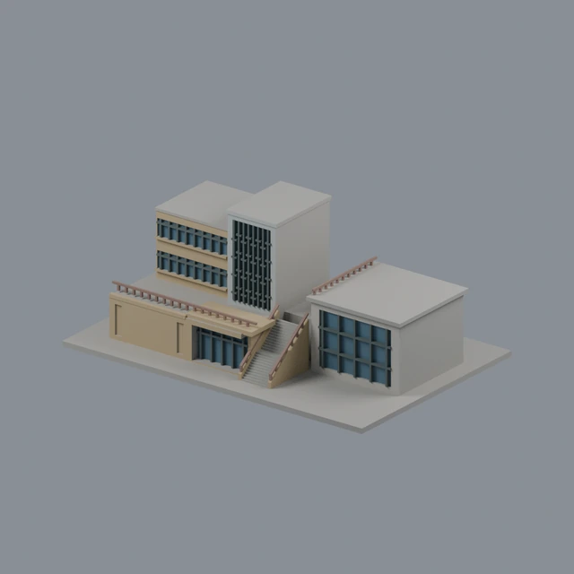
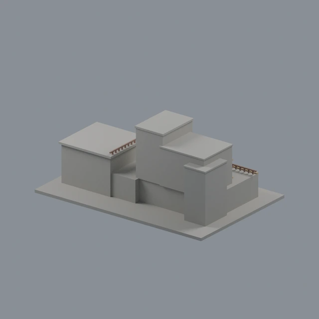
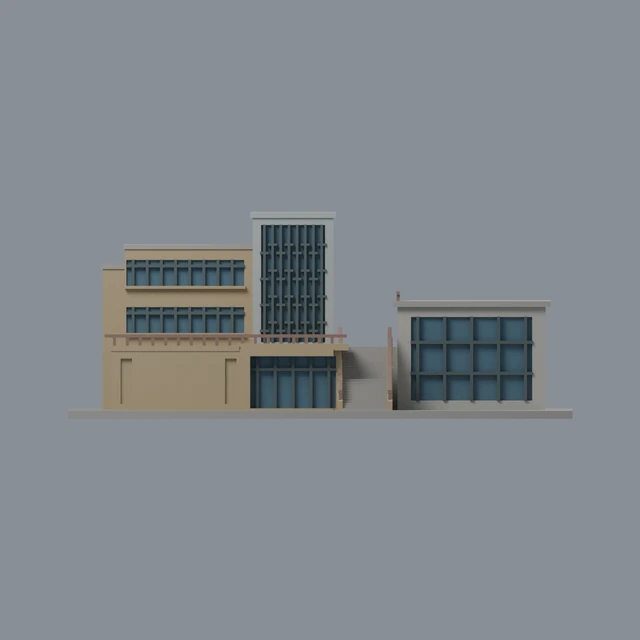
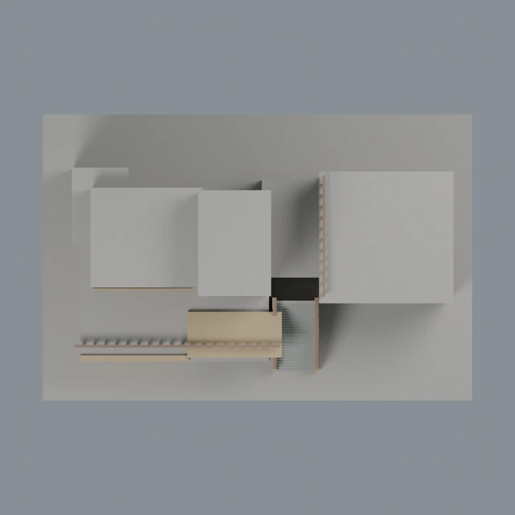

# 八甲 Q1 藝文教學中心（藝術中心）｜現行彩色展示

## 模型預覽

| 模型預覽 | 模型預覽 | 模型預覽 |
| :---: | :---: | :---: |
|  正面 |  背面 |  正立面 |
|  頂視 |  |  |

四張全尺寸無失真 WebP 由現行八材質 Blender 場景核對重繪，點擊縮圖可放大。中央塔樓凹口上緣內側 18 面與最高右內返的 2 面沿用現行冷灰；右側禮堂有歷史航照限制，背面與屋頂不猜測配色。此處不改幾何或擴大補色。

[現行彩色 Blender](../appearance/scene.blend) · [彩色 3MF](../appearance/nuuq1-appearance.3mf) · [STL](../model.stl) · [渲染驗證](render-proof.json) · [本頁校驗](SHA256SUMS)

[原模型與限制](../README.md) · [原外觀來源與證據](../appearance/README.md)。彩色展示已統一；幾何、配色與歷史 QA 不變。未實體試印。

現行大圖可用 [WebP 與原圖像素對照](archive-png.json) 校驗。在模型資料夾執行 `python display/verify_webp.py`（需 Pillow）。原四張彩色 PNG 與舊校驗表保留在[固定歷史版本](https://github.com/hplin50643/taiwan-buildings-3d/tree/8bd3a7213b4c6867a7a70c867a4d7881d39a6868/%E5%A4%A7%E5%B0%88%E6%A0%A1%E9%99%A2/%E5%9C%8B%E7%AB%8B%E8%81%AF%E5%90%88%E5%A4%A7%E5%AD%B8/buildings/bajia-q1-arts-teaching-center)，不再放在主分支。重繪請先在暫存副本建立 `appearance/previews`，再執行 `blender -b -t 4 --python-exit-code 1 -P appearance/render_q1_views.py -- appearance`，再以 `--replay-root /path/to/copy` 校對。
