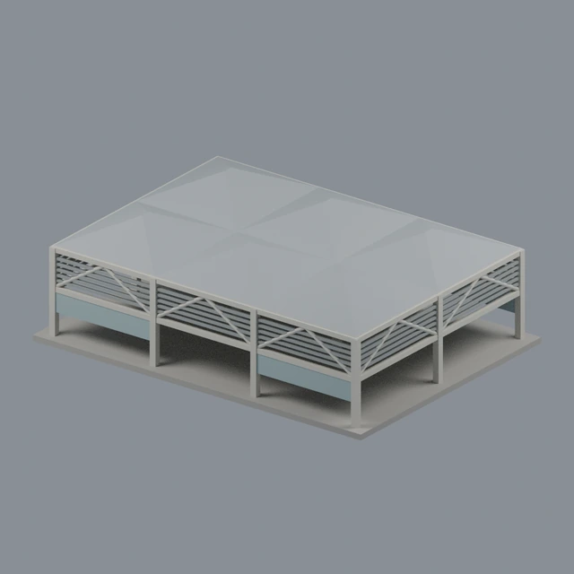
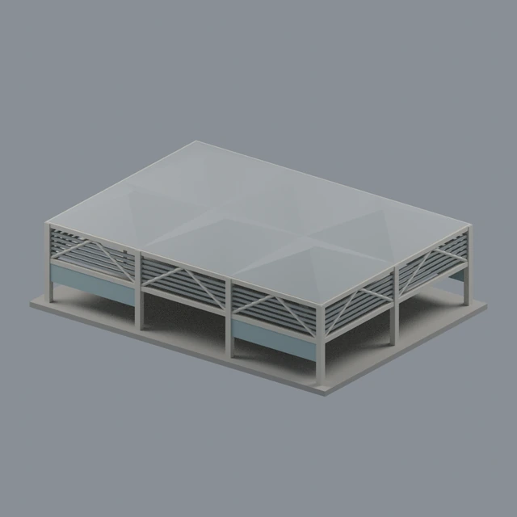
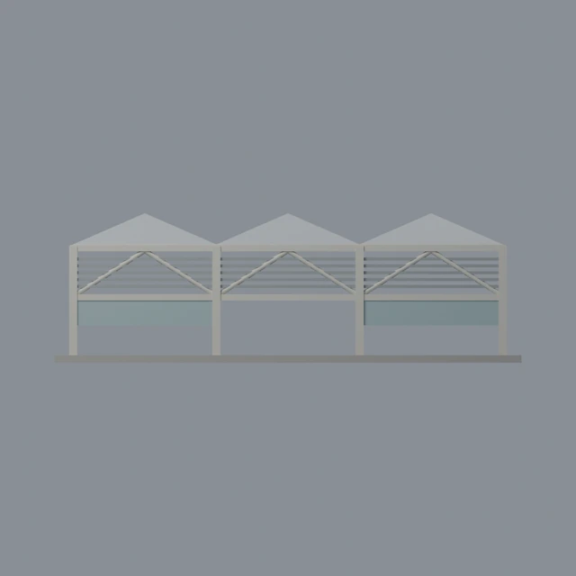
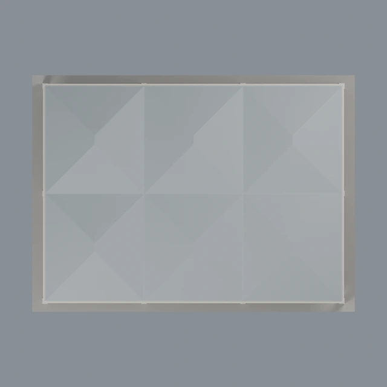

# 國立聯合大學 八甲風雨球場

## 模型預覽

| 模型預覽 | 模型預覽 | 模型預覽 |
| :---: | :---: | :---: |
|  正面 |  背面 |  正立面 |
|  頂視 |  |  |

## 現行5材質外觀

[來源界線與四視角](appearance/README.md) · [表面色 3MF](appearance/nuus2-appearance.3mf) · [可編輯場景](appearance/scene.blend)

依四張官方內外照片配置銀灰金屬屋頂、象牙白結構、灰百葉與淡藍灰屏板；同構未見側材質為明示有界推估，屋頂不是 PV，不添加未分面的透光片、護柱套或球場圖形。 原 STL 與歷史 QA 不變；這是外觀改善，不是新增幾何。維持既有金屬屋頂，未把屋頂視為光伏。未於原網格獨立分面的屋面及柱腳不補畫。

依官方外觀照片製作的近似列印模型。最長邊獨立設定150 mm，並非全校統一縮尺或實測模型。正面朝-Y。只建外觀，不建內部配置。

## 外形與來源
六組連續低坡四坡屋頂、開放側面柱列、上部百葉與斜撐、局部下部遮板。

官方相簿：https://secretary.nuu.edu.tw/p/132-1003-1093.php?Lang=zh-tw

完整照片標題與原圖來源見evidence.json。照片只用於研究，未收入交付檔。上方彩色預覽由現行外觀模型渲染；STL 網格不含顏色。

## 證據限制
屋頂以3×2照片辨識單元表現；背側被樹遮蔽，柱位節奏為列印化近似。球具、室內球場線與鄰近田徑場均排除。
所有長寬高、深度與樓層比例均為照片估計，未見部分不視為可靠復原；相簿發布／拍攝年代不等於2026現況。

## 列印
此件大面積懸空屋頂必須支撐，切片後檢查可移除性。柱2.6 mm、屋頂底板1.7 mm、百葉1.0 mm、斜撐1.6 mm；不可宣稱無支撐列印。
建議0.4 mm噴嘴、0.16–0.20 mm層高、底座平放、先在切片器檢查支撐與橋接。布林合併為單一封閉連通實體，保留外露孔洞／廊道。不含封閉內腔殼。未做實際列印或切片驗證。

## 內容與重建
- build_model.py：原創參數化外觀來源，Python 3.11+
- model.stl：毫米單位可列印網格
- scene.blend：與STL一致的可編輯網格場景（另含攝影棚地面）
- previews/front.png、rear.png：實際STL全幅前後視圖
- validate_model.py、validation.json：原始法線、邊、頂點連結、連通與尺寸檢查
- rebuild-check.json、blender-stl-agreement.json、SHA256SUMS：重建與交付核對

安裝requirements.txt後執行python build_model.py；再執行python validate_model.py model.stl --longest-edge 150 --output validation.json。Blender 4.3.2執行blender -b -t 2 -P render_preview.py可重建預覽與場景。

## 實際模型尺寸
150.0 × 110.0 × 48.0 mm（X × Y × Z，含底座）。

現行大圖可用 [WebP 與原圖像素對照](display/archive-png.json) 校驗。在模型資料夾執行 `python display/verify_webp.py`（需 Pillow）。原四張彩色 PNG 與舊校驗表保留在[固定歷史版本](https://github.com/hplin50643/taiwan-buildings-3d/tree/8bd3a7213b4c6867a7a70c867a4d7881d39a6868/%E5%A4%A7%E5%B0%88%E6%A0%A1%E9%99%A2/%E5%9C%8B%E7%AB%8B%E8%81%AF%E5%90%88%E5%A4%A7%E5%AD%B8/buildings/bajia-s2-covered-court)，不再放在主分支。重繪請先在暫存副本建立 `appearance/previews`，再執行 `blender -b -t 4 --python-exit-code 1 -P appearance/source/render_appearance.py`，再以 `--replay-root /path/to/copy` 校對。
