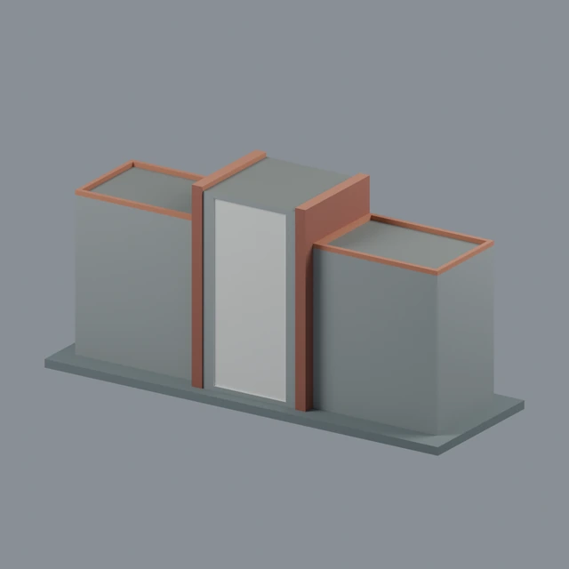
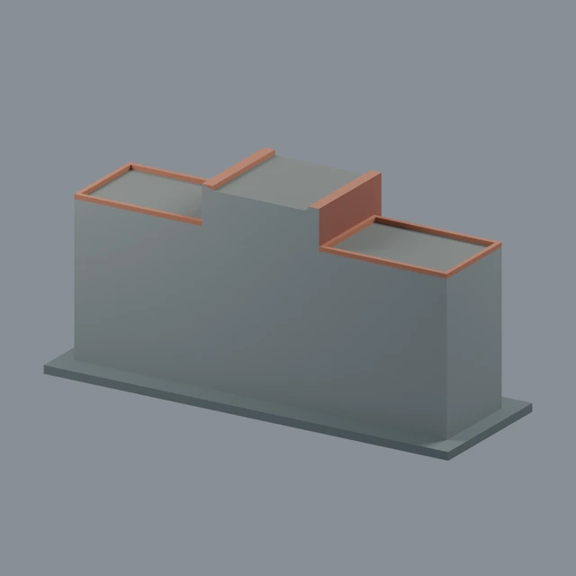
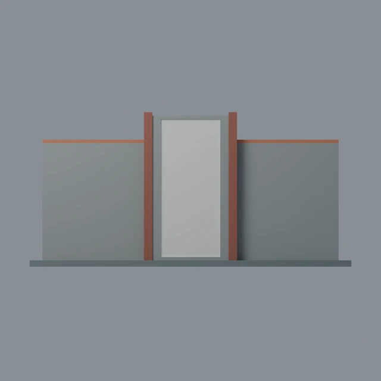
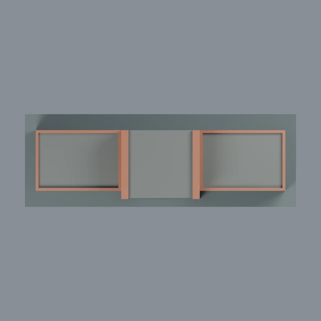
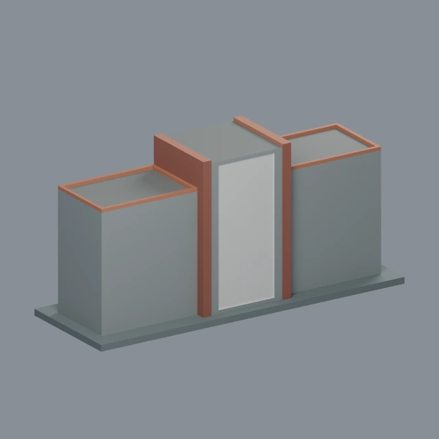

# 國立聯合大學八甲南大門中央三段門牆外觀段

## 模型預覽

| [](previews/front.webp) | [](previews/rear.webp) | [](previews/elevation.webp) |
| :---: | :---: | :---: |
| 正面斜視 | 背面 | 正立面 |
| [](previews/top.webp) | [](previews/left_oblique.webp) |  |
| 俯視 | 左斜視 |  |

新增的照片導向建築外觀模型，**只包含兩車道之間中央三段實心門牆**，不是完整南大門，也不是北大門或二坪山校門。

## 檔案與實際視圖
- [可編輯彩色 Blender](scene.blend)
- [彩色 3MF](model.3mf)：6 種獨立命名展示材質，可逐項換色；不是列印機料槽指派。
- [單色幾何 STL](model.stl)
- [可重建生成器](build_model.py) · [渲染器](render_model.py) · [材質表](palette.json)
- [正面斜視](previews/front.webp) · [背面](previews/rear.webp) · [正立面](previews/elevation.webp) · [俯視](previews/top.webp) · [左斜視](previews/left_oblique.webp)
- [來源與推估邊界](SOURCES.md) · [驗證及列印限制](QA.md)


## 表達範圍
保留高聳中央白色校名面、紅褐磚色直立邊、兩片較低灰色門牆、三個淺凹灰色平頂及橘紅壓頂。中央立面略向路側突出，白色面板是有實心背板的淺凹，不是可穿越門洞。書法文字刻意留白；磚與石材只以色區區分，不複製攝影紋理，不任意添加密集磚縫。

排除獨立行人小門、兩側伸縮門、警衛亭、告示、花草、車輛、道路及校園其他建築。**這個模型不將整座南大門標示為完成。** 未見背面採中性灰色封閉，中央後緣未虛構紅色橫框。

展示尺寸 **152 × 52 × 73 mm**，含另加 3 mm 底板；門牆寬 140 mm、中央高 70 mm、側牆高 57 mm，深度約 34–38.6 mm，皆為照片比例推估，非量測縮尺。側頂框寬與淺凹深 1.6 mm 是模型辨識性調整。官方來源拍攝於 **2025-03-10**，不表示 2026 現場狀態；原照片不隨包發行。

## 重建
Python 幾何環境依 `requirements.txt`；交換驗證另需 lib3mf SDK。
其他生成或 QA 步驟請在隔離副本重跑，避免覆寫發布檔案。

```sh
python qa_model.py
python check_features.py
python verify_exchange.py
blender -b -t 4 --python verify_scene.py
blender -b -t 4 --python verify_render.py
python verify_package.py
```
若 lib3mf 與幾何套件分屬不同環境，以 `BUILD_PYTHON` 指定生成器 Python。渲染採 Blender 4.3.2 CPU Cycles、seed 0、48 samples；不承諾跨版本／平台圖片位元組一致。

**沒有實際列印測試，不保證免支撐或直接可印。** 白色淺凹上緣仍有向下面，須依切片方向、線寬與設備評估。數值拓撲與切片測試不等於完整製造認證。

### 展示圖與隔離重建

使用 Blender 4.3.2 與 requirements.txt 的幾何依賴。個別分析可在隔離副本執行 `qa_model.py`、`check_features.py`；`verify_scene.py` 和 `verify_exchange.py` 分別核對場景及 lib3mf 交換格式，後者可用 `BUILD_PYTHON` 指定幾何環境。

```bash
python -m pip install -r requirements.txt Pillow==13.0.0
python verify_package.py
blender -b --threads 4 --python-exit-code 19 --python verify_render.py
python rebuild.py --output ../new-clean-rebuild --blender blender --threads 4
```

五張展示圖使用 640 px WebP 縮圖，可點圖開啟全尺寸無失真 WebP。[縮圖校驗](previews/thumbnail-proof.json)。重建只在暫存目錄產生 PNG，重新核對圖像 RGBA 像素、尺寸和 WebP 檔案校驗碼。模型檔與歷史 QA 報告不變。[現行 WebP 校驗](qa/preview-webp.json) · [原始 PNG 與歷史 QA](https://github.com/hplin50643/taiwan-buildings-3d/tree/336ce1843e6e4435f93ed1a5df7cc26434fb9596/%E5%A4%A7%E5%B0%88%E6%A0%A1%E9%99%A2/%E5%9C%8B%E7%AB%8B%E8%81%AF%E5%90%88%E5%A4%A7%E5%AD%B8/buildings/bajia-south-gate-central-wall-segment)。
