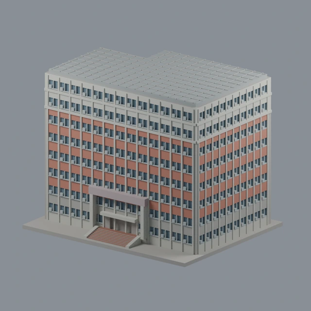
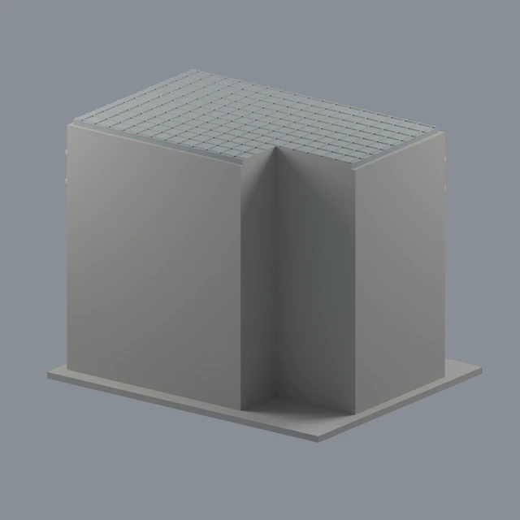
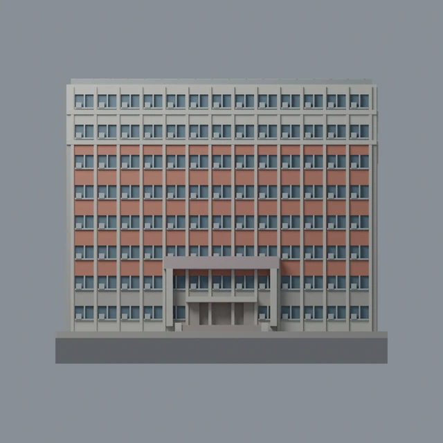
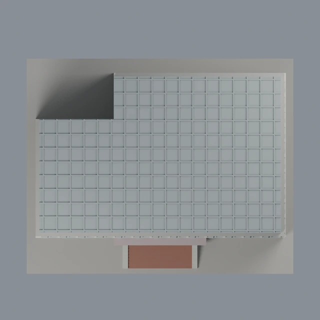

# 聯大二坪 C1 立德樓：現行8材質外觀

沿用原 **21,246 三角面／10,419 頂點**，不改原 STL 位元、座標、面序或幾何；這是既有模型外觀改版，不增加模型包數。

| 模型預覽 | 模型預覽 | 模型預覽 |
| :---: | :---: | :---: |
|  正面 |  背面 |  正立面 |
|  頂視 |  |  |

## 本次原加厚金屬棚外緣同灰延伸（推估）

將既有屋頂棚四個最外垂直輪廓面（包含原淺凸縫端頭）共 268 個原中性三角，延續既有棚頂灰金屬材 7。原 18,685 著色面及所有未變更面理由完整保留，其餘 20,978 面不變。原 21,246 面／10,419 點、八色表、STL bytes、座標及面序不變。現中性 2,293、陶紅 878、象牙 2,573、銀框設備 11,306、灰藍窗 846、灰粉門楣 138、紅褐階 48、金屬棚 3,164。

選取僅原 x=−68、+68、y=−41、+47 mm 的四個朝外有限垂直平面，z=117…119.9 mm；分別 40／100／76／52 面，解析面積 162.34／223.12／344.68／238.12 mm²。所有選中三角完整、唯一，不切面；交角及原 boolean 截斷保留，無任何推估凹口 x=−26 或 y=23 共面三角。屋頂水平面、內部細縫、牆及後凹口都不變，不把相連長牆染成金屬。

本輪親看官方未定年校史照，屋頂可見灰金屬遮棚，不是光電板證據。**真棚為薄金屬與開放支撐，原模型為便於列印採厚實底與加厚網格**；本次只對這個原有簡化量體外緣採同金屬族代理色，並非實景棚邊厚度、構造層或金屬材質逐面量測，也不修復模型。校史照未定年，既有近照 EXIF 日期時區亦未獨立核實，非 2026 現況；未實體試印。第三方照片只私人研究，不入公開包。混合紅白長牆維持保守中性，不藉三角斜切補色。

現行 QA 在 `qa-continuous-walls/`；歷史 QA 保留，新增 `PUBLIC-MODEL-SHA256SUMS`。重建外觀 `python appearance/source/build_continuous_walls.py`；交換驗證 `python appearance/source/verify_continuous_exchange.py`；渲染 `blender -b --python appearance/source/render_continuous_walls.py`；場景驗證 `blender -b --python appearance/source/verify_continuous_scene.py`。ZIP 含原 STL、原 `generate_model.py` 與本次外觀程式／有限域，不含照片；獨立重建驗證是從原 STL 重建外觀，不宣稱重算歷史製造驗證。

## 前版說明與保留限制

[表面色 3MF](nuuc1-appearance.3mf) · [可編輯 Blender](scene.blend) · [材質色表](palette.json) · [逐面指派與依據](face-materials.json) · [原 STL](../model.stl)

## 來源與配色邊界

親自核對官方 [立德樓相簿](https://secretary.nuu.edu.tw/p/132-1003-1101.php?Lang=zh-tw) 的 [照片 1](https://secretary.nuu.edu.tw/var/file/3/1003/gallery/1/1101/gallery_1101_637737_26854.jpg)、[照片 4](https://secretary.nuu.edu.tw/var/file/3/1003/gallery/1/1101/gallery_1101_5926483_26855.jpg)，及 [校史照片](https://nuuarchives.nuu.edu.tw/var/file/97/1097/img/828/06image012.jpg)。近照 EXIF DateTimeOriginal **2025-02-28 10:19:35／11:26:26**；校史照未定年，用於上部兩層與屋頂金屬棚登錄，不冒稱 2026 現況。EXIF 日期與時區未獨立核實；照片不隨包散布。

- 只對原正面與右側中段可完整區分的面採陶紅色，原連續立柱及上部兩層淡象牙色。原幾何沒有精準分開所有紅／白邊界，下部過渡帶與跨界長面保守中性；不藉三角面斜切色塊或新增幾何補足。
- 每一原窗凹背採低彩度灰藍，既有窗梃、窗台及空調簡化方塊銀灰，不把空調染作玻璃。原設備位置／數目與窗格節奏都是近似，不宣稱逐台辨認，不增加照片的管線與機器細節。
- 既有入口大門楣淡灰粉色、小門楣與支柱象牙色、梯踏面紅褐磁磚色；原空白招牌面不加文字。實景圓柱等差異仍是原模型簡化，不靠配色掩飾。
- 原實底網格屋頂採灰金屬色：來源只能支持金屬遮棚，**沒有把它認定或染成光電板**。網格仍是原加厚模型，並非薄金屬施工圖。
- 未見左側、後牆及推估後凹口保持中性；不新增任何室內、植栽或街景。原 STL／面序／座標不變，不增加模型數，不宣稱物理列印成功。

[原幾何與來源限制](../README.md) · [來源覆核](qa/source-review.json)

## 歷史版本的重建與核驗

安裝 [依賴](source/requirements.txt)，Blender 使用 4.3.2。由本資料夾上層提供原 model.stl：

1. `python appearance/source/build_appearance.py`
2. `python appearance/source/verify_exchange.py`
3. `blender -b -t 3 --python-exit-code 1 -P appearance/source/render_appearance.py`
4. `blender -b -t 3 --python-exit-code 1 -P appearance/source/verify_scene.py`

[獨立重建 ZIP](rebuild-source.zip)含原 STL、四支程式及依賴，不含第三方照片；不取代原建模腳本。[逐檔 SHA256](SHA256SUMS)

[交換／拓撲 QA](qa/exchange-validation.json)核對原座標與面序、全部面材質、單連通、有向水密邊、頂點 link 單環、正體積與零退化／重複面；lib3mf 嚴格讀取零警告，實際編輯單材質再存讀，其他材質及面指派不變。SDK 六位小數量化誤差另列。

[Blender 存讀與編輯](qa/scene-validation.json) · [渲染記錄](qa/render-manifest.json) · [獨立重建](qa/rebuild-validation.json)

## 製造限制照舊

尺寸仍為 150 × 121 × 119.9 mm；原 STL、建模程式、場景及歷史 QA 保留。原層檢與薄特徵檢查本次未重跑，不能由材質 QA 代替。

3MF 是同一網格的表面色，不是八個封閉分色實體、切片專案、噴頭映射或 G-code。切片 GUI、多材料路徑與實體列印未測；柱頭、屋簷、窗框及薄邊仍須評估材料、支撐及拆除風險，沒有保證可印或免支撐。

現行大圖可用 [WebP 與原圖像素對照](../display/archive-png.json) 校驗。在模型資料夾執行 `python display/verify_webp.py`（需 Pillow）。原四張彩色 PNG 與舊校驗表保留在[固定歷史版本](https://github.com/hplin50643/taiwan-buildings-3d/tree/2cd2ec0cc96f9eb0460fdc7ed82043e2c853ae68/%E5%A4%A7%E5%B0%88%E6%A0%A1%E9%99%A2/%E5%9C%8B%E7%AB%8B%E8%81%AF%E5%90%88%E5%A4%A7%E5%AD%B8/buildings/erping-c1-lide)，不再放在主分支。重繪請先在暫存副本建立 `appearance/previews`，再執行 `blender -b -t 4 --python-exit-code 1 -P appearance/source/render_continuous_walls.py`，再以 `--replay-root /path/to/copy` 校對。
