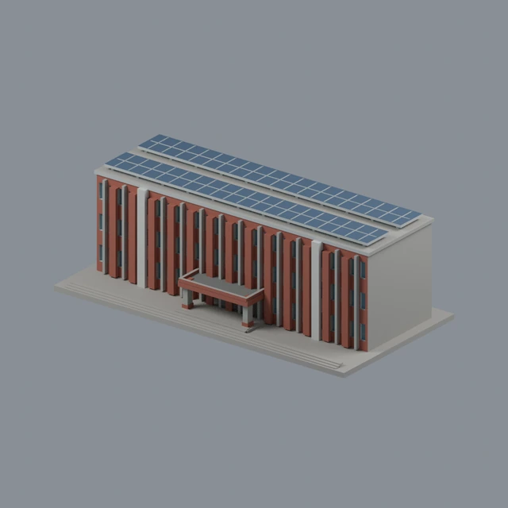
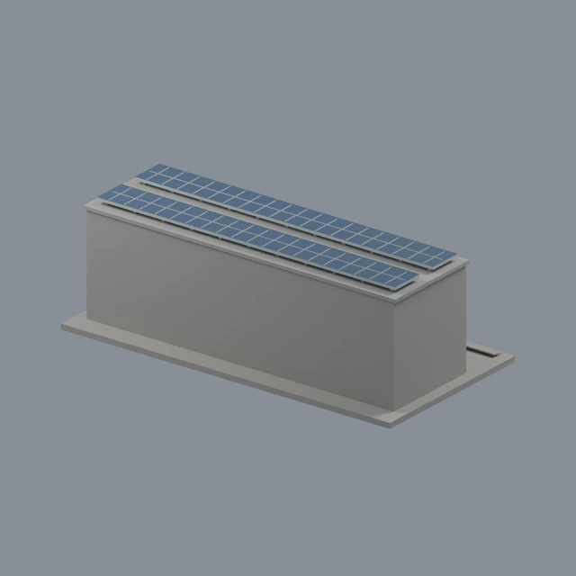
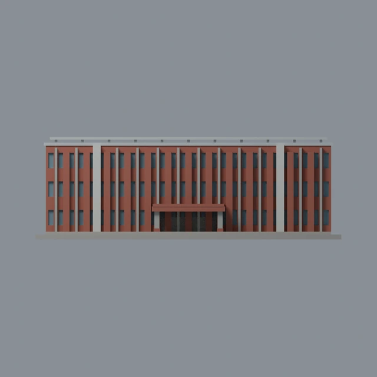
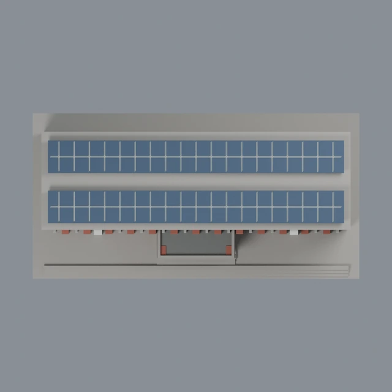

# 聯大二坪 F2 建築二館：現行8材質外觀

沿用原 **4,958 三角面／2,425 頂點**，不改原 STL 位元、座標、面序或幾何；這是既有模型外觀改版，不增加模型包數。

| 模型預覽 | 模型預覽 | 模型預覽 |
| :---: | :---: | :---: |
|  正面 |  背面 |  正立面 |
|  頂視 |  |  |

[表面色 3MF](nuuf2-appearance.3mf) · [可編輯 Blender](scene.blend) · [材質色表](palette.json) · [逐面指派與依據](face-materials.json) · [原 STL](../model.stl)

## 來源與配色邊界

親自核對官方 [F1／F2 建築館相簿](https://secretary.nuu.edu.tw/p/132-1003-1100.php?Lang=zh-tw) 的 F2 [外觀 5](https://secretary.nuu.edu.tw/var/file/3/1003/gallery/0/1100/gallery_1100_9194754_26749.jpg)與[外觀 8](https://secretary.nuu.edu.tw/var/file/3/1003/gallery/0/1100/gallery_1100_5278281_26750.jpg)完整照片。EXIF 分別為 2025-02-28 10:53:16／10:54:22；時區與拍攝日期未獨立核實，不代表 2026 現況。來源照片不隨包散布。

- 正面紅磚背景與寬凸柱、窄灰直柱、兩條較寬的白色直帶分開登記；不把全部垂直柱都染紅。既有窗洞凹背採灰藍、不增加窗格。
- 門廊立柱灰色，原來已分開的柱腳與柱頭紅磚色；門廊立面紅磚、上表面深灰，非把陰影畫成黑牆。中央入口是混合門／廊景，保守中性，不整塊當玻璃。
- 高角照片清楚見到兩排**真實 PV 電池片**及銀框，只有原兩陣列頂面採深藍，切槽與支架銀灰。原模型陣列為水平簡化，而照片呈傾斜；本次不改坡度、不新增紅鋼軌或設備。
- 主屋頂未被陣列覆蓋的區域、未見側／背面保持中性；不把鄰館／樹木／球場納入模型。原 STL／面序／座標不變，不增加模型數，不宣稱物理列印成功。

[原幾何與來源限制](../README.md) · [來源覆核](qa/source-review.json)

## 重建與核驗

安裝 [依賴](source/requirements.txt)，Blender 使用 4.3.2。由本資料夾上層提供原 model.stl：

1. `python appearance/source/build_appearance.py`
2. `python appearance/source/verify_exchange.py`
3. `blender -b -t 3 --python-exit-code 1 -P appearance/source/render_appearance.py`
4. `blender -b -t 3 --python-exit-code 1 -P appearance/source/verify_scene.py`

[獨立重建 ZIP](rebuild-source.zip)含原 STL、四支程式及依賴，不含第三方照片；不取代原建模腳本。[逐檔 SHA256](SHA256SUMS)

[交換／拓撲 QA](qa/exchange-validation.json)核對原座標與面序、全部面材質、單連通、有向水密邊、頂點 link 單環、正體積與零退化／重複面；lib3mf 嚴格讀取零警告，實際編輯單材質再存讀，其他材質及面指派不變。SDK 六位小數量化誤差另列。

[Blender 存讀與編輯](qa/scene-validation.json) · [渲染記錄](qa/render-manifest.json) · [獨立重建](qa/rebuild-validation.json)

## 製造限制照舊

尺寸仍為 150 × 76 × 50.2 mm；原 STL、建模程式、場景及歷史 QA 保留。原層檢與薄特徵檢查本次未重跑，不能由材質 QA 代替。

3MF 是同一網格的表面色，不是八個封閉分色實體、切片專案、噴頭映射或 G-code。切片 GUI、多材料路徑與實體列印未測；柱頭、屋簷、窗框及薄邊仍須評估材料、支撐及拆除風險，沒有保證可印或免支撐。

現行大圖可用 [WebP 與原圖像素對照](../display/archive-png.json) 校驗。在模型資料夾執行 `python display/verify_webp.py`（需 Pillow）。原四張彩色 PNG 與舊校驗表保留在[固定歷史版本](https://github.com/hplin50643/taiwan-buildings-3d/tree/2cd2ec0cc96f9eb0460fdc7ed82043e2c853ae68/%E5%A4%A7%E5%B0%88%E6%A0%A1%E9%99%A2/%E5%9C%8B%E7%AB%8B%E8%81%AF%E5%90%88%E5%A4%A7%E5%AD%B8/buildings/erping-f2-architecture-2)，不再放在主分支。重繪請先在暫存副本建立 `appearance/previews`，再執行 `blender -b -t 4 --python-exit-code 1 -P appearance/source/render_appearance.py`，再以 `--replay-root /path/to/copy` 校對。
