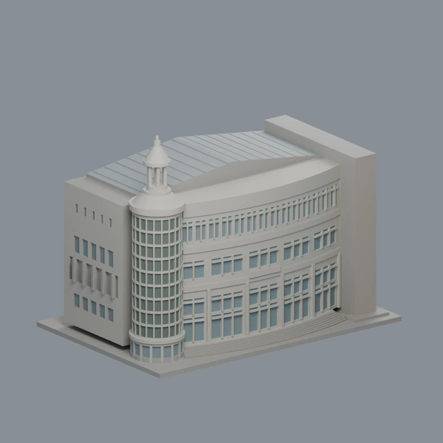
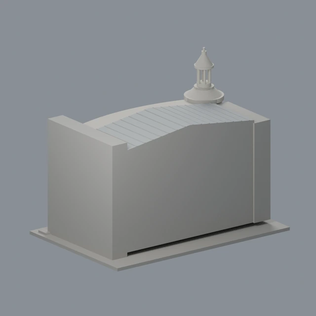
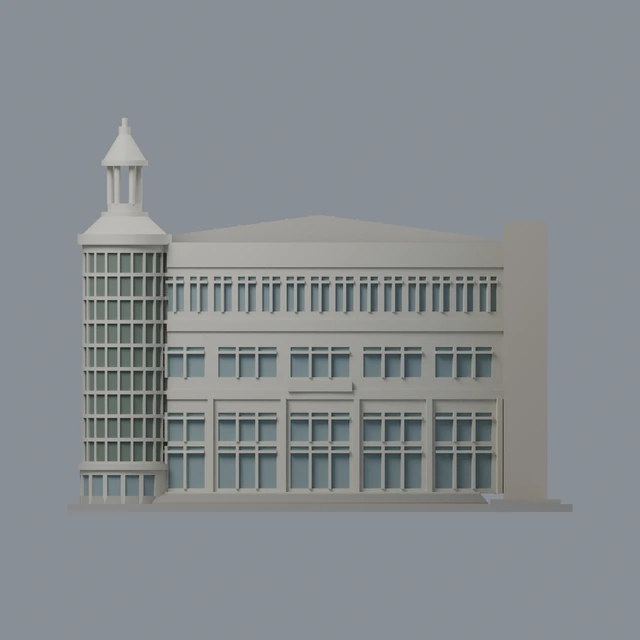
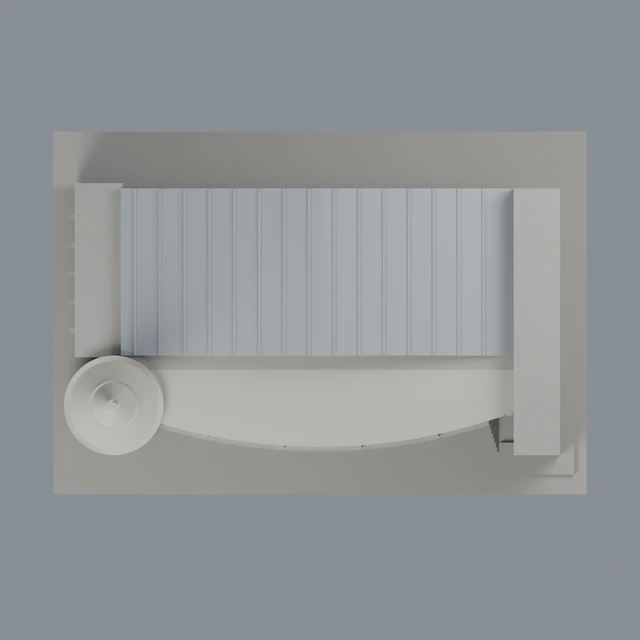

# 聯大二坪 J1 大禮堂、體育館及活動中心：現行八材質外觀

沿用原 **16,168 三角面／8,070 頂點**，不改原 STL 位元、座標、面序或幾何；這是既有模型外觀改版，不增加模型包數。

| 模型預覽 | 模型預覽 | 模型預覽 |
| :---: | :---: | :---: |
|  正面 |  背面 |  正立面 |
|  頂視 |  |  |

[表面色 3MF](nuuj1-appearance.3mf) · [可編輯 Blender](scene.blend) · [材質色表](palette.json) · [逐面指派與依據](face-materials.json) · [原 STL](../model.stl)

## 來源與配色邊界

親自核對官方 [J1 大禮堂、體育館及活動中心相簿](https://secretary.nuu.edu.tw/p/132-1003-1102.php?Lang=zh-tw) 的[照片 1](https://secretary.nuu.edu.tw/var/file/3/1003/gallery/2/1102/gallery_1102_8277325_43968.jpg)與[照片 2](https://secretary.nuu.edu.tw/var/file/3/1003/gallery/2/1102/gallery_1102_4551047_43999.jpg)完整影像。EXIF 分別為 2025-02-28 10:11:41／10:12:39；2025-03-09 是修改日期。時區與拍攝日期未獨立核實，不代表 2026 現況。來源照片不隨包散布。

- 正面曲線寬帶及牆面淡象牙石色；原切出的窗背低飽和灰藍，原窗框淡色。材質按切面登記，不把寬實牆帶染成玻璃，也不加名稱。
- 圓樓梯塔玻璃凹背使用灰橄欖色**照片反射代理**，不是證實玻璃本體固有綠色；原細柱及環帶保留淡石色。下鼓座只有離散凹背上色，不整圈當透明玻璃。
- 塔亭原開孔不填玻璃；塔亭周向石材色及體育館銀灰金屬屋面延伸屬**同系統材料有界推估**，不宣稱每個背面直接看見。體育館屋面不是 PV，不增添設備。
- 左側中層是凹廊／柱廊而非窗，保持中性不染玻璃；只對離散窗背著色。右高核心正面米灰實牆，未見背面維持中性。
- 原頂亭比例、槽紋、台階、後側底部退縮等均保留既有幾何，不藉配色聲稱修復或列印驗證。沒有加旁邊校門／警衛亭；那些獨立模型不重複計入。
- 原 STL／面序／座標不變；這是外觀改善，不增加模型數，不宣稱物理列印成功。

[原幾何與歷史來源限制](../README.md) · [來源覆核](qa/source-review.json)

## 歷史七材質版本的重建與核驗

安裝 [依賴](source/requirements.txt)，Blender 使用 4.3.2。由本資料夾上層提供原 model.stl：

1. `python appearance/source/build_appearance.py`
2. `python appearance/source/verify_exchange.py`
3. `blender -b -t 3 --python-exit-code 1 -P appearance/source/render_appearance.py`
4. `blender -b -t 3 --python-exit-code 1 -P appearance/source/verify_scene.py`

[獨立重建 ZIP](rebuild-source.zip)含原 STL、四支程式及依賴，不含第三方照片；不取代原建模腳本。[舊校驗表](https://github.com/hplin50643/taiwan-buildings-3d/tree/56ba188f00c02328b7df99361fa1ed9f32552303/%E5%A4%A7%E5%B0%88%E6%A0%A1%E9%99%A2/%E5%9C%8B%E7%AB%8B%E8%81%AF%E5%90%88%E5%A4%A7%E5%AD%B8/buildings/erping-j1-auditorium-gym-activity-center/appearance/SHA256SUMS)

[交換／拓撲 QA](qa/exchange-validation.json)核對原座標與面序、全部面材質、單連通、有向水密邊、頂點 link 單環、正體積與零退化／重複面；lib3mf 嚴格讀取零警告，實際編輯單材質再存讀，其他材質及面指派不變。SDK 六位小數量化誤差另列。

[Blender 存讀與編輯](qa/scene-validation.json) · [渲染記錄](qa/render-manifest.json) · [獨立重建](qa/rebuild-validation.json)

## 製造限制照舊

尺寸仍為 150 × 102 × 117 mm；原 STL、建模程式、場景及歷史 QA 保留。原層檢與薄特徵檢查本次未重跑，不能由材質 QA 代替。

3MF 是同一網格的表面色，不是七個封閉分色實體、切片專案、噴頭映射或 G-code。切片 GUI、多材料路徑與實體列印未測；柱頭、屋簷、窗框及薄邊仍須評估材料、支撐及拆除風險，沒有保證可印或免支撐。

## 現行八材質與重建

只原最低弧階 i0 的完整弧前立面64個平面、128個三角面作暖褐背景近似，排除踏面、側端、底面、上六級及其餘構件；原7材質保持。暖褐前立與淺米踏面分開，左塔、車輛與錐筒局部遮端僅同一原弧構件有限延續，不認證全域直接實見；其他同棟角度為補充，不是獨立交叉測色。原七粗級、64分段弧不同於真實級數、曲率及鼻緣細分；不修幾何，也不延色到右側實際轉階或坡道。原塔與最低弧不相交，照片塔遮影不等於模型切除。原階底2.3被基座頂2.4扣除，選域至2.95；原塔最小淨空2.256984mm，右平台與原弧無交。逐平面完整三角雙向支承仍有非零浮點差，不聲稱全零。

本次五張官方照片已可讀，原README第五圖取得失敗為歷史記錄，不覆寫歷史。僅外觀材料家族近似，不是校準色、材種鑑定或逐階測繪；照片不認證拍攝日期或2026現況。原STL、幾何、面序、代表圖及原視角保持，歷史QA與製造限制仍適用。
# Official references

- https://secretary.nuu.edu.tw/p/132-1003-1102.php?Lang=zh-tw
- https://secretary.nuu.edu.tw/var/file/3/1003/gallery/2/1102/gallery_1102_3151800_43999.jpg
- https://secretary.nuu.edu.tw/var/file/3/1003/gallery/2/1102/gallery_1102_3886969_43999.jpg
- https://secretary.nuu.edu.tw/var/file/3/1003/gallery/2/1102/gallery_1102_4551047_43999.jpg
- https://secretary.nuu.edu.tw/var/file/3/1003/gallery/2/1102/gallery_1102_7326819_43999.jpg
- https://secretary.nuu.edu.tw/var/file/3/1003/gallery/2/1102/gallery_1102_8277325_43968.jpg

J1 official album; current source3/4 lowest curved riser background.

現版共 8 個顯示材質（含未知中性色）。前節的舊建置流程與 QA 僅供重現歷史版本；現行模型未新增幾何。

本節提及原ZIP/QA/校驗數目屬歷史記錄，不是現版ZIP清單。現版ZIP僅含原STL、必要舊建置與渲染程式、三支現版包裝／驗證程式、requirements-current.txt與本README及授權說明（如原有）。完整來源研究、照片、私人審核與廣泛校驗清單不公開。PUBLIC-MODEL-SHA256SUMS僅核當前交付產品；原QA不替代當前驗證。

現版命令：`python -B appearance/source/build_current.py`、`python -B appearance/source/verify_current.py`、`blender -b -t 4 --python-exit-code 1 --python appearance/source/render_current.py`。依requirements-current.txt安裝必要依賴。直接執行舊builder會重建歷史配色。包裝程式僅執行固定本地舊程式，新增材質時只替換新材質粗糙度運算；寫模型、材質、場景、原視角PNG與當前本地QA。歷史報告先保存再還原；原不存在時只刪該次產生的舊名報告。不進行網路或憑證操作。

[當前外觀文件與重建資產 SHA-256](SHA256SUMS) 核對此提交的檔案。

現行大圖可用 [WebP 與原圖像素對照](../display/archive-png.json) 校驗。在模型資料夾執行 `python display/verify_webp.py`（需 Pillow）。原四張彩色 PNG 與舊校驗表保留在[固定歷史版本](https://github.com/hplin50643/taiwan-buildings-3d/tree/56ba188f00c02328b7df99361fa1ed9f32552303/%E5%A4%A7%E5%B0%88%E6%A0%A1%E9%99%A2/%E5%9C%8B%E7%AB%8B%E8%81%AF%E5%90%88%E5%A4%A7%E5%AD%B8/buildings/erping-j1-auditorium-gym-activity-center)，不再放在主分支。重繪請先在暫存副本建立 `appearance/previews`，再執行 `blender -b -t 4 --python-exit-code 1 -P appearance/source/render_current.py`，再以 `--replay-root /path/to/copy` 校對。
