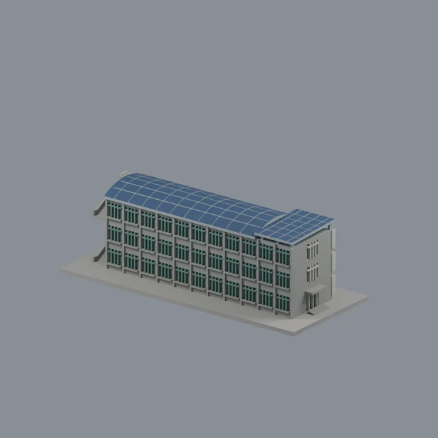
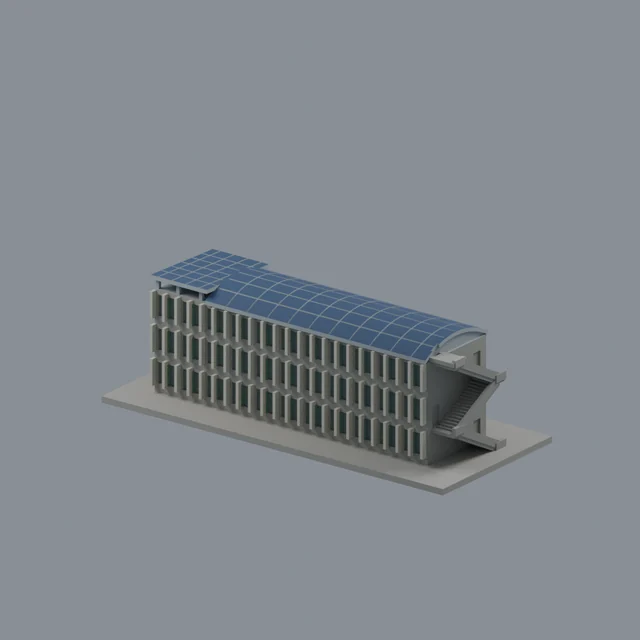
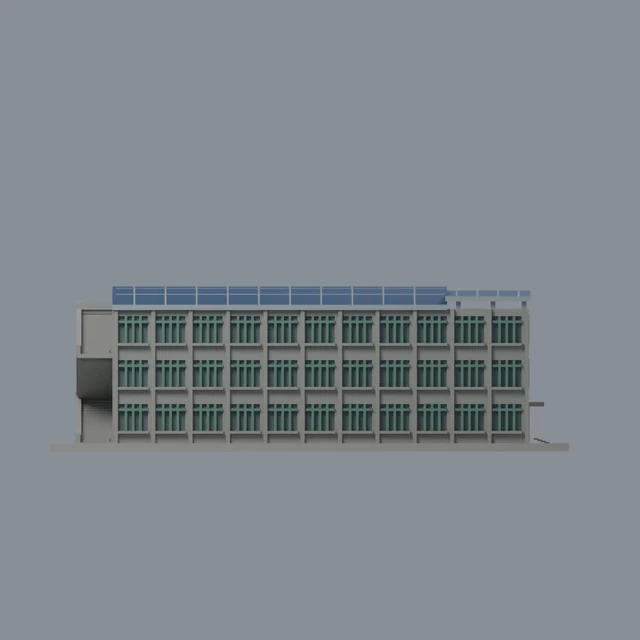
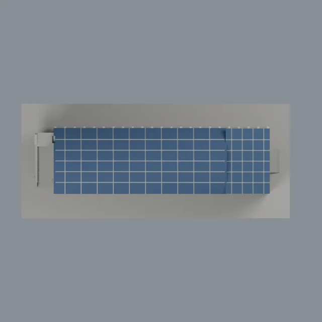

# 國立聯合大學二坪 K2 教學大樓（一）｜現行模型 WebP 預覽

四張均以現行七材質模型重渲染核對，不使用舊單色圖。表格用同視角 WebP 縮圖，點圖可開啟無損原尺寸 WebP。

| 模型預覽 | 模型預覽 | 模型預覽 |
| :---: | :---: | :---: |
|  正面與外梯 |  遮陽肋側與入口 |  正立面 |
|  頂視 |  |  |

[模型說明](../README.md) · [七材質與來源界線](../appearance/README.md) · [表面色 3MF](../appearance/nuuk2-appearance.3mf) · [可編輯 Blender](../appearance/scene.blend) · [原 STL](../model.stl) · [展示校驗](SHA256SUMS) · [模型與渲染對照](render-proof.json)

工程模型、來源覆核與重建記錄保留；原始渲染 PNG 由下方歷史版本保留。本版不新增配色或幾何，不是現況色彩測量或試印。[調整前模型說明](https://github.com/hplin50643/taiwan-buildings-3d/blob/7be659c3988c16c63b5dd93e8380a6fecd8ebec9/%E5%9C%8B%E7%AB%8B%E8%81%AF%E5%90%88%E5%A4%A7%E5%AD%B8/buildings/erping-k2-teaching-building-1/README.md) · [調整前外觀說明](https://github.com/hplin50643/taiwan-buildings-3d/blob/7be659c3988c16c63b5dd93e8380a6fecd8ebec9/%E5%9C%8B%E7%AB%8B%E8%81%AF%E5%90%88%E5%A4%A7%E5%AD%B8/buildings/erping-k2-teaching-building-1/appearance/README.md)

現行大圖可用 [WebP 與原圖像素對照](archive-png.json) 校驗。在模型資料夾執行 `python display/verify_webp.py`（需 Pillow）。原四張彩色 PNG 與舊校驗表保留在[固定歷史版本](https://github.com/hplin50643/taiwan-buildings-3d/tree/56ba188f00c02328b7df99361fa1ed9f32552303/%E5%A4%A7%E5%B0%88%E6%A0%A1%E9%99%A2/%E5%9C%8B%E7%AB%8B%E8%81%AF%E5%90%88%E5%A4%A7%E5%AD%B8/buildings/erping-k2-teaching-building-1)，不再放在主分支。重繪請先在暫存副本建立 `appearance/previews`，再執行 `blender -b -t 4 --python-exit-code 1 -P appearance/source/render_appearance.py`，再以 `--replay-root /path/to/copy` 校對。
