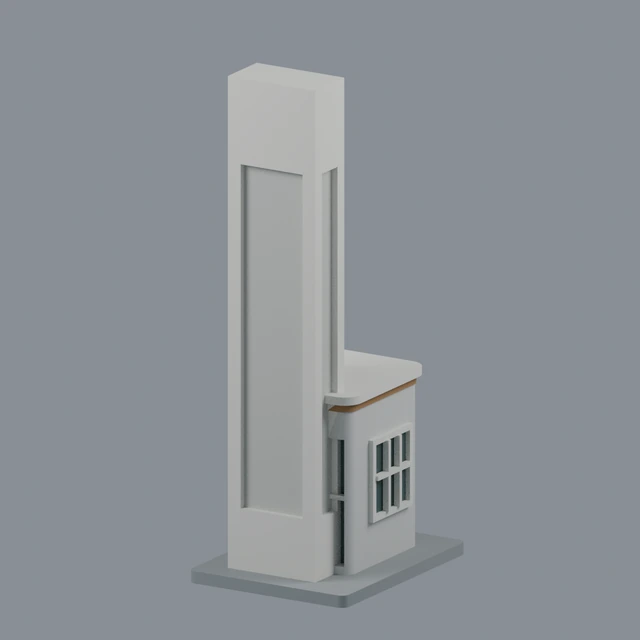
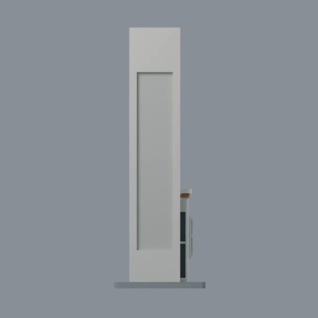
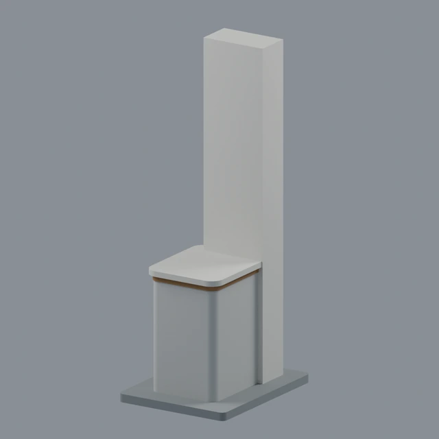
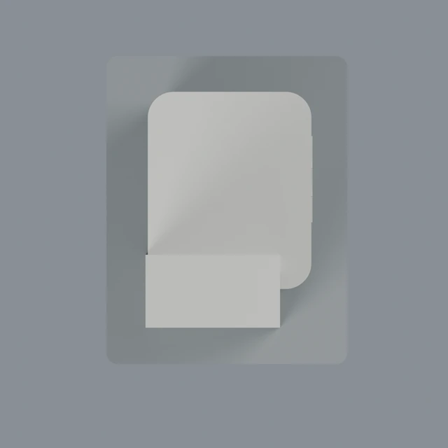
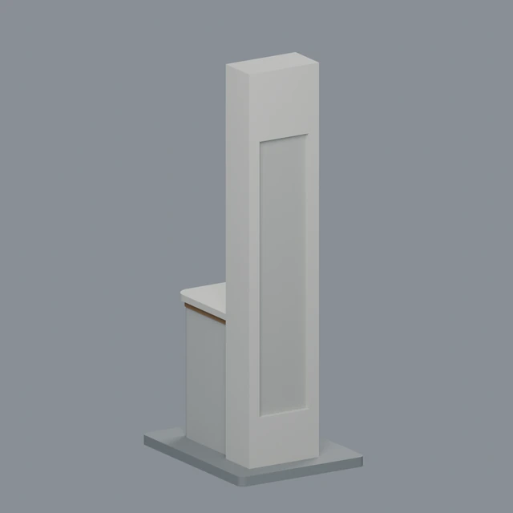

# 國立聯合大學二坪山校名柱與附連警衛亭段

## 模型預覽

<a name="五視角"></a>

| [](previews/front.webp) | [](previews/elevation.webp) | [](previews/rear.webp) |
| :---: | :---: | :---: |
| 前右 | 正面 | 後側簡化封閉 |
| [](previews/top.webp) | [](previews/left_oblique.webp) |  |
| 頂面近似 | 前左 |  |

NUU Erping Shan central gate-name tower and attached guard booth, approximate exterior segment.


## 範圍與檔案

此為新建幾何，不是全校門、整棟 J1 或另一座左側警衛亭。僅建中央白色細長校名柱與附連小型圓角警衛亭，附中性展示底座。柱約 120 mm 高、24 mm 寬、13 mm 深；整體含底座約 **43 × 55 × 123 mm**。所有尺寸由照片比例估算，無真實建築比例尺。

- [model.stl](model.stl)：無色毫米網格，1,520 三角面，單連通封閉外殼。
- [model.3mf](model.3mf)：同一網格七種顯示材質；非印表機工具頭／耗材對應。
- [scene.blend](scene.blend)：可編輯同網格、材質、相機與燈光。
- [build_model.py](build_model.py)、[render_model.py](render_model.py)：可重建幾何與實際網格五視角。
- [QA.md](QA.md)、[SOURCES.md](SOURCES.md)、[來源清單](sources.json)、[雜湊](SHA256SUMS)。

## 實景近似的限制

- **國立聯合大學書法及 NUU 標誌留白**，不捏造或以近似字形冒充。
- 長直凹區與側槽使用淺凹實背；照片無法確定內部或貫通關係。本包不提供室內、設備或門機構。
- 亭後側、完整頂面及平面深度不明，採中性簡化封閉；矩形側窗框與窗梃為照片支持的外觀近似，非精確窗格測繪。
- 薄磁磚縫、天線、桿件、交通設備與告示不建。灰色底座為模型展示／結構支撐，不是實測路島。
- 照片拍攝於 2025-02-28，不能視為 2026 年現況證明。原照片不隨包散布。

## 列印注意

原始 STL 拓撲、615 個全域層面，以及獨立窗梃、橫桿、帽簷邊、塔柱凹槽局部截面檢查通過本包記錄的篩查；**這不是所有細節可印或免支撐的保證**。細高柱需考慮列印穩定與強度，凹槽上緣、窗框及挑簷需依方向檢查支撐；1 mm 窗梃與 2 mm 帽簷仍受噴嘴、材料及縮放影響。未做實體試印或特定切片器支撐驗證。

## 重建


Original model/code: [MIT](LICENSE). Source photographs remain with their respective rights holders. Material colours are approximate display colours, not certified finishes.

### 展示圖與隔離重建

使用 Blender 4.3.2 與 requirements.txt 的幾何依賴。個別分析可在隔離副本執行 `qa_model.py`、`check_features.py`；`verify_scene.py` 和 `verify_exchange.py` 分別核對場景及 lib3mf 交換格式，後者可用 `BUILD_PYTHON` 指定幾何環境。

```bash
python -m pip install -r requirements.txt Pillow==13.0.0
python verify_package.py
blender -b --threads 4 --python-exit-code 19 --python verify_render.py
python rebuild.py --output ../new-clean-rebuild --blender blender --threads 4
```

五張展示圖使用 640 px WebP 縮圖，可點圖開啟全尺寸無失真 WebP。[縮圖校驗](previews/thumbnail-proof.json)。重建只在暫存目錄產生 PNG，重新核對圖像 RGBA 像素、尺寸和 WebP 檔案校驗碼。模型檔與歷史 QA 報告不變。[現行 WebP 校驗](qa/preview-webp.json) · [原始 PNG 與歷史 QA](https://github.com/hplin50643/taiwan-buildings-3d/tree/336ce1843e6e4435f93ed1a5df7cc26434fb9596/%E5%A4%A7%E5%B0%88%E6%A0%A1%E9%99%A2/%E5%9C%8B%E7%AB%8B%E8%81%AF%E5%90%88%E5%A4%A7%E5%AD%B8/buildings/erping-main-gate-tower-guardhouse-segment)。
