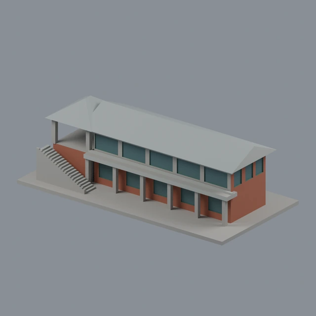
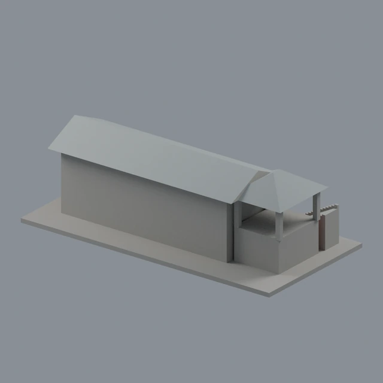
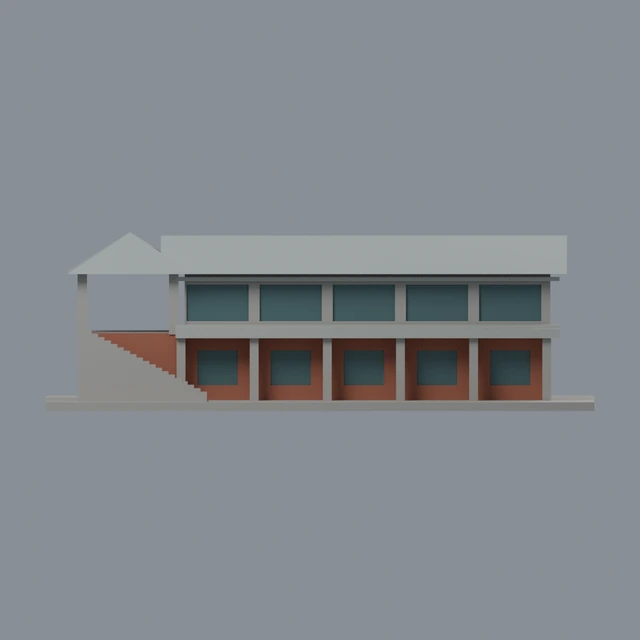
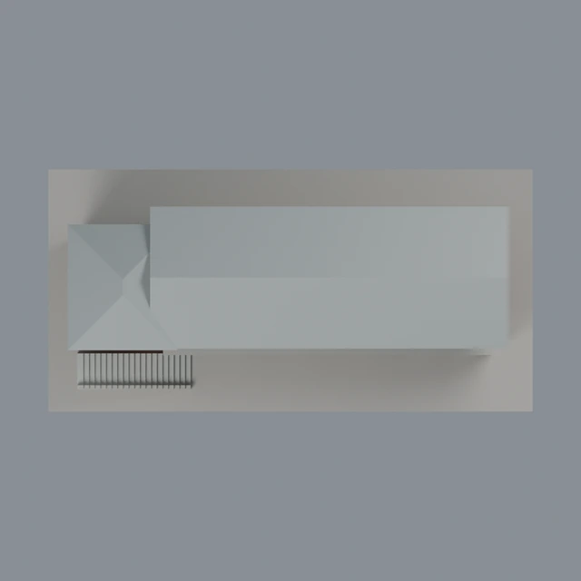

# 聯大二坪 V1 景觀餐廳：現行6材質外觀

沿用原 **1,102 三角面／531 頂點**，不改原 STL 位元、座標、面序或幾何；這是既有模型外觀改版，不增加模型包數。

| 模型預覽 | 模型預覽 | 模型預覽 |
| :---: | :---: | :---: |
|  正面斜視 |  背面斜視 |  正立面 |
|  頂視 |  |  |

[表面色 3MF](nuuv1-appearance.3mf) · [可編輯 Blender](scene.blend) · [材質色表](palette.json) · [逐面指派與依據](face-materials.json) · [原 STL](../model.stl)

## 來源與配色邊界

親自核對官方 [二坪山景觀餐廳相簿](https://secretary.nuu.edu.tw/p/132-1003-1119.php?Lang=zh-tw) 的完整 [照片 1](https://secretary.nuu.edu.tw/var/file/3/1003/gallery/19/1119/gallery_1119_6089259_97293.jpg)。EXIF DateTimeOriginal **2025-02-28 11:00:03**，日期與時區未獨立核實，不代表 2026 現況。照片 4 未完整取得，未作本版證據。來源照片不隨包散布。

- 已見下層前牆、右短端及亭下前牆紅磚色；上層正面原網格是厚實窗間牆，而實景以細綠框及大片玻璃為主，所以該厚實牆保持中性，不假造寬紅磚柱或寬綠窗框。
- 只對原離散窗凹背採低彩度灰綠玻璃；凹洞內側採克制綠色作窗框色彩代理，**不是實景細金屬框的幾何復原**。原窗數、框寬與部分樹後右端窗屬近似，凹背仍封實，不宣稱透明室內。
- 原前廊柱在實景有綠柱身與灰石腳，但原單一長面未區分這兩種材質，整根保守中性；亭上柱混有磚、綠邊及灰帶也保持中性。不為分色新增或切分任何面。
- 原雙坡與亭頂採銀灰金屬色，不是藍瓦或光電板；未清楚見到的同片屋面背坡僅是**同屋面材料的有限延伸**，不是背面直接觀察。原外牆背面中性。
- 已有腰帶灰色、梯面灰色；原厚實階梯側欄不能等同實景透空細金屬欄杆，保持中性，不添欄杆、店名字體、雕塑、設備或鄰棟。
- 原 STL／面序／座標不變，不增加模型數，不宣稱物理列印成功。

[原幾何與來源限制](../README.md) · [來源覆核](qa/source-review.json)

## 重建與核驗

安裝 [依賴](source/requirements.txt)，Blender 使用 4.3.2。由本資料夾上層提供原 model.stl：

1. `python appearance/source/build_appearance.py`
2. `python appearance/source/verify_exchange.py`
3. `blender -b -t 3 --python-exit-code 1 -P appearance/source/render_appearance.py`
4. `blender -b -t 3 --python-exit-code 1 -P appearance/source/verify_scene.py`

[獨立重建 ZIP](rebuild-source.zip)含原 STL、四支程式及依賴，不含第三方照片；不取代原建模腳本。[逐檔 SHA256](SHA256SUMS)

[交換／拓撲 QA](qa/exchange-validation.json)核對原座標與面序、全部面材質、單連通、有向水密邊、頂點 link 單環、正體積與零退化／重複面；lib3mf 嚴格讀取零警告，實際編輯單材質再存讀，其他材質及面指派不變。SDK 六位小數量化誤差另列。

[Blender 存讀與編輯](qa/scene-validation.json) · [渲染記錄](qa/render-manifest.json) · [獨立重建](qa/rebuild-validation.json)

## 製造限制照舊

尺寸仍為 150 × 75 × 48 mm；原 STL、建模程式、場景及歷史 QA 保留。原層檢與薄特徵檢查本次未重跑，不能由材質 QA 代替。

3MF 是同一網格的表面色，不是六個封閉分色實體、切片專案、噴頭映射或 G-code。切片 GUI、多材料路徑與實體列印未測；柱頭、屋簷、窗框及薄邊仍須評估材料、支撐及拆除風險，沒有保證可印或免支撐。

現行大圖可用 [WebP 與原圖像素對照](../display/archive-png.json) 校驗。在模型資料夾執行 `python display/verify_webp.py`（需 Pillow）。原四張彩色 PNG 與舊校驗表保留在[固定歷史版本](https://github.com/hplin50643/taiwan-buildings-3d/tree/ee64af983b821ac6fd24a31132cd5e3c2e255055/%E5%A4%A7%E5%B0%88%E6%A0%A1%E9%99%A2/%E5%9C%8B%E7%AB%8B%E8%81%AF%E5%90%88%E5%A4%A7%E5%AD%B8/buildings/erping-v1-landscape-restaurant)，不再放在主分支。重繪請先在暫存副本建立 `appearance/previews`，再執行 `blender -b -t 4 --python-exit-code 1 -P appearance/source/render_appearance.py`，再以 `--replay-root /path/to/copy` 校對。
