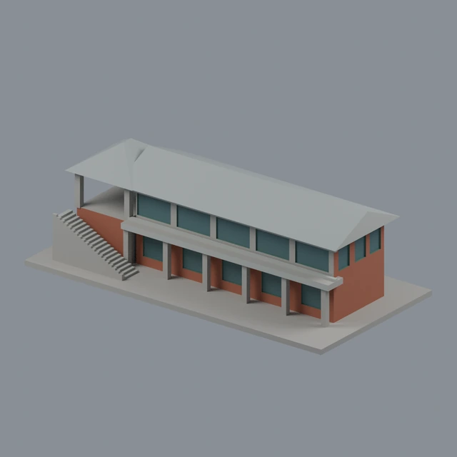
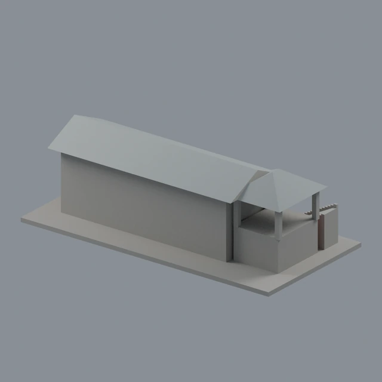
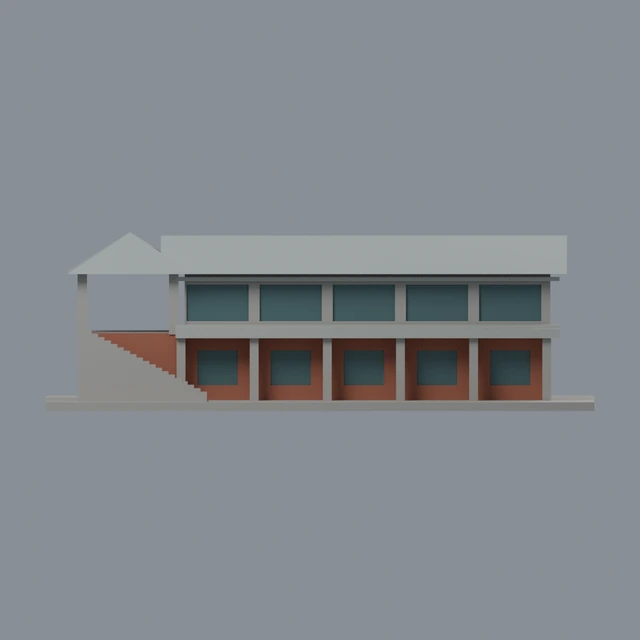
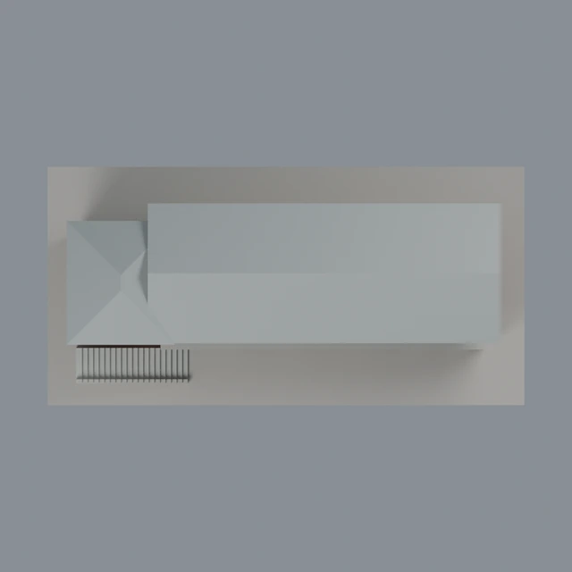

# 二坪 V1 景觀餐廳｜現行彩色展示

## 模型預覽

| 模型預覽 | 模型預覽 | 模型預覽 |
| :---: | :---: | :---: |
|  正面斜視 |  背面斜視 |  正立面 |
|  頂視 |  |  |

四張無失真展示圖由同一份六材質 Blender 場景重繪。大小較小的縮圖可點擊放大；模型及材色不變。

[可編輯 Blender](../appearance/scene.blend) · [彩色 3MF](../appearance/nuuv1-appearance.3mf) · [STL](../model.stl) · [渲染驗證](render-proof.json)

[模型與來源勘誤](../README.md)及[外觀、來源與限制](../appearance/README.md)均展示現行彩色模型。原始技術檔不變；舊 PNG 校驗可在下方固定歷史版本查閱。本模型為二坪 V1，不是八甲 V2。

現行大圖可用 [WebP 與原圖像素對照](archive-png.json) 校驗。在模型資料夾執行 `python display/verify_webp.py`（需 Pillow）。原四張彩色 PNG 與舊校驗表保留在[固定歷史版本](https://github.com/hplin50643/taiwan-buildings-3d/tree/ee64af983b821ac6fd24a31132cd5e3c2e255055/%E5%A4%A7%E5%B0%88%E6%A0%A1%E9%99%A2/%E5%9C%8B%E7%AB%8B%E8%81%AF%E5%90%88%E5%A4%A7%E5%AD%B8/buildings/erping-v1-landscape-restaurant)，不再放在主分支。重繪請先在暫存副本建立 `appearance/previews`，再執行 `blender -b -t 4 --python-exit-code 1 -P appearance/source/render_appearance.py`，再以 `--replay-root /path/to/copy` 校對。
