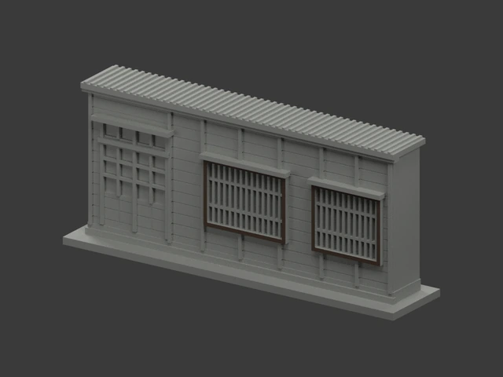

# 柳川校屬館舍

## 模型圖鑑

| 模型預覽 | 模型預覽 | 模型預覽 |
| :---: | :---: | :---: |
| 林之助紀念館畫室庭院側立面段  [局部材色3MF](buildings/ntcu-lin-atelier-courtyard-section/appearance.3mf) · [範圍與限制](buildings/ntcu-lin-atelier-courtyard-section/README.md) |  |  |

[林之助紀念館畫室庭院側立面段](buildings/ntcu-lin-atelier-courtyard-section/README.md)。局部、任意截取進深、背面留白、屋頂截斷，非全館。
