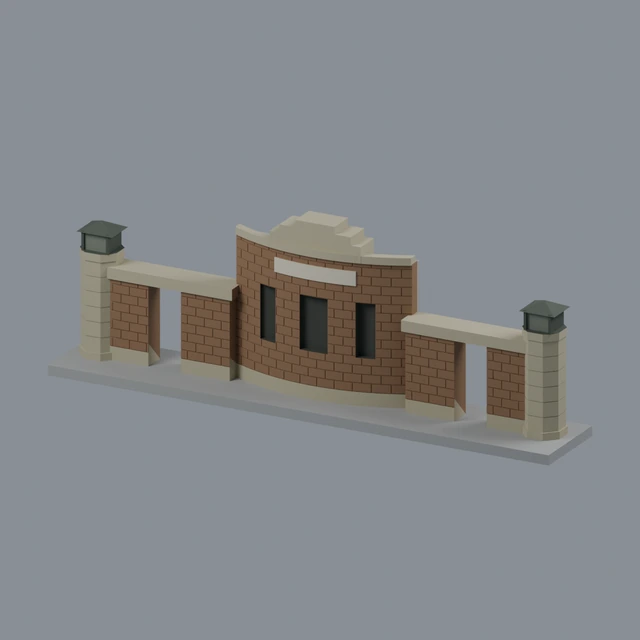
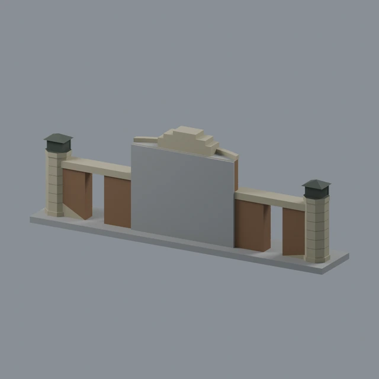
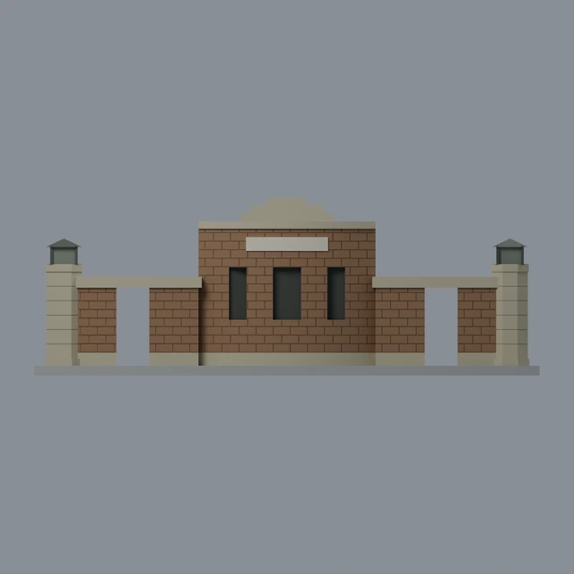
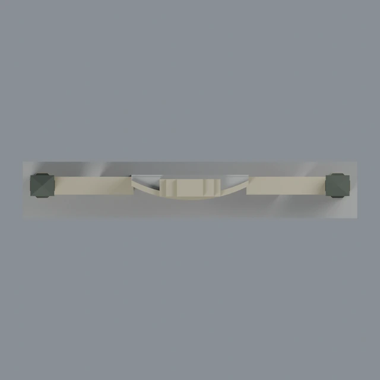
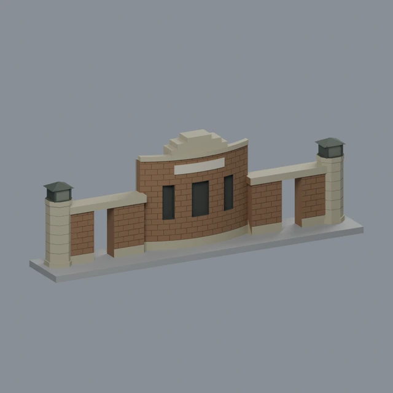

# 國立臺灣大學歷史校門：弧形前牆與內側雙行人門段

## 模型預覽

| [](previews/front.webp) | [](previews/rear.webp) | [](previews/elevation.webp) |
| :---: | :---: | :---: |
| 正面 | 背面（展示裁切） | 側立面 |
| [](previews/top.webp) | [](previews/left_oblique.webp) |  |
| 俯視 | 斜視 |  |

**新幾何模型；不是整棟警衛室，也不是完整四柱校門。** 範圍為淺弧磚前牆、三個凹窗、中寬外窄、空白石匾、三階旗座、相鄰兩個穿透人行門及兩根內側石燈柱。

- `model.stl`：單一連接封閉列印網格，無顏色。
- `model.3mf`：逐三角面七種可編輯命名材質；非七噴頭或機器耗材配置。
- `scene.blend`：相同幾何與材質、五視角相機配置；可編輯網格。
- `build_model.py`：可修改尺寸／曲率與構造的參數化來源。
- `previews/`：front、rear、elevation、top、left_oblique 五張實際模型圖。

## 比例、裁切與誠實限制

模型為任意展示毫米單位，外框 154 × 26 × 54.2 mm，**不是建築實測比例**。中央前弧寬 54 mm，弓高 6.5 mm（0.12 W）為右前照片約估，不是半圓柱。原圖像素定位／證據權重見 `qa/design-registration.json` 與 `SOURCES.md`。

**後方灰色平面、較低的灰色頂部與底座都是虛構的展示裁切支承，絕非真實屋頂、後牆或地坪平面。** 只保留沿前弧的石壓頂；未延伸整個長方警衛室，不推測不可見背面。w1 的長側窗／雨棚、車道、兩根外柱均未建模。

牌匾留白，未仿造不能可靠製作的字樣。三窗是有深度的凹槽與不透明背板，不是真正透明玻璃或室內；窗百葉、移動鐵門葉、完整旗桿旗面、植物均省略。石磚縫是簡化且加粗的視覺表現，數量、砌法和色彩不是實測；石灰／棕磚／暗燈框色取照片的近似色族，不聲稱精確色票或今日現況。

## 驗證與製作

見 [QA.md](QA.md)；拓樸、切層、局部細節、3MF 嚴格讀入與改色重存、Blend 改色重開、獨立照片比對各自有報告。**沒有實體列印、切片器支撐或機器驗證；不能宣稱全面 0.8 mm 最小厚度通過。** 人行門橫樑跨空，實際列印可能需要支撐；燈帽尖端與淺灰縫存在消失風險。

用 Blender 4.3.2 與 `requirements.txt` 所列套件重建。輸出路徑須在模型目錄外且尚未存在，避免覆寫發布檔案。個別分析入口為 `qa_model.py`、`check_features.py`；`verify_scene.py` 和 `verify_exchange.py` 分別用於場景及交換格式核對。 跨 Blender／硬體版本不承諾位元組一致。來源審查與既有 QA 的限制不變；若修改幾何，須重跑 QA 及外觀審查。

```bash
python -m pip install -r requirements.txt Pillow==13.0.0
python verify_package.py
blender -b --threads 4 --python-exit-code 19 --python verify_render.py
python rebuild.py --output ../new-clean-rebuild --blender blender --threads 4
```

五張展示圖使用 640 px WebP 縮圖，可點圖開啟全尺寸無失真 WebP。[縮圖校驗](previews/thumbnail-proof.json)。重建只在暫存目錄產生 PNG 中間檔，核對解碼 RGBA 像素及尺寸後輸出並校驗 WebP。原模型和既有 QA 報告不變，原始 PNG 和當時的校驗記錄仍可在固定提交查閱。[現行 WebP 校驗](qa/preview-webp.json) · [原始 PNG 與歷史 QA](https://github.com/hplin50643/taiwan-buildings-3d/tree/336ce1843e6e4435f93ed1a5df7cc26434fb9596/%E5%A4%A7%E5%B0%88%E6%A0%A1%E9%99%A2/%E5%9C%8B%E7%AB%8B%E8%87%BA%E7%81%A3%E5%A4%A7%E5%AD%B8/%E6%A0%A1%E7%B8%BD%E5%8D%80/buildings/ntu-historic-gate-front-segment)。

Python 依賴見 requirements.txt；lib3mf 另用可載入原生程式庫的 Python。模型與程式授權見 LICENSE；參考照片授權另見 SOURCES.md，照片未隨包分發。
