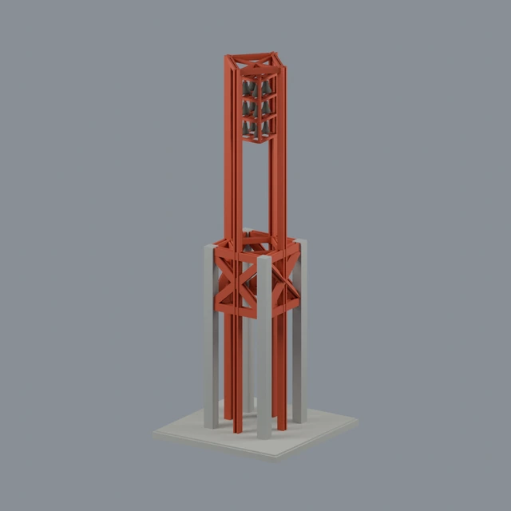
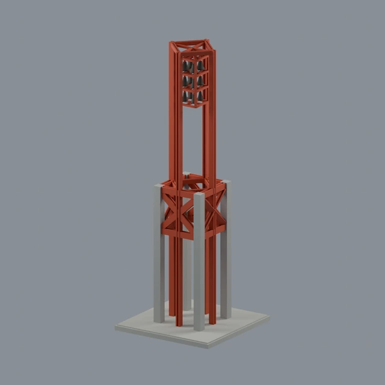
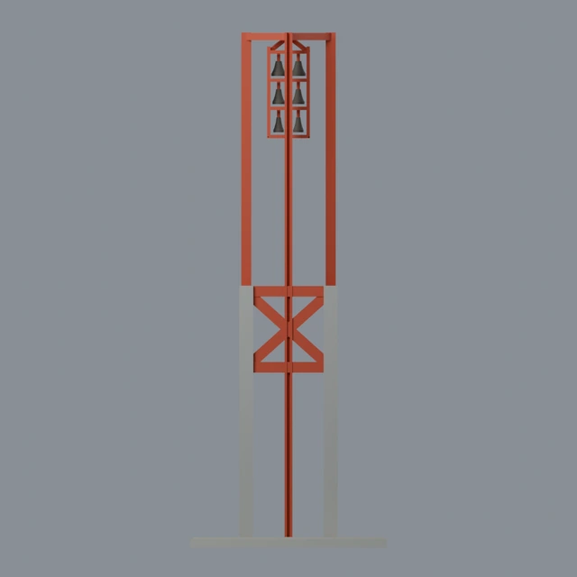
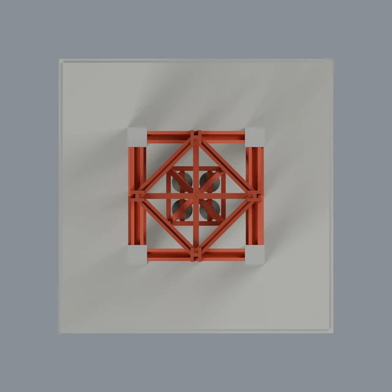
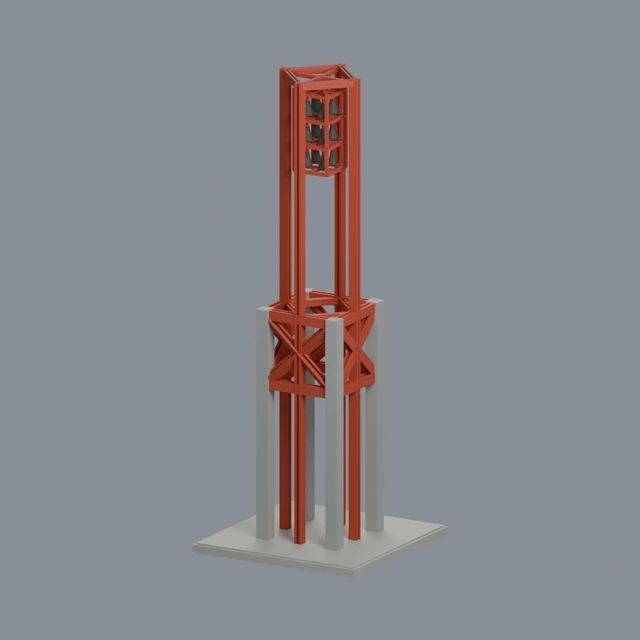

# 國立雲林科技大學｜雲科精神鐘塔

## 模型預覽

| [](previews/front.webp) | [](previews/rear.webp) | [](previews/elevation.webp) |
| :---: | :---: | :---: |
| 正面斜視 | 背斜視 | 正立面 |
| [](previews/top.webp) | [](previews/left_oblique.webp) |  |
| 頂視 | 左斜視 |  |

斗六校區，雲泰表演廳旁獨立鐘塔。完整地上主體的公開照片近似模型，非實測復原；2017、2018、2020校方照片外觀，不宣稱目前狀況。


## 下載／編輯
- [STL列印幾何](model.stl)：70×70×183 mm，單一封閉連通網格。
- [彩色3MF](model.3mf)：四組逐面材質，顯示顏色不是多料噴頭設定。
- [Blender可編輯場景](scene.blend)：相同實際網格、材質、五視角攝影機流程；沒有來源照片或外部貼圖。
- [生成程式](build_model.py)、[來源](SOURCES.md)、[驗證與限制](QA.md)。

四灰混凝土角柱、開放下半部、紅色圈梁與四面X斜撐、四根旋轉方框鋼立柱、上方鐘籠。最低四鐘口直接可見；**三層共12個代表鐘為視覺推定，並非官方確切數量**。鐘體實心、固定、形狀近似。70mm方底座是模型支承，不表示真實廣場邊界；不含禮堂、整片廣場階梯或植栽。

## 列印限制
I型鋼翼板0.85mm、腹板1mm，鐘籠桿1.2mm，細長鋼柱與懸吊鐘有脆弱／懸垂風險。必須自行檢查切片、方向、支撐及材料設定；不能宣稱免支撐或通過實體試印。縮小模型可能使細節消失。STL沒有色彩。

## 重建

用 Blender 4.3.2 與 `requirements.txt` 所列套件重建。輸出路徑須在模型目錄外且尚未存在，避免覆寫發布檔案。個別分析入口為 `qa_model.py`、`check_features.py`；`verify_scene.py` 和 `verify_exchange.py` 分別用於場景及交換格式核對。 跨 Blender／硬體版本不承諾位元組一致。來源審查與既有 QA 的限制不變；若修改幾何，須重跑 QA 及外觀審查。

```bash
python -m pip install -r requirements.txt Pillow==13.0.0
python verify_package.py
blender -b --threads 4 --python-exit-code 19 --python verify_render.py
python rebuild.py --output ../new-clean-rebuild --blender blender --threads 4
```

五張展示圖使用 640 px WebP 縮圖，可點圖開啟全尺寸無失真 WebP。[縮圖校驗](previews/thumbnail-proof.json)。重建只在暫存目錄產生 PNG 中間檔，核對解碼 RGBA 像素及尺寸後輸出並校驗 WebP。原模型和既有 QA 報告不變，原始 PNG 和當時的校驗記錄仍可在固定提交查閱。[現行 WebP 校驗](qa/preview-webp.json) · [原始 PNG 與歷史 QA](https://github.com/hplin50643/taiwan-buildings-3d/tree/336ce1843e6e4435f93ed1a5df7cc26434fb9596/%E5%A4%A7%E5%B0%88%E6%A0%A1%E9%99%A2/%E5%9C%8B%E7%AB%8B%E9%9B%B2%E6%9E%97%E7%A7%91%E6%8A%80%E5%A4%A7%E5%AD%B8/%E6%96%97%E5%85%AD%E6%A0%A1%E5%8D%80/buildings/yuntech-spirit-bell-tower)。

Exchange 驗證須用官方 lib3mf Python SDK；必要時用 BUILD_PYTHON 指定具 manifold3d 等套件的 Python。

模型與程式依LICENSE；官方來源照片權利不在此授權內，未重新散布。
