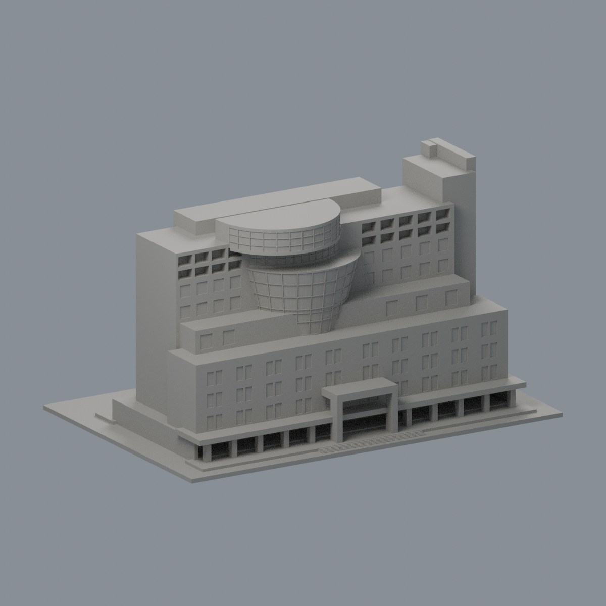
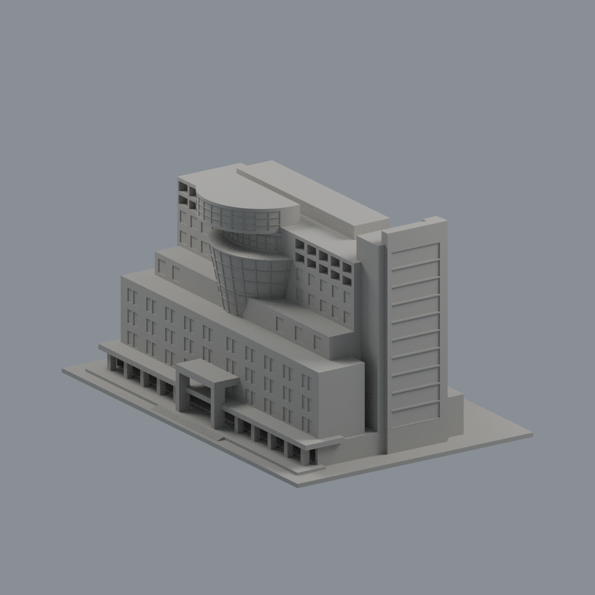
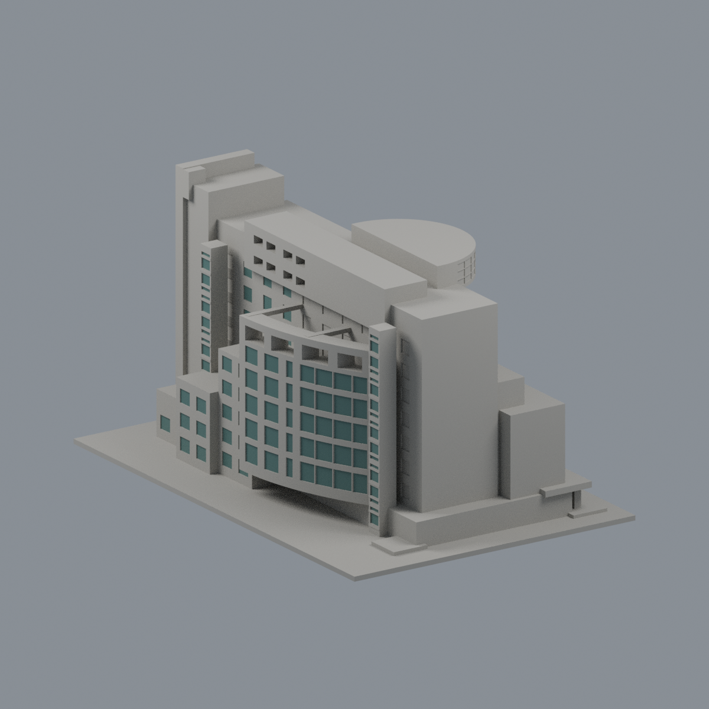
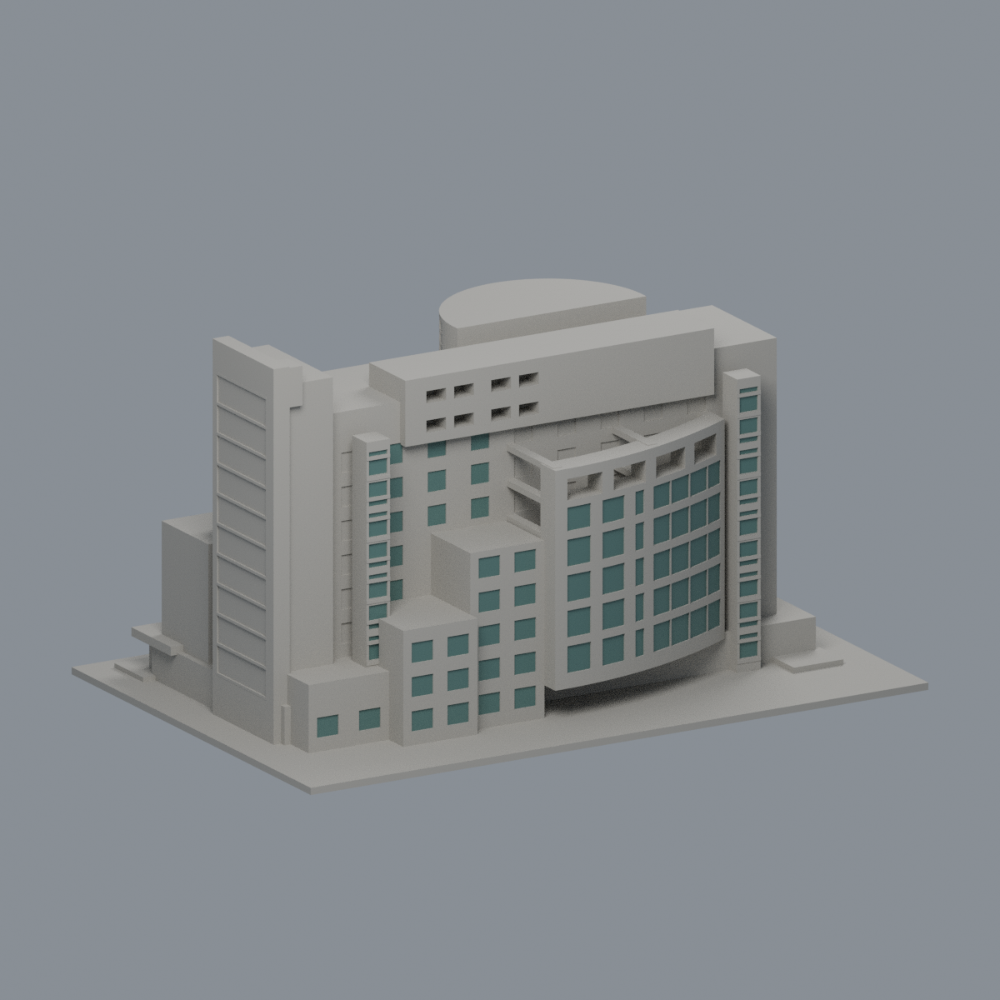
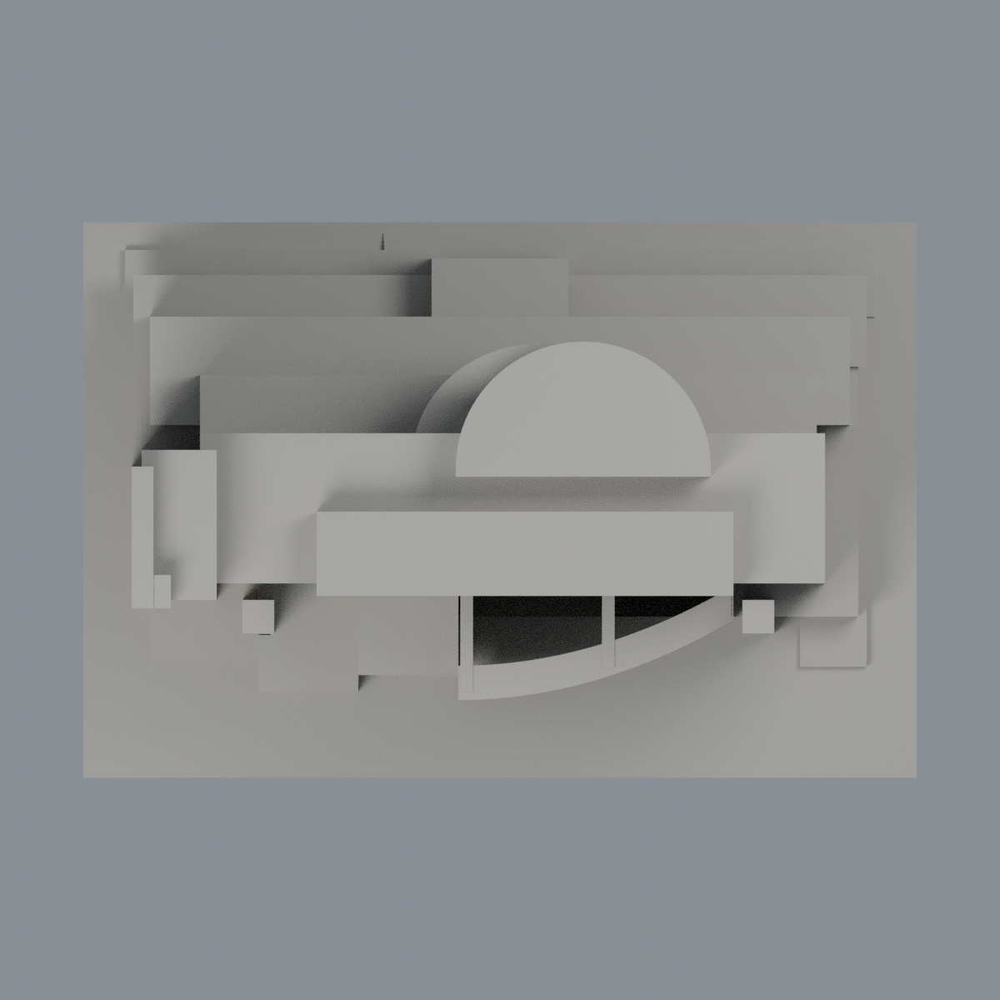

# 崑山科技大學｜永康校區｜圖書資訊館

## 模型預覽

| 模型預覽 | 模型預覽 | 模型預覽 |
| :---: | :---: | :---: |
|  正面 |  左側 |  右側 |
|  背面：歷史後窗限域配色 |  頂視 | |

[STL（不含色）](model.stl) · [現行彩色 3MF](appearance/ksu-library-information-building-appearance.3mf) · [現行 Blender](appearance/scene.blend) · [外觀、重建與校驗](appearance/README.md) · [來源與證據](sources.md)

現行版只把既有歷史後窗 1,242 個原三角面設為不透明藍綠灰代理；16,230 面維持未知中性。白曲翼窗背 1,120、兩座梯塔 64、退台 36、可見高紅磚區 22 面；另 96 個遮擋面維持中性。前面、所有不透明牆體、屋面、框、窗側壁、八孔及白翼梁槽均不補色。不是完整復色或現況實測。原 8,660 頂點、17,472 三角、原 STL 位元、全座標、面序及原 150 × 100 × 約 84.1 mm 尺度不變。

原工程 QA 的 passed=false、exceptions_independently_approved=false 與 run_all_checks 非零退出仍保留在歷史記錄；後續獨立 122,304 點查核的有限例外不覆寫原結果。真薄唇 0.599998 mm、約 0.300003 mm 的階、南槽探針與 61.7342% 局部支承等限制不變，不能視為全域 0.8 mm 通過。未做精測、切片或實體試印。原照片未附、不作紋理。

[原工程驗證報告](https://github.com/hplin50643/taiwan-buildings-3d/blob/9d27470c219df60ff5211342c28ba0aab5b06658/%E5%B4%91%E5%B1%B1%E7%A7%91%E6%8A%80%E5%A4%A7%E5%AD%B8/%E6%B0%B8%E5%BA%B7%E6%A0%A1%E5%8D%80/buildings/ksu-library-information-building/QA.md)、[舊幾何與中性預覽](https://github.com/hplin50643/taiwan-buildings-3d/blob/9d27470c219df60ff5211342c28ba0aab5b06658/%E5%B4%91%E5%B1%B1%E7%A7%91%E6%8A%80%E5%A4%A7%E5%AD%B8/%E6%B0%B8%E5%BA%B7%E6%A0%A1%E5%8D%80/buildings/ksu-library-information-building/README.md)和[原工程完整校驗表](https://github.com/hplin50643/taiwan-buildings-3d/blob/9d27470c219df60ff5211342c28ba0aab5b06658/%E5%B4%91%E5%B1%B1%E7%A7%91%E6%8A%80%E5%A4%A7%E5%AD%B8/%E6%B0%B8%E5%BA%B7%E6%A0%A1%E5%8D%80/buildings/ksu-library-information-building/SHA256SUMS.txt)保留在固定 Git 快照。舊版檢查器與其舊預覽需在該快照一起重播，不拿來驗證現行 WebP 圖冊。
