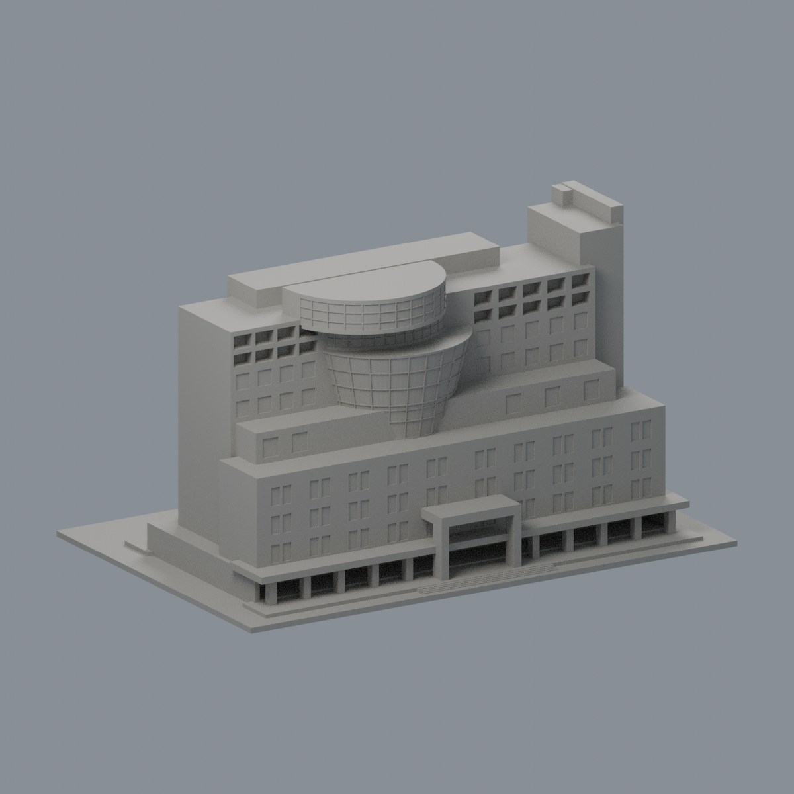
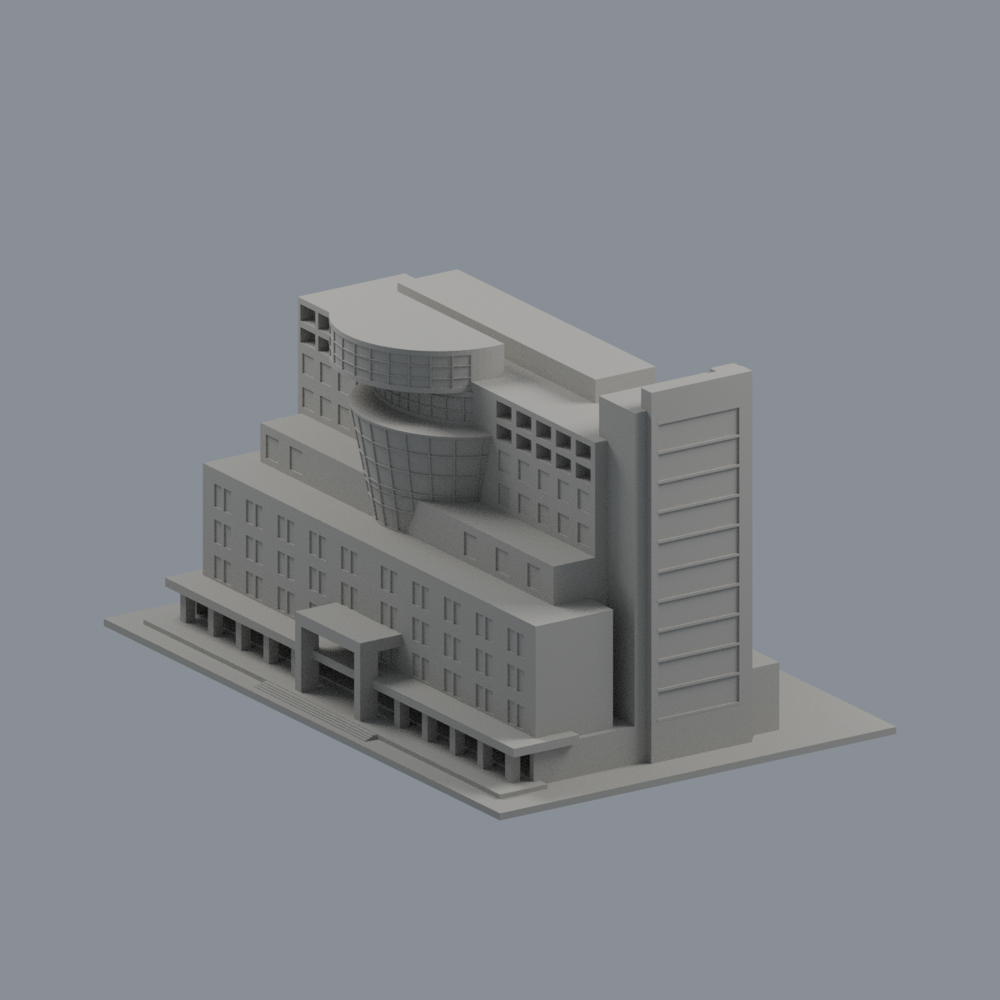
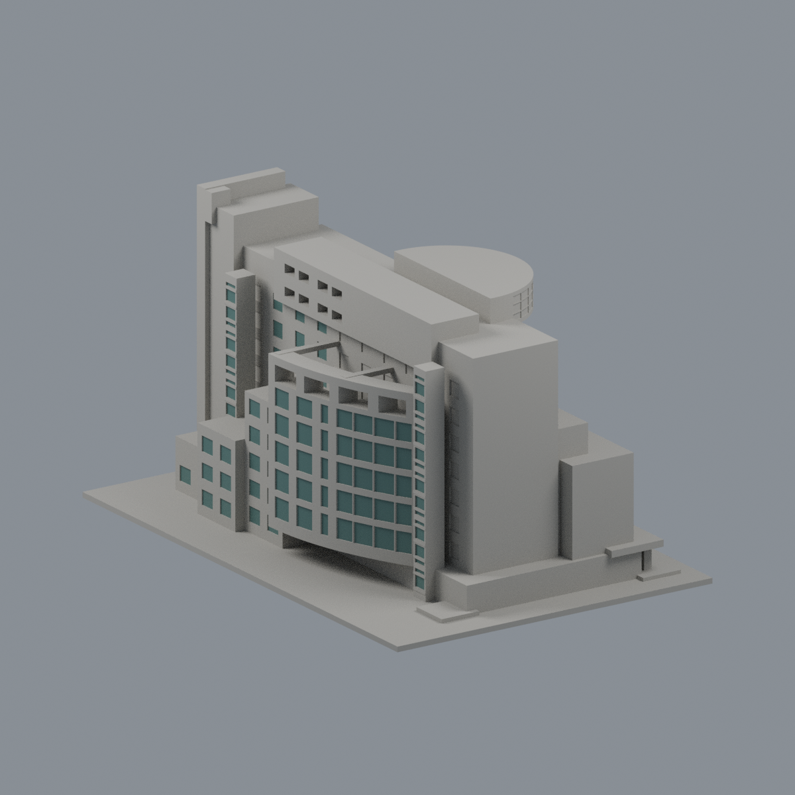
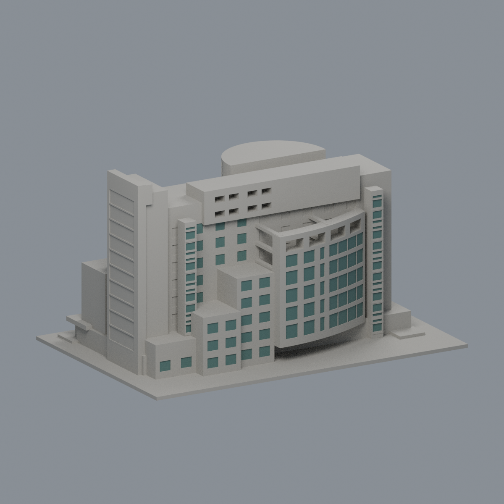
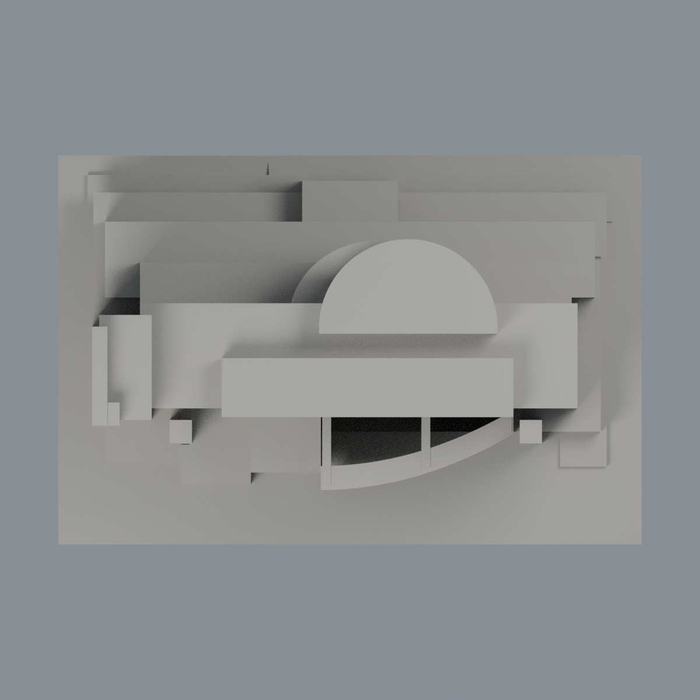

# 崑山科技大學圖書資訊館｜現行限域外觀

## 模型預覽

| 模型預覽 | 模型預覽 | 模型預覽 |
| :---: | :---: | :---: |
|  正面 |  左側 |  右側 |
|  背面：歷史後窗限域配色 |  頂視 | |

[現行 3MF](ksu-library-information-building-appearance.3mf) · [現行 Blender](scene.blend) · [原 STL](../model.stl) · [當前校驗表](../CURRENT-SHA256SUMS) · [渲染來源與視角](render-proof.json)

現行版只把既有歷史後窗 1,242 個原三角面設為不透明藍綠灰代理；16,230 面維持未知中性。白曲翼窗背 1,120、兩座梯塔 64、退台 36、可見高紅磚區 22 面；另 96 個遮擋面維持中性。前面、所有不透明牆體、屋面、框、窗側壁、八孔及白翼梁槽均不補色。不是完整復色或現況實測。原 8,660 頂點、17,472 三角、原 STL 位元、全座標、面序及原 150 × 100 × 約 84.1 mm 尺度不變。

原工程 QA 的 passed=false、exceptions_independently_approved=false 與 run_all_checks 非零退出仍保留在歷史記錄；後續獨立 122,304 點查核的有限例外不覆寫原結果。真薄唇 0.599998 mm、約 0.300003 mm 的階、南槽探針與 61.7342% 局部支承等限制不變，不能視為全域 0.8 mm 通過。未做精測、切片或實體試印。原照片未附、不作紋理。

[獨立選面核對](qa/material-boundaries.json) · [交換核對](qa/exchange-validation.json) · [原來源與限制](SOURCES.md) · [授權限制](LICENSE-NOTICE.md)

## 重現與歷史

現行三個模型格式可以獨立開啟。需要重建時，在暫存目錄解壓[獨立重建源碼](rebuild-source.zip)，依該包依賴以 Python 執行 `appearance/source/build_appearance.py`；交換使用 `verify_exchange.py`，Blender 4.3.2 使用 `render_appearance.py`。原重建流程的 PNG 中間檔只在暫存處用於校驗，不作公開預覽。現行 WebP 由最新已發布 Blender 場景直接重渲，不改材色。

[前次配色說明及單色 QA 對照](https://github.com/hplin50643/taiwan-buildings-3d/blob/9d27470c219df60ff5211342c28ba0aab5b06658/%E5%B4%91%E5%B1%B1%E7%A7%91%E6%8A%80%E5%A4%A7%E5%AD%B8/%E6%B0%B8%E5%BA%B7%E6%A0%A1%E5%8D%80/buildings/ksu-library-information-building/appearance/README.md)、[前次外觀校驗](https://github.com/hplin50643/taiwan-buildings-3d/blob/9d27470c219df60ff5211342c28ba0aab5b06658/%E5%B4%91%E5%B1%B1%E7%A7%91%E6%8A%80%E5%A4%A7%E5%AD%B8/%E6%B0%B8%E5%BA%B7%E6%A0%A1%E5%8D%80/buildings/ksu-library-information-building/appearance/SHA256SUMS.txt)和[基準工程校驗](https://github.com/hplin50643/taiwan-buildings-3d/blob/9d27470c219df60ff5211342c28ba0aab5b06658/%E5%B4%91%E5%B1%B1%E7%A7%91%E6%8A%80%E5%A4%A7%E5%AD%B8/%E6%B0%B8%E5%BA%B7%E6%A0%A1%E5%8D%80/buildings/ksu-library-information-building/SHA256SUMS.txt)只供歷史驗證，不是現行3MF、場景或預覽的下載入口。歷史報告與原重建流程以固定提交保全，不改內容。
