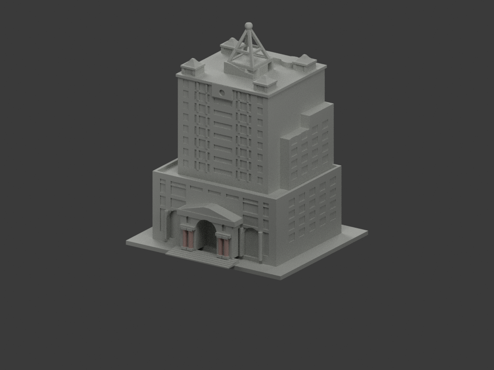
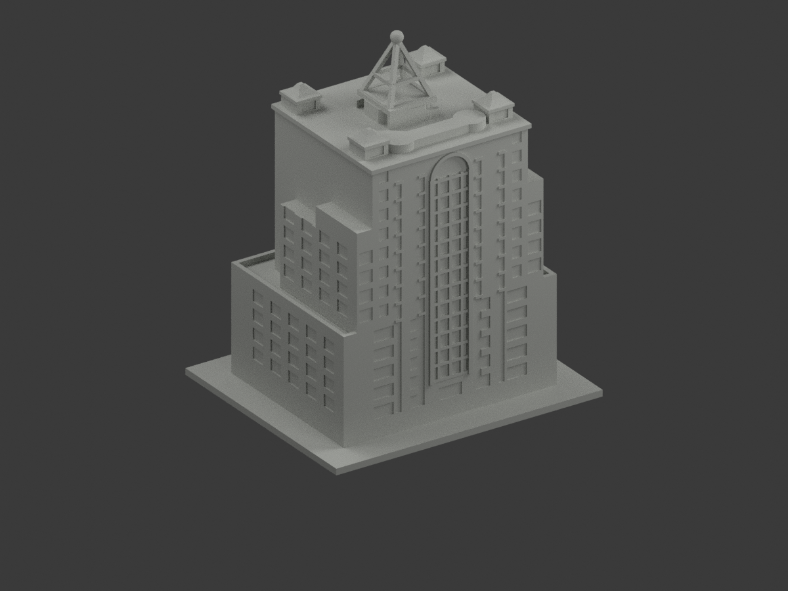
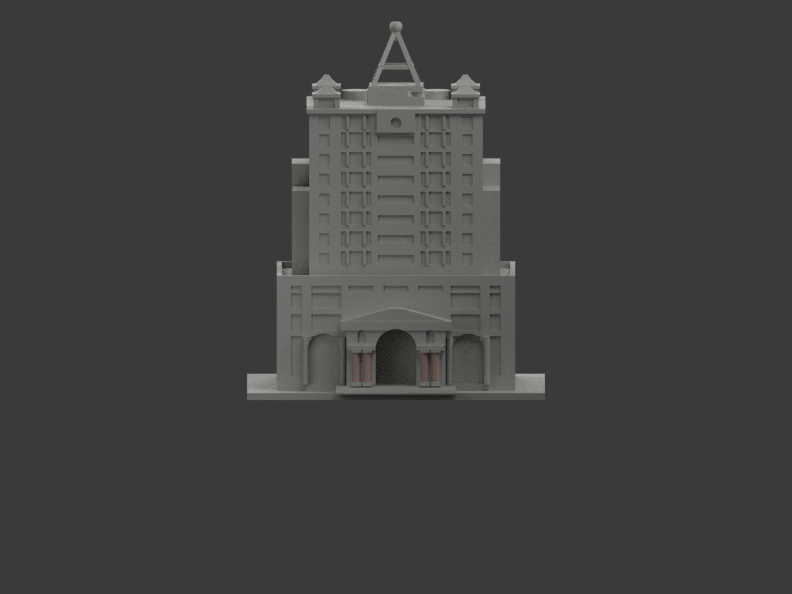
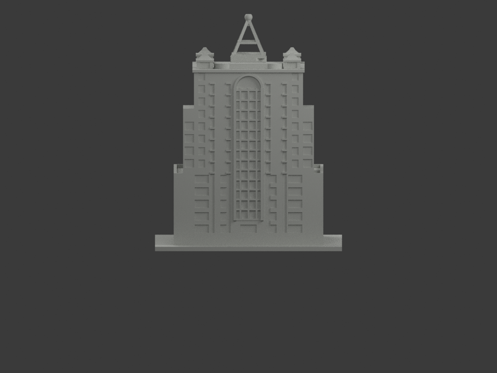
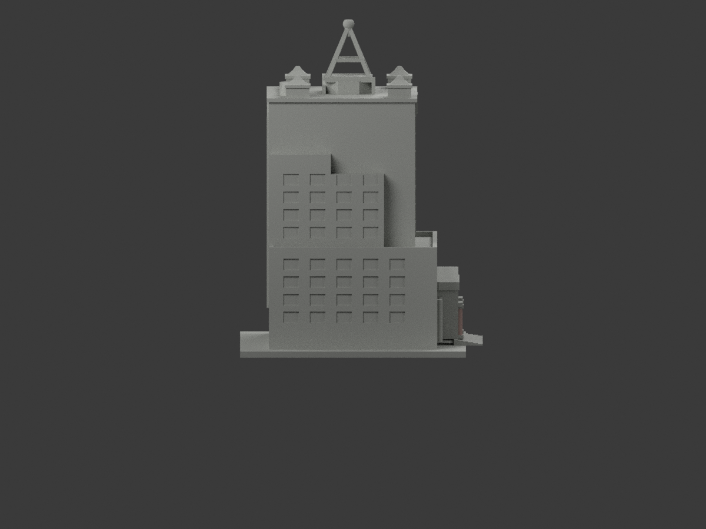
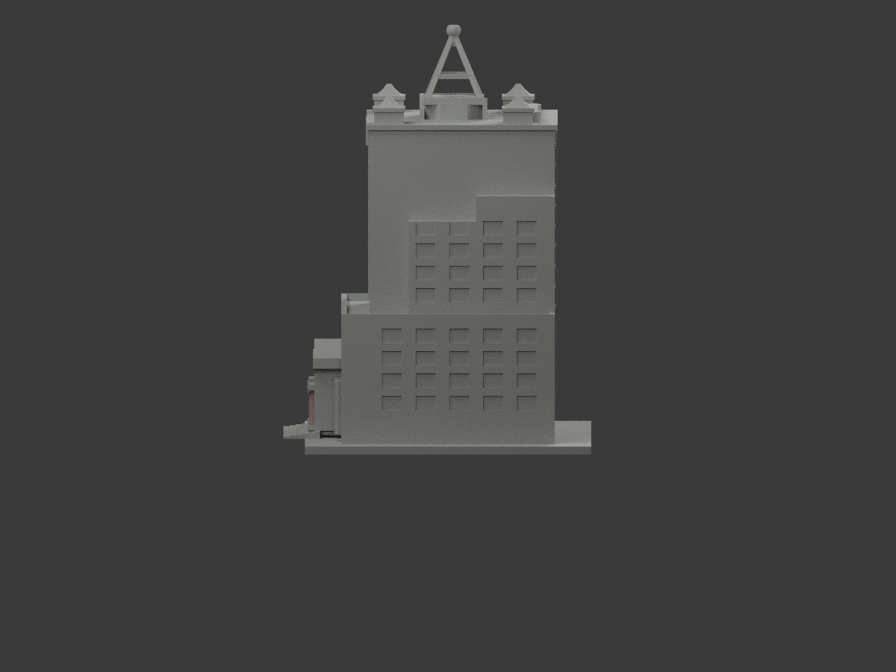
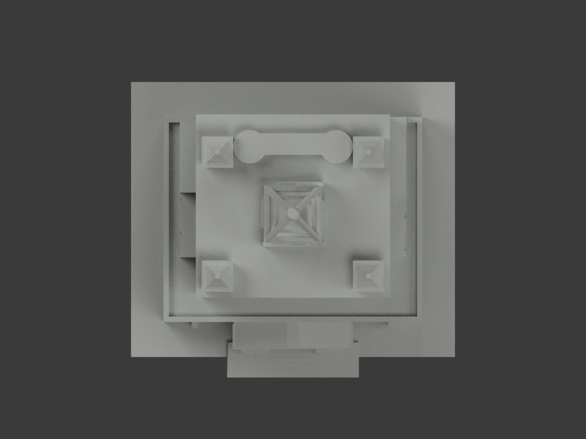
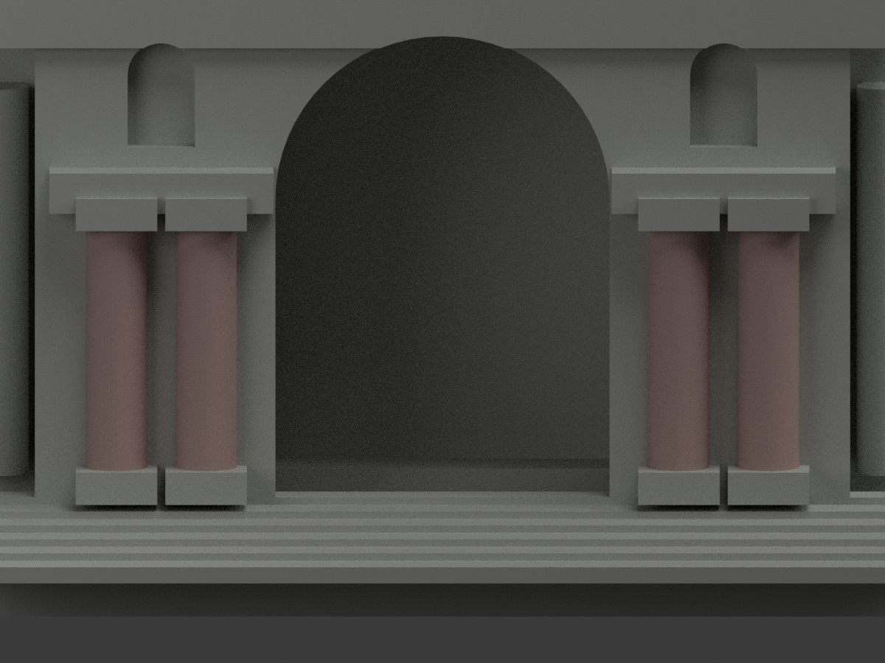
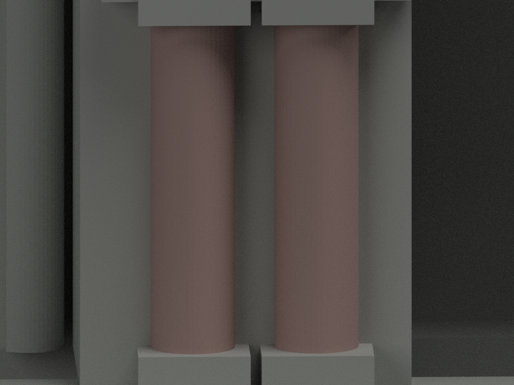
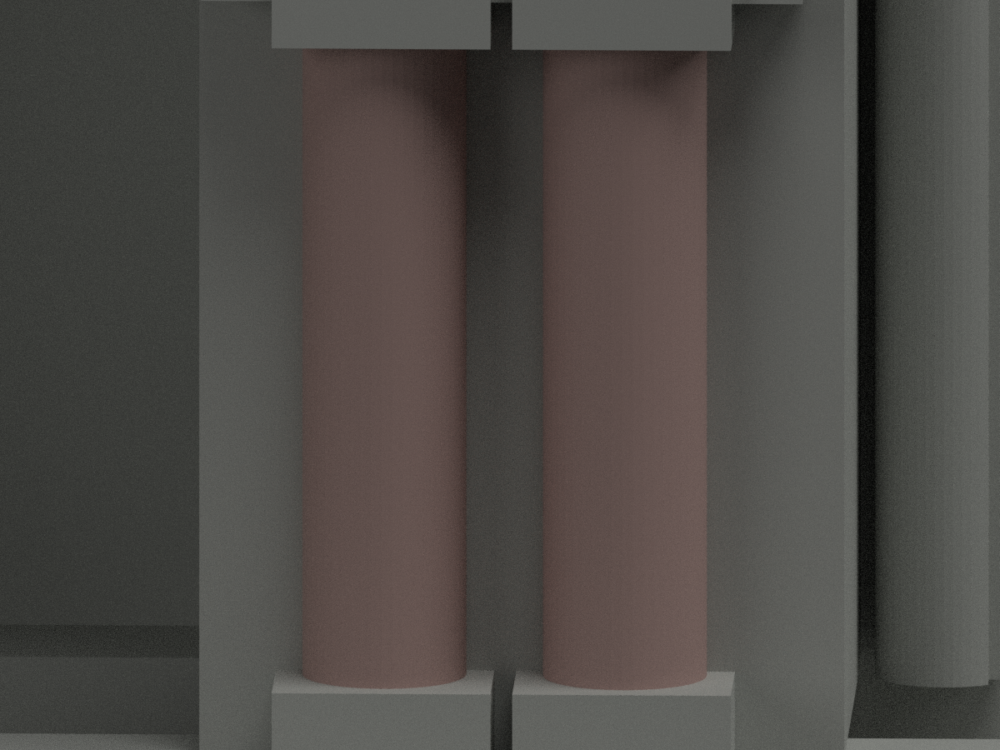

# 建國圖書人文研發大樓｜四入口柱身外露側返同材質延續

## 模型預覽

| 前斜視 | 後斜視 | 正面 |
|---|---|---|
|  |  |  |
|  |  |  |
|  |  |  |
|  | | |

## 本次四入口柱身完整外露側返延色

只將原四柱柱身尚未著色的 144 個原三角，延用既有粉石材 0。原正前象限 96 面與兩槽色盤全保留，現 240 面粉石材、11,178 面未確認中性；不是全大樓完成配色。11,418 原面／5,693 原點、原 STL bytes、面序、繞向與座標全部不變。原外包尺寸約 105×95.8999977×130.1125031 mm；沿用原作者 1.75 mm/名義公尺，不重新標尺、不稱實測比例或 150 mm 高。一個原大樓，同項 count_delta=0。

域為四個既有 48 邊柱身：原柱中心 x=[−8,−5.8,5.8,8]×1.75 mm，y=−42 mm，半徑 1.3125 mm，z=6.125…16.625 mm。原門廊實心體前界 y=−41.65 mm 已吃掉後段；不補造被嵌入的圓柱背面。每柱新增 18 個既有弦面，各兩三角、四角完整有界矩形，包括兩個被原門廊截短的弦面。逐全頂點、法向、有限切向、上下界、完整共面連通域核對，不只看面中心、不切三角。新增原面積 116.2849913544 mm² 對解析 116.2848096319 mm²，容差限於既有 float32。基座、柱頭、橫梁、山牆、深色拱圈、主牆窗、屋頂及頂冠全不變。

本輪親看校方官方入口大圖 https://www.ctu.edu.tw/var/file/0/1000/img/1387/523803785.jpg ，四根柱身可見側面延續粉色石材，與白石牆／深色拱圈區分。未見方位仍是同柱材質延續推論，不是每個弦面的獨立照片標定。原簡化柱沒有照片凹槽，不增造凹槽；既有名義色不是校準色票。照片實際日期未知，下載日不等拍攝日，不宣稱 2026 現況。來源原圖只私人參考，不入公開包，無照片貼圖。

原嚴格工程例外全部保留，不能以本次材色／交換 PASS 改寫 component 或 surface false。四冠腳向下控制 1.4874984741 mm 未達 1.75 mm；作者 83／獨審 215 短首弦、24 條 0.7424642782 mm 首段後 0.0048272640 mm 真空氣間隙都不消失；328 是跨層高損抽樣，不是 328 構件。指定根接有限證據不是全域壁厚保證，不稱免支撐、可任意縮小、完成切片或實體試印。原角亭頂端／球冠／山牆簡化與所有原 QA/source 繼續有效。

現版核對根 color-mesh.npz、appearance.3mf、scene.blend 與十張 PNG；新 QA 在 qa-continuous-column/，現 hashes 為 CONTINUATION-SHA256SUMS。原 source、QA、checksum、manifest、ORIGINAL-PREVIEW 與下方歷史文字皆保留；其 96 面及前四分之一數量是舊版本，不作現版配色統計。新 3MF 使用精確原 float32 座標十進位與合法預設材料欄位，strict 零警告不等於製造保證。Blender 保留一個建築網格及原隱藏說明／背板（非列印幾何）。

重建 python continuous-column-source/build_continuous.py；交換驗證 verify_exchange.py；Blender 執行 render_continuous.py，再執行 strip_previews.py 及 Blender verify_scene.py。rebuild-continuous-source.zip 隔離重建 NPZ／3MF／原色盤完全一致，不含私人照片。此為本地交付準備，不聲稱已上傳。

場景同步更新三項原屬性：source_mesh_sha256 對應新材質指派檔、scope 說明原 96 面保留與新增 144 柱身面推論，以及 scale 文字勘誤。原 build_model.py 第 115 行明確以 1.75 mm／名義公尺輸出，draft-parameters.json 同載此尺度；原 STL 實際 105×95.8999977112×130.1125030518 mm，原 independent-review.md 已明示規格為最大邊≤150 mm、沒有為湊150縮放。因此將含糊 independent150mm 標籤改為原作者尺度說明，不變換座標、不重新標尺、不宣稱實測比例。其餘原屬性、全部材質定義與幾何不變，palette.json 原 bytes 保留。未知建築後側中性與所有原嚴格工程例外仍有效；component／surface false 不因補色改寫。

本頁為現行說明；根 README.zh-TW.md 與 SHA256SUMS 保留歷史 bytes。完整現行校驗以 CONTINUATION-SHA256SUMS 為準。

## 前版說明與保留限制（完整歷史文字）

# 建國圖書人文研發大樓｜四入口柱前皮局部粉石色

**局部補色未完成：只四入口圓柱正前 1/4 的 96 原三角名義粉石色，其餘面尚未分色。** partial_color_incomplete=true、fully_colored_exterior=false。同項 ctu-library-humanities-2002／count_delta=0，建國科技大學校本部。身份 CTU Library Humanities 2002 partial color。

**這是來源材色批准，不是全幾何或列印 QA 通過。原嚴格 component／surface false、有限例外與未試印限制完整保留。** 四冠腳向下控制實際 1.4874984741mm 未達要求 1.75mm；作者83/獨審215短首弦、24條0.7424642782mm首段後0.0048272640mm真空氣均不改寫。328為跨層高損樣本而非構件數。原獨審只接受指定根接有限證據，不能保證全域最小壁厚、免支撐或任意縮小。詳見未修改的 [原獨審](independent-review.md)。

## 材色範圍

原四柱中心 x=-8,-5.8,5.8,8m，y=-24m、半徑0.75m、48邊，原尺度1.75。只k30..41共48個完整有限chord立面，每域2三角，共96。以原三頂點plane/tangent與原union露出z6.125..16.625mm核，不用normal/centroid漏面；不造照片凹槽。柱基/帽/側後、黑邊拱/有字門楣山花、混框反光玻璃、主牆/露台/亭屋/鋼冠全部未知中性。資料界線不代表真實材料接縫，中性不是已證實現場灰。

原11418三角不改，96名義粉石色#BBA09A、11322未知中性#B8BAB5。不是精確石種/色票，兩外航拍只補身份與全貌，不擴柱全周。

## 原件與限制

42 immutable 原件無OBJ；原code也不因本次補色生成新原件聲稱。原STL/build、原qa-summary/validation/independent-review及所有原false值原樣保留。原README.md另存ORIGINAL-PREVIEW-README.md，原scene公開別名ORIGINAL-PREVIEW-scene.blend及私存全包，原renderer/previews不改。原實際scene單展示材不等於已驗精確實景色。

原四角亭/冠球/山花截尖與加粗近似保持，不加厚、尖化或改善原網格。來源capture未知，網站URL/發布日及2017/2023正射影像年代不構成同一時點或2026現況。照片只私存不公開貼圖。

## QA範圍

本次只檢原字節/三角multiset不變、共面一致、材色格式、隔離原build+color重現、3MF/reopen與十張1200×900。新同幾何identity PASS不是舊strict false變PASS；不重新執行或追認全域厚度/列印認證。隔離重建保留不刪，未試印/多料切片；STL無色。原有限例外需試切片、適當支撐與小心拆支撐。

CTU Library Humanities 2002 partial color. Only the front quarter of four existing 48-gon entrance shafts receives nominal pink stone: 96 original triangles; 11322 unknown neutral. Original 11418 triangles and all 42 immutable files remain unchanged, no original OBJ exists. No fluting or geometric repair is added.

SOURCE-COLOR APPROVAL ONLY. Format and unchanged-geometry identity checks do not certify all original geometry or printability. Original component/surface strict false values, downward crown-foot control 1.4874984741mm versus required 1.75mm, author83/independent215 short first chords, and 24 first segments of0.7424642782mm followed by a real0.0048272640mm air gap remain unchanged.328 means cross-layer samples, not structures. Original finite-root exceptions do not establish global minimum thickness or support-free printing. Retain flattened lantern/crown/gable approximations and no physical-print limitation. Consult unchanged independent-review.md and original structured QA. No2026/single-date survey claim; no public source photos; count_delta=0.
