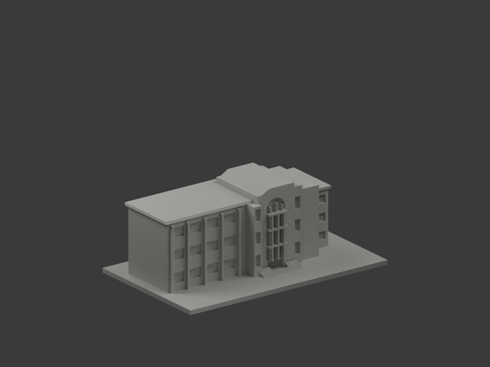
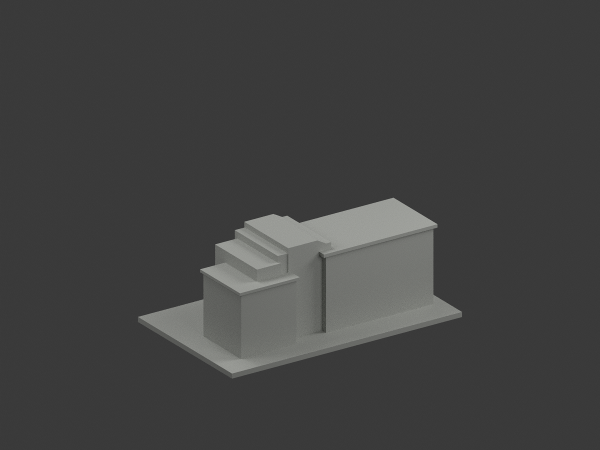
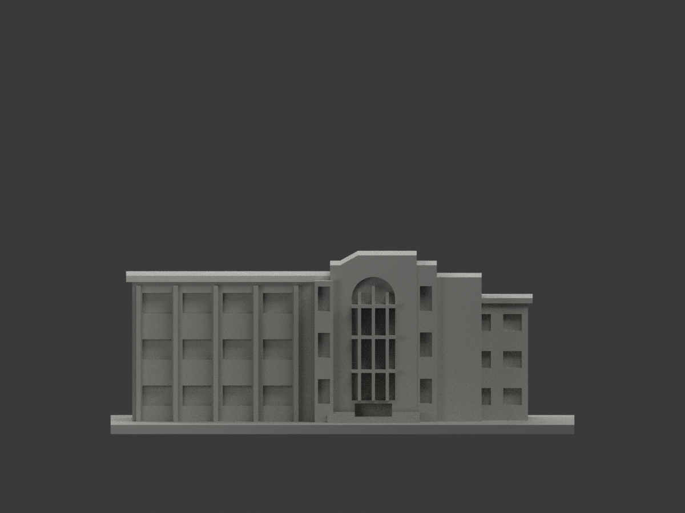
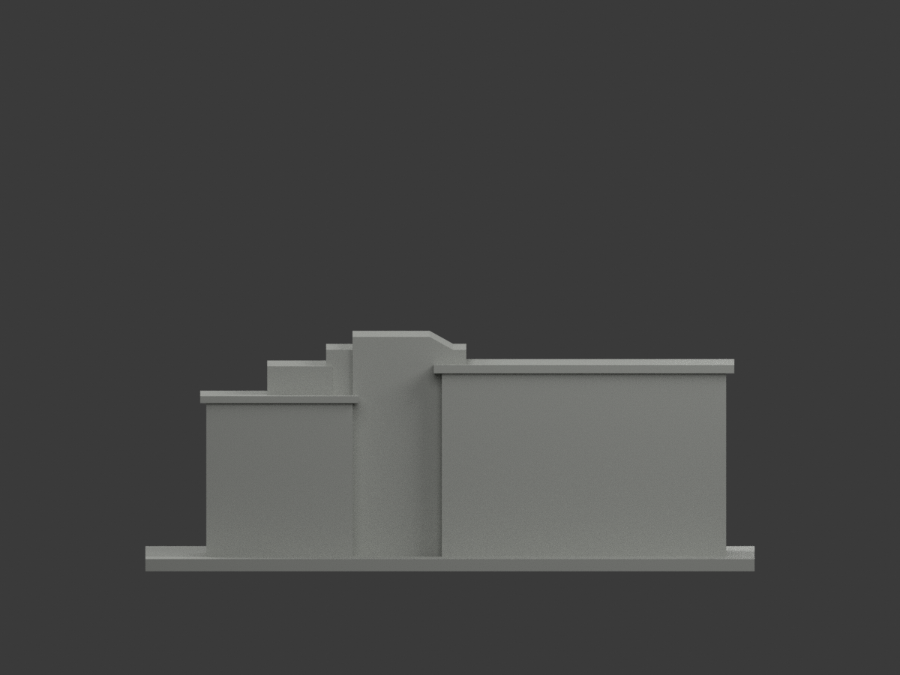
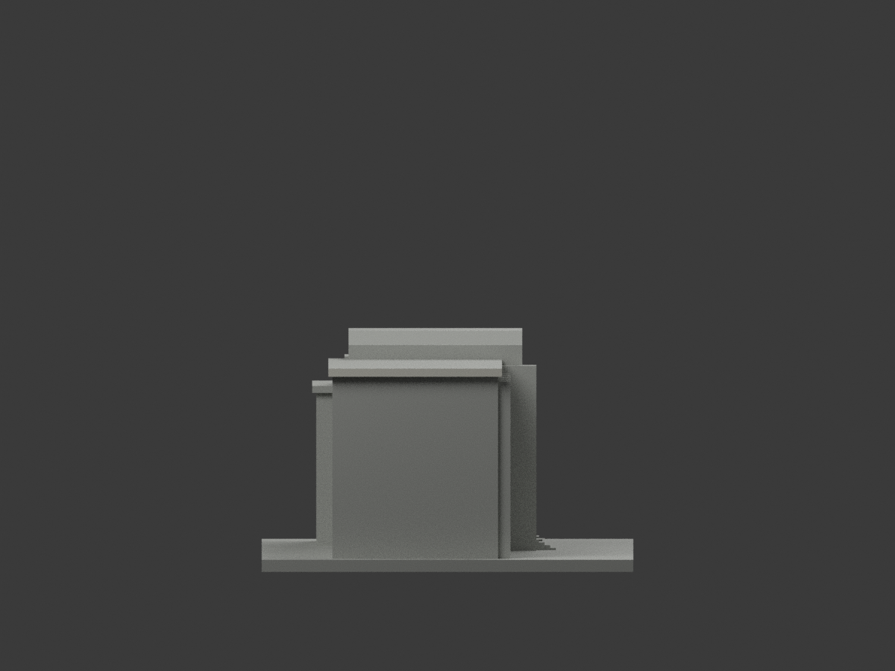
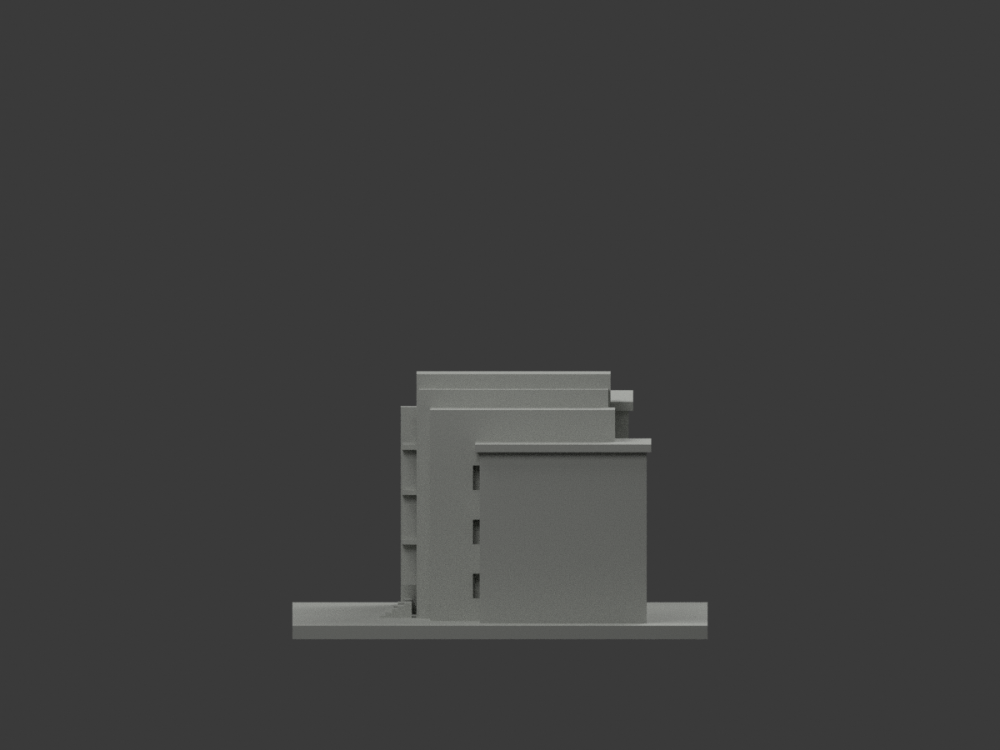
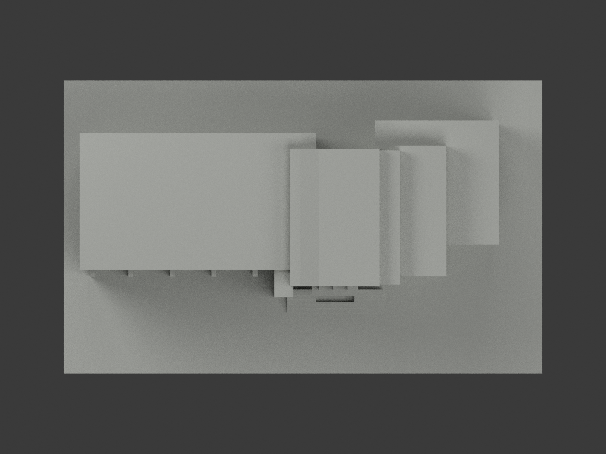
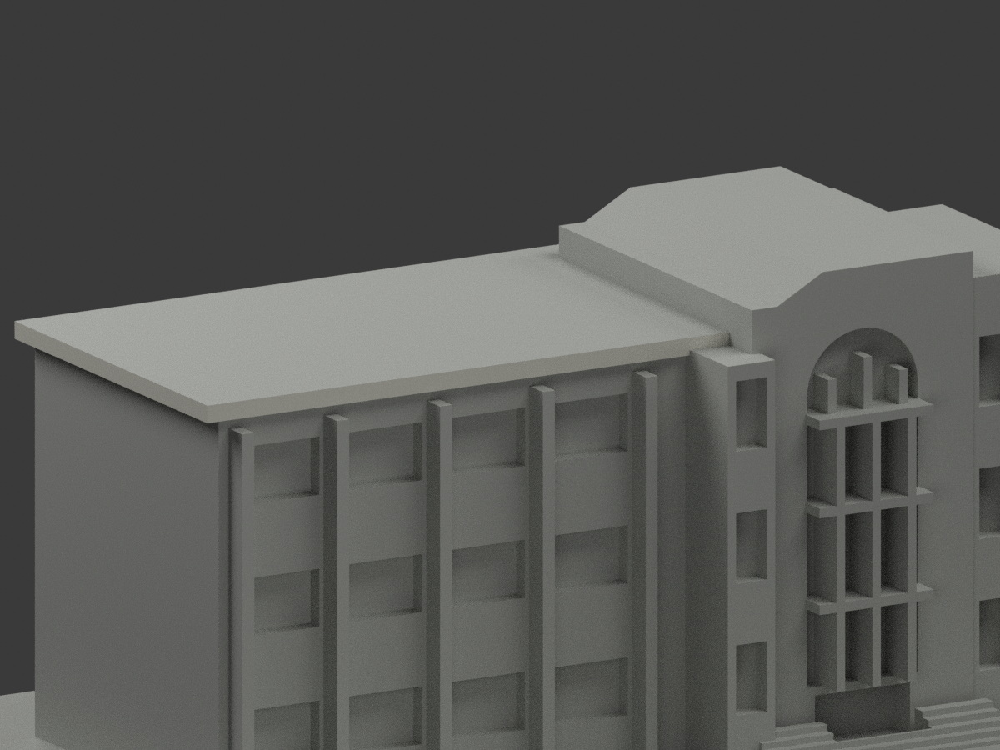
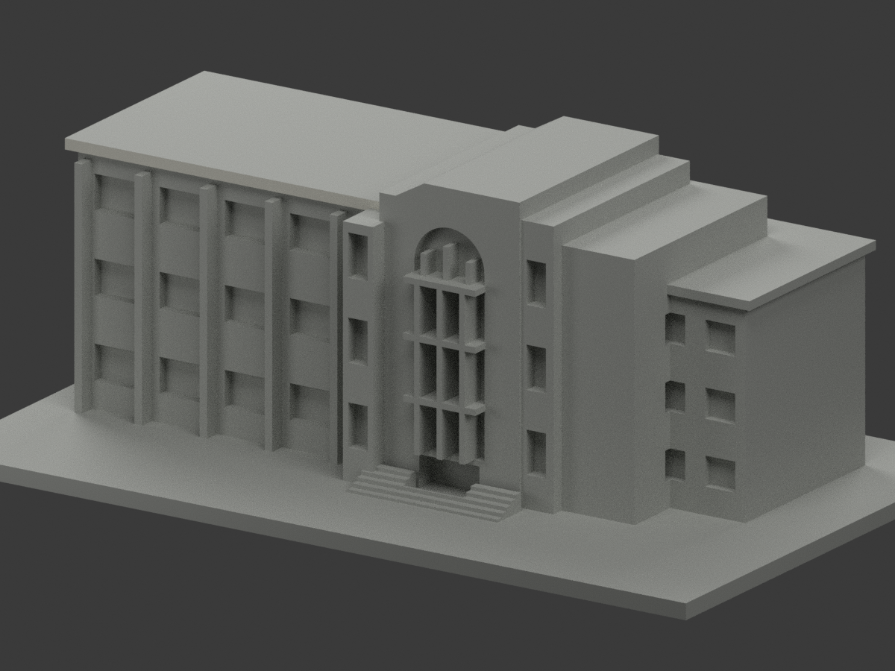
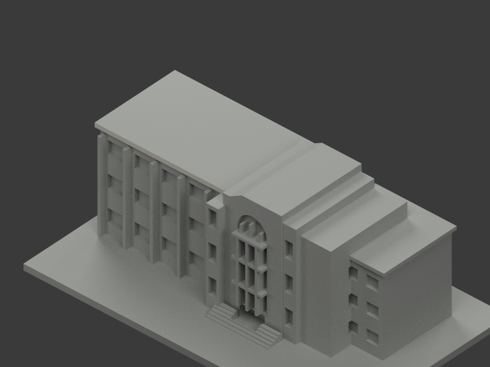

# 弘光 A 行政／舊教學群｜左屋緣端面同材質延續

## 模型預覽

| 總覽 | 背側 | 正面 |
|---|---|---|
||||
||||
||||
||||

## 本次弘光 A 左翼屋緣端面補色

僅將既有左屋 cap 的最左側端面 2 個原三角 [1094,1095] 延用原暖白色槽 0；原 4 個白面全保留，其他 1,208 面不變。新版 6 白／1,204 未驗證中性。中性槽 1 明確為 UNVERIFIED，並非把具名混凝土視作未上色。原 607 點、1,210 三角、面序、STL 與色盤 bytes 全保留，不切面、不改幾何；A 行政／舊 A 教學群為同一原項目，不增加棟數。

唯一新增域 x=−70、y=−13.5…29.5、z=48.2…50.2 mm，外法向 −X。全部原頂點在有限邊界內，兩原三角完整覆蓋四角矩形，解析面積 43×2=86 mm²，與三角解析面積相同。域等於完整共面連通分量，2 mm 前邊完整鄰接原白面，324 個共面域全維持單材，不以中心點截取或補新碎面。

本輪親看校方行政單位頁原照，SHA 符合原登記。照片中央拱窗、紅肩、左長翼及 A 教學大樓導覽牌辨識同群；左長翼最上窄屋緣及受樹遮的端角呈白色族。模型側端完整 43 mm 進深沒有在照片中全見，這一段明確採同一屋 cap 的同構件色族延續推論，並非全側面獨立實照確證。原粗化實心 cap、厚度、進深與未建細接縫不因補色獲得實測認證。2021/01 是圖片上傳路徑，不是拍攝日；不宣稱 2026 現況、精確 HEX 或校準材質。

屋 cap 頂面不推為立面同色；底面照片可見暗槽／陰影，故不塗白。後緣 y=29.5、右端 x=4 未與原白前緣直接相鄰，也不連鎖擴色。紅肩、金徽、混色教室牆、玻璃、窗洞、中央群、右低翼、未知背面、台階基座全不變。仍是局部補色未完成，非施工圖、非測繪模型，未實印或驗證多料切片。STL 本身無色。

來源原照只私人研究，不入公開包、不作貼圖，不推定再散布或商用許可。舊 QA、來源、原建模及舊補色程式、舊校驗表保持原 bytes；下方原文件「4 白面／只正面」屬歷史版本範圍。新版 QA 在 `qa-continuous-walls/`，新版校驗表 `CONTINUOUS-CAPEND-SHA256SUMS`；root scene 與十視角 PNG 更新。

新版入口 `python build_continuous_capend.py`、`python verify_continuous_exchange.py`；Blender 使用 `render_continuous_capend.py`、`verify_continuous_scene.py`。`rebuild-continuous-capend.zip` 包含固定 SHA 原公開 baseline、STL、面域與新腳本，隔離解壓精確重建 NPZ／3MF／palette，不含私人圖片。原 `colorize_model.py` 與 `export_appearance.py` 僅保留歷史，不用於新版。3MF 保留原 float 座標，strict 讀入精確核對；臨時材色編輯往返及 Blender 改存重開另有 QA，不替代交付原幾何。

場景僅同步更新 source_mesh_sha256 以對應本次含兩面材質指派變更的 color-mesh.npz；原 scope 與全部其他原屬性、全部材質定義及幾何不變。原粗化實心 cap、未知建築後側中性、攝影日期未知及未實印等限制完整保留；新增端面明示同構件材料延續推論，非完整側面獨立照片證實。兩槽 palette.json 原 bytes 完全保留，既有槽名僅描述原前緣觀察，不代表新端面逐面直接實證。

本頁為現行說明；根 README.zh-TW.md 保留舊版本原文及原 bytes，僅作歷史記錄。

## 前版說明與保留限制（完整歷史文字）

# 弘光A行政／舊教學群｜左頂前帶局部白

**紅肩、窗牆與其餘材域未完成分色。** partial_color_incomplete=true、fully_colored_exterior=false。僅左長翼屋cap前面4原面名義白，非全棟完整補色。

## 材色範圍
同 hku-a-administration 原項目，same-item、count_delta=0。1210原三角面、STL與build_model.py字節不變。弘光科技大學校本部A行政／舊A教學是同一群，舊新名稱不另拆棟計數。右低翼未由本張實照核材。原公開包無OBJ，不假稱保存不存在的原件，程式可產生不代表原包存在。
- 原左屋cap add(−33,8,48.2,74,43,2)完整前平面y−13.5，原x−70..4、z48.2..50.2，4原Boolean三角名義暖白。
- 全三頂點有限plane核，整無限plane全部4原面等於有限域；左紅肩合併讓近端底抬至48.8、中央量體遮至x−4，這是原Boolean邊界非人工材色裁線，全部碎面保留、不補三角缺口。
- 其餘1206中性：中央白面跨下部門／樹遮、左紅肩缺真下門洞、右紅肩金徽無獨立面，均不能整塗白紅；教室牆混紅白，弧窗背混棕填板／反光／框，細通風口及所有窗背、屋頂／側／底、右低翼、階與未知背均不硬染。
- 原粗化群體／拱與右翼形狀不因補色被追認為實測。材色／中性分界表證據範圍非真實材縫。不新造徽字／細通風／門窗界。

## 來源與日期
親看校方已建成外觀實照，左翼最上前帶白色有據；原preview只供面域對照，不作右低翼色證。拍攝日未知，不宣稱2026現況。
原照私人參考、不公開、不貼圖；未確認CC或再散布授權，不保證商用。HEX為名義白族非校準色票。正式GO已發行，繼承的先期review-only文字不改狀態，仍須builder QA。

## 格式與列印
[原STL](model.stl) · [逐面材色3MF](appearance.3mf) · [Blender](scene.blend)
原150×92mm展示底座，照片近似非測量比例。STL無色；3MF／Blender有真逐面材。兩材標籤不是驗證兩色／四色耗材切片，未實際列印，無切片路徑。

## 重建與 QA
原build_model.py → colorize_model.py → export_appearance.py → validate_color.py；Blender render_color.py／verify_color_scene.py。完整隔離原build＋color重建、原bytes／全三角multiset、閉合正體積、3MF逐面材、scene重開、十圖1200×900及圖文hash。原依賴隔離使用，不改原碼；程序不替代人工來源核對。
原README／previews／validation／renderer保留歷程，不冒充新QA；沒有刪檔。

## English scope
Partial only:4original Boolean triangles onthe whole leftwing roofcap front,nominaloffwhite;1206neutral. Original1210triangles unchanged,no originalOBJ. Hungkuang A administration/formerAteaching samegroup,count0;rightlowwing unverified. Entire infiniteplane equalsoriginalfinite domain;shoulder/centralunion boundaries retained. Mixedred shoulderswithdoor/emblem,centralwhitewall,windows,roofskins andotherwalls neutral. Captureunknown,not2026condition. Not fullsurvey,testprinted or validatedfilament slicing.

## 版本 2 名稱勘誤

3MF 與 Blender 物件顯示名稱統一更正為「HKU A Administration partial color」，並同步匯出、渲染與驗證程式的名稱。場景重新開啟與保存後，除物件名稱及非渲染執行期記錄外，網格、材質、變換、相機、燈光與字幕語義完全相同；場景檔案雜湊因此更新。原 STL、材色陣列與十張預覽位元不變，未重新渲染。原有局部補色及未試印限制不變。
