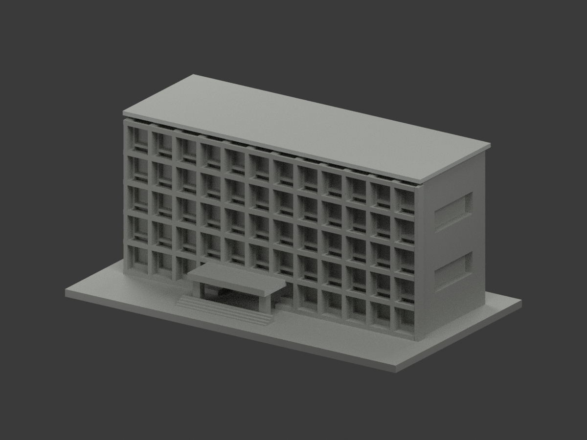
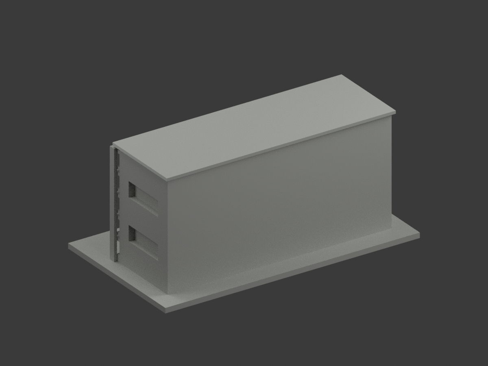
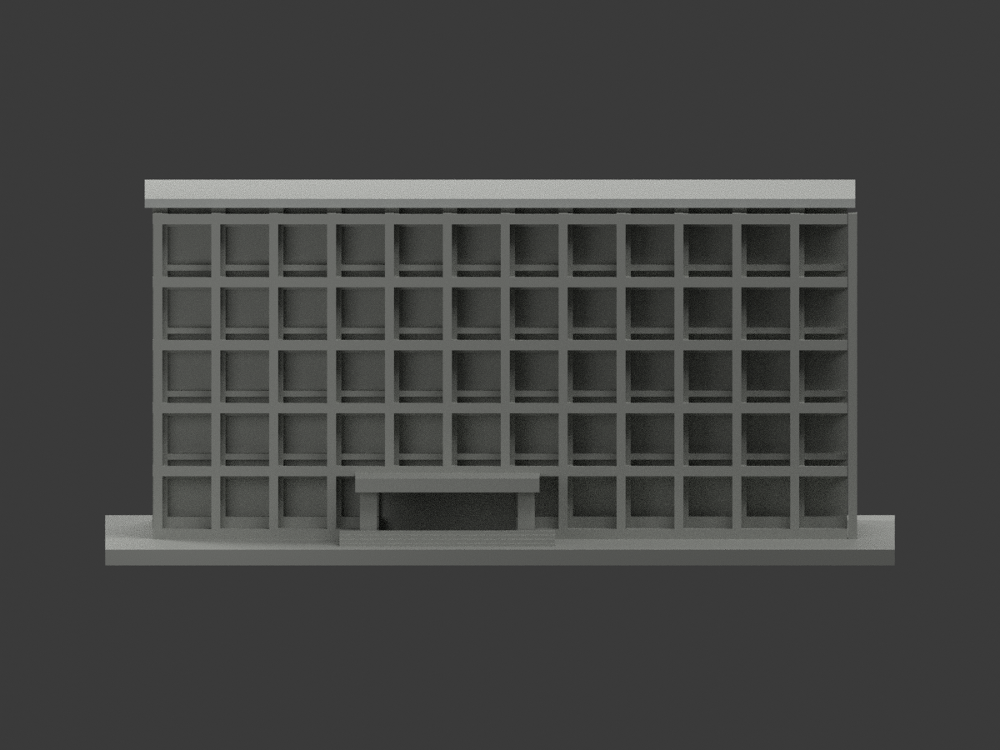
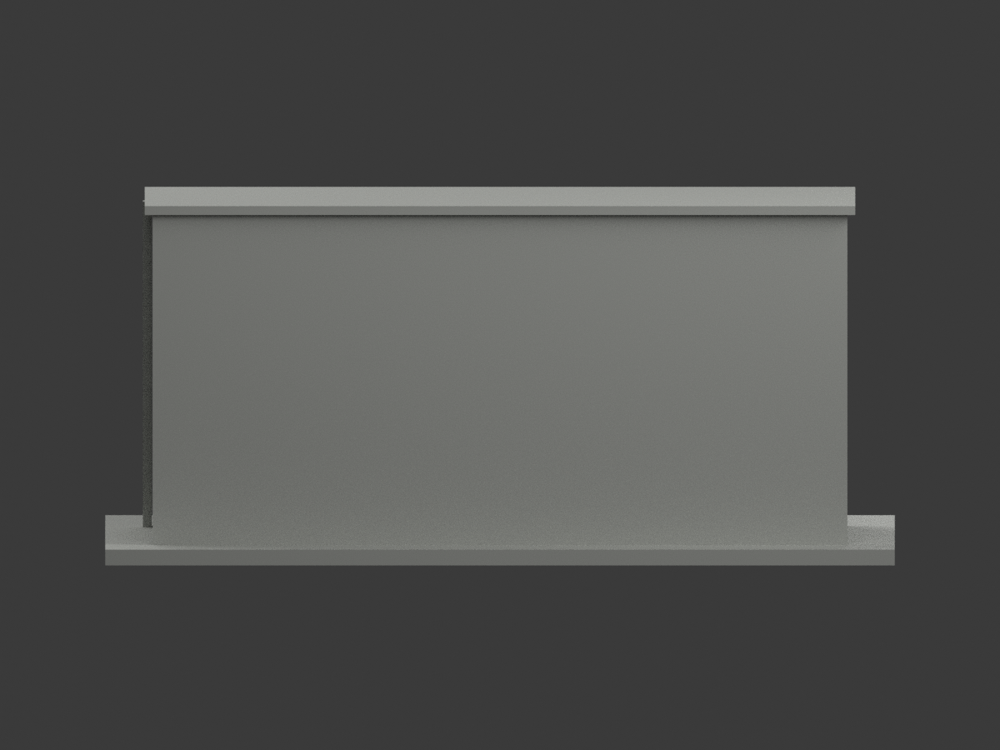
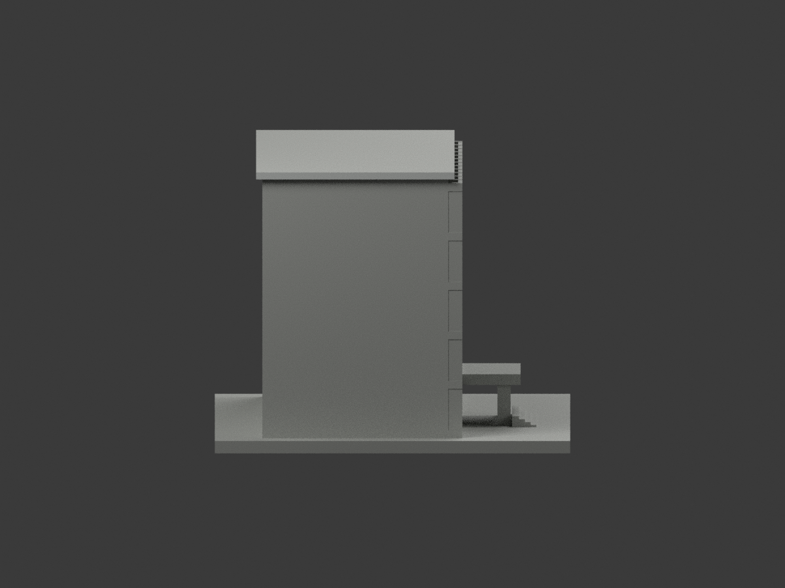
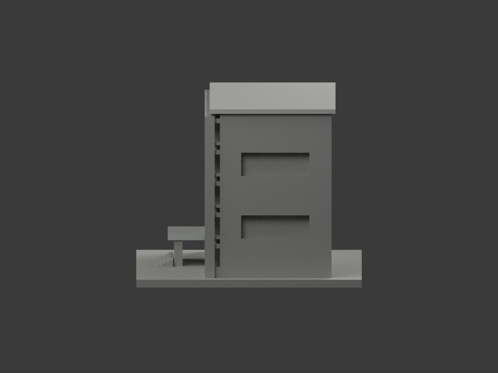
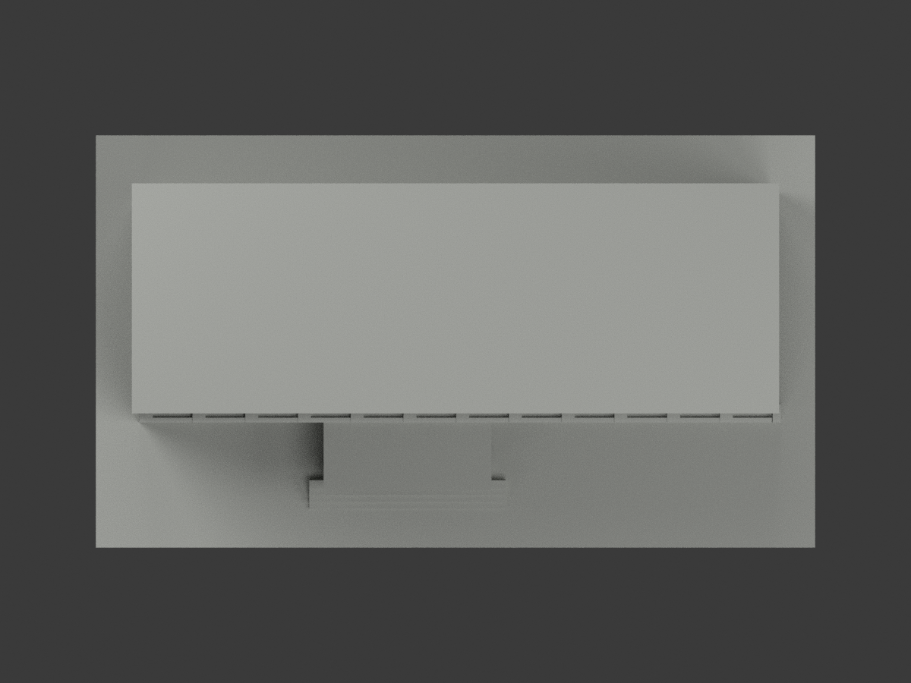
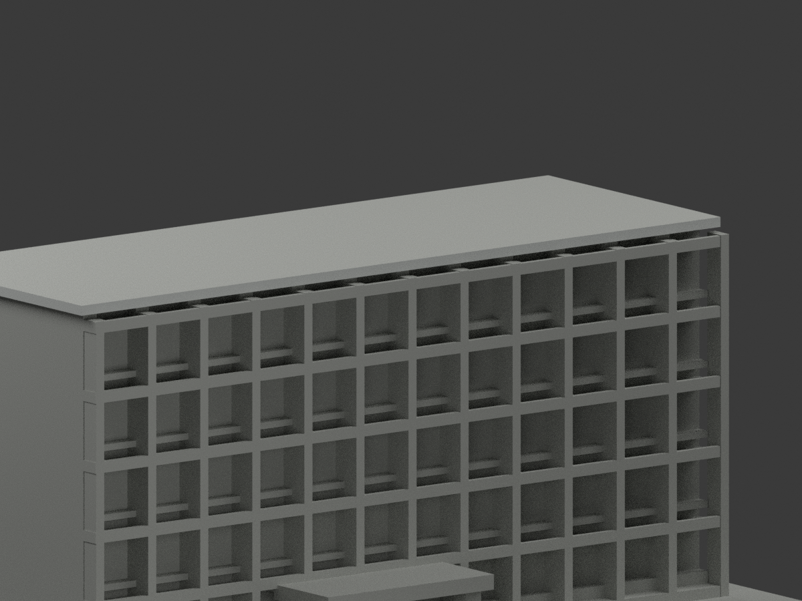
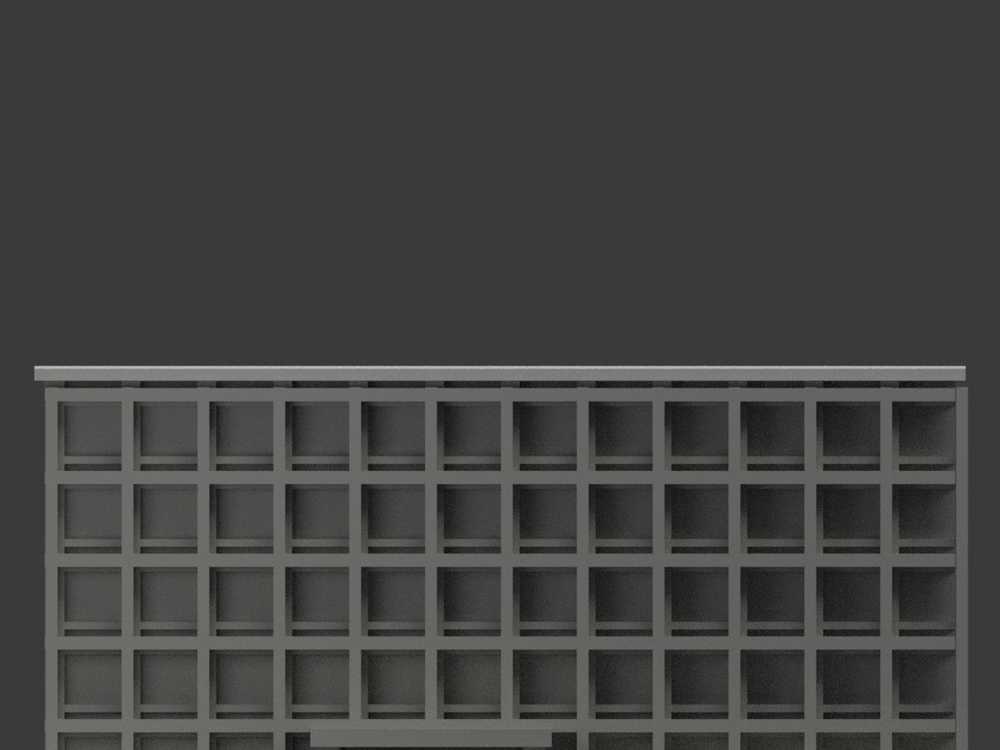
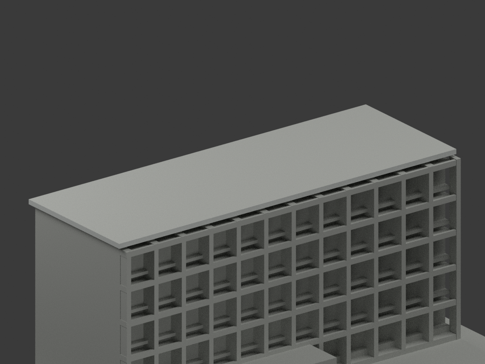

# 弘光 D 食品科技大樓｜最高屋帽兩側端同材質延續

## 模型預覽

| 前斜視 | 後斜視 | 正面 |
|---|---|---|
|  |  |  |
|  |  |  |
|  |  |  |
|  | | |

## 本次弘光 D 食品科技大樓屋頂帽側端補色

固定 current root 8 個已灰原面作 baseline，包含原屋頂帽前緣 2 面及既有入口右返 6 面；不回退舊 2 面分類器。只將最高屋頂帽兩側完整矩形／4 原三角 [4093,4095,4104,4107] 延用原淺灰槽 0，新版 12 灰／4,146 未驗證中性。其餘 4,154 面逐面不變；槽 1 明確 UNVERIFIED，不將具名實材當中性。原 2,077 點、4,158 三角、面序、STL bytes 與 palette bytes 完整保留，不切面、不補幾何、不新增棟數。

兩側有限域分別 x=−67.5 與 x=67.5，皆 y=−15…33、z=66…67.69999694824219 mm，外法向分別 −X、+X。每域兩原三角為完整四角矩形，等於整個共面連通分量；全頂點、法向及前方完整 1.7 mm 原灰共同邊皆核對。每側名義面積 48×1.7=81.6 mm²，原 float32 點形成 81.599853515625 mm²，兩側合163.19970703125 mm²；每域採 0.0002 mm² 容差，不 round 原點。957 共面域皆單材，無人為切面或中心點選域。

本輪親看師大大學博覽會頁刊載的校方照片 pic03，入口「食品科技大樓」字樣、長矩形主棟及格網對應 D；左側 N 圓弧塔與前景雕塑不是本件。照片最高屋頂帽前緣屬淺灰族，但左右完整 48 mm 側深並未全由照片看見，只採同一原屋頂帽材料族延續推論，不稱全深實景確證或測量。照片拍攝日未知，查閱日不當拍攝日，不宣稱2026現況、精確 HEX 或校準色票。

現有入口右返 6 灰面、其止界及來源 pending 歷史字樣全部保留，不改寫歷史 QA／GO，也不重跑較舊分類器。最高帽頂面、底面、後緣、屋欄、字樣入口正面、白格架與紅棕板、玻璃、廣告看板、主牆、台階基座及未知側背全不染；不是把整棟刷白。原屋帽深厚、格架、窗帶與構件皆粗化近似，補色不追認精測，不新增缺失文字或細界。

仍是局部補色未完成，非施工圖／測繪模型、未實印或驗證多料切片，STL 無色。原參考圖片私人研究，不入公開包、不作貼圖，不推定再散布或商用權利。原 pending 來源、QA、建模／舊補色程式和校驗表皆保持原 bytes；下方 8 灰／更早 2 灰限制是歷史範圍。新版 QA 為 `qa-continuous-walls/`，校驗表 `CONTINUOUS-ROOFCAPENDS-SHA256SUMS`；root scene 與十視角更新。

full-float 3MF strict 讀回精確對原 STL，隔離材色編輯往返、Blender 材質／頂點改存重開及 preview 逐 bytes 重渲染另有 QA。新版入口 `python build_continuous_roofcapends.py`、`python verify_continuous_exchange.py`；Blender 使用 `render_continuous_roofcapends.py`、`verify_continuous_scene.py`。`rebuild-continuous-roofcapends.zip` 含固定 SHA 的 current8 baseline、STL、面域與新腳本，隔離解壓精確重建 NPZ／3MF／palette，不含照片；舊入口只供歷史，不可用來回退已有色。

場景僅同步更新 source_mesh_sha256 以對應本次含四面材質指派變更的 color-mesh.npz；原 scope 與全部其他原屬性、全部材質定義及幾何不變。固定遠端原 8 灰面全部保留，包含入口右返 6 面，不回退歷史 2 面。原粗化屋帽、未知側背中性、來源 pending 歷史、攝影日期未知及未實印等限制完整保留；新增兩側端為同構件材料延續推論，非完整側面獨立照片證實。palette.json 原 bytes 完全保留，既有槽名不代表新域的獨立實測色票。

本頁為現行說明；根 README.zh-TW.md 保留舊版本原文及原 bytes，僅作歷史記錄。

## 前版說明與保留限制（完整歷史文字）

弘光 D 食品科技大樓｜入口庇右立返有限補色

僅原6面[4039,4043,4049,4050,4052,4053]完整單域，x7.5、y−31..−13.5、z13..15.6，原2屋帽前白保持，合8色／4150中性／4158原面，0混材共面連通域。原兩palette精確保持，roof cap歷史名稱沿用於名義#D3D6D3淺白灰族，非同物料實測。原STL/build及未選索引不動，原公開包無OBJ，不新增。

新讀官方112招生PDF第38頁內嵌425×484照片，右庇直立面與前金字／下暗底可分；111版同構圖非獨立拍攝證據。新讀來源非新拍，拍攝日未知，不稱2026現況。原35×18×2.6盒體和後端Boolean是粗近似，不認證厚深或像素逐點；只准右平面淺白族，不拓前字面、頂底、左返、柱、廣告遮格網、窗背、屋側後及鄰N/F。來源照片私人，不公開；未多料試印，工程限制及aliases保留。SOURCE pending審後不改，final獨審另綁精確hash。

## 原版歷史說明（下列舊數量屬前版）

# 弘光D食品科技｜頂帽前帶局部白

**局部補色未完成：只頂帽前帶2原三角淺白；框架窗與其餘未完成／不含N圓塔。** partial_color_incomplete=true、fully_colored_exterior=false。同項hku-d-food-science／count_delta=0，弘光科技大學校本部；D食品科技不等於F餐旅，也不包含左鄰N圓塔。

## 材色範圍

先枚舉原y−15整個無限plane，所有三頂點容差0.0001mm；恰2面共邊單component，完整覆蓋原x±67.5、z66..67.7矩形。不是截一半面或按normal/面心判定；2白、4156中性，957原共面連通域uniform，原4158三角與頂點不變。

頂帽前窄帶有白色族證據；不外推屋上面、側邊、背面。大格架右側有巨幅廣告、底部植栽遮蔽，整個原連通格架中性，不把廣告當白結構，也不隨意只截左側原三角染白。窗洞背板混酒紅窗間板、框、玻璃、冷氣，整體中性。入口棚含金字，無原材界不整白。原右側陽台凹口無本照色證、階地/未見後面全中性，左N圓塔完全排除。中性不是實景灰，資料覆蓋界不是材接縫。

## 來源與版本限制

親看校方提供外照及原碼/預覽，只支持頂帽前緣名義白色，不模擬污斑/細欄/植物。拍攝日期未知，不聲稱2026現況。原D食品科技五主要樓層與通風短帶近似不因補色追認實測，通風短帶不是新增樓層。原右側/屋背估算保留，不新增設備或幾何。照片私人，不公開貼圖，不推未見CC為商用許可。

## 檔案與 QA

原STL/build與4158三角字節/座標不變；immutable18件無OBJ，原builder雖輸出OBJ，隔離生成只私存，不宣稱原repo有OBJ。原README存ORIGINAL-MONOCHROME-README.md，舊單色previews/QA保歷程。appearance.3mf兩展示材、scene.blend實際面材、color-mesh.npz同原三角。精確requirements隔離build+color、閉合正體積、3MF面材座標/Blender重開/10張1200×900檢核；重建保留不刪，未實際列印或證多色切片。

## English limitations

Partial only:entire y=-15 plane exactly2 shared-edge triangles covering original x±67.5,z66..67.7 front roof-cap fascia offwhite;4156neutral. No centroid/normal/bbox clipping;957coplanar domains uniform,original4158triangles/STL/build unchanged,noimmutableOBJ,count_delta0. Isolated builder-generated OBJ private,not an original repo file. Billboard-covered connected grid,windowbacks mixing burgundy panels/frames/glass/AC,lettered entrance canopy,right balcony pockets,roof top/side/rear and ground remain neutral. D Food Science only,not F Culinary or neighboring N round tower. Unknown capture,no2026survey or geometry recertification. No public source images/textures,not testprinted.
