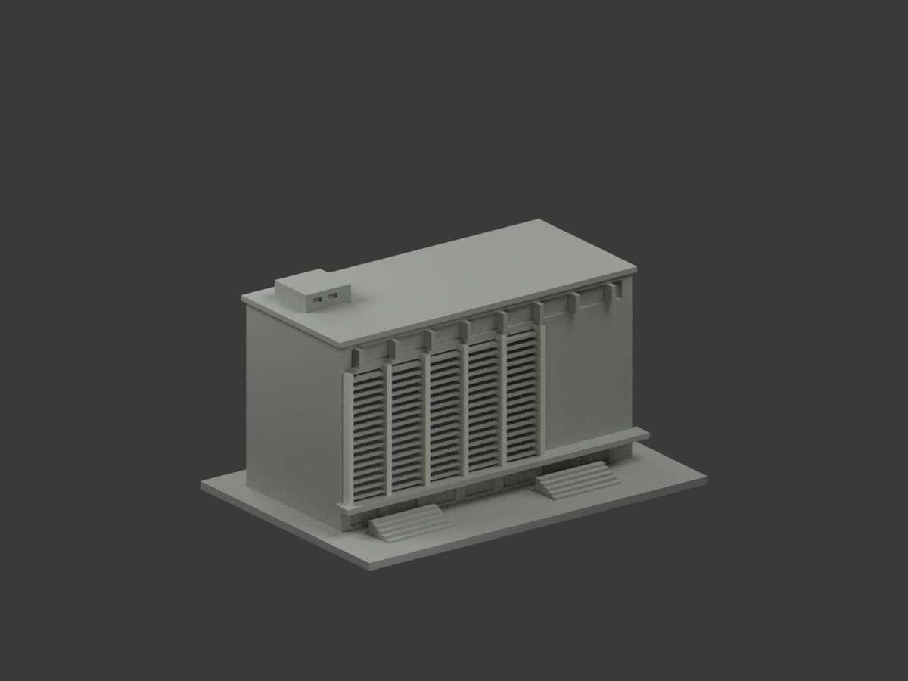
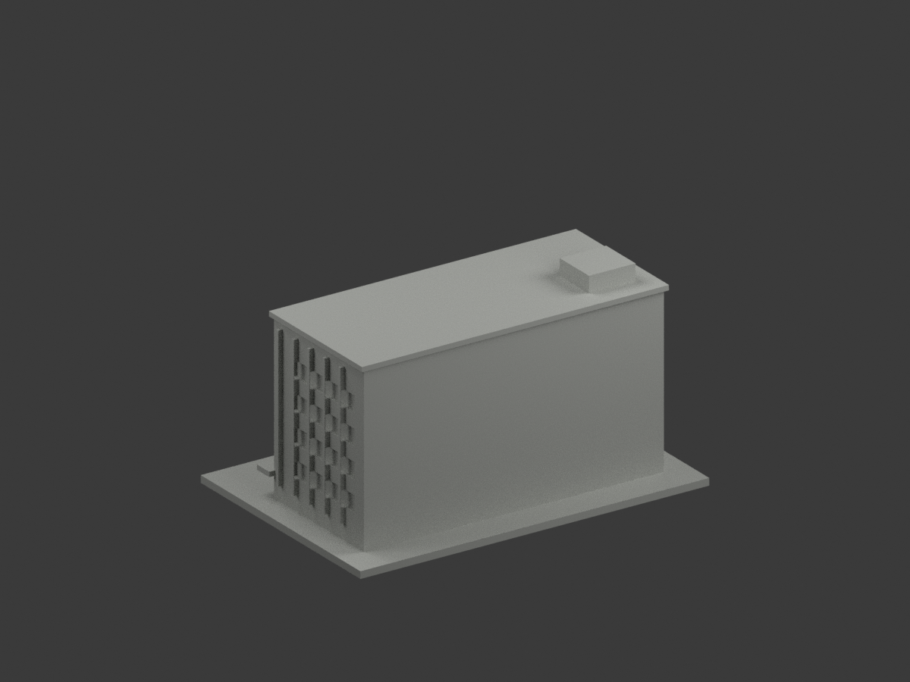
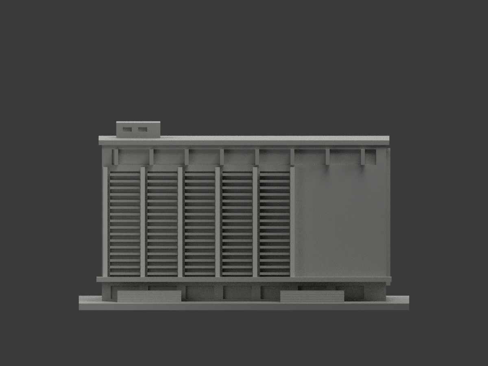
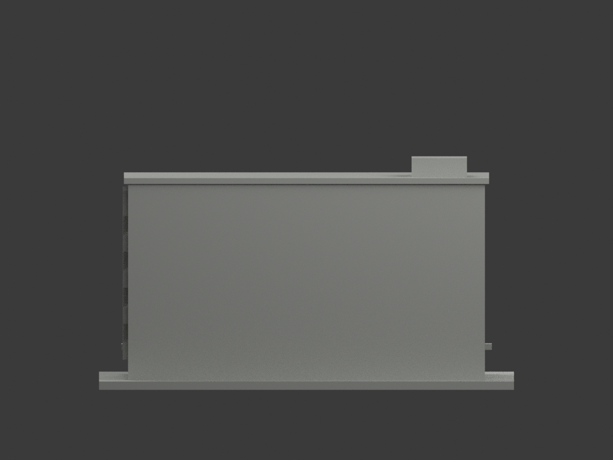
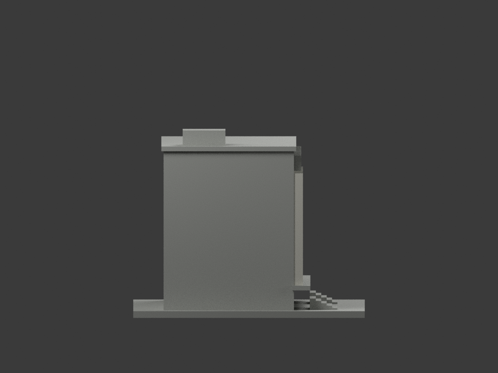
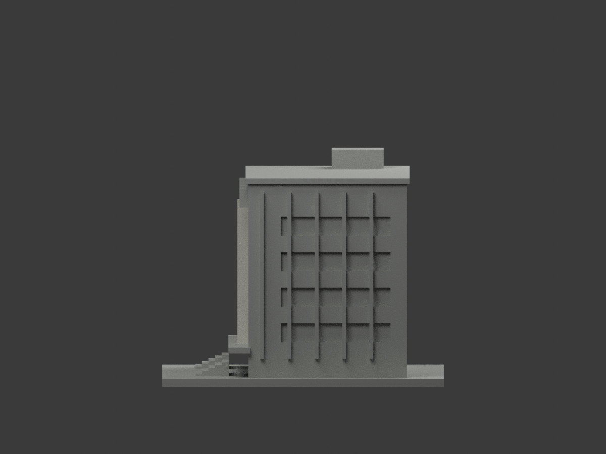
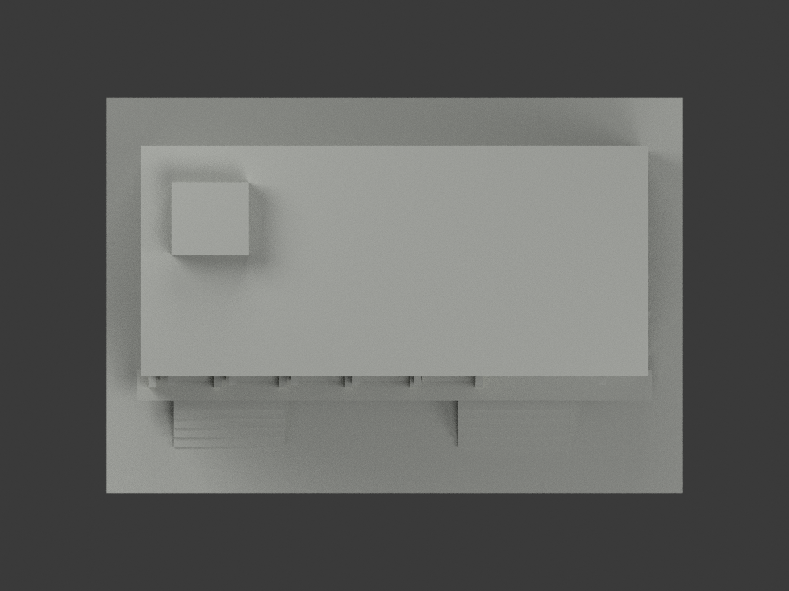
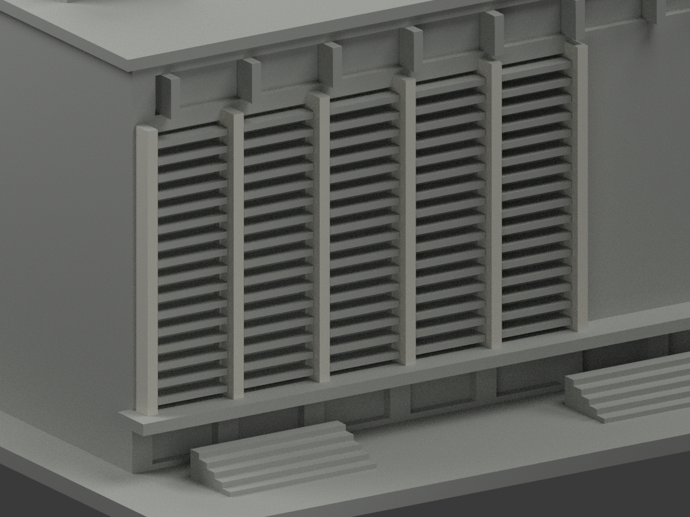
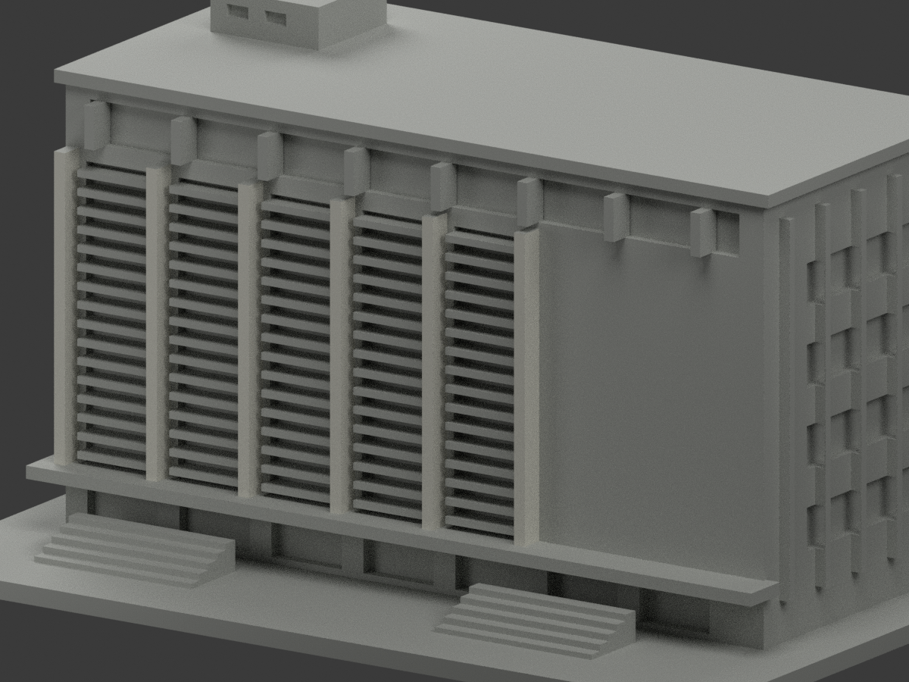
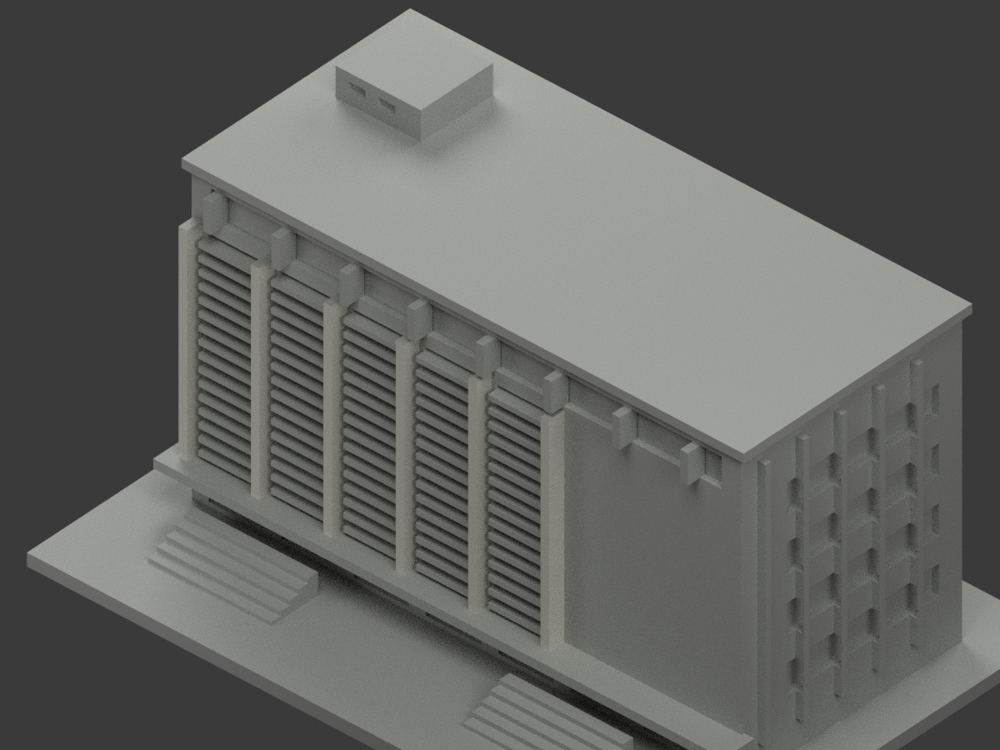

# 弘光 F 食品技藝大樓｜六豎框左右側返同材質延續

## 模型預覽

| 總覽 | 背側 | 正面 |
|---|---|---|
||||
||||
||||
||||

## 本次弘光 F 食品技藝大樓豎框側返補色

保留既有六條豎框白色正面 12 個原三角，只把左右 12 個完整原矩形／24 個中性三角延用原淺白槽 0。新版白 36／未知中性 4,144 面。中性槽 1 原名為 UNVERIFIED，不把已色混凝土當成未上色。原 4,180 三角、頂點、面序、STL bytes 與色盤 bytes 全不變，不切面、不新造細節；同一原項目 hku-f-culinary-arts，不增加棟數。

六框中心 x=−63、−46、−29、−12、5、22 mm，左右面 x=中心±1、y=−24…−20、z=14.1…64 mm。每側全部原頂點落在有限面域，外法向、四角與兩三角完整矩形皆核對；每域面積 4×49.9=199.6 mm²，合計 2,395.1999817 mm² 對解析 2,395.2。每域等於全部共面連通分量，49.9 mm 前邊完整鄰接一個原白面；757 共面域新舊皆單材。原雨棚 Boolean 將框底遮至 z=14.1，絕不延到原構件起點 z=12 或補缺面。

來源為活動主辦單位官方導引原照，並非校方網域照片。導引頁標題是 L 棟活動場地，但圖中右側棕色大牆直排金字清楚為「食品技藝大樓」，與原 repo F 棟名稱及五百葉區／六豎框配置一致；照片是路線沿途建築，不把頁面 L 標題當模型名，也不誤作另棟 D 食品科技。原 source register 的照片 SHA 已核對一致，本輪再次親看；來源差異不新增或改名任何建築。

原白色豎框與混棕黑百葉可區分，原 4 mm 深左右側返採同框族材料延續推論；遮樹、遮雨棚或背向小面並非逐面獨立照片確證。原框數、厚度、進深與整體造型是粗化近似，不因補色獲得測量認證。旗上 2024、頁面活動 2025 都不是精確拍攝日期，不宣稱 2026 現況、精確 HEX 或校準色票。照片中箭頭、活動旗、人物與植栽不作材色依據。

混色百葉與窗背、金字大牆、紅字雨棚、整寬頂帽、上層水平窗帶、框頂底背、右側回廊／格柵、後牆、屋頂設備、台階與基座全部不新增色。仍是局部補色未完成，非施工圖／實測模型，未實印或多料切片。來源照片僅私人研究，不入公開包，不作貼圖或推定商用權利。

舊 QA、來源、原建模／補色入口及舊校驗表保留原 bytes。新版 QA 為 `qa-continuous-walls/`，校驗為 `CONTINUOUS-FRAMES-SHA256SUMS`。root scene 與十視角 PNG 更新為本輪配色；下方舊文件的 12 白面及「只前面」限制屬歷史範圍。新版 3MF 完整保留原 float 座標，lib3mf strict 讀入精確對回 STL；臨時材質編輯重存精度另記，不替代交付幾何。

`rebuild-continuous-frames.zip` 含固定 SHA 的原公開 baseline NPZ、STL、面域與新腳本，不含照片。新版入口 `python build_continuous_frames.py`、`python verify_continuous_exchange.py`；Blender 執行 `render_continuous_frames.py`、`verify_continuous_scene.py`。原 `colorize_model.py`／`export_appearance.py` 是歷史入口，不用於新版；所有原製造限制保留。

場景僅同步更新 source_mesh_sha256 以對應本次含材質指派的 color-mesh.npz，並更新 scope，明示六豎框左右側返同淺白推論、原 12 正面白面保留，混色百葉、字牆、紅雨棚及頂帽未改，模型身份是 F 棟而非 L／D 棟。原簡化幾何、未知建築後側中性，以及非現況、未實印的限制仍保留；非遮蔽面獨立照片證實；其餘原屬性、全部材質定義與幾何不變。兩槽 palette.json 原 bytes 完全保留，既有槽名只描述原正面觀察，不表示側返也有逐面直接證據。

本頁為現行說明；根 README.zh-TW.md 保留舊版本原文及原 bytes，僅作歷史記錄。

## 前版說明與保留限制（完整歷史文字）

# 弘光F食品技藝大樓｜六豎框前局部白

**百葉、字牆與屋帽等材域未完成分色。** partial_color_incomplete=true、fully_colored_exterior=false。僅六直框完整前表面12原三角名義白，非全棟補色完成。

## 材色範圍
同 hku-f-culinary-arts 原項目，same-item、count_delta=0。4180原三角面、STL與build_model.py字節不變。弘光科技大學校本部F食品技藝大樓，不是活動頁標題L棟，也不是另棟D食品科技。原公開18件無OBJ；原碼可生成不代表原包存在，不造原件。
- 僅原六獨立框前y−24，中心x−63/−46/−29/−12/5/22、寬2、原z12..64，完整12原面名義暖白。全三頂點有限矩形核，整無限plane12面恰等於六矩形聯集，不靠normal或centroid。
- 原雨棚Boolean自然遮去框底至z14.1，這是原幾何邊界，不是材色人工裁線。全部原裁切保留，無新增頂點/缺口/彩繪線。
- 其餘4168面中性：頂帽原全寬與照片上退縮跨度不唯一，整帽不染不裁半。五片浮雕百葉混棕黑實板／玻璃，右金字牆、紅字棚、窗背、側後、屋皮、階及設備均未證，不整塗。
- 原粗化百葉與群體不因補色追認為實測；中性分界僅表示證據範圍，不是現實材縫。無補造文字、門窗、周邊棟或人物。

## 來源與日期
親看官方活動導引中的已建成外觀，照片食品技藝字樣辨識F；活動頁L標題不套到此棟。畫面2024旗是場景內容，非精確拍攝日期，拍攝日未證，不稱2026現況。
原照私存不公開／不貼圖，未確認CC或再散布授權，不保證商用；HEX是近似名義白非色票。正式GO已發，先期review-only標籤不免除builder QA。

## 格式與列印
[原STL](model.stl) · [逐面材色3MF](appearance.3mf) · [Blender](scene.blend)
原150×103mm展示底座，照片近似非測量比例。STL無色，3MF與Blender實際逐面分材；兩材標籤不等於驗證兩色／四色耗材切片，未實際列印，無切片路徑。

## 重建與 QA
原build_model.py → colorize_model.py → export_appearance.py → validate_color.py；Blender render_color.py／verify_color_scene.py。完整隔離精確原build＋color重建、原bytes／全三角multiset、閉合正體積、3MF逐面材、scene重開、十圖1200×900及圖文hash。隔離原依賴，不改原碼；程序不替代人工來源核對。
原README／previews／validation／renderer保留歷程，不冒充新QA；沒有刪檔。

## English scope
Partial only: twelve original triangles on six complete front framing strips are nominal off-white;4168 faces remain neutral. All4180 original triangles and source bytes unchanged. Original18-file package contains noOBJ. F Culinary Arts is not the event-page L venue or separate D Food Technology building. Whole y−24 plane equals six original finite rectangles; awning Boolean boundaries retained. Topcap correspondence is unproven, so no partial-span painting. Mixed brown louvers/glazing, gold lettering wall, marked awning, windows, sides and roof remain neutral. Visible2024 flag does not establish capture date; no2026 condition or survey claim. Not testprinted or filament-slicer validated.
