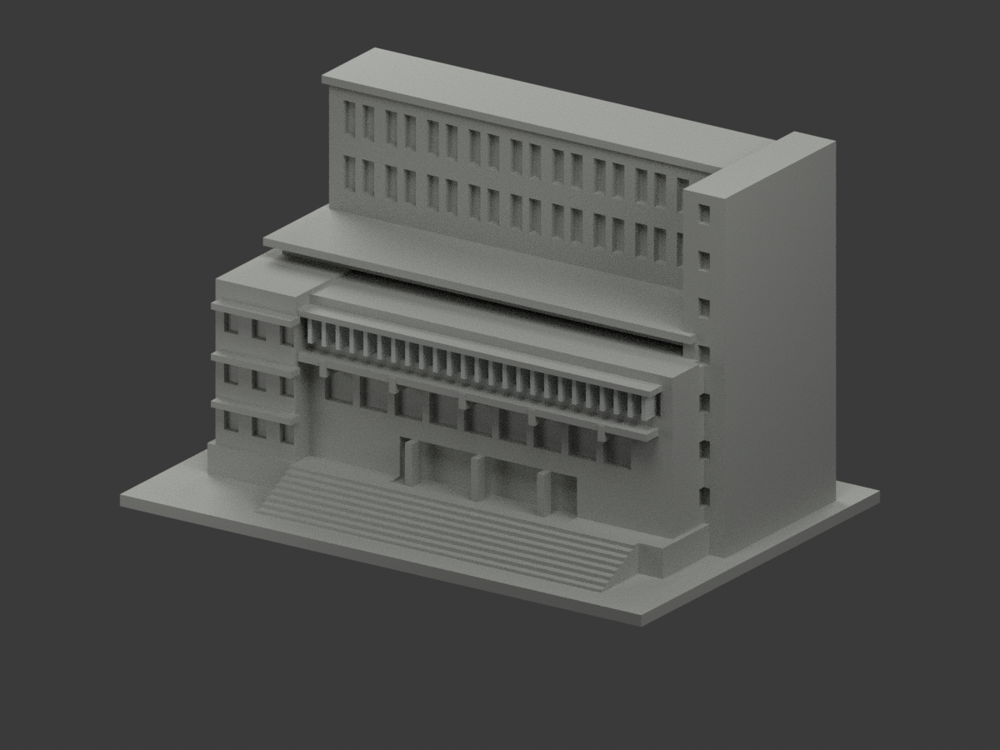
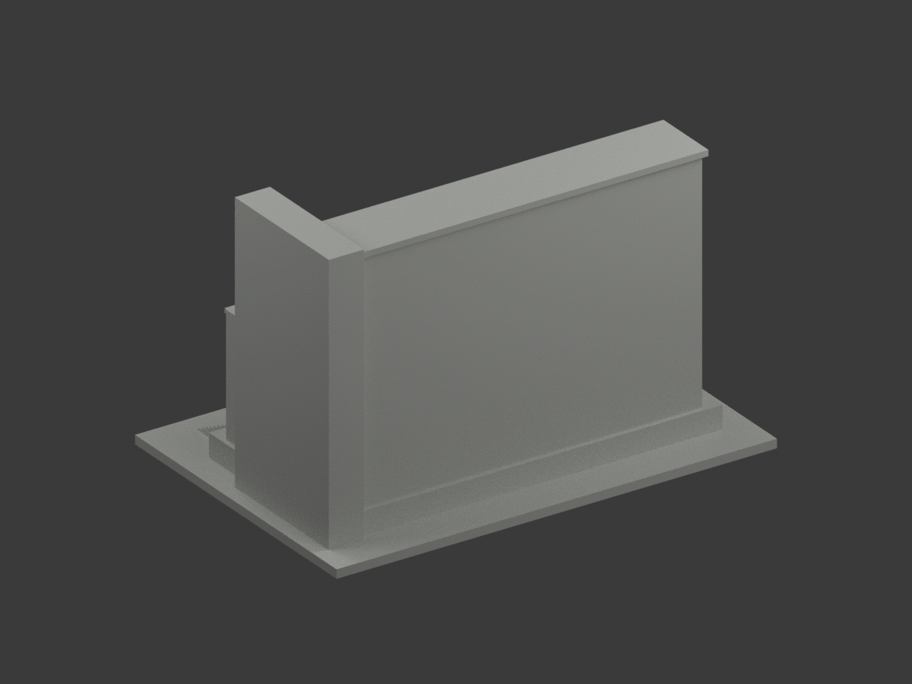
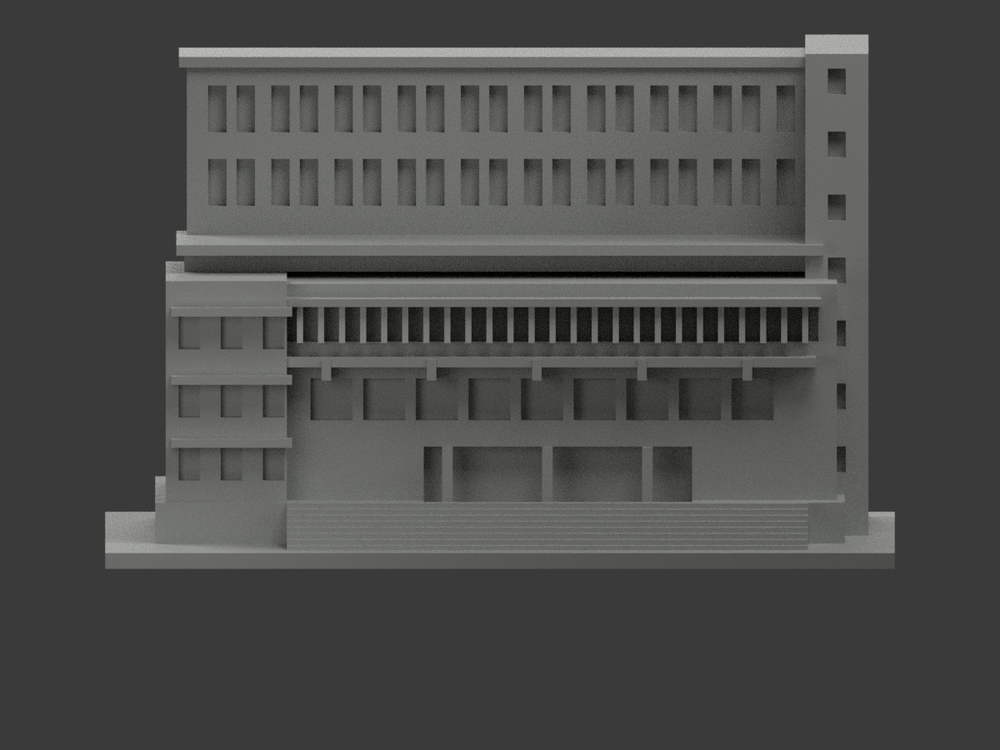
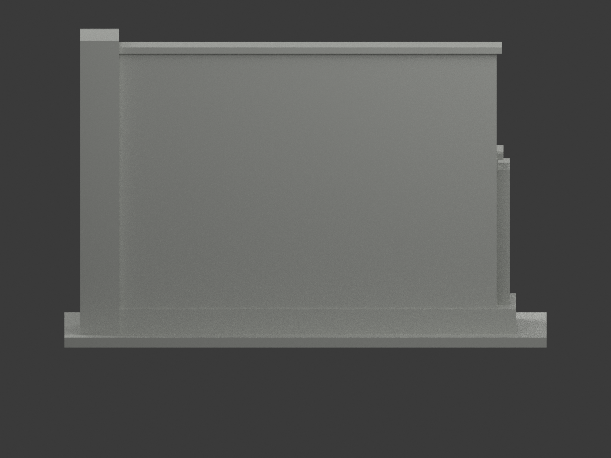
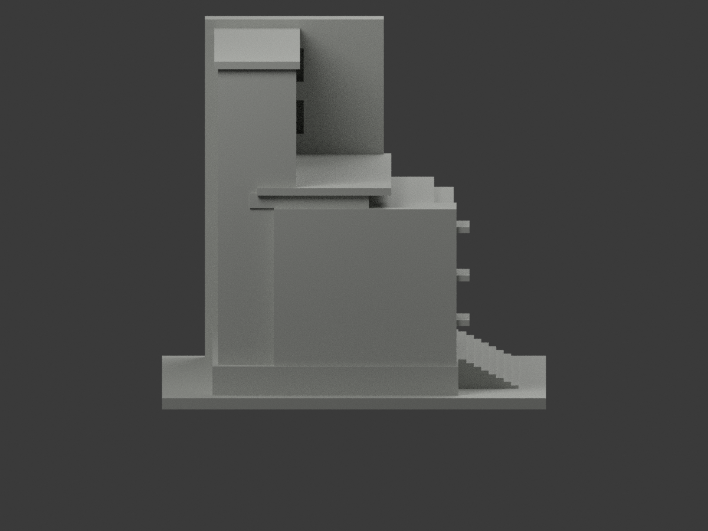
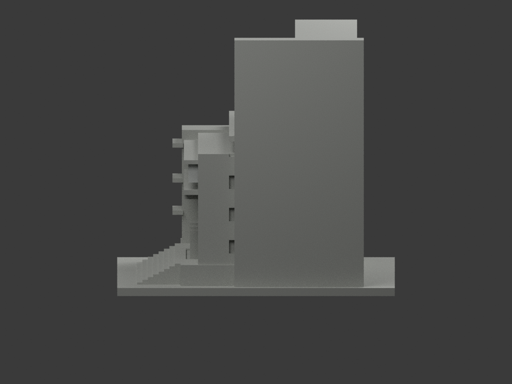
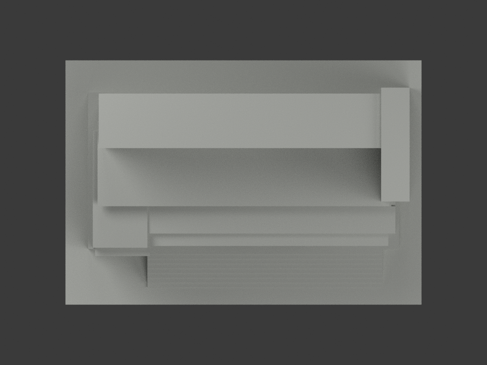
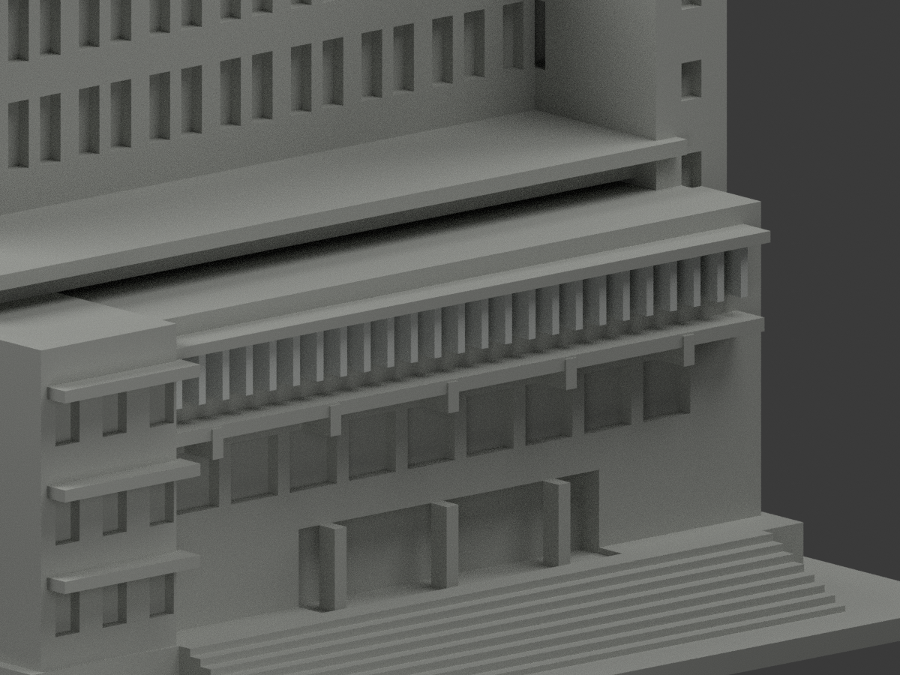
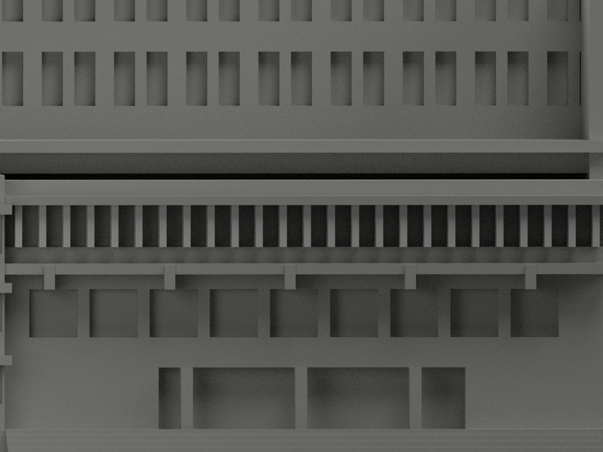
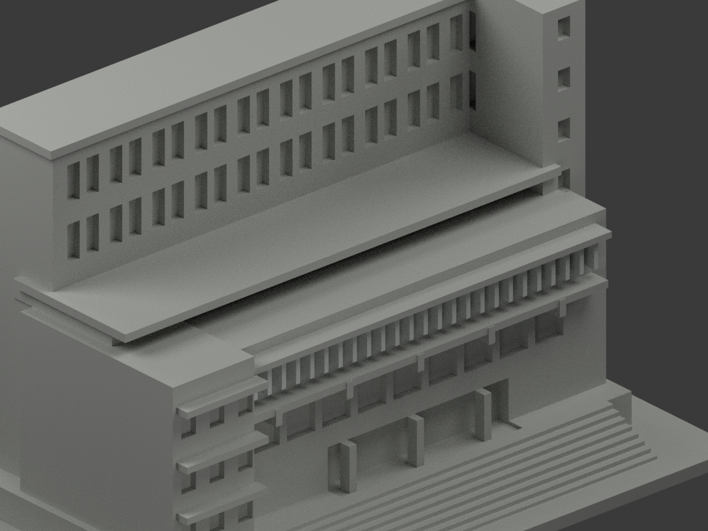

# 弘光 G 圖資群｜25 條窗格直肋左右側返同材質延續

## 模型預覽

| 前斜視 | 後斜視 | 正面 |
|---|---|---|
|  |  |  |
|  |  |  |
|  |  |  |
|  | | |

## 本次弘光 G 圖資群窗格直肋側返補色

僅替前低圖書館 25 條原窗格直肋的左右側返延用既有淺白槽 0，共 50 個完整原矩形／200 原三角。原 50 個白色前緣全部保留；新白 250／未知中性 2,242 面。中性槽 1 原名明列 UNVERIFIED，不把一般混凝土已色域當作未上色。原 2,492 三角、頂點、面序、STL bytes 與色盤 bytes 全不變，不切面、不補窗格或細節；前低館與後資訊高棟仍同一原模型群，不拆棟計數。

25 條中心 x=−38、−34…58 mm，每側面 x=中心±0.575、y=−25.1…−20.1、z=41…48 mm。逐一檢查全部三頂點有限邊界、外向法線、四角與原邊界分段；每完整矩形 4 原三角，面積 5×7=35 mm²，總 1,750 mm² 精確吻合。每域均為全部共面連通分量，前邊完整鄰接一個原白面，全部 608 共面域維持單材。x=−42 的第 26 條被原左量體吞掉，不補造不存在的面。

親看官方 lib.png，前窗格白色直肋與可見淺白側返能與反光玻璃區分；整個原 5 mm 深側返仍為同一構件材料延續推論，遮蔽區不冒稱獨立照片確證。原粗化直肋數量、斷面與進深不因此獲得測繪認證。照片拍攝日未知，2025/04 上傳路徑不是攝影日期，不宣稱 2026 現況或精確色票。本輪不新增 Commons 來源，不使用照片貼圖。

直肋背面、頂底、玻璃背板、橫框、圖書館字牆、粉色長簷與暗底、低層石牆、入口、階梯、左塊體、後高棟、右塔及基座全部不新增色。原配色仍局部未完成，非施工圖／實測模型；未實際列印或多料切片。原照只在私人研究，不入公開包。

舊 QA、來源、原建模／補色入口及舊校驗表保留原 bytes。新版驗證在 `qa-continuous-walls/`，校驗為 `CONTINUOUS-FINS-SHA256SUMS`。root scene 與十視角 PNG 更新為本輪配色；下方舊文件的 50 白面及「只前面」限制屬歷史範圍。新版 3MF 完整保留原 float 座標；lib3mf strict 讀入精確對回 STL，臨時材質編輯重存差另記，不作交付幾何。

`rebuild-continuous-fins.zip` 含固定 SHA 的原公開 baseline NPZ、STL、域報告與新腳本，不含照片。新版入口 `python build_continuous_fins.py`、`python verify_continuous_exchange.py`；Blender 執行 `render_continuous_fins.py`、`verify_continuous_scene.py`。原 `colorize_model.py`／`export_appearance.py` 是歷史入口，不用於新版；原製造限制全部保留。

場景僅同步更新 source_mesh_sha256 以對應本次含材質指派的 color-mesh.npz，並更新 scope，明示 25 條直肋左右側返同淺白推論；玻璃背板、橫框、粉色長簷與後高棟未改，攝影日期未知。原簡化幾何、未知建築後側維持中性，以及非現況、未實際列印的限制仍保留；非遮蔽面獨立照片證實；其餘原屬性、全部材質定義與幾何不變。兩槽 palette.json 原 bytes 完全保留，既有槽名稱只描述原前緣觀察，不表示側返也有逐面直接證據。

本頁為現行說明；根 README.zh-TW.md 保留舊版本原文及原 bytes，僅作歷史記錄。

## 前版說明與保留限制（完整歷史文字）

# 弘光G圖資群｜25條外露窗格fin正面局部白

**局部補色未完成：只前低館25條外露fin正面50原三角淺白；字牆後高棟與其他未完成／非全色。** partial_color_incomplete=true、fully_colored_exterior=false。同項hku-g-library-information／count_delta=0，弘光科技大學校本部。圖書館前低館與後資訊高棟同一原群，不按名稱拆兩套。

## 材色範圍

枚舉全原y−25.1無限plane，所有三頂點容差0.0001mm，50面恰25個共邊連通矩形各2面。原碼有26條fin，但x−42被左量體union吞掉，原STL沒有可見前面，不能補造52面。原fin前完整選取，不任按面心/高度切色；共608共面連通域uniform，原2492三角與頂點不變。50淺白、2442中性。

只窗格fin外朝前面，不外推側返、玻璃背或橫框。上方有字牆、粉色長簷與深影未有原對應材界，整體中性；大面石紋/分縫/立柱、遮陽、門窗框反光、階與底座不硬合一色。後高棟、右塔、屋面與未核側背中性，不以原碼描述紅色當色證。中性不是實景灰，資料範圍不是材料接縫。

## 來源與版本限制

親看官方前低圖書館外照，白細fin前緣連續有據；只名義展示色族，非測色或石材紋理。官方2025發表脈絡不等於獨立確認拍攝年；原幾何另參2013照片，後高棟本輪未獲色證，不能聲稱2026現況或用本輪色審追認整群幾何。前低館與後高棟仍同一原模型群，未新增內部/構造/棟數。照片私人，不公開貼圖，不推未見CC為商用許可。

## 檔案與 QA

原STL/build與2492三角字節/座標不變；immutable18件無OBJ，原builder雖會輸出OBJ，隔離生成僅私存，不偽稱原repo有OBJ。原README存ORIGINAL-MONOCHROME-README.md，舊單色previews/QA保歷程。appearance.3mf兩展示材、scene.blend實際面材、color-mesh.npz同原三角。精確requirements隔離build+color、閉合正體積、3MF面材座標/Blender重開/10張1200×900檢核；重建保留不刪，未實際列印或證多色切片。

## English limitations

Partial only:whole original y=-25.1 plane50triangles forms25 separate shared-edge fin-front rectangles,offwhite;2442neutral. Code specifies26fins,but x=-42 is swallowed by original union and has no exposed front;do not invent52faces. All608coplanar domains uniform,original2492triangles/STL/build unchanged,noimmutableOBJ,count_delta0. Generated isolated OBJ is private,not an original repo artifact. Lettered wall,pinkcanopy/mixedshadow,glassbacks,finreturns,crossframes,stonewalls,stairs and rear information tower/roof neutral. One original library/information building group,not two new packages. Official2025 publication not verified capture;original2013 geometry source does not certify rear colors or2026current condition. No public source images/textures,no geometry recertification,not testprinted.
