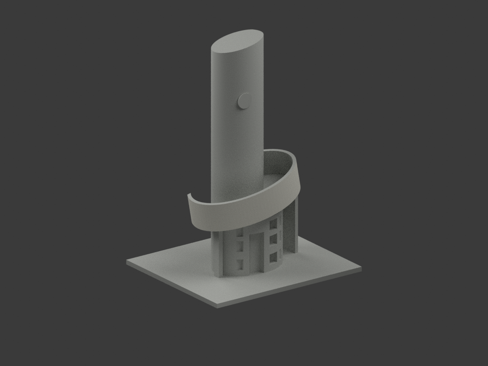
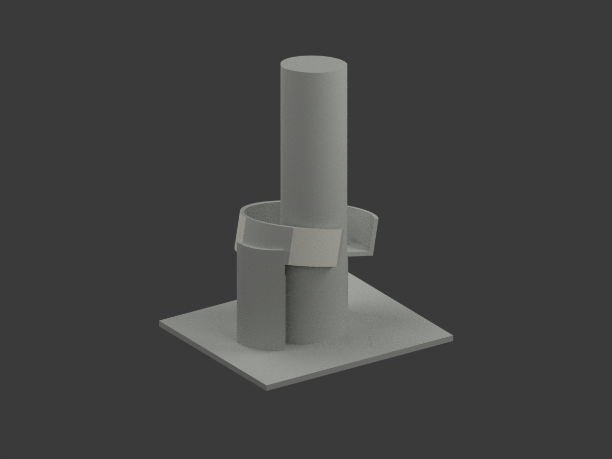
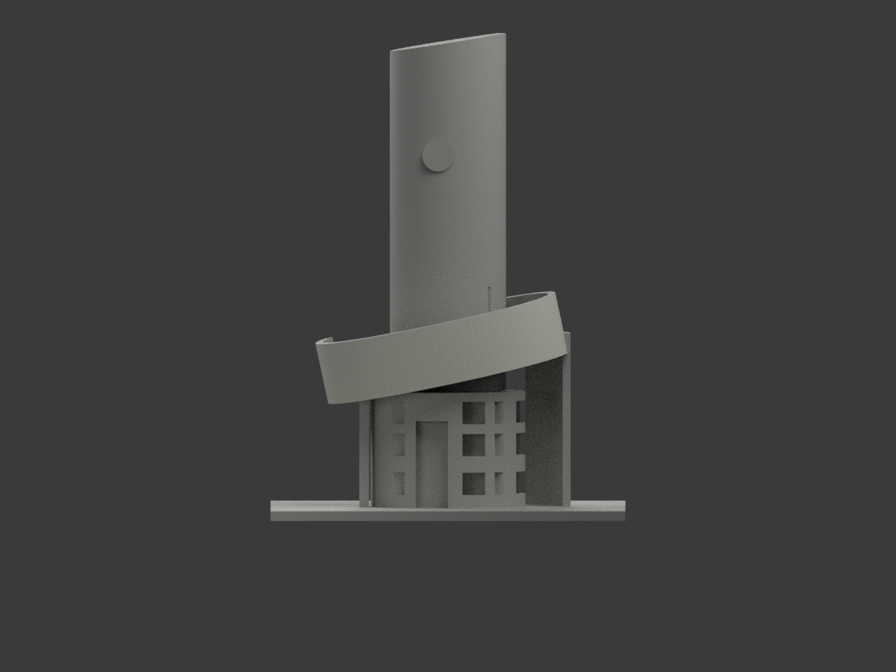
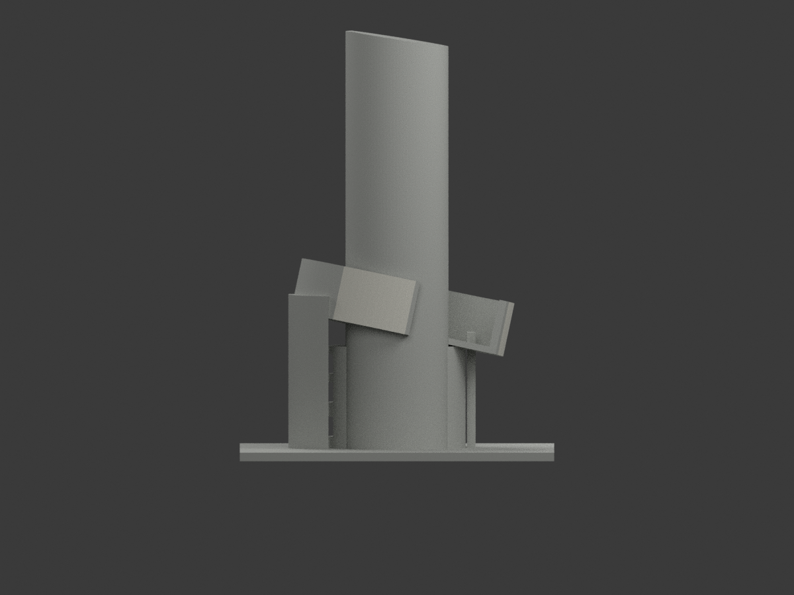
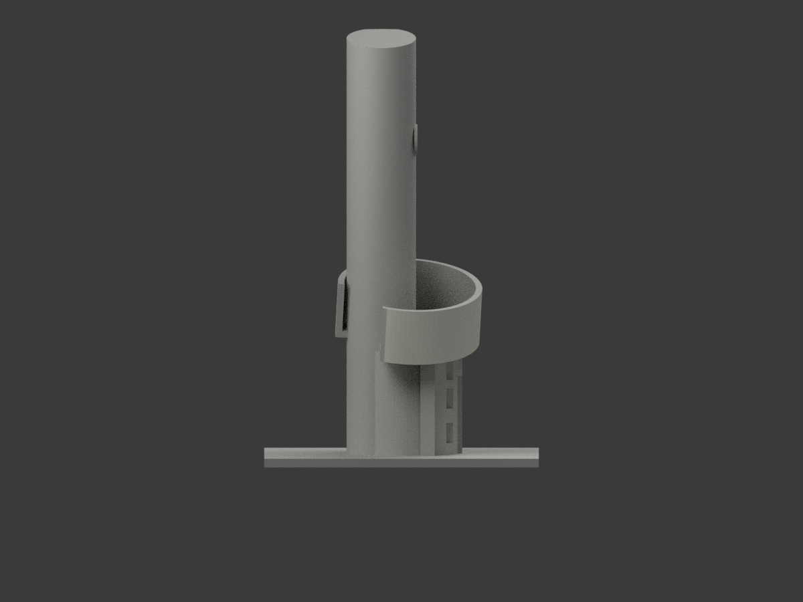
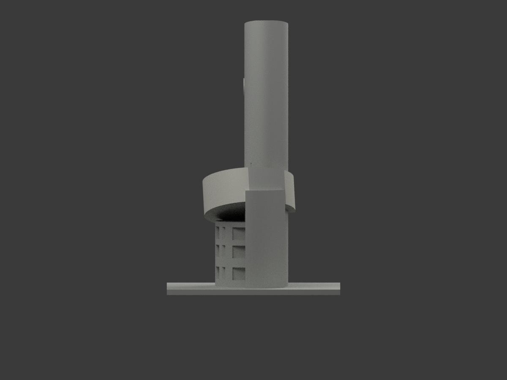
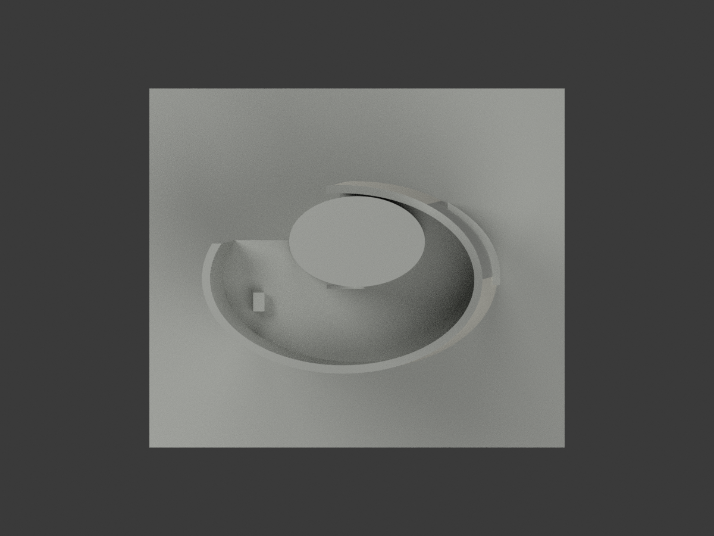
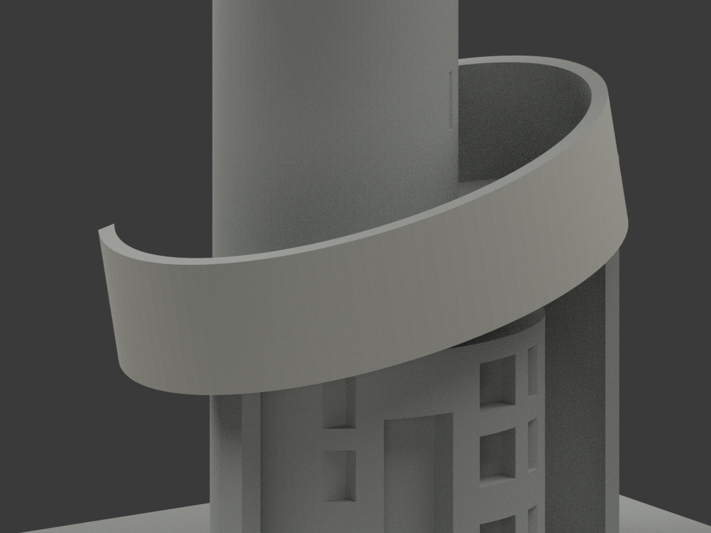
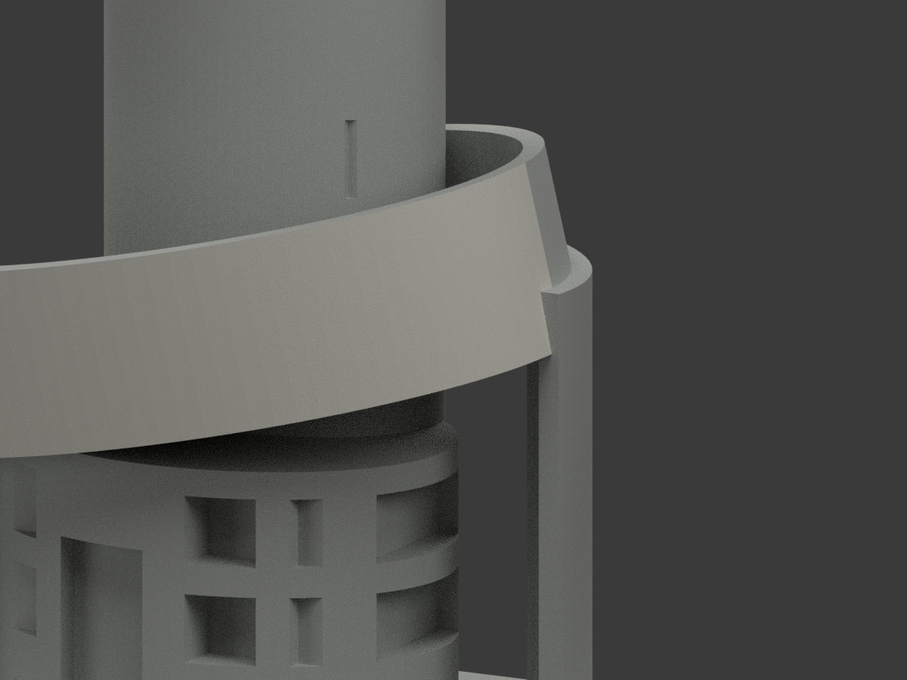
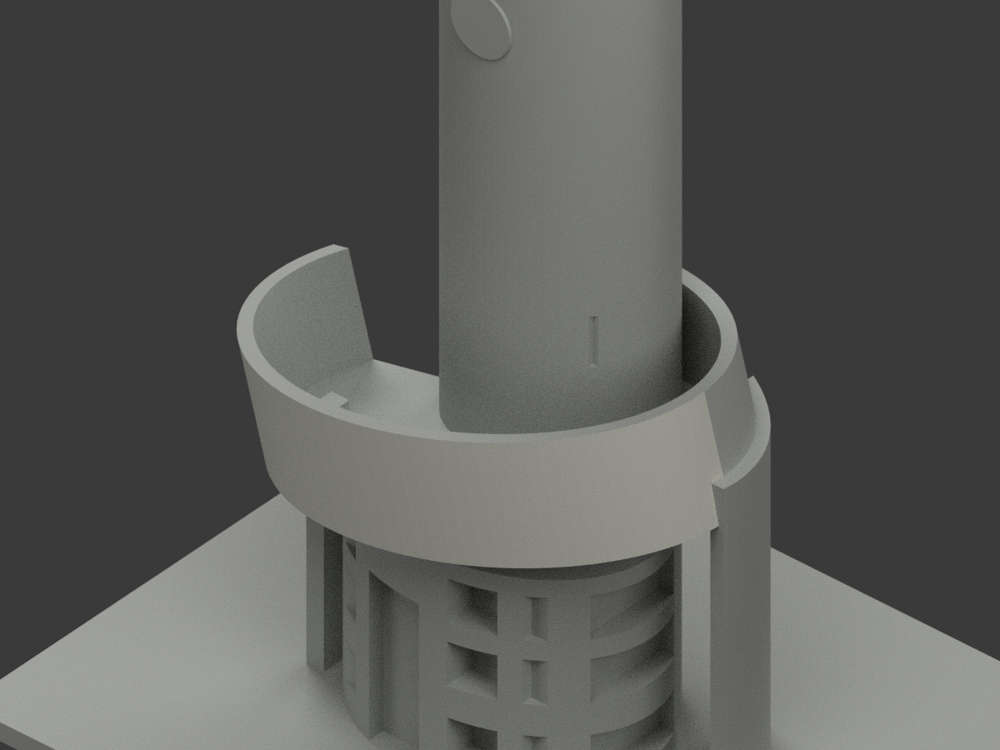

# 弘光校門警衛室｜外弧帶有限同材質延續

## 模型預覽

| 總覽 | 背側 | 正面 |
|---|---|---|
||||
||||
||||
||||

## 本次弘光校門警衛室外弧帶有限延色

固定 current root 114 灰面 baseline，原前弧 98 面與已完成後弧中段 16 面全保留，不回退舊 98 面分類器。只新增原外弧 facet 14、15、24、43、44、45、46、47 的 8 個完整矩形／16 原三角，變成 130 灰／2,430 未驗證中性；其餘 2,544 面逐面不變。槽 1 明列 UNVERIFIED，不把具名實材當中性。原 1,276 點、2,560 三角、面序、STL bytes 與 palette bytes 全保留，不切面、不補面、不增加棟數。

選取沿原96邊橢圓外皮，局部半徑38／25、中心y=−2、局部z=0…19。由原底座x跨度／110還原整體縮放，扣除原z43平移，逆轉原Rx3°再Ry−12°。每facet以全部三頂點對原弦平面、切向0…原弦長及z界核對；原整無限平面等於有限域，每域兩原三角、四角完整且等於全部共面分量。每域面積對原弦長×19×scale²，誤差小於3e−5mm²；合294.6553837067mm²。638共面域皆單材，外法向正確，不用面心挑片。

三條原完整局部19高共享邊把新增區接回既有灰外弧，其他新增facet沿原完整邊連續。facet14／15／24接後弧中段，43…47接原前半弧。仍排除0…13的下垂端Boolean交界、25及42切端、原本缺失26…41，不重建缺矩形。新增角界只是保守作業範圍，不宣稱真實材料縫。內壁、頂、底、落地端、支柱、塔身、徽牌、玻璃、硬件、警衛室混皮與獨立校名字牆全部不染。

本輪與第二審皆親看原註冊後視照片photo68，SHA相符；照片來源是第三方markchoo現地拍攝，不稱校方實拍。後視外弧淺灰外皮與暗底可分，但本輪不是逐facet實測對位。新增段是同一外弧材料族延續推論，隱藏／被植栽遮擋部分並非直接全見證據；塔也呈白色不代表放行整塔。原等高19傾斜橢圓帶只是實景變高曲帶的粗化代理，不因補色認證高度、厚度、曲率或精確HEX，不改原幾何。

照片精確拍攝日未獨立核定，檔名2024不是單獨日期證據，不稱2026現況。原後弧修正、source pending固定快照與全部舊QA保留原bytes，不改寫原GO或把現在狀態回退。仍是局部補色未完成，非施工圖／測繪模型，未實印或驗證多料切片，STL無色。原照只私人研究，不入公開包、不作貼圖，不推定再散布或商用權利。

新版QA在 `qa-continuous-walls/`，校驗表 `CONTINUOUS-RIBBON-SHA256SUMS`；root scene與十視角更新。下方114灰／更早98灰限制屬歷史範圍。full-float 3MF strict讀回精確對原STL，隔離材色往返、Blender材質／頂點改存重開及preview逐bytes重渲染另有QA。

新版入口 `python build_continuous_ribbon.py`、`python verify_continuous_exchange.py`；Blender執行 `render_continuous_ribbon.py`、`verify_continuous_scene.py`。`rebuild-continuous-ribbon.zip` 含固定SHA的current114 baseline、STL、有限域及新腳本，隔離解壓精確重建NPZ／3MF／palette，不含原照。舊 `colorize_model.py` 等保留歷史，不用於新版，避免回退既有色。

場景僅同步更新 source_mesh_sha256 以對應本次含 16 面材質指派變更的 color-mesh.npz；原 scope 與全部其他原屬性、全部材質定義及幾何不變。固定遠端原 114 灰面全部保留，不回退歷史 98 面。原等高傾斜橢圓帶近似、未知後側中性與未選域、來源 pending 歷史、攝影日期未獨驗及未實印等限制完整保留；新增外弧有限段為同構件材料延續推論，不是逐 facet 實測對位。palette.json 原 bytes 完全保留，原前弧材名仍為歷史標籤。

本頁為現行說明；根 README.zh-TW.md 保留舊版本原文及原 bytes，僅作歷史記錄。

## 前版說明與保留限制（完整歷史文字）

# 弘光校門警衛室｜後弧中段外皮有限補色

新增16原面／8完整有限facet16..23，以原scale與Ry(-12)@Rx(3)逆變換及全三頂點弦界核定，僅中段外弧。原98前色保留，合114色／2446中性／2560原三角。兩palette條目保持；原front ribbon名稱是歷史標籤，此次延用名義#DEDDD3淺灰族，不宣稱色票校準。原0混材共面連通域保持。原STL/build/其餘indices不動，原包無OBJ不新增。

原註冊rear照片hash精確重審，後弧中段外皮與暗底可分，非新角或新拍。原等高19傾橢圓環只是實景變高曲帶的粗對應，只准有限淺灰色族連續推定，不認證幾何、厚度、HEX或逐facet實測。選區角界是保守證據範圍而非真材縫。避開下垂端Boolean交界與截斷端，不放行其他後弧。

頂端小設備原未建，不認證其材色。塔、徽牌、玻璃、內壁、頂、底、落地端、支柱與另外校名牆均不擴。拍攝日期未獨驗，檔名2024不單獨作日期證據，不稱2026現況。原工程與薄件限制及aliases全部保留，未實際多料試印。原照私人保存不發布。SOURCE pending固定快照，審後不改；最終獨審另檔。

## 原版說明與限制

# 弘光校門警衛室與曲塔｜前弧帶外面局部淺灰

**塔身、徽牌、玻璃與後弧等材域未完成分色。** partial_color_incomplete=true、fully_colored_exterior=false。僅前半弧帶原外立面98三角名義淺灰，非全體完整補色。

## 材色範圍
同 hku-gate-guardhouse 原項目，same-item、count_delta=0。弘光科技大學校本部警衛室／整合曲塔單群，獨立校名字牆不在此模。2560原三角、STL與build_model.py字節不變，原18件無OBJ，不造原件。
- 原弧帶96邊ellipse半徑38/25、中心y−2、局部z0..19，原先Rx3°再Ry−12°、平移z43，最後全模uniform scale。由STL原底座x跨度/110重算scale，再反旋全三頂點。
- 僅前半facet48..95完整有限chord外立域。每facet所有原無限plane三角均符合弦切向0..length與局部z0..19；不以normal或centroid篩面。47片各2三角，facet94原Boolean四碎片全保，共98面，並非假設96。
- 其餘2462中性：整塔身／徽牌／槽／斜頂、弧後半／內壁／頂底、未核下垂端與支柱、混門窗玻璃警衛室、地面全部不擴染。
- 原粗化橢圓、旋轉、厚度、支柱與Boolean交界保留；不改幾何補精度。中性邊界是證據範圍非真實材縫，不造徽字或透明玻璃。

## 來源與日期
親看正側官方外觀及另一後視實照，前弧外淺灰與下玻璃混皮可區別；後視只輔助辨識，不自動放行未證全塔。照片精確拍攝日期未由本次核定；檔名2024非唯一日期證據，不稱2026現況。
原照私人不公開、不貼圖，未確認CC或再散布授權，不保證商用。HEX是名義色族非校準色票。正式GO與保留先期獨審分開，不免builder QA。

## 格式與列印
[原STL](model.stl) · [逐面材色3MF](appearance.3mf) · [Blender](scene.blend)
原最高150mm整體縮放展示，非測量比例。物件名 HKU Gate Guardhouse partial color，由真slug／館名獨立核。STL無色，3MF及Blender逐面分材；兩材標籤非驗證兩色／四色耗材切片，未實際列印。

## 重建與 QA
原build_model.py → colorize_model.py → export_appearance.py → validate_color.py；Blender render_color.py／verify_color_scene.py。完整隔離精確原build＋color重建、原bytes／全三角multiset、閉合正體積、3MF逐面材、scene重開、十圖1200×900及圖文hash。隔離原依賴，不改原碼；程序不替代人工來源核。
原README／previews／validation／renderer保留歷程，不冒充新QA；沒有刪檔。

## English scope
Partial only:98 original exterior faces on the front half curved ribbon, pale gray;2462 neutral. Original2560 triangles and bytes unchanged,18 immutable files noOBJ. Inverse original uniform scale and Ry(-12)@Rx(3) transform, then all-three-vertex finite chords48..95 of ellipse96. Every infinite-plane selection equals its finite domain. Facet94 has4 Boolean fragments; all retained. Tower/emblem, booth glazing, rear half, inner wall, top/underside and unknown supports remain neutral. Separate lettered wall excluded. Approximate shape retained, no2026 survey/capture claim. Not tested filament slicing or full color.
