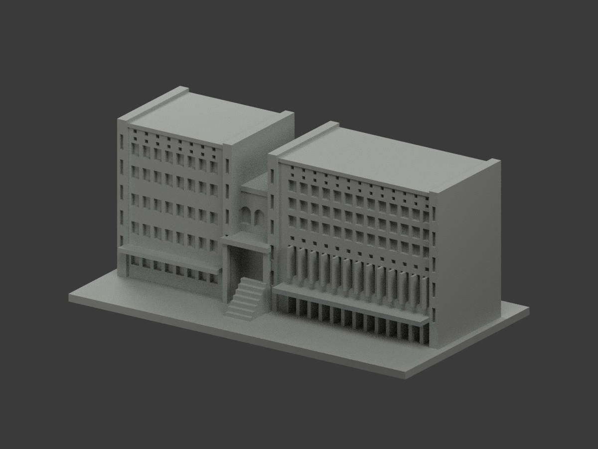
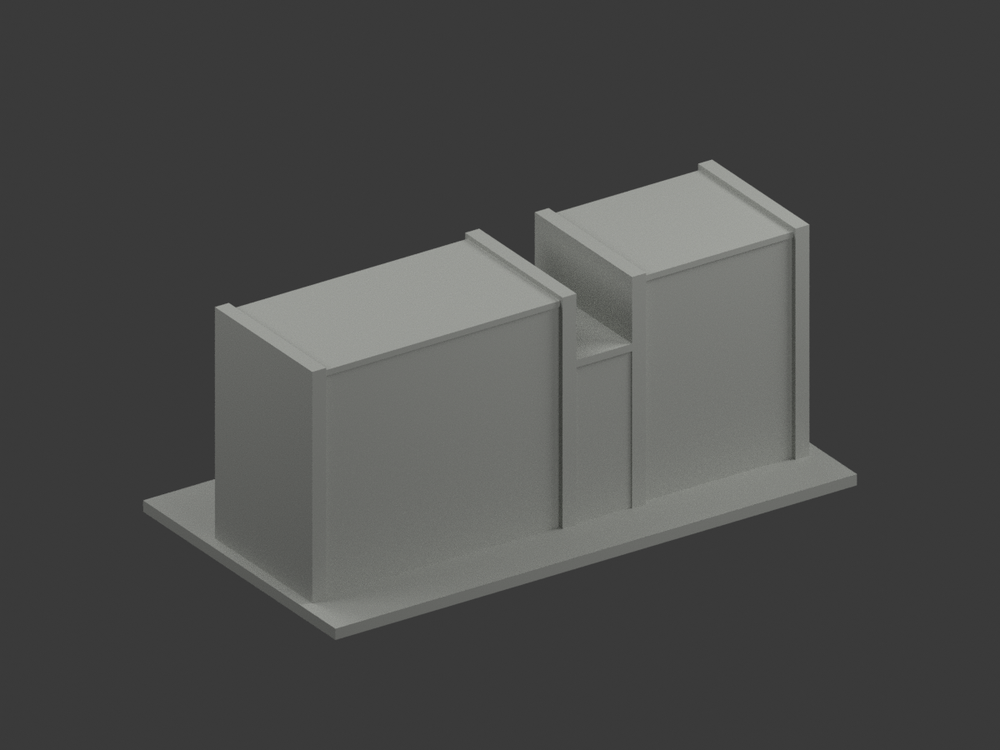
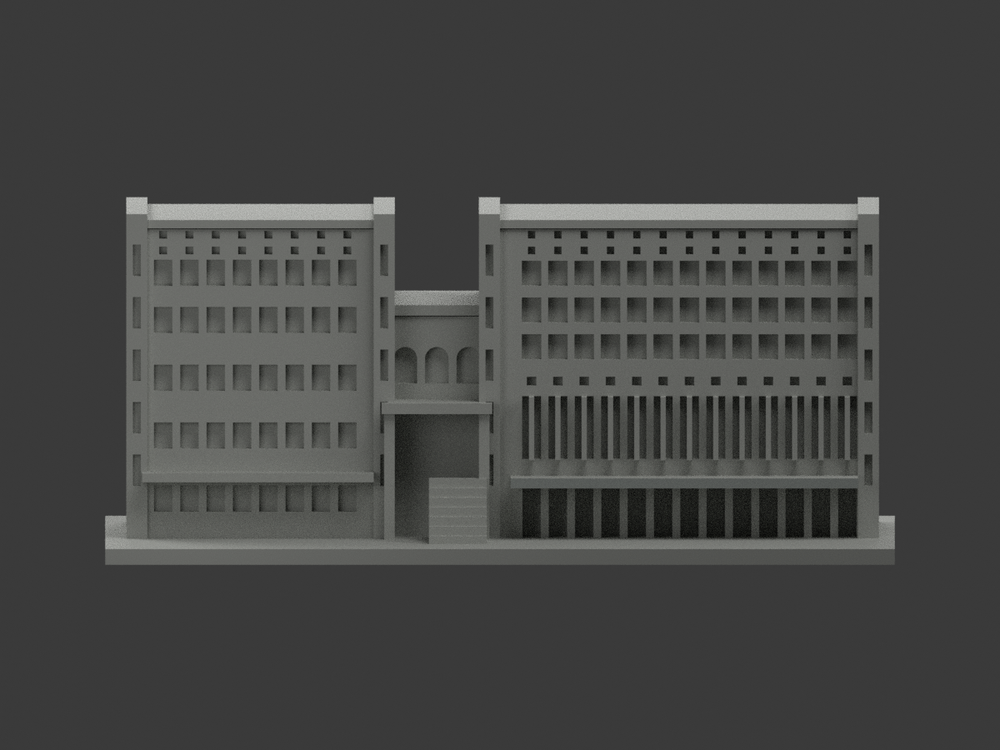
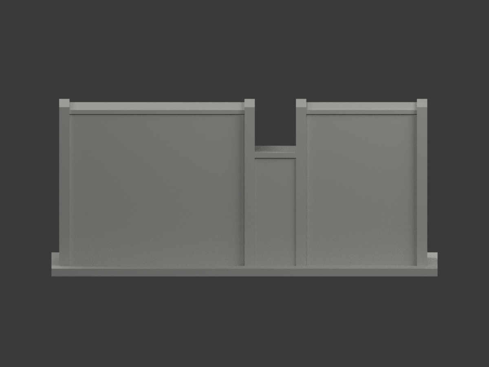
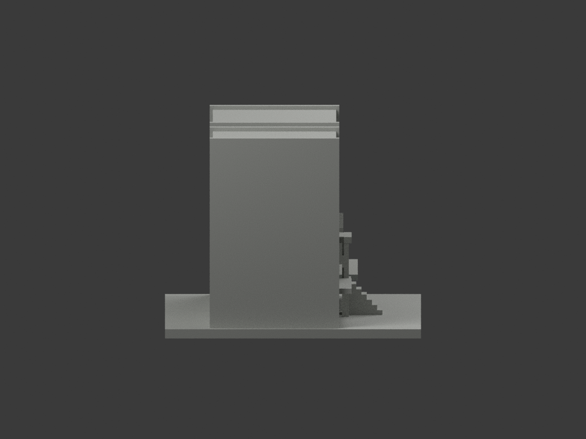
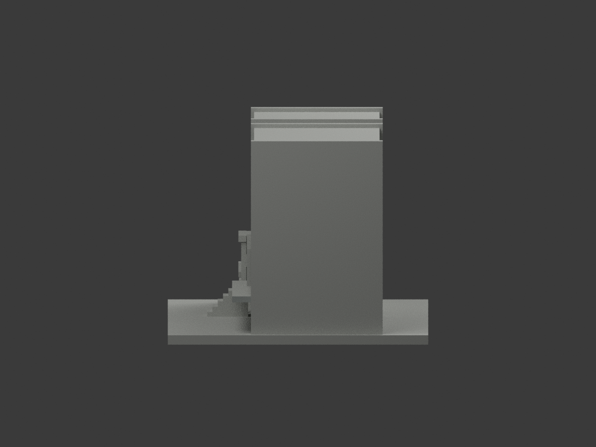
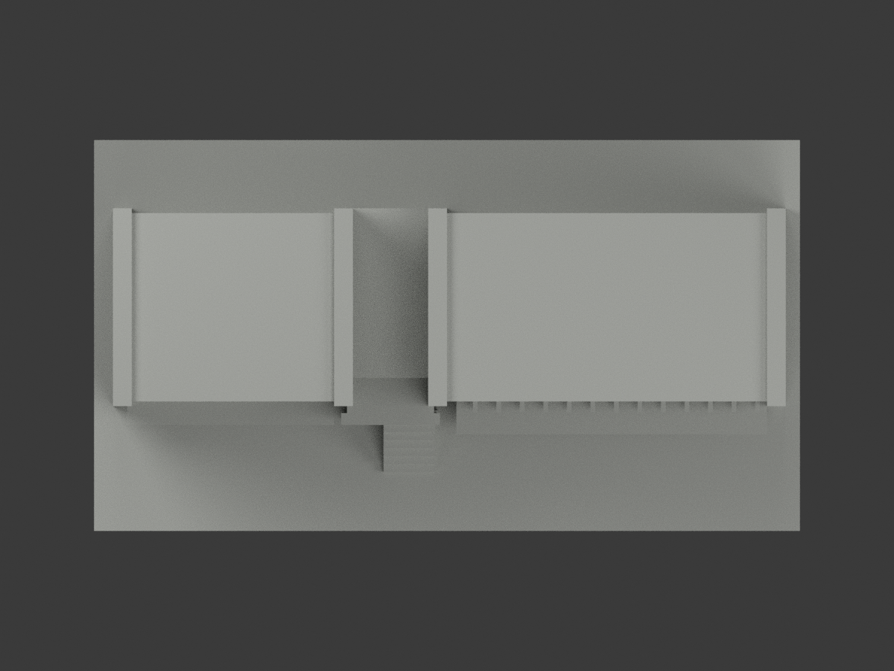
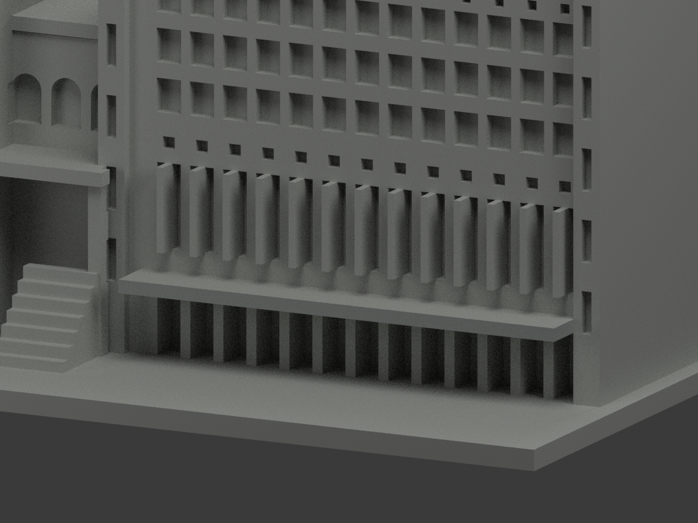
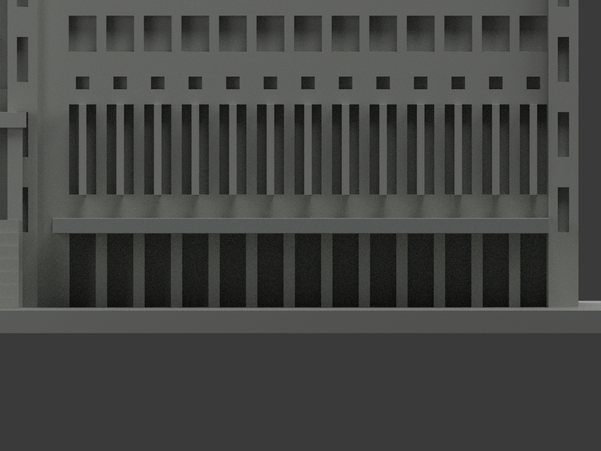
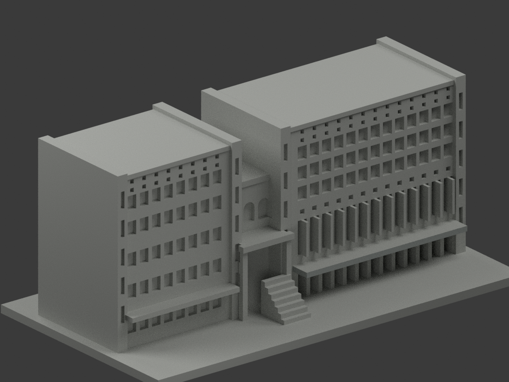

# 弘光 JK 科技體育連體群｜右低柱廊簷側端同材質延續

## 模型預覽

| 前斜視 | 後斜視 | 正面 |
|---|---|---|
|  |  |  |
|  |  |  |
|  |  |  |
|  | | |

## 本次弘光 JK 右低柱廊簷側端補色

只將右低柱廊窄簷的左右兩個完整端面／4 原三角 [3275,3276,3284,3285] 延用既有中淺灰槽 0。原 2 灰面保留，其他 4,112 面不變；新版 6 灰／4,110 未驗證中性。槽 1 明確是 UNVERIFIED，不將具名實材當作未上色。原 2,024 點、4,116 三角、面序、STL bytes 與 palette bytes 完全保留，不切面、不補洞、不改造型。J/K 雙翼與共享廳是原同一群，棟數不變。

左右域分別 x=2、y=−21…−13.5 與 x=68、y=−21…−15，皆 z=13…14.9 mm。每域為完整四角矩形、兩原三角及全部共面連通分量；全部頂點、外法向及完整 1.9 mm 前邊與既有灰面的鄰接皆檢核。解析面積 (7.5+6)×1.9=25.65 mm²，三角面積 25.64999485 mm²，浮點差記錄。1,155 共面域均單材，不用中心點裁界。右端止於原高端牆 y=−15，左端止於原主翼前牆 y=−13.5，不能延到名義 cap 後緣 y=−13，也不填 Boolean 接觸缺段。

本輪親看第三方現地攝影來源 markchoo 的 photo65，原圖 SHA 與既有來源登記相符。右低柱廊上方窄灰前緣可與更上方藍窗及淺板分開；左右端的 7.5／6 mm 深度並未逐面全由照片確認，採同一窄簷代理的材料延續推論，不把上方藍灰帶、主牆或柱面一起塗灰。來源是第三方攝影，不稱校方實拍。校方環境頁只核對 J 智慧科技大樓與 K 體育館同圖／同連結身份，不將校方渲染當作實景材色證據。

photo65 拍攝時刻未獨立確認；不得把 photo77 頁記 2024-10-19 10:49:36 移用為 photo65 時刻，也不自行補時區。原 photo77 帳篷遮擋造成的 HOLD，已由 photo65 與 v2 前緣審核解除；舊 HOLD、v2 及 GO 歷史不改寫，本輪只另述有限側端推論，不假稱原審已放行側端。不宣稱 2026 現況、精確 HEX、測量幾何或材料紋理。

頂面、底面、後緣、柱面、門洞與玻璃、上方淺板／藍窗帶、主牆格網、左低簷、中央廳、招牌、屋頂及未知後側全部不新增色。原簷厚、進深、雙翼尺寸及窗孔仍為照片粗化近似，補色不追認測繪。仍是局部補色未完成、未實印或驗證多料切片，STL 本身無色。私人參考圖片不入公開包、不作貼圖，不推定再散布或商用權利。

歷史來源、QA、原建模和舊補色程式與校驗表保留原 bytes；下方舊文件只前緣 2 灰面屬歷史版本範圍。新版 QA 是 `qa-continuous-walls/`，校驗表 `CONTINUOUS-CANOPYENDS-SHA256SUMS`；root scene 與十視角更新。3MF 原 float 座標 strict 讀回精確核對，隔離材色編輯往返、Blender 材質／頂點改存重開與 preview 逐 bytes 重渲染另有驗證。

新版入口 `python build_continuous_canopyends.py`、`python verify_continuous_exchange.py`；Blender 使用 `render_continuous_canopyends.py`、`verify_continuous_scene.py`。`rebuild-continuous-canopyends.zip` 含固定 SHA 原公開 baseline、STL、面域及新腳本，隔離解壓精確重建 NPZ／3MF／palette，不含照片。舊 `colorize_model.py`、`export_appearance.py` 只留作歷史，不能用於新版重建。

場景僅同步更新 source_mesh_sha256 以對應本次含四面材質指派變更的 color-mesh.npz；原 scope 與全部其他原屬性、全部材質定義及幾何不變。原粗化簷厚與進深、未知建築後側中性、photo65 拍攝時刻未確認及未實印等限制完整保留；新增側端明示同構件材料延續推論，非完整側面獨立照片證實。兩槽 palette.json 原 bytes 完全保留，既有槽名僅描述原前緣觀察，不代表新增端面逐面直接實證。

本頁為現行說明；根 README.zh-TW.md 保留舊版本原文及原 bytes，僅作歷史記錄。

## 前版說明與保留限制（完整歷史文字）

# 弘光JK科技體育連體群｜右低柱廊前簷局部灰

**局部補色未完成：只右低柱廊前簷2原三角灰；雙翼共享廳同群／其他材色未完成。** partial_color_incomplete=true、fully_colored_exterior=false。同項hku-jk-technology-gymnasium／count_delta=0，弘光科技大學校本部。英文身份為 HKU JK Technology Gymnasium partial color。J/K雙翼與共享低廳同一原群，不拆成兩套。

## 材色範圍

只全原y−21無限plane，所有三頂點容差0.0001mm；恰2面共邊單component，完整原x2..68、z13..14.9矩形。2面名義中淺灰、4114中性，1155原共面連通域uniform，原4116三角與頂點不變。不按面心或只裁帳篷未遮半邊，不把上方藍灰窗間帶染成此灰。

兩翼整牆/格網含不同色域、窗背含玻璃與框/實板、門廳拱孔、字帶、左低簷、屋上、側背、柱與階地保持中性。下前灰邊不外推棚頂、底或側端。中性不是實景灰，資料範圍不是材料接縫。

## 來源與審核歷程

親看photo77與photo65：77帳篷遮住右低廊中央，初0438審因此HOLD；65另一角度完整露出窄灰前緣，review0438-v2解除該來源缺口，GO0441只放行這一原完整面。原HOLD/修訂都私存，不重寫歷史、不以移除帳篷造新幾何。photo77頁列2024-10-19 10:49:36，無時區或相機鐘校證，不自行換算；65拍攝日期未證，不從URL推。不是2026現況測繪。既有雙翼共享廳近似不因補色追認實測；照片私人，不公開貼圖，不推未見CC為商用許可。

## 檔案與 QA

原STL/build與4116三角字節/座標不變；immutable18件無OBJ，原builder雖輸出OBJ，隔離生成只私存，不宣稱原repo有OBJ。原README存ORIGINAL-MONOCHROME-README.md，舊單色previews/QA保歷程。appearance.3mf兩展示材、scene.blend實際面材、color-mesh.npz同原三角。四腳本與實際3MF/scene均必須精確身份 HKU JK Technology Gymnasium partial color，不用舊模板名互比。精確requirements隔離build+color、閉合正體積、3MF面材座標/Blender重開/10張1200×900檢核；重建保留不刪，未實際列印或證多色切片。

## English limitations

HKU JK Technology Gymnasium partial color. Entire y=-21 plane exactly2 connected triangles covering original x2..68,z13..14.9 right low canopy front,nominalgray;4114neutral. All1155coplanar domains uniform,original4116triangles/STL/build unchanged,noimmutableOBJ,count_delta0. Original HOLD0438 due tent in photo77 resolved only by unobstructed photo65 and review0438-v2;both historical records preserved privately. Photo77 reported2024-10-19 10:49:36 has no timezone/camera-clock certification;photo65captureunknown,no2026survey. J/K plus shared hall onegroup,not two packages. Mixedwalls/windowbacks/upperbluegraystrip/leftcanopy/rooftops/rear neutral. No public source images/textures,no geometry recertification,not testprinted.
