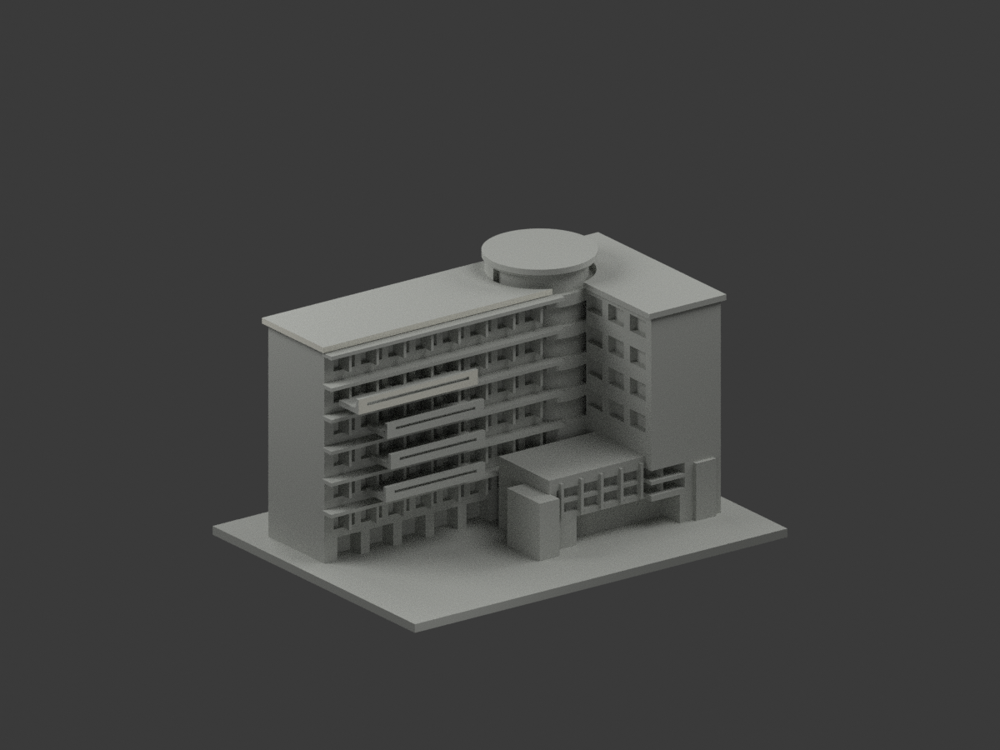
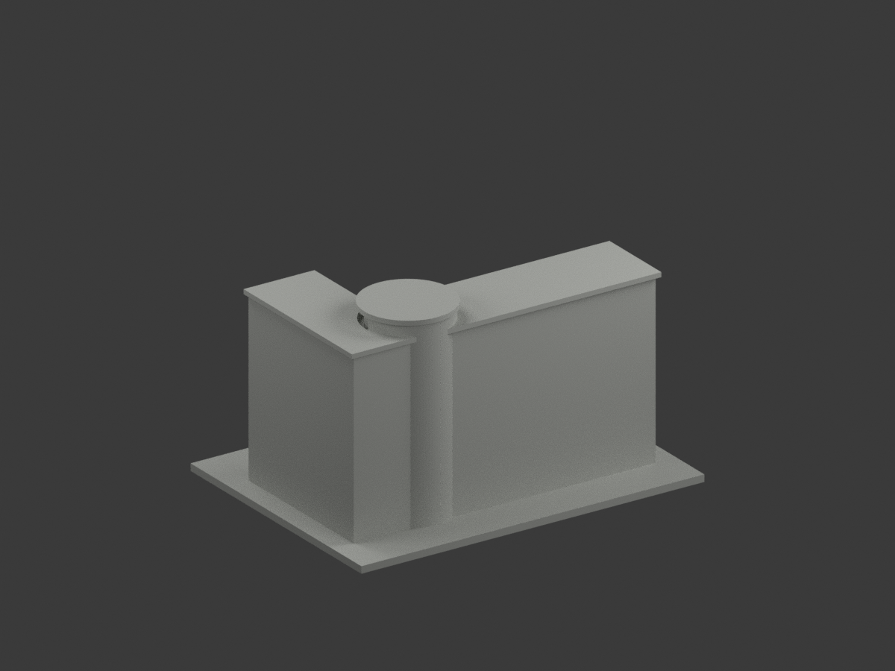
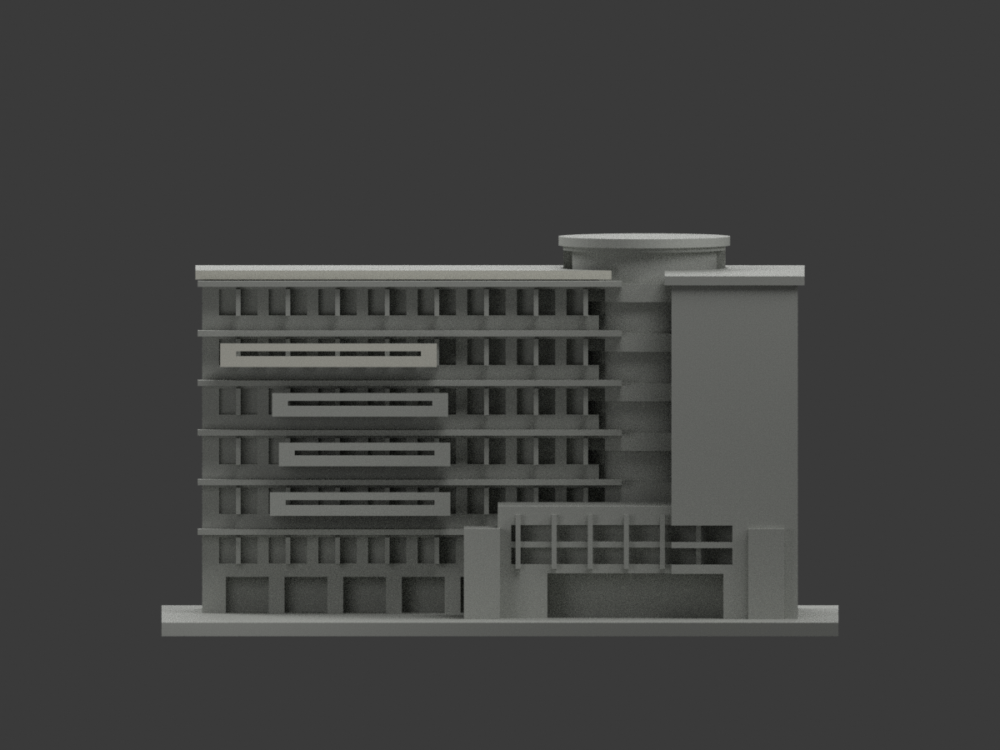
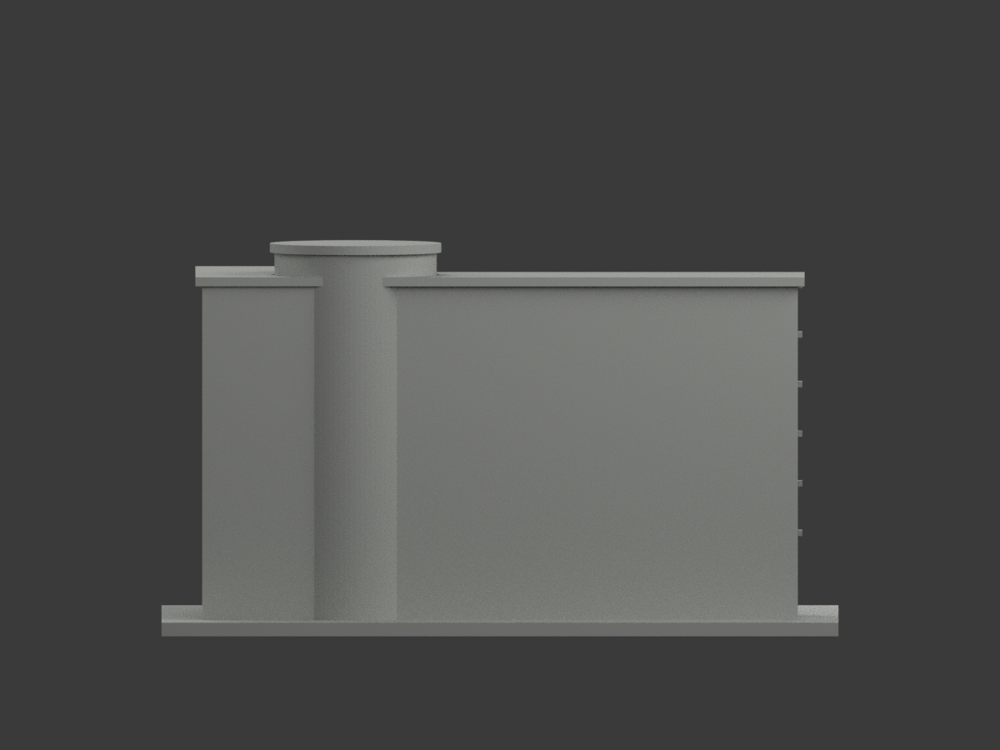
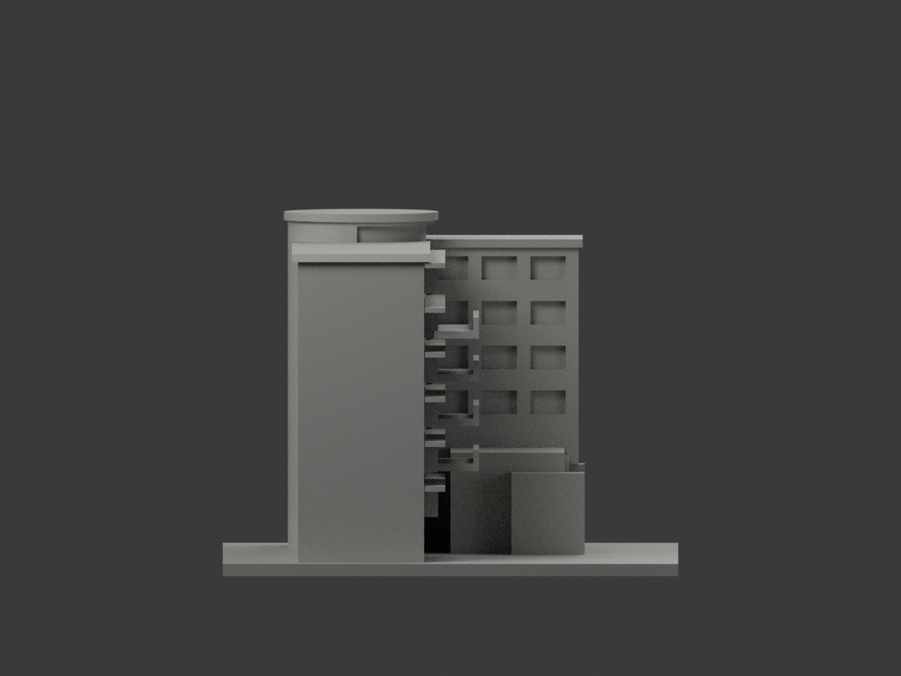
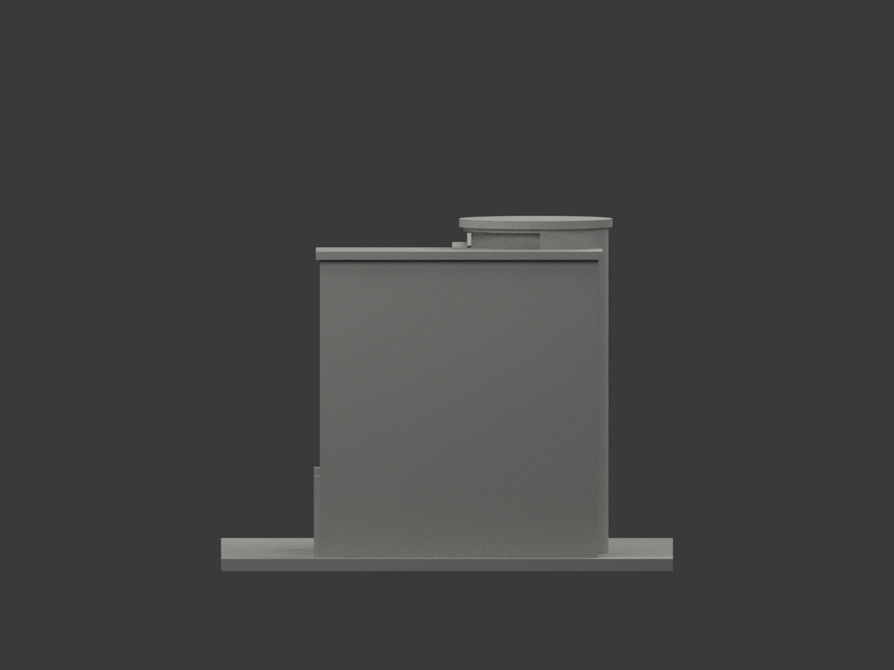
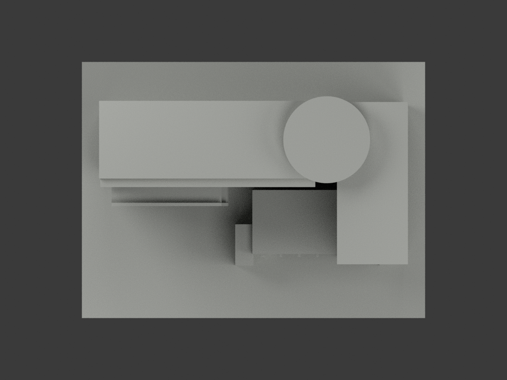
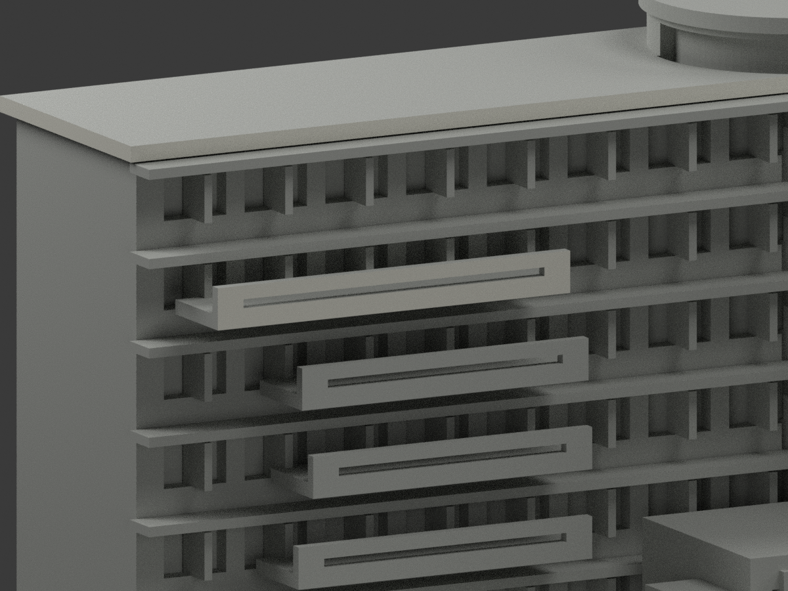
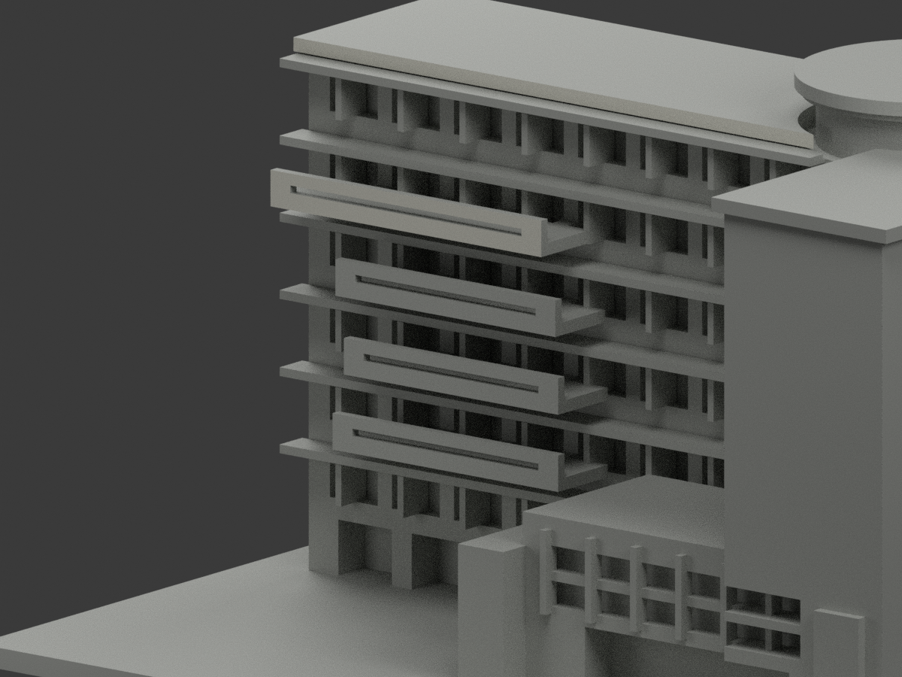
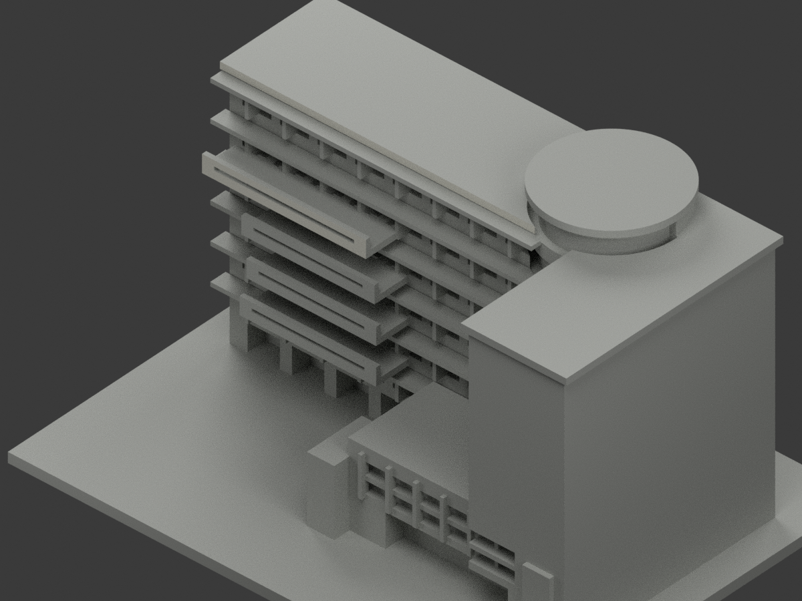

# 弘光 N 研究大樓｜最高長屋簷左端同材質延續

## 模型預覽

| 總覽 | 背側 | 正面 |
|---|---|---|
||||
||||
||||
||||

## 本次弘光 N 最高長屋簷左端補色

固定目前 root 已有 14 灰面作 baseline，保留最高陽台 12 面與最高長屋前薄緣 2 面。僅將同一屋 cap 左端完整兩原三角 [6951,6953] 延用原名義淺灰槽 0，新版 16 灰／7,054 未驗證中性；其餘 7,068 面逐面不變。槽 1 明確為 unverified，不將具名實材當未上色。原 3,357 點、7,070 三角、面序、STL bytes 及 palette bytes 全保留，不切面、不補洞、不增加棟數。

唯一域 x=−67.5、y=5…39、z=77…79 mm，外法向 −X。全三頂點皆在有限邊界內，兩原三角完整四角矩形等於整個共面連通分量；面積 34×2=68 mm²，前方 2 mm 整邊完整鄰接當前已灰屋前薄緣。1,599 共面域均單材，不以中心點截域。前緣既有 [6956,6959] 在圓塔 Boolean 截至 x=24.71781349182129 的止界完全保留。

本輪親看營造商工程頁原 2048×1536 實拍，SHA 與 current source register 的 ce07b453… 相符，不稱新照或校方實拍。L 形內庭、錯列陽台、長橫窗、內角圓弧塔及低入口車道對應同一 N 群，鄰 D 與前景獨立雕塑不納入。最高長屋前薄緣呈淺灰，與上方局部女兒牆／欄及下方暗腹可分；模型左側完整 34 mm 深度並未由照片全見。這兩面只作同一 95×34×2 屋 cap 的同材料族延續推論，不是全深逐面實景確證，不跨成女兒牆、欄、主磚牆或屋底。

工程 2004/06–2005/10、圖片 URL 的 180524 均不是確證拍攝時間，拍攝日未知，不稱 2026 現況、精確 HEX 或測量幾何。原來源登記仍保留 SOURCE_SCOPE_SUPPORTED_PENDING_FINAL_MODEL_REVIEW 歷史字樣，不為本次改寫；當前 NPZ、README 已明確是 14 灰面，絕不因舊來源文字或舊分類器回退成 12 面。原最高前緣局部被雕塑遮擋的限制繼承，本輪不擴範圍以繞開遮擋。

頂面、底面、後緣、右返、女兒牆／欄、圓弧玻璃塔、鄰 D 及未知後側不染。下三陽台實景紅色通透欄與白實板混合，但原全寬實心代理缺對應材界，維持中性；最高陽台槽內／頂底／回側也不連鎖擴色。95×34×2 厚深、窗孔與整體皆原照片粗化，補色不追認測繪，不增加細節。仍是局部補色未完成，非施工圖、未實印或驗證多料切片，STL 無色。

來源圖片只私人研究，不入公開包、不作貼圖，不推定再散布或商用許可。歷史來源 pending、原 QA、原建模／補色程式及校驗表保留原 bytes；下方 14 灰及更早 12 灰說明是歷史版本範圍。新版 QA 在 `qa-continuous-walls/`，校驗表 `CONTINUOUS-CAPEND-SHA256SUMS`，root scene 與十視角更新。3MF full-float 保留原座標，strict 讀回精確對原 STL；隔離材色往返與 Blender 材質／頂點編輯重開及 preview bytes 重渲染另有 QA。

新版入口 `python build_continuous_capend.py`、`python verify_continuous_exchange.py`；Blender 使用 `render_continuous_capend.py`、`verify_continuous_scene.py`。`rebuild-continuous-capend.zip` 含固定 SHA 的 current14 baseline、STL、面域及新腳本，隔離解壓精確重建 NPZ／3MF／palette，不含圖片。舊 `colorize_model.py` 等歷史入口不得用於新版，避免回退已有色。

場景僅同步更新 source_mesh_sha256 以對應本次含兩面材質指派變更的 color-mesh.npz；原 scope 與全部其他原屬性、全部材質定義及幾何不變。固定遠端原 14 灰面全部保留，不回退成歷史 12 面。原粗化屋 cap、未知建築後側中性、雕塑遮擋、來源 pending 歷史、攝影日期未知及未實印等限制完整保留；新增左端為同構件材料延續推論，非完整側面獨立照片證實。palette.json 原 bytes 完全保留，既有最高陽台槽名不代表新域的獨立實測色票。

本頁為現行說明；根 README.zh-TW.md 保留舊版本原文及原 bytes，僅作歷史記錄。

## 前版說明與保留限制（完整歷史文字）

弘光 N 研究大樓｜最高長屋簷前薄帶有限補色

僅原 [6956,6959] 兩面、一完整共面域，y=5、z77..79；右界因圓塔 Boolean 裁至24.7178。原12陽台色保留，合14色／7056中性／7070原三角，兩原palette保持，0混域。沿用名義#DEDDD3灰族，highest balcony歷史材名不是新域實測色票。原STL/build與未選索引不動；原無OBJ，不新增。

營造商原2048×1536照片hash精確重審，不是新照。真最高薄前沿與上方局部女兒牆／欄、下暗腹分層；右端前景雕塑局部遮擋，僅同帶連續推定而非逐pixel直證。只有限同灰族粗對應，原95×34×2屋帽厚深非測量。頂底／34深側返／女兒牆／欄／玻璃塔與鄰D不擴，3下陽台真開欄與白實板混域維持中性。未知拍攝日，不稱2026現況。原工程限制與aliases全部保留，未多料試印。SOURCE pending審後不回寫，來源照片私人不發布。

## 原版歷史說明

# 弘光N研究大樓｜最高陽台前局部淺灰

**下三層陽台、牆窗等材域未完成分色。** partial_color_incomplete=true、fully_colored_exterior=false。僅最高陽台完整前實欄與連續板緣12原三角淺灰，非全棟完整補色。

## 材色範圍
同 hku-n-research 原項目，same-item、count_delta=0。弘光科技大學校本部N研究大樓單一連通群，不含D棟與獨立雕塑。7070原三角面、STL與build_model.py字節不變；原18件無OBJ，不假稱保存不存在原件。
- 原y−7全平面先列44原三角，分四個共享邊連通域12/10/10/12；只最高一個完整域12面淺暖灰。原有限x−62..−14、z58..63.2，全三頂點核；不按normal、centroid或局部高度選面。
- 原板緣／實欄union及橫凹槽完整保留，不只染z59.6以上。真實多個小凹槽與原單一近似槽不同，不改幾何補精度。
- 下三陽台實照左段為通透紅欄、右段白實板，原全寬實心代理沒有材界，三個完整共面域全部中性，不能只挑右半三角。
- 其餘7058面中性：主磚牆／窗帶混框板、曲玻璃塔與低入口為不透明代理，不假染藍透明；車庫字牆／側返／屋／地面／最高欄頂底及槽內亦未證。
- 材色邊界是證據範圍而非真實材縫，原近似比例與群體不因補色成為實測。無新增文字、欄杆、門窗或人物。

## 來源與日期
親看承包商已建成外觀，最高錯落陽台前為連續淺灰實板，與下三層左側紅通透欄區別明確。工程2004/06–2005/10及URL180524均非拍攝時間，拍攝日未知，不稱2026現況。
原照私存不公開、不貼圖，未確認CC或再散布授權，不保證商用；HEX名義色非校準色票。正式GO已發行，先期review-only標籤不免除builder QA。

## 格式與列印
[原STL](model.stl) · [逐面材色3MF](appearance.3mf) · [Blender](scene.blend)
原150×112mm展示底座，照片近似非精測比例。公開物件名 HKU N Research partial color，與本slug/館名核對；STL無色，3MF和Blender有逐面材。兩材標籤不是驗證兩色／四色耗材切片，未實際列印，無切片路徑。

## 重建與 QA
原build_model.py → colorize_model.py → export_appearance.py → validate_color.py；Blender render_color.py／verify_color_scene.py。完整隔離精確原build＋color重建、原bytes／全三角multiset、閉合正體積、3MF逐面材、scene重開、十圖1200×900及圖文hash。隔離原依賴，不改原碼；程序不替代人工來源核對。
原README／previews／validation／renderer保留歷程，不冒充新QA；沒有刪檔。

## English scope
Partial only:12 original triangles on the highest whole connected balcony front component are pale warm gray;7058 neutral. All7070 original triangles and source bytes unchanged;18 immutable files have noOBJ. N Research connected group excludes neighboring D and sculpture. Enumerate all44 y−7 plane triangles first:four components12/10/10/12, only the highest complete component selected. Original slab/rail overlap and single slot remain. Lower three full solid proxies lack actual open red railing/white-panel boundaries and stay neutral, not right-half painted. Roofs, mixed walls/windows, opaque glazing proxies and garage remain neutral. Construction/project/URL dates are not capture dates. No2026 survey, full color or tested filament-slicing claim.
