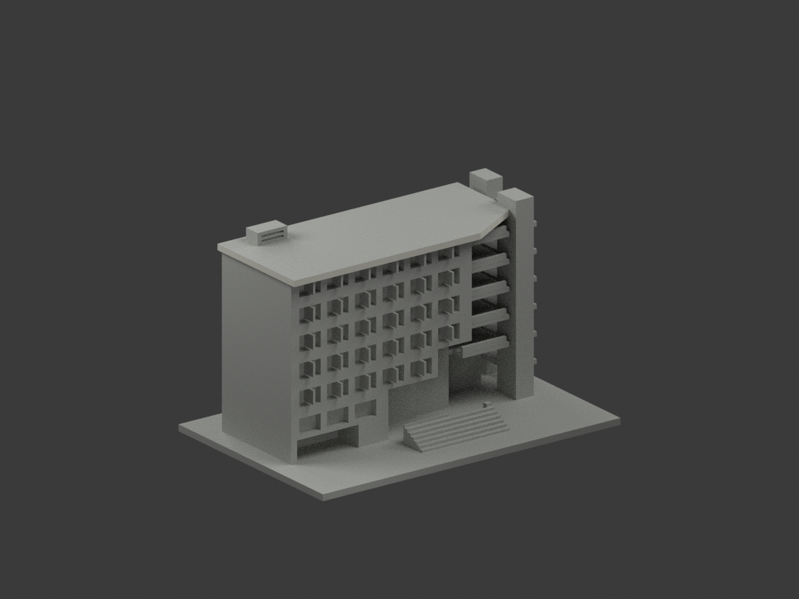
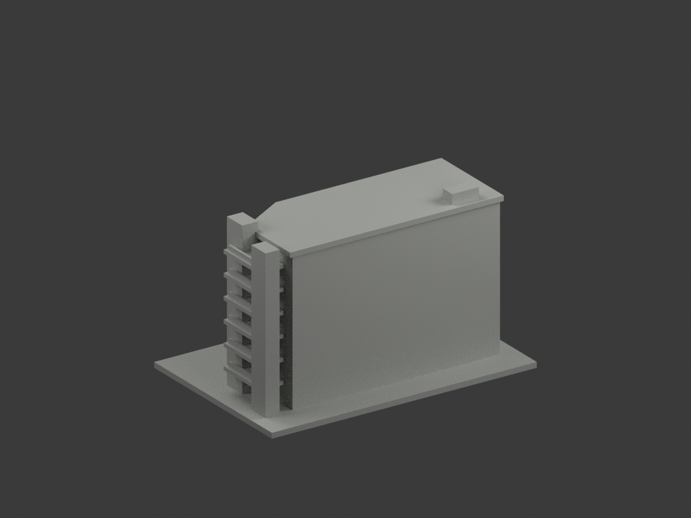
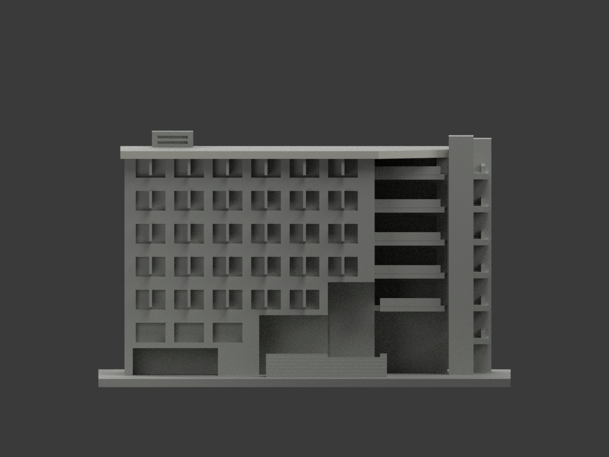
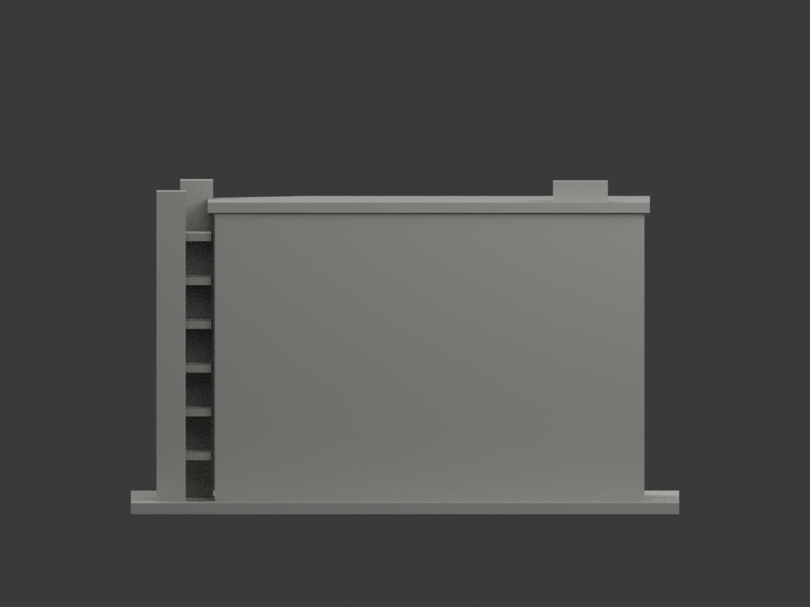
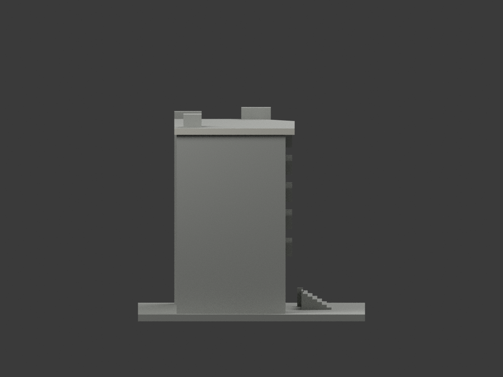
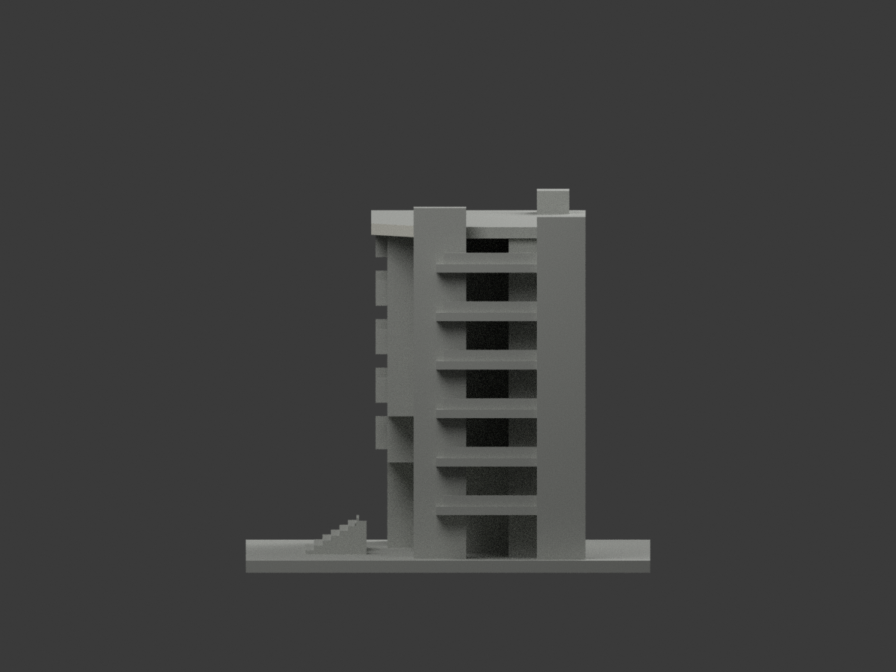
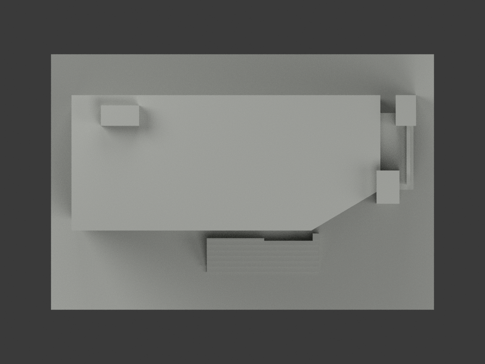
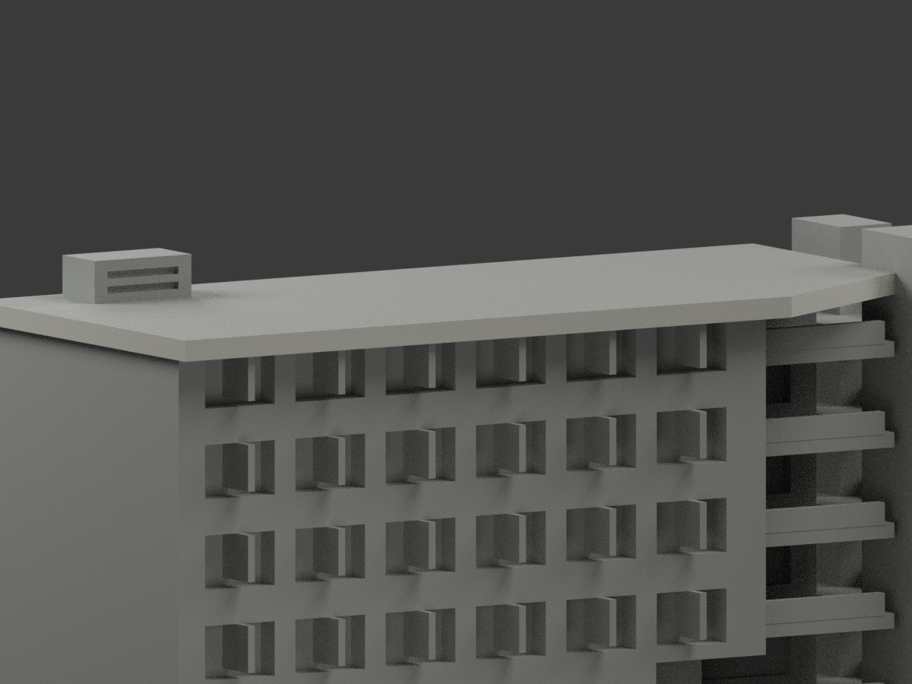
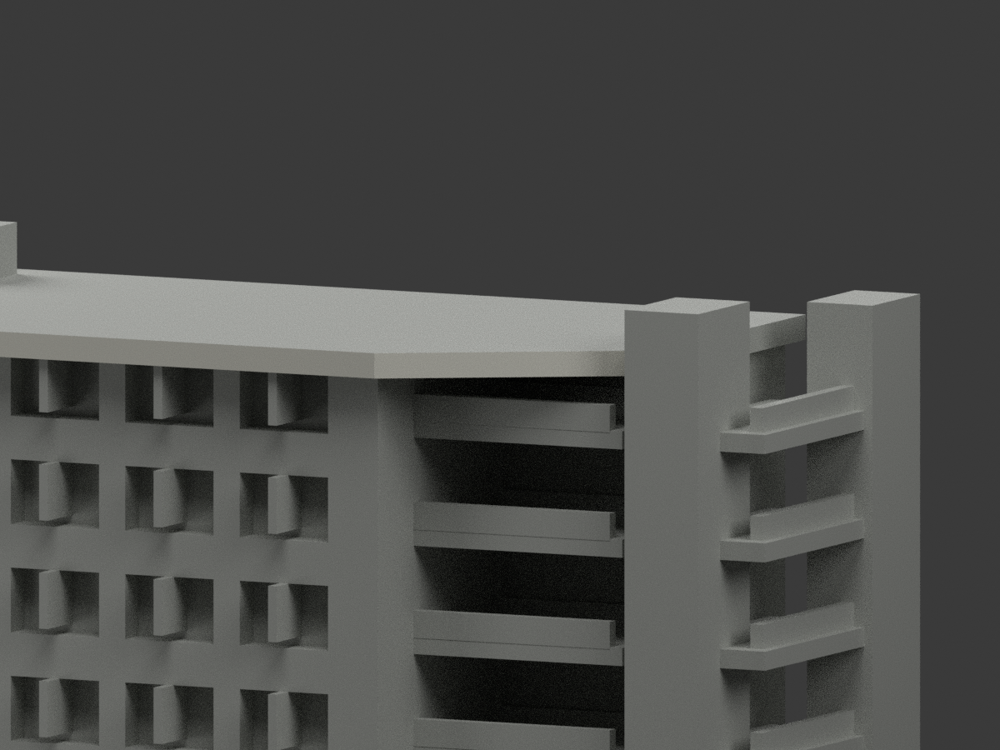
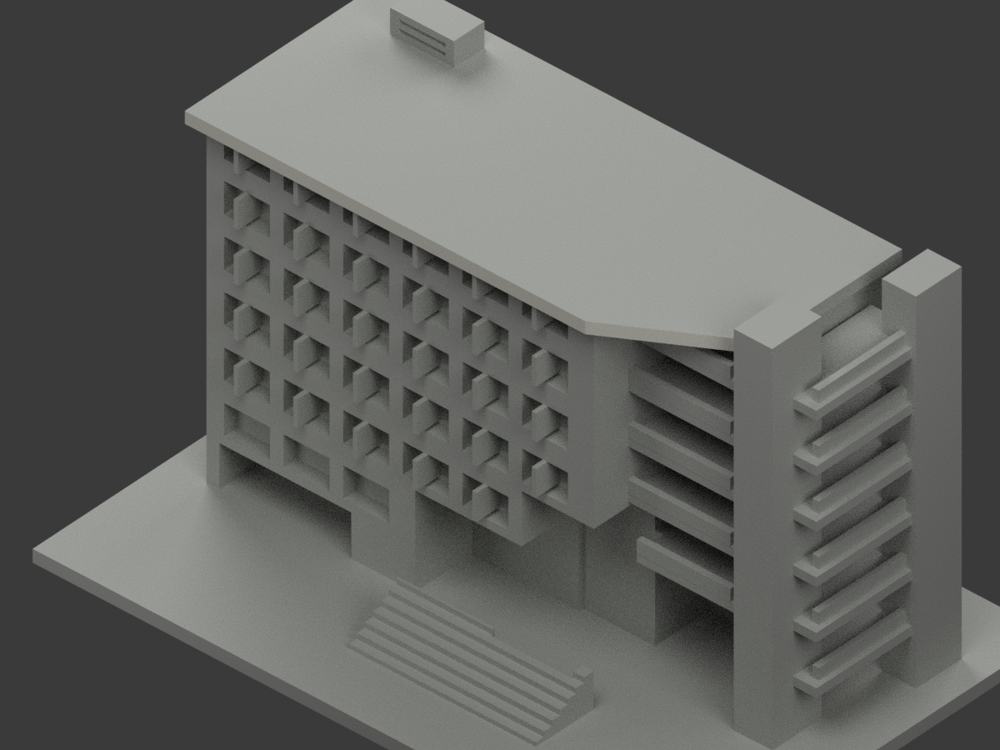

# 弘光 P 綜合教學大樓｜左屋簷窄邊同材質延續

## 模型預覽

| 總覽 | 背側 | 正面 |
|---|---|---|
||||
||||
||||
||||

## 本次弘光 P 左屋簷窄邊補色

只將原 polygon 屋簷最左外立窄邊的 2 個完整原三角 [1979,2022] 延用原淺暖灰槽 0。原 4 灰面包含前緣與右折面全部保留；其他 2,196 面不變。新版 6 灰／2,192 未驗證中性，槽 1 原名明列 unverified，不把具名混凝土等實色當中性。原 1,077 點、2,198 三角、面序、STL bytes 與 palette bytes 全保留，不切面、不改幾何、不增加棟數。

唯一有限域 x=−67、y=−19…34、z=82…84.8 mm，外法向 −X。全部頂點核對有限域，兩原三角完整四角矩形等於完整共面連通分量，前方 2.8 mm 整邊鄰接既有灰面；572 共面域維持單材。名義解析面積 53×2.8=148.4 mm²，原 STL float32 的頂 z=84.80000305175781，使實際三角面積 148.40016174316406 mm²，使用 0.0002 mm² 容差承認這個原浮點差，絕不 round 原點湊數。

本輪親看承包商港洲營造工程頁兩張實景，右磚塔「綜合教學大樓」字樣、折角寬簷、下層階梯狀大開口與右凹廊對應原 P 單群。來源是承包商自己的工程記錄，不稱校方實拍。原屋簷前邊及右折邊連續淺暖灰可與暗底區分；正向照左角與左邊框可辨，但模型左側完整 53 mm 深度並未全展示。該窄邊是同一屋簷材料族延續推論，未見部分不是逐面實照確證；不因此塗整左牆，原左窄帶與真樓垂直邊框之間的簡化關係不獲實測認證。

原資料登記的兩張 SHA 對應網站 timthumb 1920×1080 版本，本輪取回皆相符。原 upload 圖檔與 timthumb 圖檔的 SHA 分別列於面域報告，不冒稱不同版本檔案相同。2009-05-21 是完工日，不是拍攝日；兩照片拍攝日未知，不把另一 2013 來源日期套用，不宣稱 2026 現況、精確 HEX 或校準材質。原照只私人研究，不入公開包或貼圖，不推定再散布及商用許可。

頂面、暗底／soffit、後緣、右後窄邊、整左牆、文字磚塔、玻璃與混框、露台實欄代理、設備、台階基座及未知背面全不染。既有右折灰面由 tower union 實際止於 x=52.5、y=−3.88888884，保留原面和止界，不改成名義 54／−3。不新增玻璃金字塔、接縫、樓層或細節；六列可見窗不認證全樓僅六層。仍是局部補色未完成，非測繪或施工圖、未實印或驗證多料切片，STL 無色。

舊來源、QA、原建模／補色程式及校驗表保持原 bytes；下方舊文件「4 灰／只前與右折」為歷史範圍。新版 QA 在 `qa-continuous-walls/`，校驗表 `CONTINUOUS-ROOFEDGE-SHA256SUMS`，root scene 和十視角更新。full-float 3MF strict 讀回精確對原 STL，隔離材色往返及 Blender 材質／頂點編輯重開、preview 逐 bytes 重渲染另列 QA，不替代交付幾何。

新版入口 `python build_continuous_roofedge.py`、`python verify_continuous_exchange.py`；Blender 使用 `render_continuous_roofedge.py`、`verify_continuous_scene.py`。`rebuild-continuous-roofedge.zip` 含固定 SHA 原公開 baseline、STL、面域與新腳本，隔離解壓精確重建 NPZ／3MF／palette，不含原照。舊 `colorize_model.py` 與 `export_appearance.py` 只留歷史，不用於新版。

場景僅同步更新 source_mesh_sha256 以對應本次含兩面材質指派變更的 color-mesh.npz；原 scope 與全部其他原屬性、全部材質定義及幾何不變。原簡化屋簷與左側構件關係、未知建築後側中性、拍攝日期未知及未實印等限制完整保留；新增左窄邊明示同構件材料延續推論，非完整側面獨立照片證實。兩槽 palette.json 原 bytes 完全保留，既有槽名僅描述原前緣色族，不代表新增左邊逐面直接實證。

本頁為現行說明；根 README.zh-TW.md 保留舊版本原文及原 bytes，僅作歷史記錄。

## 前版說明與保留限制（完整歷史文字）

# 弘光P綜合教學大樓｜前屋簷與右折緣局部淺灰

**文字磚塔、主牆與其他材域未完成分色。** partial_color_incomplete=true、fully_colored_exterior=false。僅前屋簷2面與右折緣2面名義暖灰，非全館完整補色。

## 材色範圍
同 hku-p-comprehensive-teaching 原項目，same-item、count_delta=0。弘光科技大學校本部P綜合教學大樓單群，原2198三角面、STL與build_model.py字節不變；原18件無OBJ，不假稱保存不存在的原件。
- 原屋polygon前邊y−19、x−67..27，z82..84.8完整2面。右折邊16(x−27)−27(y+19)=0、原端(27,−19)→(54,−3)、同z完整2面。全三頂點有限plane核，兩整無限plane各恰2，無漏片或normal/centroid選面。
- 右折面原tower union實際止於x52.5、y−3.88888884，而非原碼端54/−3。此為原Boolean外露邊界，並非人為裁色；全2三角保留。
- 其餘2194面中性：上屋皮／陰影底／左後屋緣、文字磚塔、混框玻璃與主牆、陽台實欄／板側、階與地面／設備均不擴染。
- 不新增玻璃金字塔、文字與其他樓層。原模型6可見窗列並非認證全館只有6層；原碼層數描述不能用本次補色補造未見樓層。材色不追認原形為精測，中性邊界只是證據範圍。

## 來源與日期
親看承包商兩張實景，連續淺暖灰屋外立邊與暗底可區別；不用陰影作固有材色。2009完工不是拍攝日，拍攝日期未知，不宣稱2026現況。
原照私存不公開、不貼圖，未確認CC／再散布授權，不保證商用。HEX僅名義色族非校準色票。正式GO繼承先期review文字，不免builder幾何及域核。

## 格式與列印
[原STL](model.stl) · [逐面材色3MF](appearance.3mf) · [Blender](scene.blend)
原150×100mm展示底座，照片近似非精測比例。物件名 HKU P Comprehensive Teaching partial color，從真slug與館名獨立核對。STL無色，3MF與Blender有逐面材；兩材標籤非驗證兩色／四色耗材切片，未實際列印，無切片路徑。

## 重建與 QA
原build_model.py → colorize_model.py → export_appearance.py → validate_color.py；Blender render_color.py／verify_color_scene.py。完整隔離精確原build＋color重建、原bytes／全三角multiset、閉合正體積、3MF逐面材、scene重開、十圖1200×900與圖文hash。隔離原依賴，不改原碼；程序不替代人工來源核對。
原README／previews／validation／renderer保留歷程，不冒充新QA；沒有刪檔。

## English scope
Partial only: two whole front and right-chamfer roof fascia planes,4 original triangles, nominal pale warm gray;2194 neutral. All2198 original triangles and source bytes unchanged;18 immutable files contain noOBJ. Each infinite plane exactly equals its original finite domain. Chamfer ends at52.5/−3.88888884 through original tower union, not color clipping. Lettered brick tower, main mixed walls/windows, top roof and shaded soffits remain neutral. No pyramid, lettering or floors added; six visible window rows do not establish total building floors. Completion2009 is not photograph date, no2026/current measured survey claim. Not tested filament slicing or full exterior color.
