# 文藻外語大學

本輪17件公開外觀研究模型，均由實際STL渲染圖鑑。全校逐棟工作尚未完成；[19棟基線及缺口](校本部/COVERAGE.md)。每件含底板最長150mm，獨立比例，不可拼成同比例校園。

| 建築模型 | 建築模型 | 建築模型 |
| :---: | :---: | :---: |
| [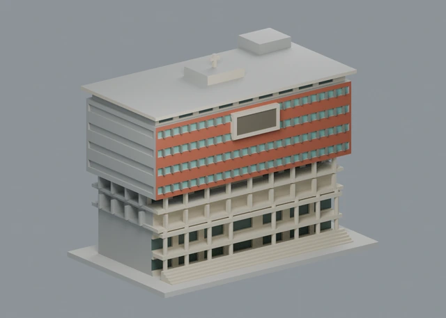](校本部/buildings/wzu-library/README.md) **[圖書館大樓](校本部/buildings/wzu-library/README.md)** | [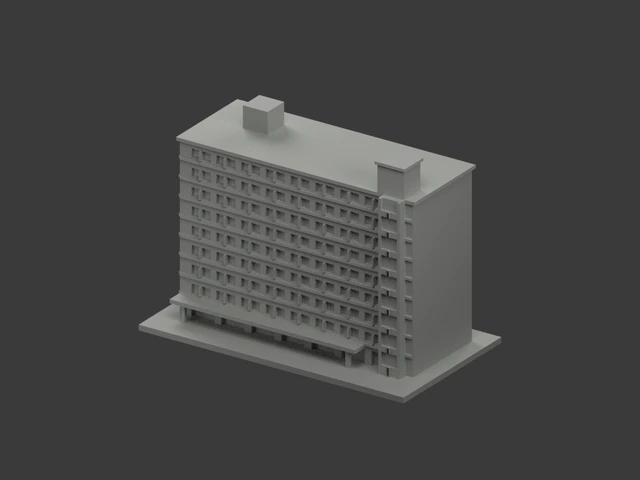](校本部/buildings/wzu-qiuzhen/README.md) **[求真樓](校本部/buildings/wzu-qiuzhen/README.md)** [局部材色3MF](校本部/buildings/wzu-qiuzhen/appearance.3mf) · [範圍與限制](校本部/buildings/wzu-qiuzhen/README.md) | [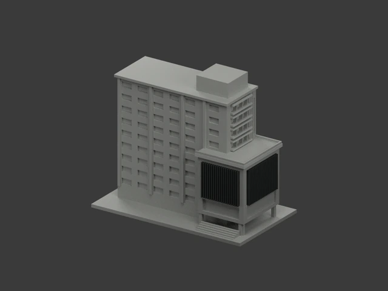](校本部/buildings/wzu-wenrui/README.md) **[文瑞樓](校本部/buildings/wzu-wenrui/README.md)** [局部材色3MF](校本部/buildings/wzu-wenrui/appearance.3mf) · [範圍與限制](校本部/buildings/wzu-wenrui/README.md) |
| [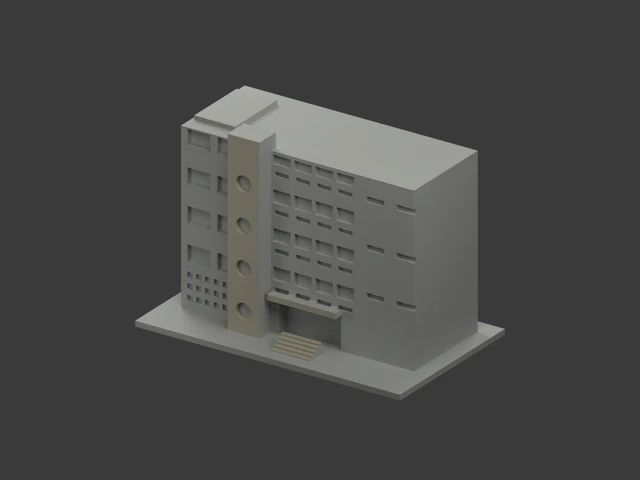](校本部/buildings/wzu-student-activities/README.md) **[學生活動中心](校本部/buildings/wzu-student-activities/README.md)** [局部材色3MF](校本部/buildings/wzu-student-activities/appearance.3mf) · [範圍與限制](校本部/buildings/wzu-student-activities/README.md) | [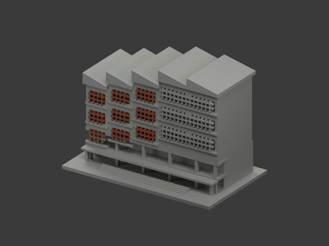](校本部/buildings/wzu-juxian/README.md) **[聚賢館](校本部/buildings/wzu-juxian/README.md)** [局部材色3MF](校本部/buildings/wzu-juxian/appearance.3mf) · [範圍與限制](校本部/buildings/wzu-juxian/README.md) | [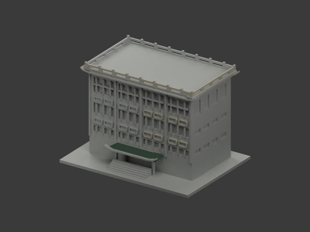](校本部/buildings/wzu-gongjian/README.md) **[公簡廳](校本部/buildings/wzu-gongjian/README.md)** [局部材色3MF](校本部/buildings/wzu-gongjian/appearance.3mf) · [範圍與限制](校本部/buildings/wzu-gongjian/README.md) |
| [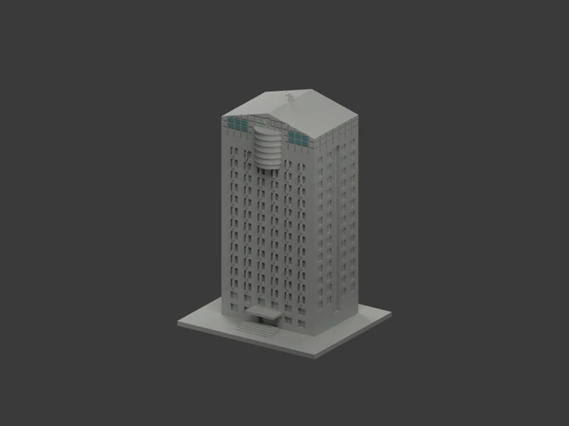](校本部/buildings/wzu-zhishan/README.md) **[至善樓](校本部/buildings/wzu-zhishan/README.md)** [局部材色3MF](校本部/buildings/wzu-zhishan/appearance.3mf) · [範圍與限制](校本部/buildings/wzu-zhishan/README.md) | [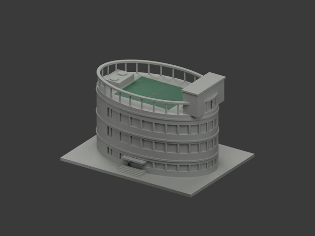](校本部/buildings/wzu-yumei-gym/README.md) **[育美體育館](校本部/buildings/wzu-yumei-gym/README.md)** [局部材色3MF](校本部/buildings/wzu-yumei-gym/appearance.3mf) · [範圍與限制](校本部/buildings/wzu-yumei-gym/README.md) | [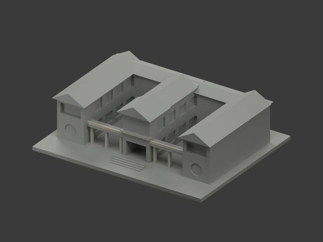](校本部/buildings/wzu-mingyuan/README.md) **[明園](校本部/buildings/wzu-mingyuan/README.md)** [局部材色3MF](校本部/buildings/wzu-mingyuan/appearance.3mf) · [範圍與限制](校本部/buildings/wzu-mingyuan/README.md) |
| [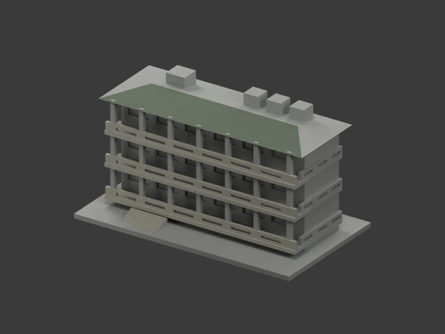](校本部/buildings/wzu-zhuangjing/README.md) **[莊敬樓](校本部/buildings/wzu-zhuangjing/README.md)** [局部材色3MF](校本部/buildings/wzu-zhuangjing/appearance.3mf) · [範圍與限制](校本部/buildings/wzu-zhuangjing/README.md) | [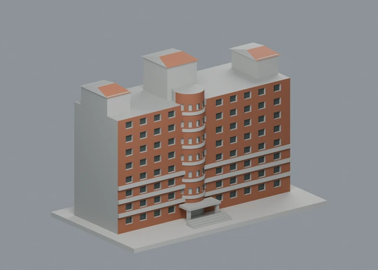](校本部/buildings/wzu-millennium/README.md) **[千禧樓](校本部/buildings/wzu-millennium/README.md)** | [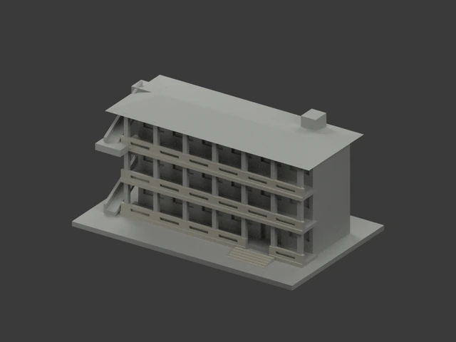](校本部/buildings/wzu-ziqiang/README.md) **[自強樓](校本部/buildings/wzu-ziqiang/README.md)** [局部材色3MF](校本部/buildings/wzu-ziqiang/appearance.3mf) · [範圍與限制](校本部/buildings/wzu-ziqiang/README.md) |
| [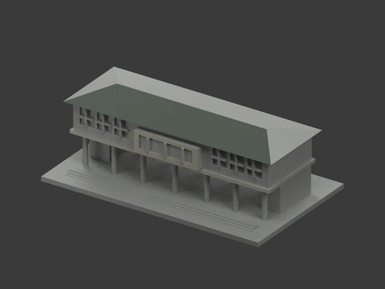](校本部/buildings/wzu-wenyuan/README.md) **[文園](校本部/buildings/wzu-wenyuan/README.md)** [局部材色3MF](校本部/buildings/wzu-wenyuan/appearance.3mf) · [範圍與限制](校本部/buildings/wzu-wenyuan/README.md) | [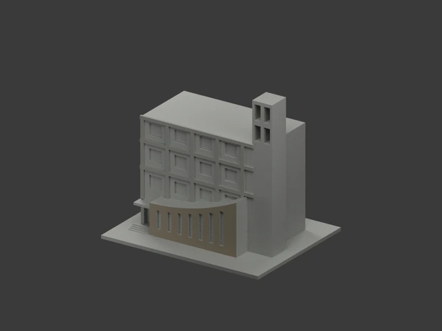](校本部/buildings/wzu-convent/README.md) **[修院暨教職員宿舍](校本部/buildings/wzu-convent/README.md)** [局部材色3MF](校本部/buildings/wzu-convent/appearance.3mf) · [範圍與限制](校本部/buildings/wzu-convent/README.md) | [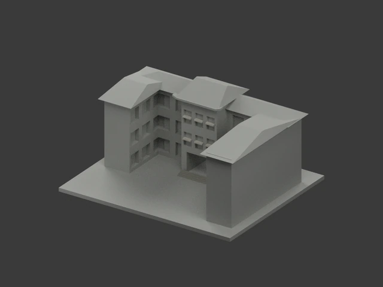](校本部/buildings/wzu-lourdes/README.md) **[露德樓](校本部/buildings/wzu-lourdes/README.md)** [局部材色3MF](校本部/buildings/wzu-lourdes/appearance.3mf) · [範圍與限制](校本部/buildings/wzu-lourdes/README.md) |
| [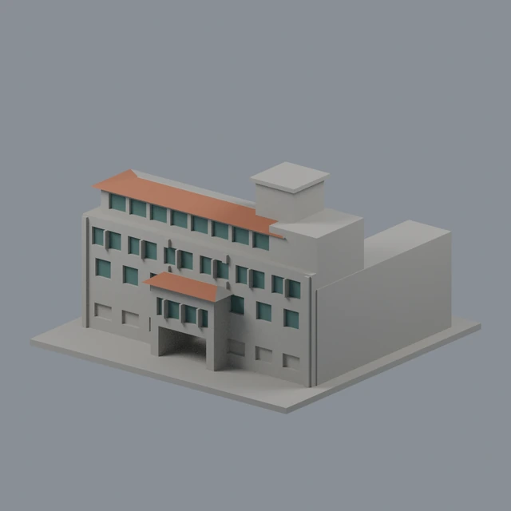](校本部/buildings/wzu-administration/README.md) **[行政大樓](校本部/buildings/wzu-administration/README.md)** [限域外觀](校本部/buildings/wzu-administration/appearance/README.md) | [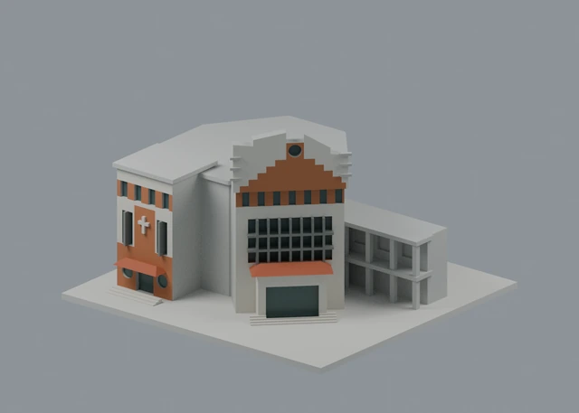](校本部/buildings/wzu-huayu-chapel/README.md) **[化雨堂暨詠穌堂](校本部/buildings/wzu-huayu-chapel/README.md)** |  |

所有模型均附STL、Blender、Python重建、正背預覽、繁中說明、來源與檢驗。原STL拓撲/法向、重建SHA與Blend一致性、0.2mm閉合/有效輪廓均通過；0.8mm薄篩只作幾何提示，不是真正切片或試印。懸挑屋簷、雨遮、柱廊需檢查支撐。來源照片、PDF及私用QA對照不公開。

照片日期大多未標；現況表填於2023-12，不宣稱2026實測外貌。[校方逐館來源](https://c005.wzu.edu.tw/category/132558)。個別限制與SHA請見館舍詳頁。[逐項來源與缺口續接](校本部/SOURCE-CONTINUATION.md)。

圖書館大樓已補[正面八材質外觀交換版](校本部/buildings/wzu-library/appearance/README.md)：紅磚橫帶、青綠玻璃與米白柱檐近似配色；側後／屋面未確認部分中性。原幾何、8 層薄篩警示及尚未 FFF／實印的限制保留，仍為既有 17 包。

化雨堂暨詠穌堂已補[七材質外觀交換版](校本部/buildings/wzu-huayu-chapel/appearance/README.md)：兩堂主要磚白區、短門廊頂與深窗按實照近似。保留原 STL，僅共面細分交換網格、不改外包絡；未確認側後／屋面中性，未 FFF／實印。仍為同一包，文藻仍 17 件。

千禧樓已補[正面六材質外觀交換版](校本部/buildings/wzu-millennium/appearance/README.md)：紅磚、灰帶／塔面、深窗及窄塔頂朝前坡面橘瓦近似。原帶寬與塔盒簡化、未知側後／屋面中性及製造限制保留；未經 FFF／實體試印，仍是既有 17 包之一。
