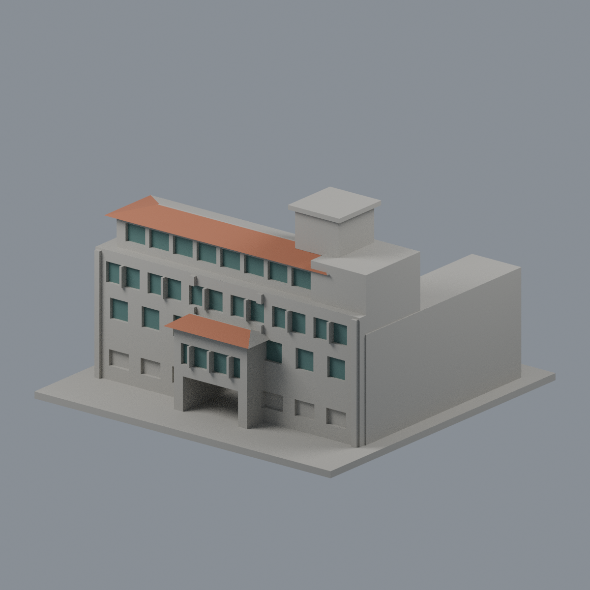
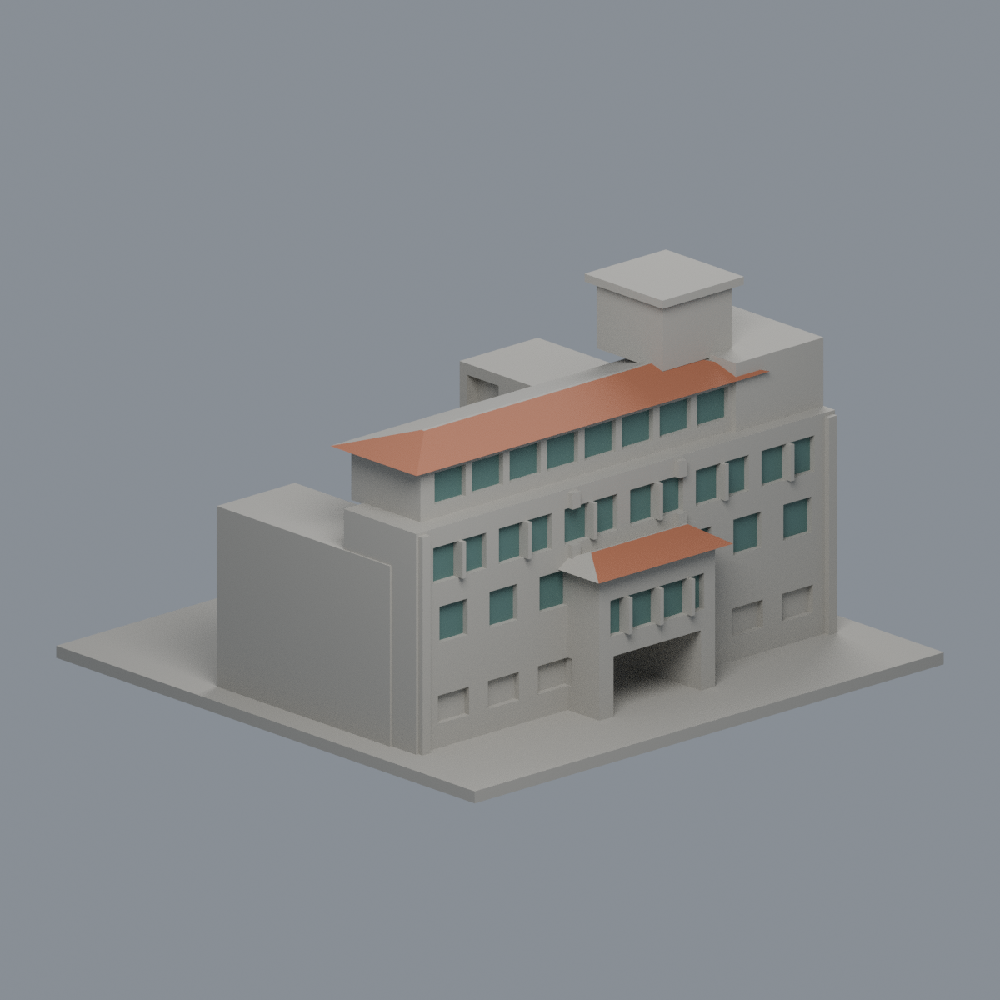
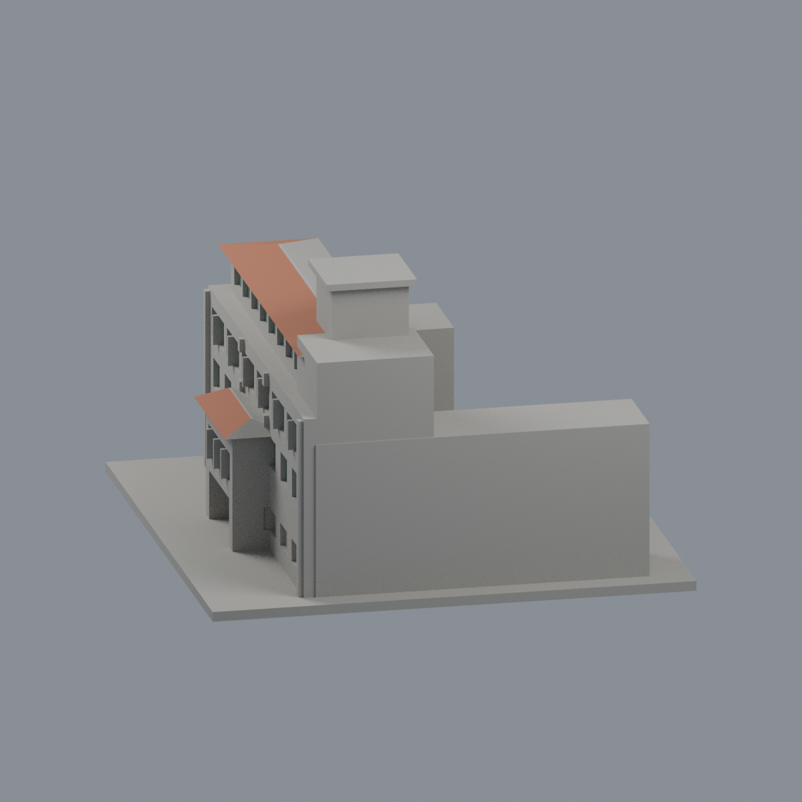
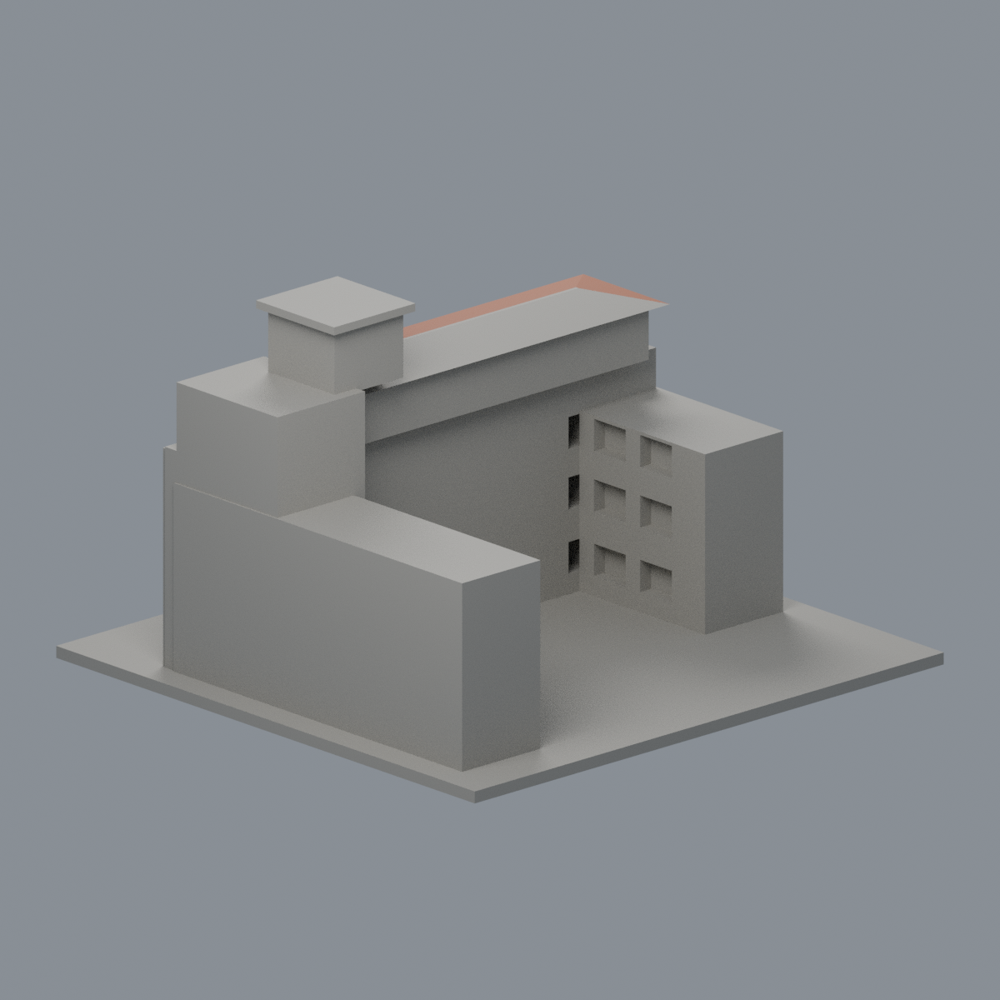
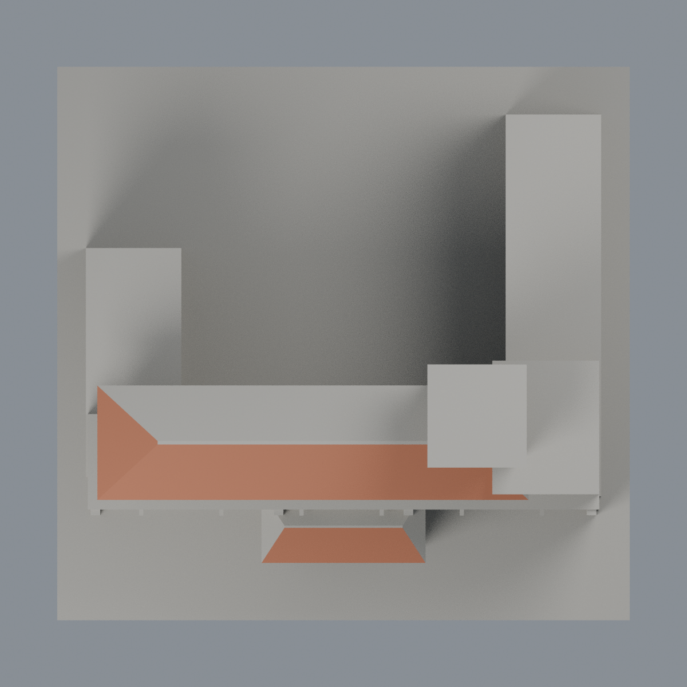

# 行政大樓｜文藻外語大學

## 模型預覽

| 新版模型預覽 | 新版模型預覽 | 新版模型預覽 |
| :---: | :---: | :---: |
|  |  |  |
|  |  |  |

## 本次主屋頂左坡同材質補色

僅將主屋頂左側完整梯形的 2 個原中性三角面（485、486）延用既有歷史紅瓦代理色 1。保留原 9 個正面屋坡面、42 個窗背面及全部既有理由；1,442 個原三角／701 點、STL 位元、座標、面序皆不變。現為中性 1,389、紅瓦 11、窗背 42 面。不是新建一套模型。

有限平面為 u=(z−71)/4、x=−64.5+15.82u、0≤u≤1、|y+26|≤15−14.55u，外法向比例為 (−4,0,15.82)。只收完整原三角，形成四頂點梯形；原面積 252.11087151 mm²，解析面積 252.11086363 mm²，差異小於 0.00003 mm²。右側高服務塔交接遠離選區，不切面、不修補、不改屋坡厚度或原估算形狀。

本輪親看官方 AAA 歷史正面照片，支持主屋頂紅瓦家族；左坡以同一屋頂材質延伸推論，並非側後照片直接確認。來源相機時間 2008-09-24 16:08:20，時區及相機日期未獨立核實；不是 2026 現況。後坡、右坡、門廊側後坡、屋脊、頂面、簷邊、混合磚灰牆、高塔及底座不擴色。代理色非校色測量，無實體試印聲稱。原照片只供私人研究，不入公開包。

新版驗證在 `appearance/qa-continuous-walls/`，歷史 QA、根 `SHA256SUMS` 與 `SHA256SUMS.txt` 留存作歷史記錄，舊雜湊不代表本次產品；新校驗表用 `appearance/SHA256SUMS`、根 `PUBLIC-MODEL-SHA256SUMS`。歷史文件中的 51 面／側坡中性為原版本範圍，本節記錄新增 2 面。重建用 `python appearance/source/build_continuous_walls.py`，交換驗證用 `python appearance/source/verify_continuous_exchange.py`，Blender 背景執行 `render_continuous_walls.py` 與 `verify_continuous_scene.py`。ZIP 包含原 STL、建模腳本、既有 23 域和新增左坡有限域，無照片。原製造與未見立面限制仍適用。

## 前版說明與保留限制

校本部／公開外觀近似模型。每棟獨立縮放，最長尺寸含底板150mm；並非各館同一比例。實際尺寸：150.00 × 145.00 × 92.50 mm。

## 外觀與範圍
三層主正面、後退高窗層、右側高低服務塔、中央覆瓦門廊、兩側不等長返翼及院內廊道。

依官方校圖與公開外包絡/側照近似返翼深度及庭院；未重建室內房間或設施。不同地形高度以單一模型底板簡化；遠端窗序近似。

主要依據[校方建築物介紹](https://c005.wzu.edu.tw/category/132558)及[2025-03-12公開PDF第12頁外觀照片](https://c004.wzu.edu.tw/datas/upload/files/Documents/111_1075_%E6%A0%A1%E5%9C%92%E7%81%BD%E5%AE%B3%E9%98%B2%E6%95%91%E8%A8%88%E7%95%AB%E6%9B%B8_1140312.pdf#page=12)。現況表填於2023-12；兩來源照片拍攝日期未註明，不把文件日期當拍攝日期，不宣稱2026完全現況。來源照片、PDF及私用對照不隨模型公開。[完整來源及近似限制](sources.json)。

## 檔案
- [STL](model.stl)／[Blender](scene.blend)／[Python重建](build_model.py)
- [原始STL拓撲、法向、重建SHA及Blend一致性](validation.json)
- [0.2mm輪廓閉合與逐輪廓/合成多邊形有效性](contour-validity-check.json)
- [0.8mm XY薄特徵篩查](thin-feature-check.json)

## 數位檢查與列印限制
單一連接表面殼、正體積、所有邊恰有兩面、vertex-link單循環、無獨立內腔、原始法向一致；Python重建SHA相同，Blend與STL三角形一致。0.2mm實際STL斷面通過閉合及有效性assert，未用buffer修補無效多邊形。

中央地面穿堂確實通過主樓，院落未填實；窗框1.1mm為附牆浮雕；長出簷及入口跨距需支撐檢視。

這些均為數位幾何檢查，未經實際列印或真正列印切片器驗證。建議底板朝下、0.4mm噴嘴、0.2mm層高作為切片起點；簷口、雨遮、格柵及挑空需在切片器檢視支撐、橋接與可拆性；不得據此保證免支撐。

## 重建
Python 3.12，安裝requirements.txt，執行build_model.py；Blender以背景模式執行render_preview.py，產生實際STL預覽與scene.blend。接著依序執行validate_model.py、check_contour_validity.py、check_thin_features.py，退出碼均須為0且validation.json所有checks為true。

STL SHA-256：aeb72efac741a2f0c4e8a878fbef02f7b33d34f7f425c10ac0964d1a3219d81f

[校區圖鑑](../../README.md)／[學校](../../../README.md)

## 歷史限域外觀層

[三材質3MF、可編輯Blend與五視角](appearance/README.md)：只染前紅屋坡9面與綠灰窗背42面，1391面維持未查證中性。官方AAA圖EXIF三日期為2008-09-24 16:08:20，無offset；非2026整樓現況。這項新年代辨識補充上文歷史原始來源說明；本輪未重看2025 PDF。原幾何及製造限制不變。

