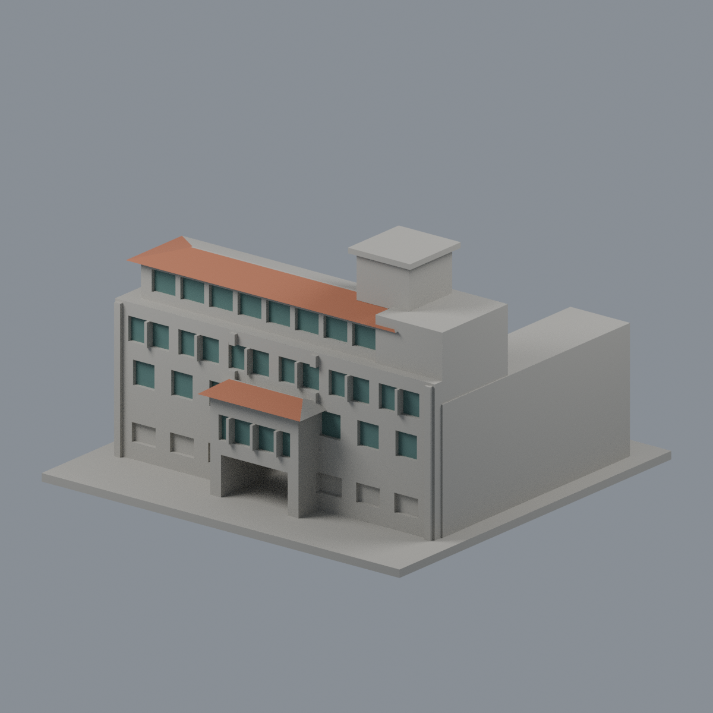
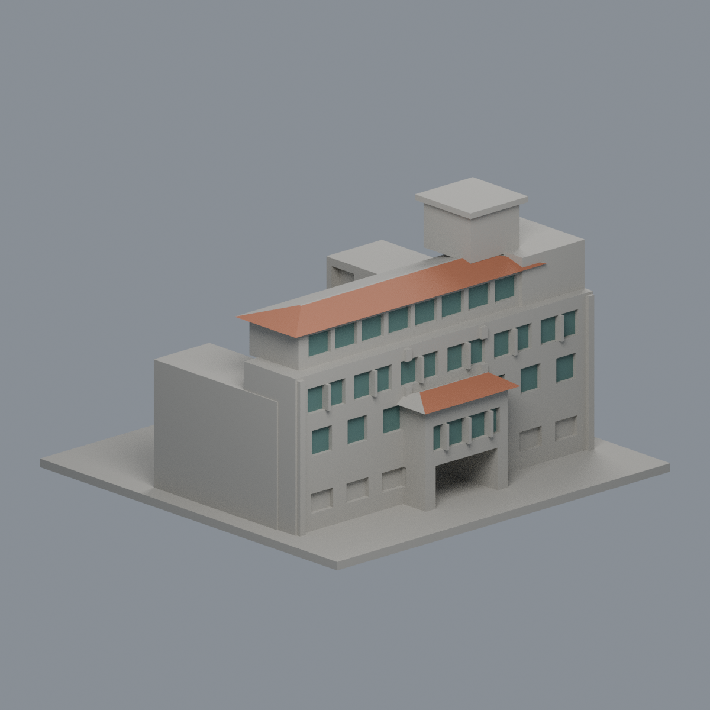
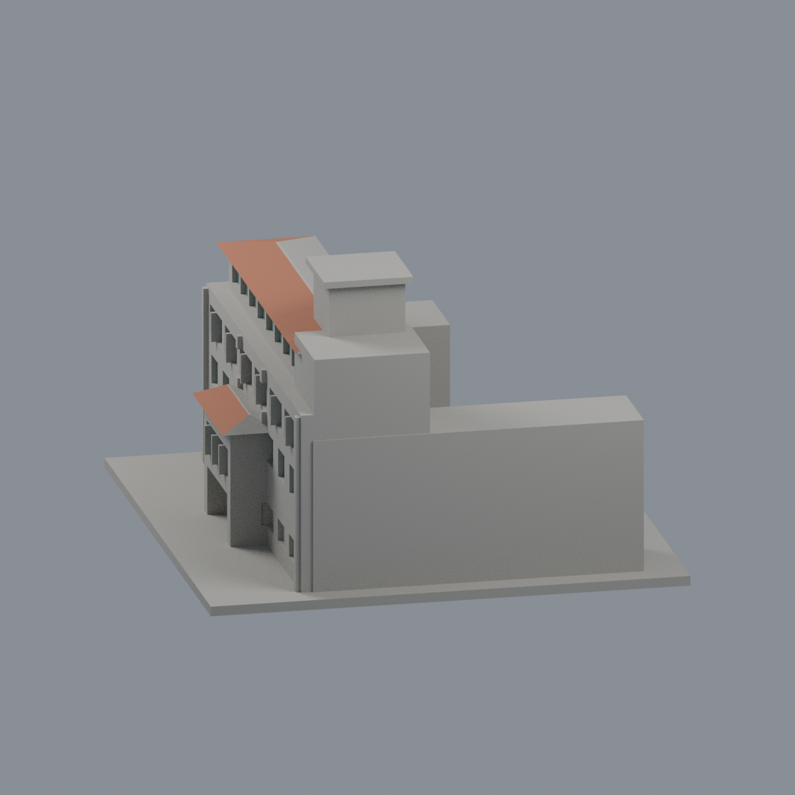
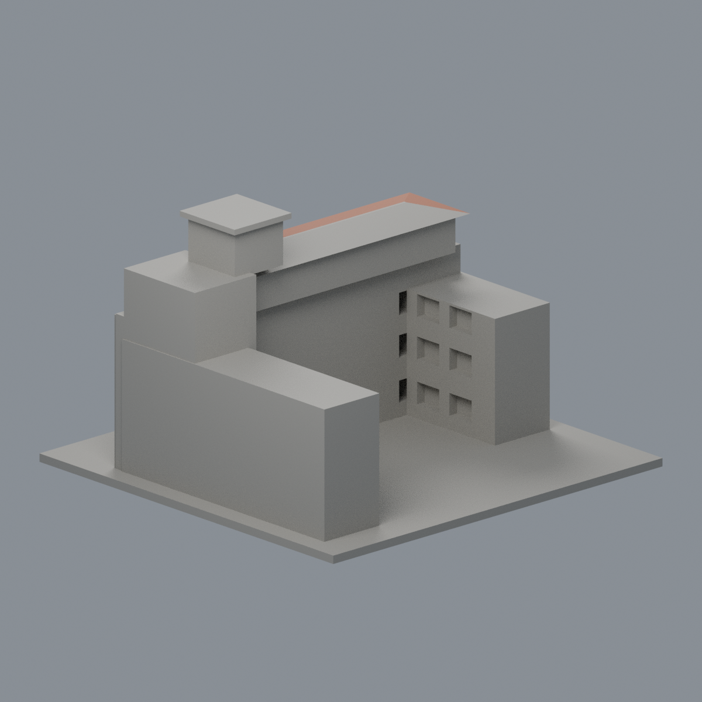
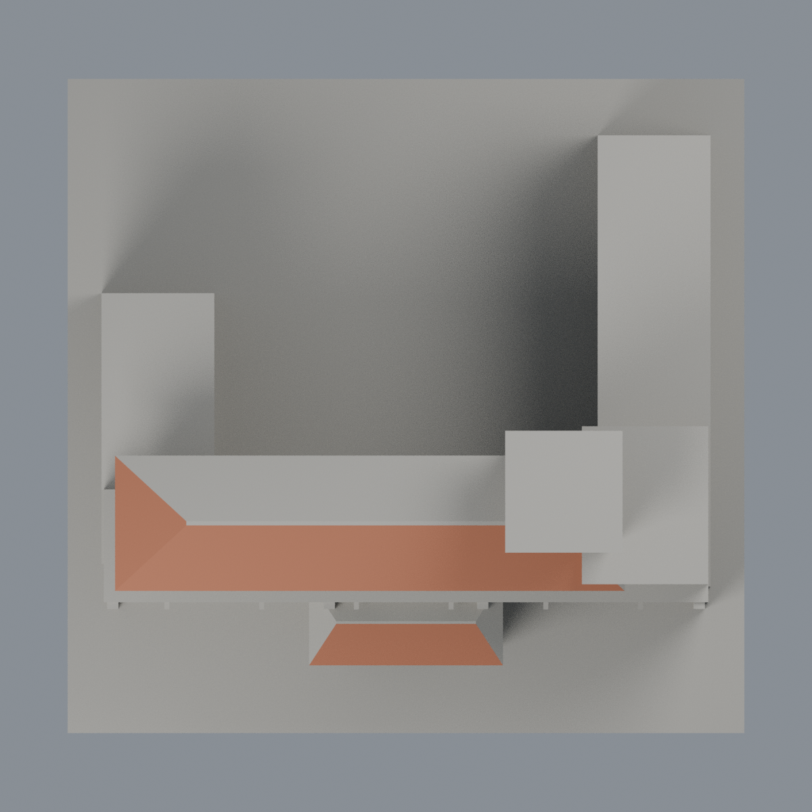

# 文藻外語大學行政大樓：歷史限域外觀層

| 模型預覽 | 模型預覽 | 模型預覽 |
| :---: | :---: | :---: |
| 正面  | 左面  | 右面  |
| 背面  | 頂面  |  |

## 本次主屋頂左坡同材質補色

僅將主屋頂左側完整梯形的 2 個原中性三角面（485、486）延用既有歷史紅瓦代理色 1。保留原 9 個正面屋坡面、42 個窗背面及全部既有理由；1,442 個原三角／701 點、STL 位元、座標、面序皆不變。現為中性 1,389、紅瓦 11、窗背 42 面。不是新建一套模型。

有限平面為 u=(z−71)/4、x=−64.5+15.82u、0≤u≤1、|y+26|≤15−14.55u，外法向比例為 (−4,0,15.82)。只收完整原三角，形成四頂點梯形；原面積 252.11087151 mm²，解析面積 252.11086363 mm²，差異小於 0.00003 mm²。右側高服務塔交接遠離選區，不切面、不修補、不改屋坡厚度或原估算形狀。

本輪親看官方 AAA 歷史正面照片，支持主屋頂紅瓦家族；左坡以同一屋頂材質延伸推論，並非側後照片直接確認。來源相機時間 2008-09-24 16:08:20，時區及相機日期未獨立核實；不是 2026 現況。後坡、右坡、門廊側後坡、屋脊、頂面、簷邊、混合磚灰牆、高塔及底座不擴色。代理色非校色測量，無實體試印聲稱。原照片只供私人研究，不入公開包。

新版驗證在 `qa-continuous-walls/`，歷史 QA、根 `SHA256SUMS` 與 `SHA256SUMS.txt` 留存作歷史記錄，舊雜湊不代表本次產品；新校驗表用 `appearance/SHA256SUMS`、根 `PUBLIC-MODEL-SHA256SUMS`。歷史文件中的 51 面／側坡中性為原版本範圍，本節記錄新增 2 面。重建用 `python appearance/source/build_continuous_walls.py`，交換驗證用 `python appearance/source/verify_continuous_exchange.py`，Blender 背景執行 `render_continuous_walls.py` 與 `verify_continuous_scene.py`。ZIP 包含原 STL、建模腳本、既有 23 域和新增左坡有限域，無照片。原製造與未見立面限制仍適用。

## 前版說明與保留限制

既有模型的局部材質改善，新增模型套數為零；不是整樓全彩復原，也不是2026現況調查。

- [三材質3MF](wzu-administration-appearance.3mf) · [可編輯Blender](scene.blend) · [材質表](palette.json) · [逐面對照](face-materials.json)
- [正面](previews/front.png) · [左面](previews/left.png) · [右面](previews/right.png) · [背面](previews/rear.png) · [頂面](previews/top.png)
- [來源與年代](SOURCES.md) · [授權說明](LICENSE-NOTICE.md) · [重建原始碼包](rebuild-source.zip)

保留1442個原三角面的座標與面序，原STL bytes不動。僅兩片前向紅屋坡9面（主坡7、門廊2，1768.181312平方毫米）和21組窗背42面（2314平方毫米）；合計51面／4082.181312平方毫米。其餘1391面維持未查證中性色，不表示實際白牆。23有限域要求全部三頂點在明確有限平面／梯形內且叉積法向吻合；不切面、不新增玻璃、不重三角化。

混合磚灰主牆、地層格柵／植栽、側後屋坡、屋脊、簷邊、右高塊及其餘面皆不染。前後坡色彩終止是證據範圍，不是實景材質接縫。窗框與凹口仍是原始幾何，粗略窗序不宣稱精確歷史復原。紅坡、綠灰窗皆未校色的不透明展示代理，非精確RGB或玻璃光學。

## 原幾何與製造限制
150×145×92.5毫米，701頂點、1442三角形。原validation報告通過，單一連接表面、無獨立內腔；原輪廓檢查463採樣層閉合有效。原薄特徵檢查93層、超過1%損失為0層、最大損失比例0.0004314477413078034。以上是原有歷史報告，本輪不冒稱重跑完整製造檢驗。深度及未見立面仍是照片估計，未做窮盡自交、真正切片器或實體列印驗證。穿堂、簷口、門廊跨距及細窗框仍須實際切片檢視支撐；材質改善不消除幾何限制。

## 重建
appearance上層放原model.stl，安裝source/requirements.txt，依序執行 `python source/build_appearance.py`、`python source/verify_exchange.py`，再以Blender背景模式執行 `source/render_appearance.py`、`source/verify_scene.py`。strict 3MF讀取零警告並實際材質修改存讀；Blend驗證真頂點／材質修改存讀及原檔reopen render。乾淨重建比較3MF、map、palette及五張PNG bytes，Blend比較語義不宣稱二進位一致。
