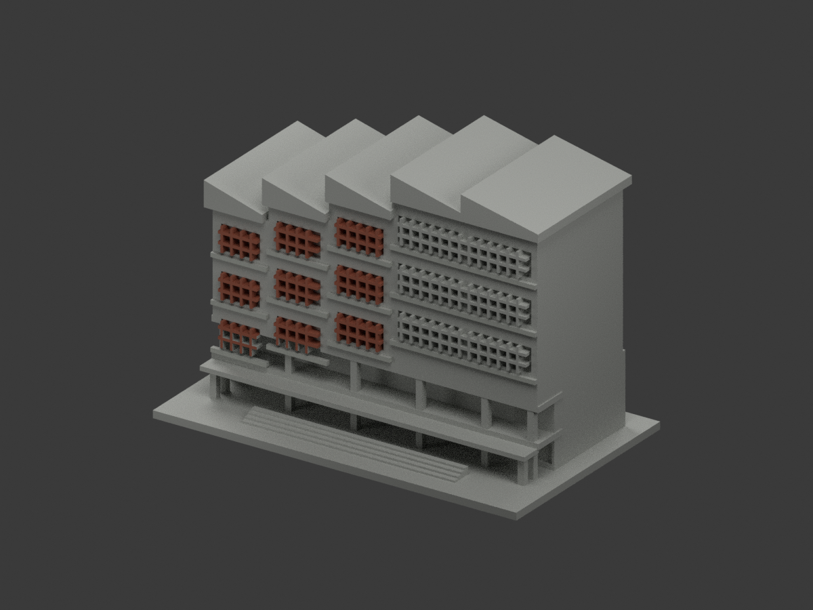
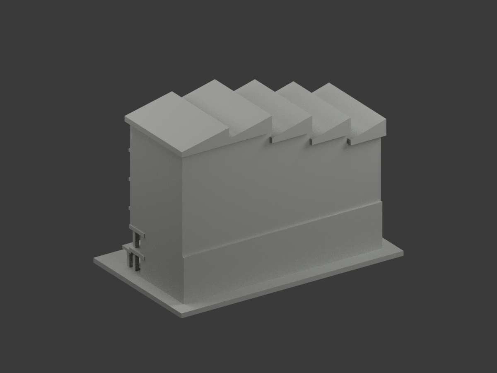
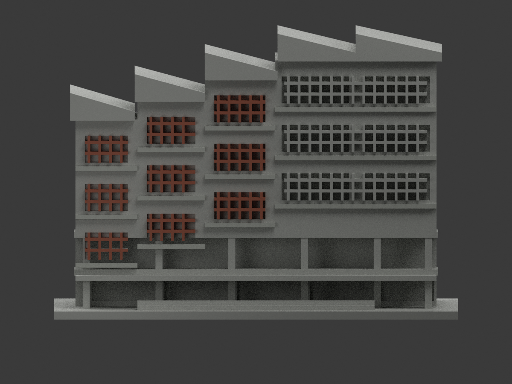
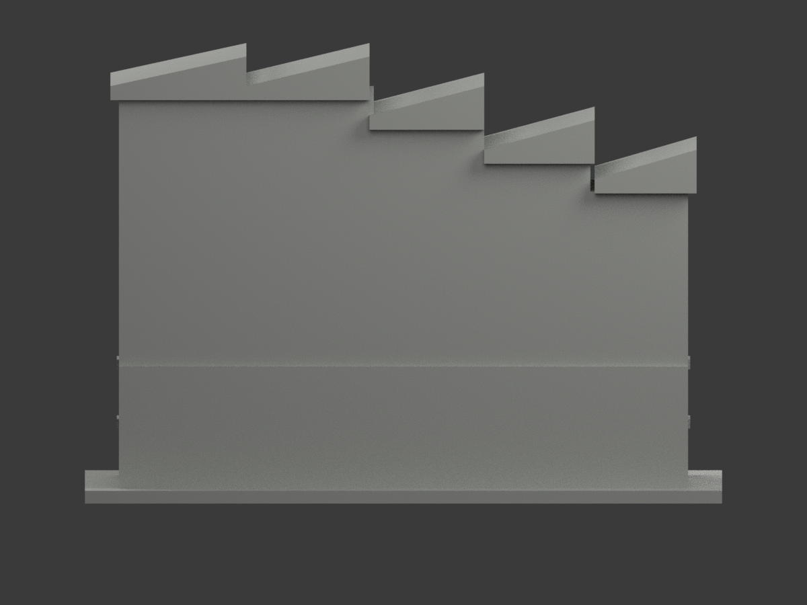
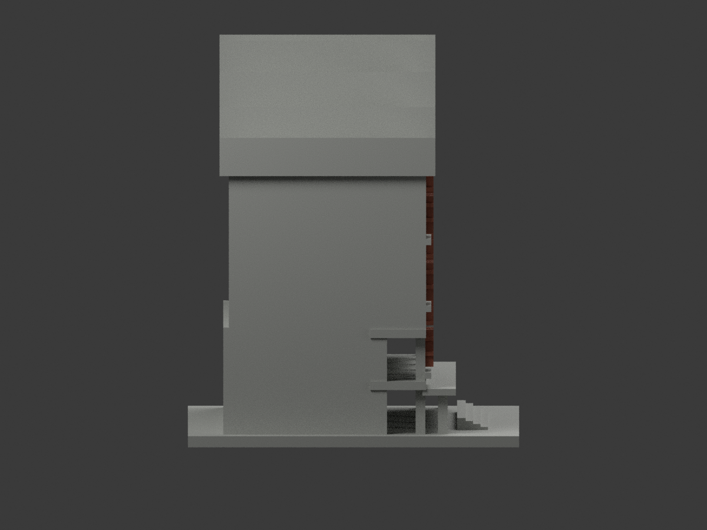
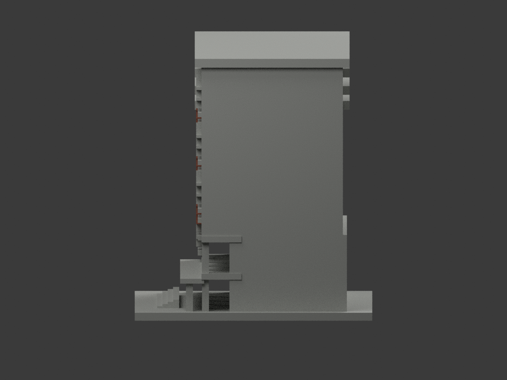
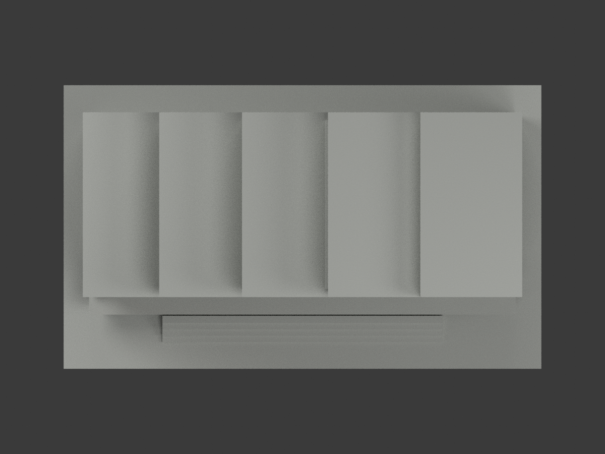
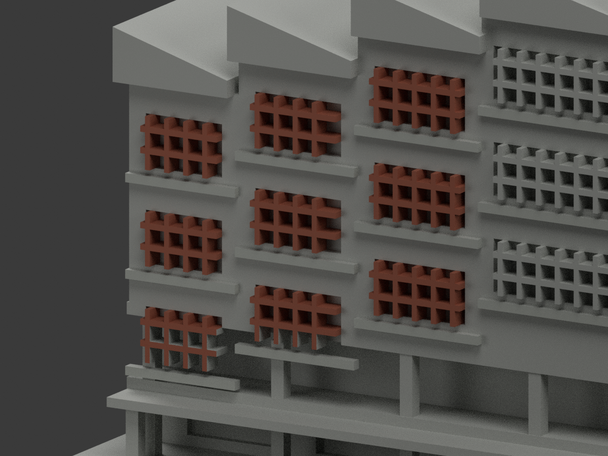
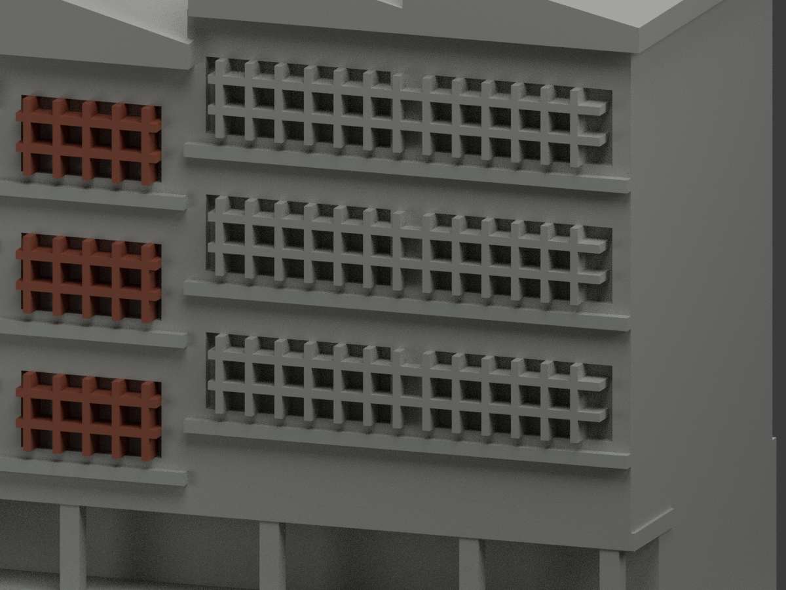
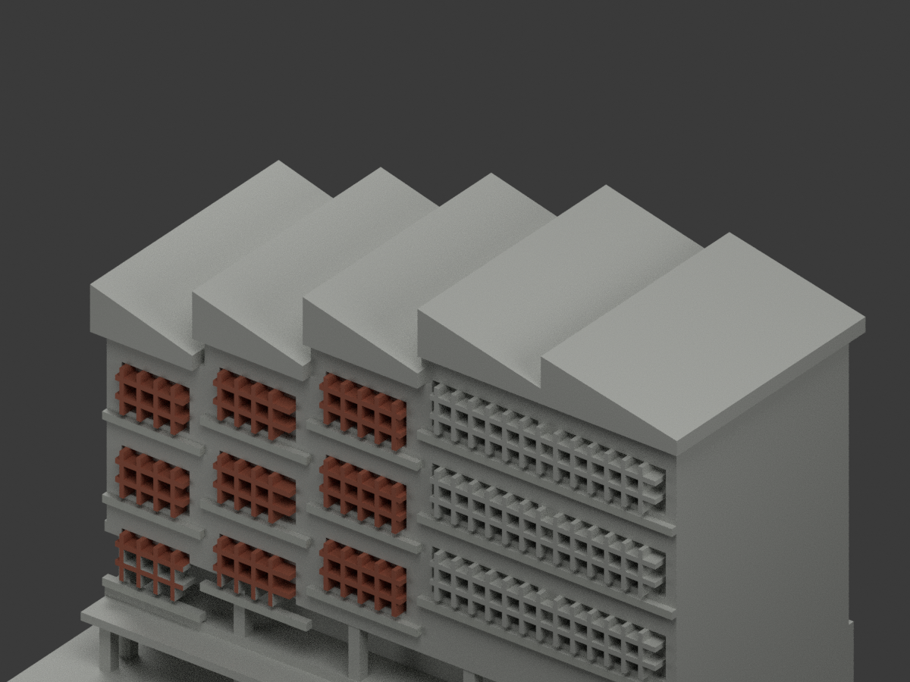

# 文藻聚賢館｜樓帶端返同材質延續

## 模型預覽

| 總覽 | 背側 | 正面 |
|---|---|---|
||||
||||
||||
||||

## 本次聚賢館樓帶垂直端返補色

沿用現行 root 三槽局部配色。僅將 15 個完整原樓帶垂直端返矩形／30 個原中性三角，延用相鄰既有灰色槽 1。原 1,790 紅磚屏面與 24 灰面全保留，完成後紅 1,790／灰 54／中性 4,338 面。原 6,182 三角／3,059 點、STL bytes、面序、頂點及幾何精確不變，色盤 bytes 不變，不切面、不補造細節。

每端返檢查全部三頂點的有限 x／y／z 邊界、外法向、兩三角四角完整矩形與全部共面連通分量；每域前緣有完整邊鄰接原灰樓帶。新增總面積 35.6999903 mm² 對解析 35.7 mm²。最左 x=−67、最右 x=67 等共面延入未知主牆的五端返整域排除；所有上／下面、屋頂、混牆、右側寬格屏及玻璃代理面皆保持原狀，避免三角碎色。

已親看校方聚賢館中庭照片，既有灰樓帶與紅磚屏可辨；細小端返仍明示為同一樓帶材料延續推論，不是每面獨立照片確證或精確校色。照片拍攝時間未知，2007 年落成不當作拍攝日期，不宣稱 2026 現況。模型屬簡化近似造型，非測繪或施工圖；未做實體試印／多料切片。照片只存私人研究，不入公開包。

舊 QA、來源、原建模／補色入口及校驗表保持原 bytes。新版驗證在 `qa-continuous-walls/`，逐檔校驗用 `CONTINUOUS-BANDS-SHA256SUMS`。root scene 與十視角 PNG 為本次新版；舊 README 的 24 灰面或正面限制屬先前範圍，本節記錄新增 30 面。新版 3MF 以完整原 float 座標輸出，原生 lib3mf strict 讀入精確對回 STL；臨時編輯重存精度差另記，不用於交付幾何。

`rebuild-continuous-bands.zip` 含固定 SHA 原公開 baseline NPZ、STL、域報告與新重建腳本，不含照片。執行 `python build_continuous_bands.py`、`python verify_continuous_exchange.py`；Blender 執行 `render_continuous_bands.py` 與 `verify_continuous_scene.py`。原 `colorize_model.py`／`export_appearance.py` 是歷史入口，勿用於新版；原製造與模型限制完整保留。

場景僅同步更新 source_mesh_sha256 以對應本次含材質指派的 color-mesh.npz，並更新 scope，明示 15 個完整樓帶端返同灰推論，以及未知牆、屋頂與背面維持中性、非現況證明；其餘原屬性、全部材質定義與幾何不變。

本頁為現行說明；根 README.zh-TW.md 保留舊版本原文及原 bytes，僅作歷史記錄。

## 前版說明與保留限制（完整歷史文字）

# 文藻聚賢館｜磚屏及樓帶局部材色示意

**右寬格屏、混材主牆及屋面未完成分色。** `partial_color_incomplete=true`、`fully_colored_exterior=false`。只有前三窄段有據格條與獨立樓帶，不是全館完成。

## 材色範圍
同 `wzu-juxian` 原項目，same-item、count_delta=0。**6182 個原三角面、頂點與原 STL/build_model.py 位元組不變**，沒有切面、新幾何或修正原近似外觀。原公開包無 OBJ；隔離重建的 OBJ 不冒稱原公開件。

- 前三窄段實際屏洞內的原獨立格條，共1790面近似低飽和磚紅，後方實心替代背板不染成磚。每個頂點與真構件域均核對。
- 四段共12條原獨立樓帶外前緣24面灰，不擴展到全部主牆。
- 最右60寬段實景有兩屏，中間5寬是灰隔；原x36豎條與跨中隔橫格融合在同前平面。**本輪整個右寬段格屏中性**，不按三角挑紅色造成假斜邊。
- 其他混色邊緣揭露面經相鄰同平面連續性檢查，15個原候選紅面撤回中性，使完整共面域一致；不切面湊色。
- 全部placeholder背板、階梯狀主牆、五個厚實屋楔（頂／邊／底）、下廊、柱、後側與地階維持中性。照片深色屋底可能陰影，不能整屋黑色。
- 色與中性分界只是來源與原拓撲限制，不宣稱真材接縫。原粗化格數與實景不同，補色不替原幾何背書；不增磚孔、文字、人物、草木或鄰棟。

## 日期與來源
採校方聚賢館照片及官方PDF第67實頁／印刷2-61外觀照。拍攝日期未載，2023-12是填表日、2025-03-12是文件版本，**不是攝影日期或現況精測**。只使用外觀照片，不取室內防災配置。
原照及PDF私人保存，不公開或作貼圖；未確認CC／再散布授權，不保證商用權利。HEX僅展示近似色族，不是校準色票。

## 格式與列印
[原 STL](model.stl) · [材色 3MF](appearance.3mf) · [Blender](scene.blend) · [原說明](ORIGINAL-MONOCHROME-README.md)
原底座150×89 mm為獨立照片近似展示，非測量比例。3MF basic materials及Blender真正逐面材質；STL不含色。三材質標籤不是已驗證三色／四色耗材切片專案。**未實際列印**，未產生切片工具路徑；格條／屋挑風險不因補色解除。

## 重建與 QA
依原 requirements 安裝後 `build_model.py` → `colorize_model.py` → `export_appearance.py` → `validate_color.py`。Blender 執行 `render_color.py`、`verify_color_scene.py`。
包含原位元組、逐三角座標、正體積閉合、3MF材質與完整隔離重建；scene重開、十圖與README/hash另驗。材域檢查另驗相鄰共面連續面同色，但程式不能取代來源人工判讀。
原previews/render/validation保留為單色歷程，不當新材色QA；未刪原件。
