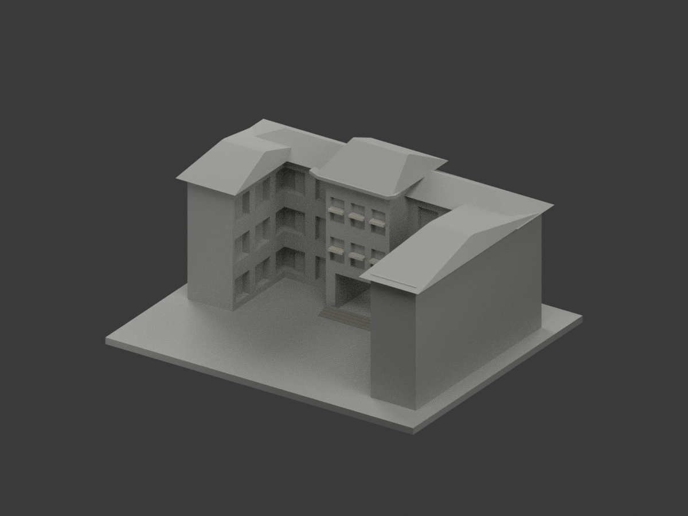
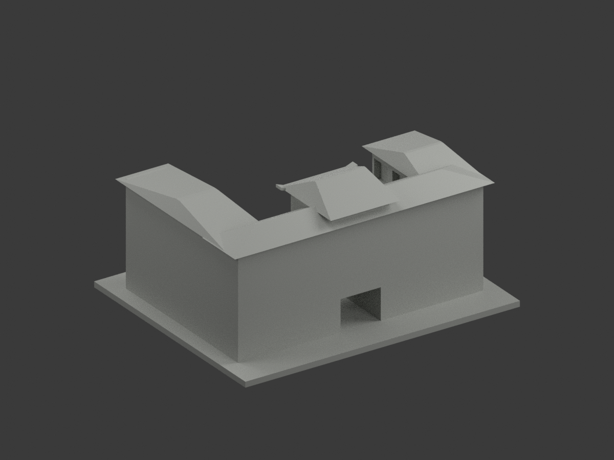
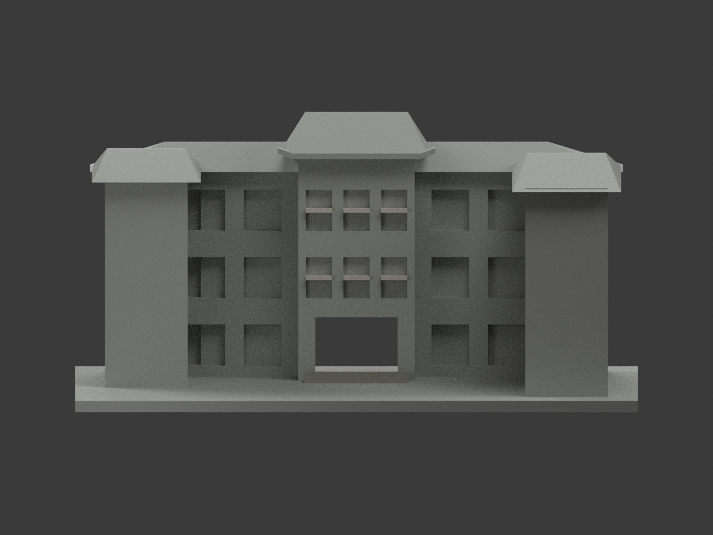
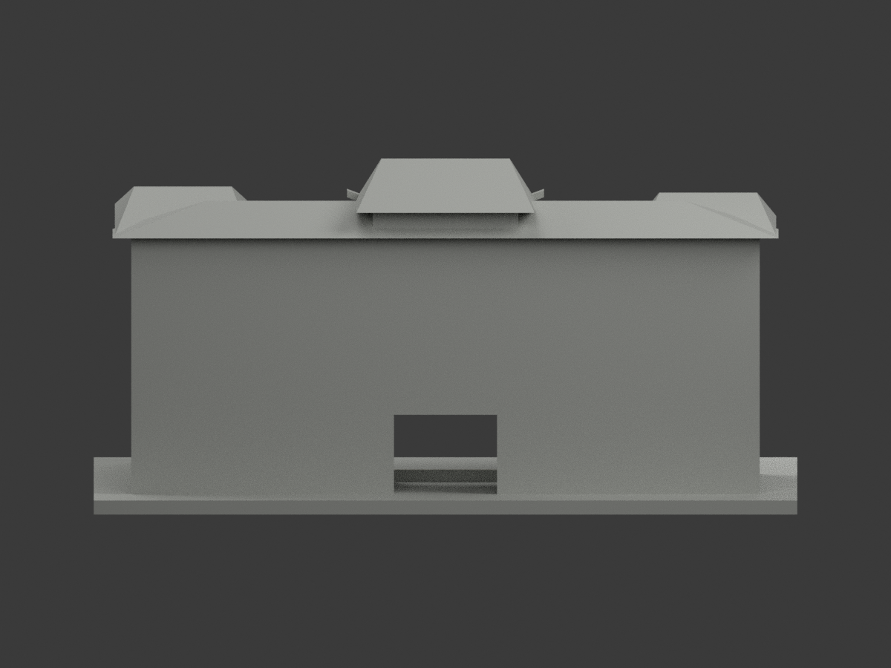
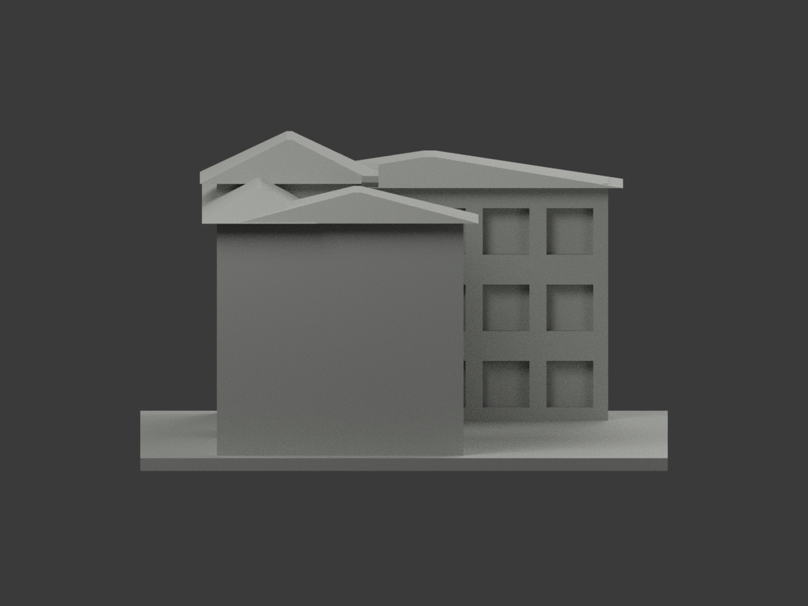
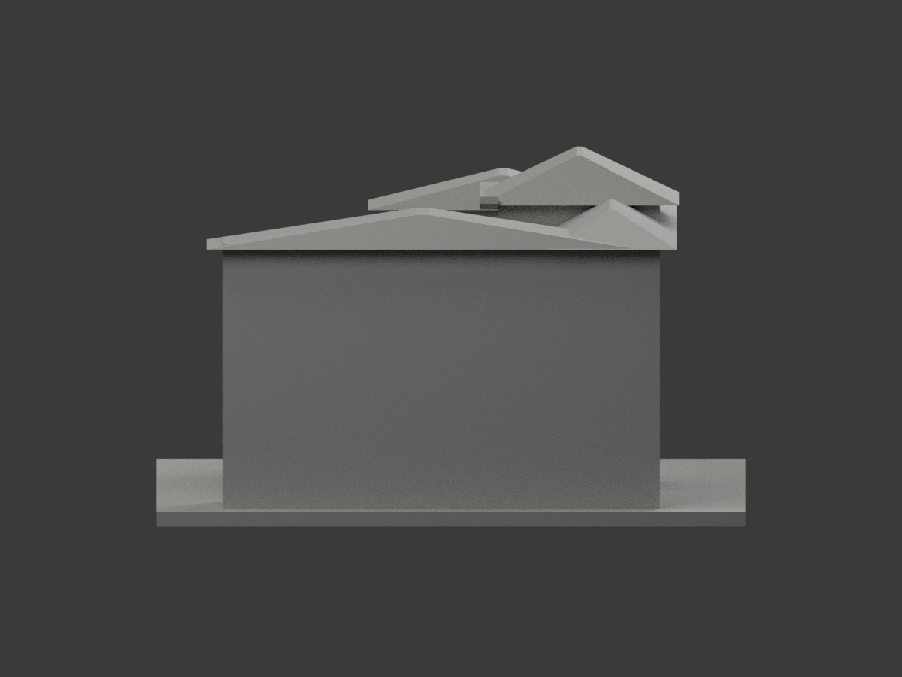
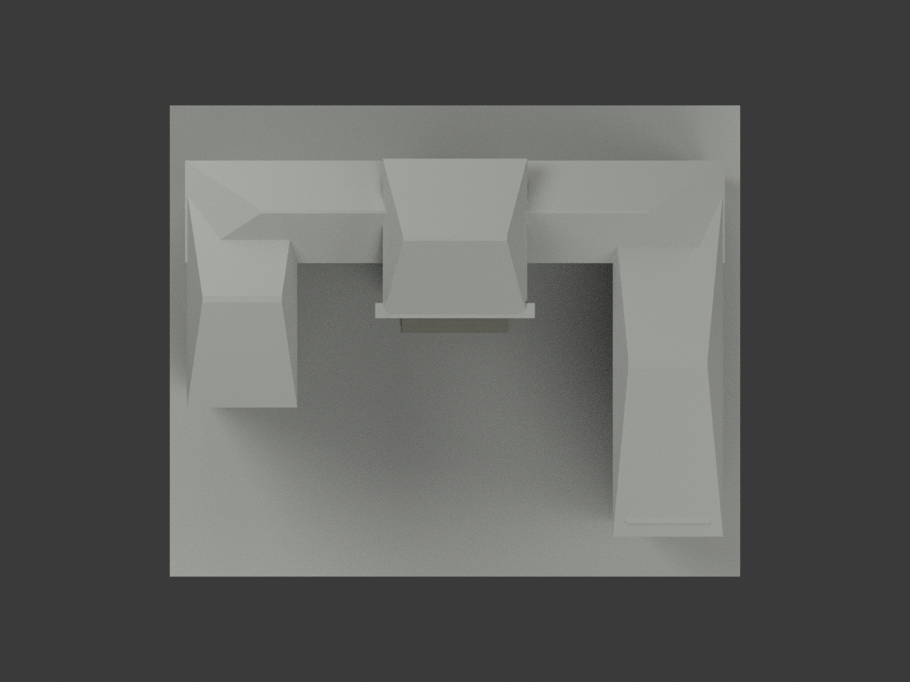
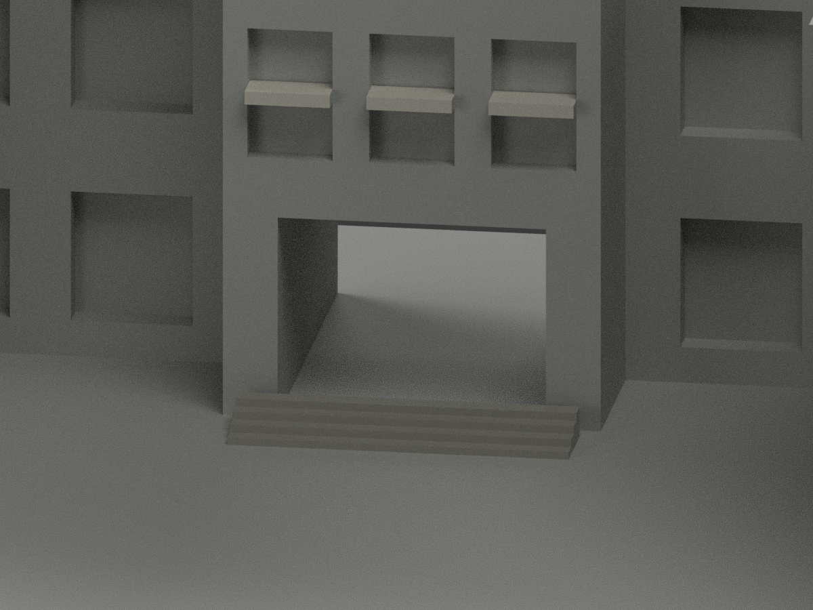
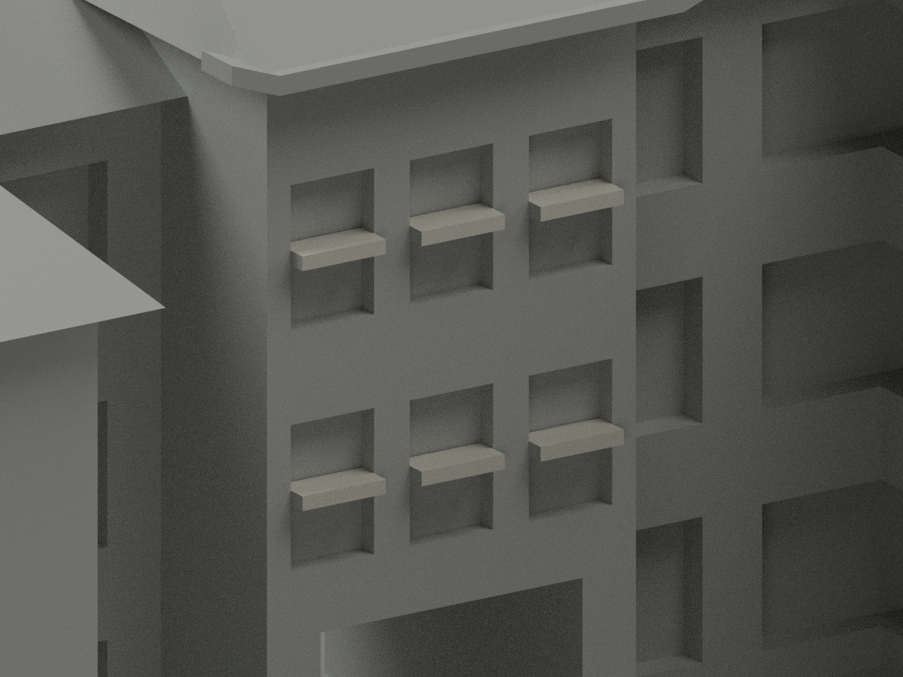
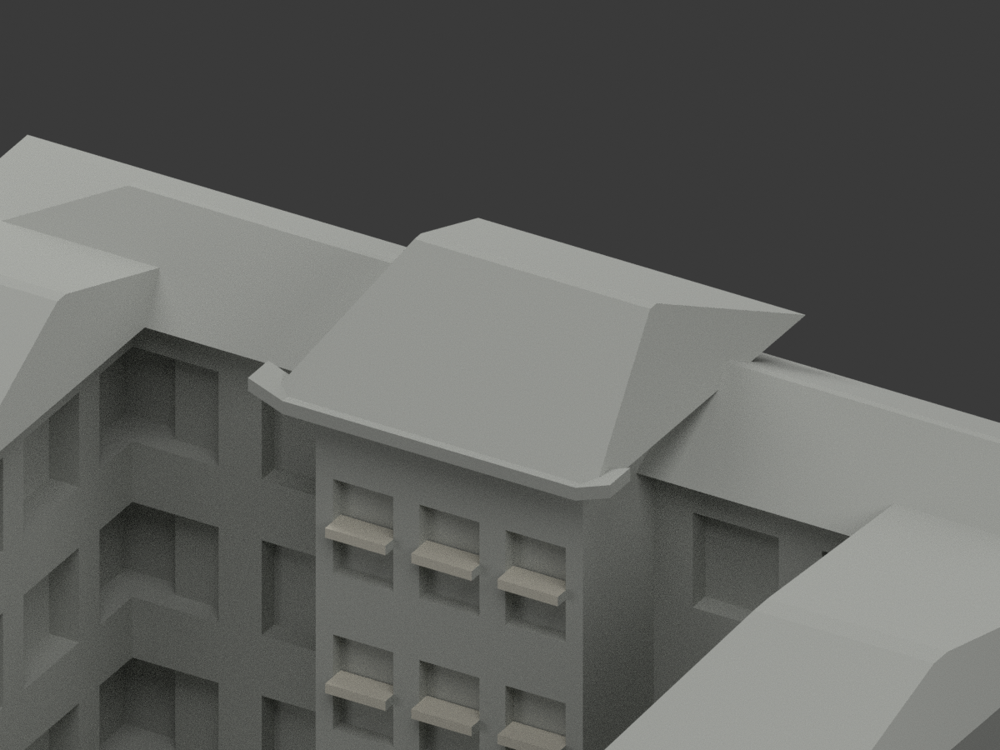

# 文藻露德樓｜六窗梃同材質延續

## 模型預覽

| 前斜視 | 後斜視 | 正面 |
|---|---|---|
|  |  |  |
|  |  |  |
|  |  |  |
|  | | |

## 本次露德樓六片窗梃同材補色

只沿用既有六片暖白水平窗梃，把各片背面、上面與下面的完整原矩形合計 60 個中性三角延用暖白槽 0。原 12 白色正面與 16 石色階梯面全部保留；新版共白 72／石 16／未知中性 1,112 面。1,200 原三角、頂點、面序、尺寸、STL bytes 與色盤 bytes 全不變，不增加實景細格、不切面，也不補 2005 已拆西側體量。

六窗梃中心 x=−10、0、10 mm，底 z=30、48 mm，原尺寸 7×3.1×1.1 mm。選區僅 y=11.55 背面及 z／z+1.1 上下原有限面；全部頂點須落在原矩形內、法向向外、矩形四角完整。每背面 2 三角、每上下矩形 4 三角（保留原邊界分段頂點），皆等於整個共面連通域；總面積 306.600008 mm² 對解析 306.6 mm²。左右端與原窗洞接觸不塗。窗背、玻璃、洞返、整柱混材、裝飾白帶、牌匾、紅椽式厚檐、屋瓦、後側、階梯側與基座皆不新增色。

親看校方官方 PDF 第 50 實頁／印刷 2-44 的正面與側面外觀，中央窗格可見暖白框族；原模型六片粗化窗梃的背／上／下色仍是同一構件延續推論，不是每個隱藏面獨立照片確證。原近似比例與缺少細框不因補色獲得精確性背書。拍攝日未知；2023 表格日、2025 文件版次都不是攝影日期，不宣稱 2026 現況或量測色票。

舊 QA、來源、原建模／補色入口及舊校驗表保留原 bytes。新版 QA 在 `qa-continuous-walls/`；新版逐檔校驗為 `CONTINUOUS-MULLIONS-SHA256SUMS`。root scene 與十視角 PNG 更新為此次配色；下方舊文件的 12 白面／正面限制是歷史範圍。本模型仍局部未完成、非測繪／施工圖，未實印或多料切片。照片／PDF 僅私人研究，不入公開包。

`rebuild-continuous-mullions.zip` 含固定 SHA 的原公開 baseline NPZ、STL、面域與重建腳本，不含照片。新版入口 `python build_continuous_mullions.py`、`python verify_continuous_exchange.py`；Blender 執行 `render_continuous_mullions.py`、`verify_continuous_scene.py`。原 `colorize_model.py`／`export_appearance.py` 是歷史入口，不用於新版。新版 3MF 完整保留原 float 座標，lib3mf strict 讀入精確對回 STL；臨時編輯重存的十進位精度差另記，不作交付幾何。

場景僅同步更新 source_mesh_sha256 以對應本次含材質指派的 color-mesh.npz，並更新 scope，明示六窗梃背面、頂面與底面同暖白推論，混材牆、窗與屋頂中性且攝影日期未知。原簡化幾何與未知建築後側維持中性的限制仍保留；非逐面照片證實、非現況或實體列印保證；其餘原屬性、全部材質定義與幾何不變。

本頁為現行說明；根 README.zh-TW.md 保留舊版本原文及原 bytes，僅作歷史記錄。

## 前版說明與保留限制（完整歷史文字）

# 露德樓｜既有模型少量局部補色

**局部補色未完成：僅中央六片水平窗梃與入口階梯少量補色；立面、窗背、屋瓦與紅檐仍未完成。** `partial_color_incomplete=true`、`fully_colored_exterior=false`。同項目`wzu-lourdes`／`count_delta=0`，不新增套數。

## 材色範圍

只有六片原水平梃正面（y=8.45、12三角面）採暖白，以及4個原階的實際踏面／正立面16三角採灰石色族。其餘1172三角全部未知中性，**不是實景灰色證明**。

實景窗格細密、白帶有裝飾，但粗原模型沒有這些界線；不新增細梃或把整窗塗白／深色。全高柱壁混淺石、深基座且無對應原面，整域中性。實景紅色是中央檐下椽，不能據此把上hip屋皮或整個厚檐塗紅；所有屋坡、上翹厚檐、窗背、門洞、牌匾與後院保持中性。不畫假接縫、不以高度挑三角、不填補2005已拆除西側體量。

原1200三角、頂點、尺寸、STL與原程式完全不改；本次色審不追認原近似幾何，非現況精測。色材範圍邊界不是實際材質接縫。

## 來源與權利

文藻[官方校園頁](https://c005.wzu.edu.tw/category/132558)外觀照片及官方PDF實體50頁兩張外觀照。拍攝日未知，PDF2025-03-12版本／2023-12表格不是拍攝日。只取外觀，不使用內部應變資訊。精確URL／hash／GO2142與獨審2141-v1見`COLOR-SOURCE-REGISTER.json`。

未確認CC授權。原照/PDF私存、不公開或作貼圖；來源權利不被repo license取代，不保證商用。

## 檔案與重建

`appearance.3mf`含3展示材標；`scene.blend`含實際面材與相機，`color-mesh.npz`存原面與material index。STL無色且原字節不變。原公開包無OBJ；原build隔離產生的OBJ只私存，不稱原OBJ已保存。

依`requirements.txt`先`python colorize_model.py`、`python export_appearance.py`、`python validate_color.py`；Blender執行`render_color.py`、`verify_color_scene.py`。完整原build＋color隔離重建目錄保留，不自動刪除。原場景與全部原件另私存；`ORIGINAL-MONOCHROME-README.md`、舊`previews/`及原QA為單色歷程，不是本次補色QA。

## QA與列印限制

原STL字節／三角座標multiset、封閉正體積、3MF索引與隔離重建見`COLOR-*QA.json`；Blender重開見`SCENE-QA.json`；10張1200×900圖與首段三欄／圖文hash見`DELIVERY-QA.json`。人工實看另交父終審。

**未實際列印。** 三展示材標不是驗證過的四色列印工程，切片、色料映射、支撐與細節強度須另驗，不保證直接多料成功。
