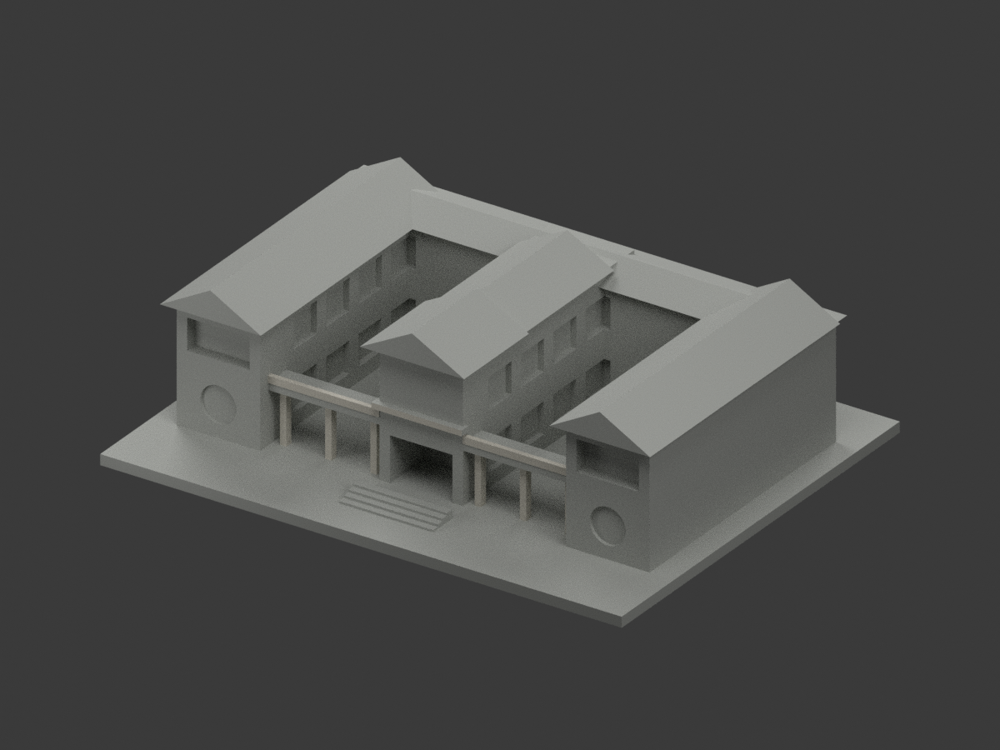
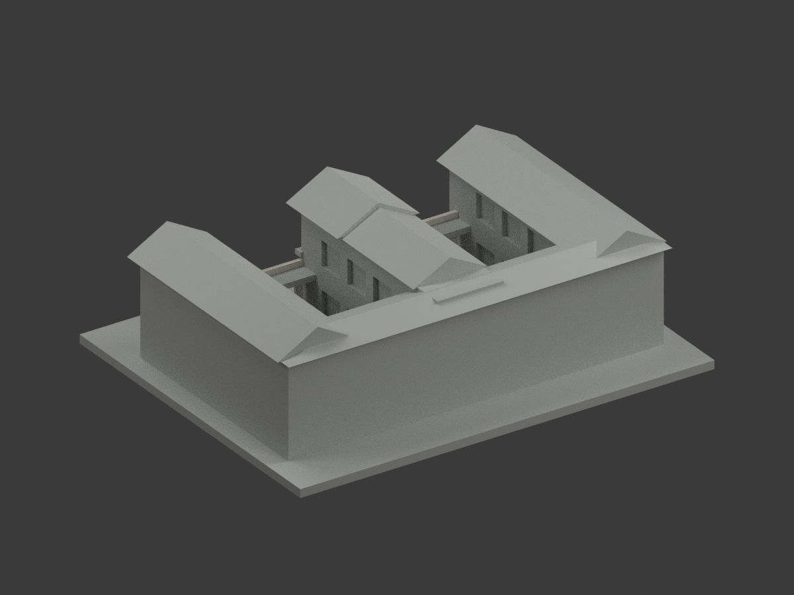
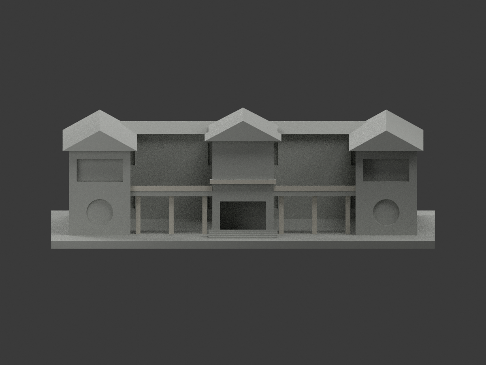
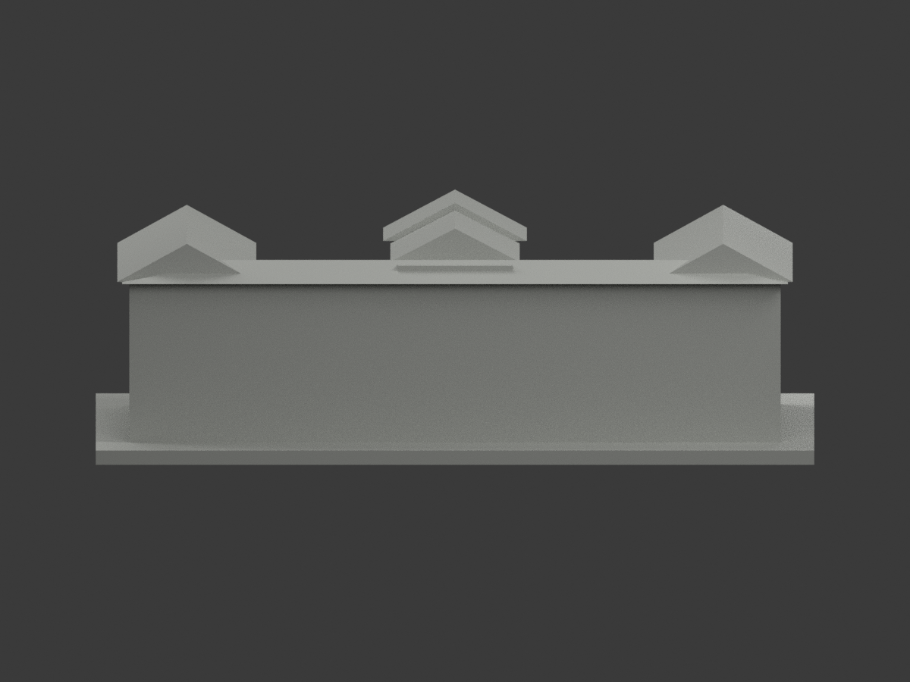
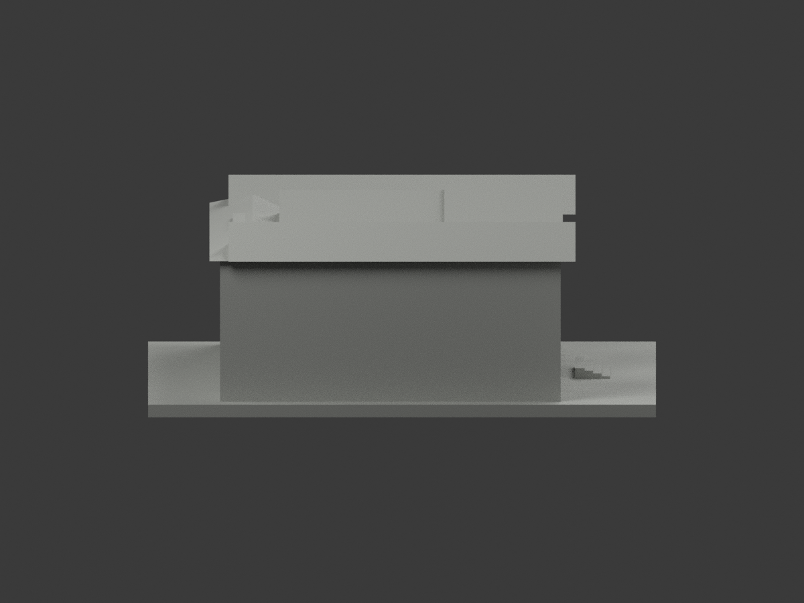
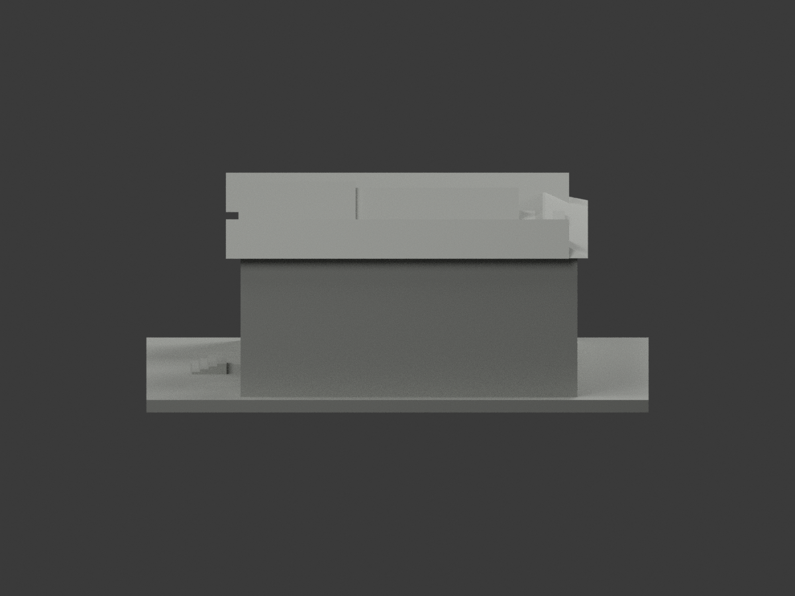
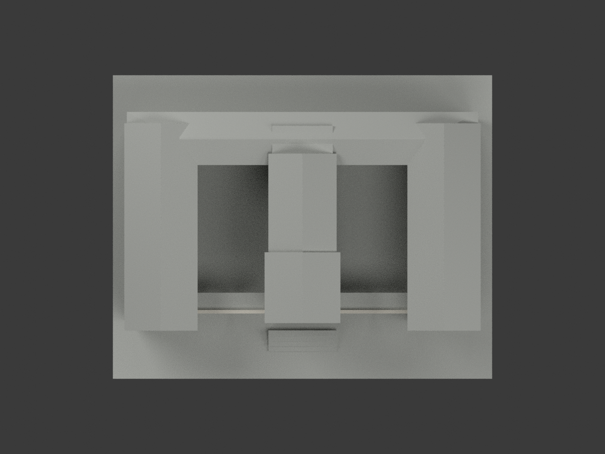
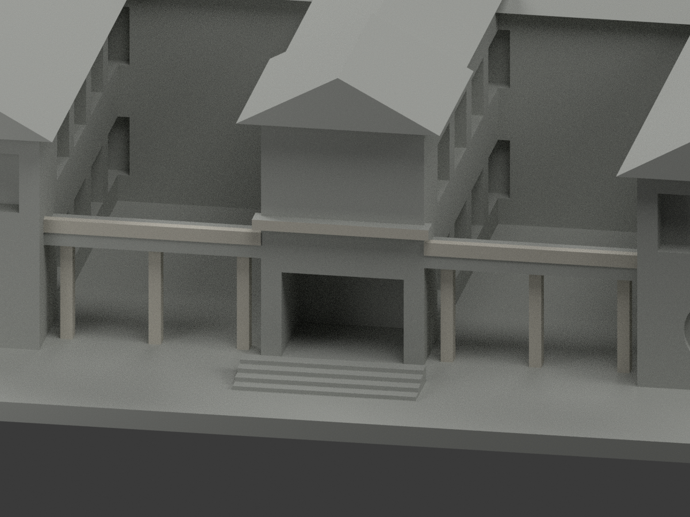
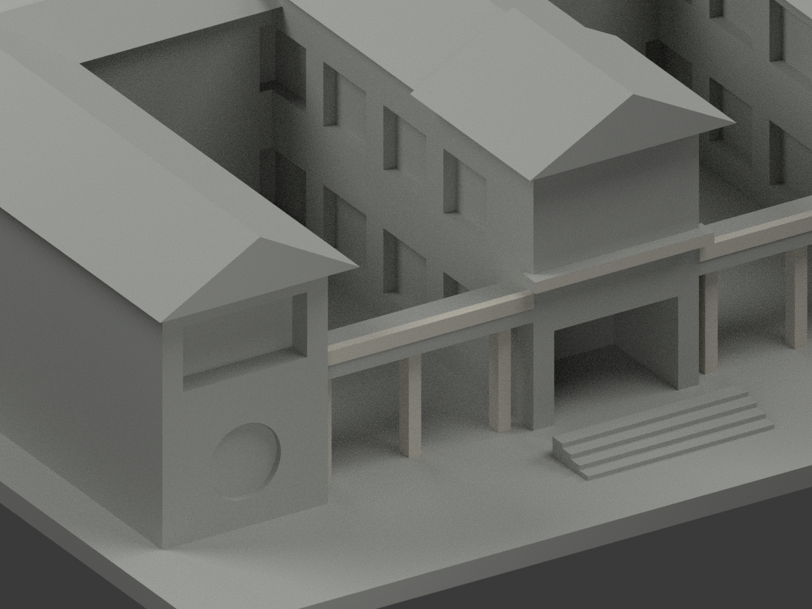
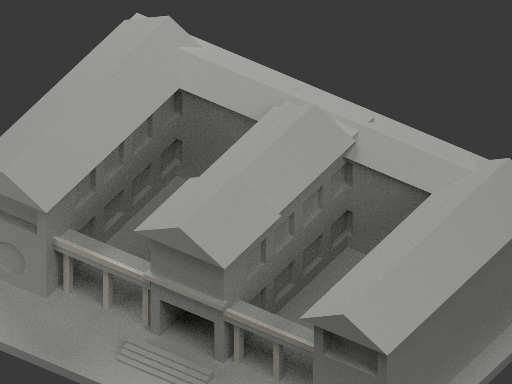

# 文藻明園｜兩片前廊欄帶背頂同材質延續

## 模型預覽

| 前斜視 | 後斜視 | 正面 |
|---|---|---|
|  |  |  |
|  |  |  |
|  |  |  |
|  | | |

## 本次明園前廊欄帶背面與頂面延色

僅將兩片原前廊欄帶的背面與頂面四個完整有限矩形／10 個原中性三角，延用已有淡暖灰材質 0。原 54 已色面、兩槽色盤 bytes、原 1,488 三角／730 點、STL bytes、面序及頂點全不變；新版淡灰 64 面、中性 1,424 面。不新增或切割三角，不改厚度、欄杆或柱型。

選區 x=−44…−12 與 12…44、y=−34.2…−32.8、z=20…22 mm；僅正 y 背面與正 z 頂面。每域核對全部三頂點、外法向、完整共面連通分量及矩形四角，頂面多出的點只在矩形邊界上。四域共 217.6000977 mm² 對解析 217.6 mm²；兩端連接翼樓與中棟的接觸面、底面、主牆與屋頂全排除。

已親看校方 J.jpg 及防災計畫 PDF 實體第 29 頁／印刷 2-23 頁。實景欄杆含細金屬與開孔，原模型卻是粗化實心欄帶；本次僅把原模型同一代理構件的材料延續到背／頂面，不能解讀為實景實心欄杆、真實金屬顏色或幾何準確度獲照片證實。其他既有灰柱、灰帶不動；先前撤回黑山牆著色的限制完整保留，混磚牆、瓦屋面與山牆仍中性。

來源攝影日期未知，2023 表格及 2025 PDF 版次不是拍攝時間，不宣稱 2026 現況。私照與 PDF 不入公開包。模型非測繪或施工圖，未實體試印／多料切片；原製造與簡化限制不變。

歷史 QA、來源、校驗表與原補色／建模入口保留原 bytes；原文件反映舊 54 色面範圍。本版 QA 用 `qa-continuous-walls/`，新逐檔校驗用 `CONTINUOUS-RAILS-SHA256SUMS`，root scene 與十視角 PNG 為更新版。新版 3MF 完整保留原 float 座標，strict 讀入精確對回 STL；臨時編輯重存精度差另記，不用於交付。

`rebuild-continuous-rails.zip` 含固定 SHA 原公開 baseline NPZ、原 STL、有限域與重建腳本。執行 `python build_continuous_rails.py`、`python verify_continuous_exchange.py`；Blender 執行 `render_continuous_rails.py`、`verify_continuous_scene.py`。原 `colorize_model.py`／`export_appearance.py` 是歷史入口，勿用來重建本版。

場景僅同步更新 source_mesh_sha256 以對應本次含材質指派的 color-mesh.npz，並更新 scope，明示兩片原簡化實心欄帶背面與頂面同灰推論，非實景開孔欄杆重建。未知建築後側維持中性、未知牆面、屋頂及撤回黑山牆著色的限制保留；非逐面照片證實、非現況或實體列印保證；其餘原屬性、全部材質定義與幾何不變。兩槽 palette.json 原 bytes 完全保留。

本頁為現行說明；根 README.zh-TW.md 保留舊版本原文及原 bytes，僅作歷史記錄。

## 前版說明與保留限制（完整歷史文字）

# 明園｜既有模型局部灰白示意

**局部補色未完成：僅前廊欄杆、柱及門樓獨立橫帶局部灰白補色；磚瓦與混材立面仍未完成。** `partial_color_incomplete=true`、`fully_colored_exterior=false`。同項目 `wzu-mingyuan`／`count_delta=0`，不新增套數。

## 材色範圍

只有原有獨立前廊欄杆正面、六柱可見側面與門樓獨立橫帶正面採近似暖灰白，共54面。原1488三角面、頂點、尺寸、`model.stl`、`build_model.py`均不變。其他1434面為未知中性，**不是實景灰色證明**。

全山牆同時包含實際淺框及黑百葉，而原三角沒有分界，因此全片中性，不塗黑；月窗背面不是可證紅磚/黑玻璃，不畫白圓環。前牆混磚、淺框及石基座沒有原分面；所有瓦坡、後側、院內及基座保持中性。不按照片新增窗、瓦、框、植栽或切面湊色。

原簡化屋脊方向／外觀與照片有近似差異；本次只材色更新，**色審不追認原幾何精確性**，不稱現況精測。來源覆蓋與未知面分色不是實際材料接縫。

## 來源與權利

文藻官方[校園頁](https://c005.wzu.edu.tw/category/132558)及其明園實景照片；官方PDF實體第29頁的兩張建築外觀照片。照片拍攝日未知，PDF 2025-03-12版本／2023-12表格日期不是拍攝日。只採外觀，不使用內部應變資訊。精確來源URL、SHA與v2審核在 `COLOR-SOURCE-REGISTER.json`。早期黑山牆許可已撤，只有2114-v2有效。

未確認CC授權；原照/PDF私人保存、不隨模型公開、不作貼圖；來源權利不被repo license取代，不保證商用。

## 檔案與重建

`appearance.3mf`包含2種展示材質；`scene.blend`含實際面材與相機，`color-mesh.npz`保原三角及材質index。STL本身無色，原件字節保持。原遠端包**沒有OBJ**；原`build_model.py`隔離重建產生的OBJ只私人保留，不聲稱保留原OBJ。

Python依原`requirements.txt`：先`python colorize_model.py`，再`python export_appearance.py`、`python validate_color.py`。Blender執行`render_color.py`及`verify_color_scene.py`。驗證會保留隔離原程式重建目錄，不自動刪除。原場景/所有原件另完整私存；舊`previews/`、原驗證與`ORIGINAL-MONOCHROME-README.md`只是單色歷程，不是本次彩材QA。

## QA與列印限制

原STL hash／全部三角座標multiset、封閉正體積單體、3MF材質索引、完整隔離原程式＋色程式重建、Blender重開及10張1200×900圖綁定分別記在本次`COLOR-*QA.json`、`SCENE-QA.json`、`DELIVERY-QA.json`。人工視覺核另交父獨審。

**未實際列印。** 兩個展示色標不是已驗證四色列印工程；切片／材料分配／支撐與細節強度須另驗，不保證兩料或四色直接成功。
