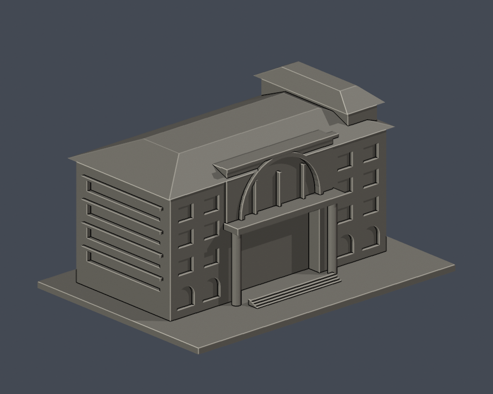
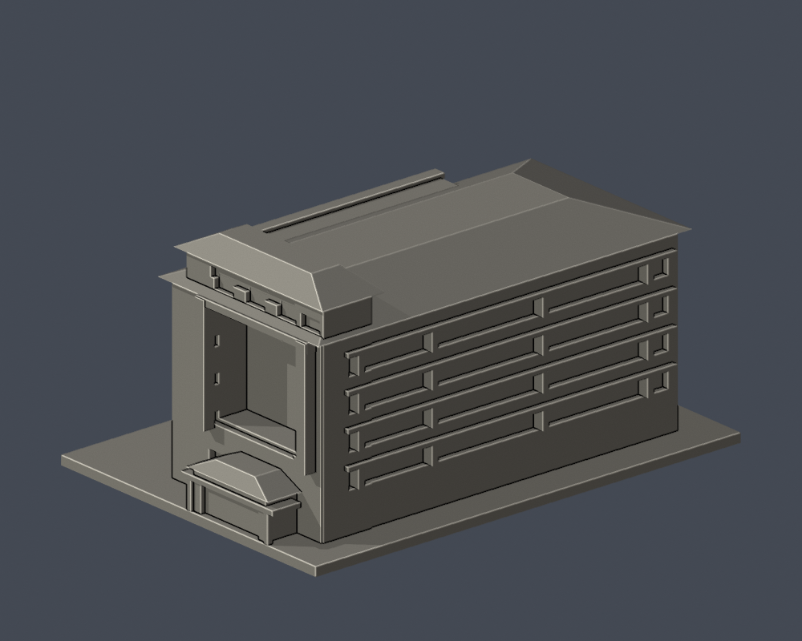

# 景文科技大學人文館（F）

## 模型預覽

|  |  |
| :---: | :---: |
| 正面 | 背面（證據不足處簡化） |

公開外觀照片推估的建築微縮研究，非測繪級BIM，也不代表2026即時外觀。

## 外觀依據
- 中央挑空圓柱廊與单一大型圓拱開口、坡頂大出簷
- 長側面水平陽台帶、較高端塔窄窗及低層入口屋簷
- 另一可見端的跨層深凹框架及高柱、長側連續陽台帶

兩張官方照片均明確題為人文館01／02，可確認同棟不同側，絕非未知背面。模型以01大拱柱廊面定義為前方-Y，02短端大框配置在+X、連續陽台回轉面配置在+Y；這是模型座標對應，不宣稱已知實際方位角。因沒有可量測連續全景，兩攝影面的精確轉角、長寬比及地形高差仍屬近似。v3已保留第二視角的大型跨層凹框、兩高柱、上層房間、低入口坡頂及回轉陽台，未把有照片的一面留成實牆。

## 比例及限制
- 含底板尺寸：150.00 × 106.00 × 77.60 mm。每件独立縮放，最長150 mm，並非統一比例校園拼圖。
- 未取得實測尺寸；整體深度、背側、被遮擋細節為估計或明示簡化，未見的背面不任意複製正面窗格。
- 門窗數量、曲率和間距是視覺近似。省略文字、旗幟、空調、植栽和細欄杆；細柱及窗框為列印加厚。
- 官方273頁所附PNG是示意插畫，不能當照片。本模型另有 sources.json 所列實拍，來源照片不隨包公開。

## 檔案及重建
安裝 requirements.txt，執行 Python build_model.py 產生 model.stl。預覽可用 Blender 4.3.2、Pillow 13.0.0（libwebp 1.6.0）執行 `python export_preview_webp.py` 重建，不覆寫 STL 或 Blender 場景。若需重建場景，僅將 model.stl 和 render_preview.py 複製到獨立資料夾，再以 Blender 執行該腳本。再執行 validate_model.py、check_layers.py、check_thin_features.py。Python生成程式保留所有形體參數。

## 檢查
- 原STL法向、封閉邊與頂點流形、正體積、一個連通外表面、無分離內腔殼、重建SHA及Blend/STL幾何一致：通過。
- 0.2 mm間距、非共面微偏移截面，共388層全部閉合。
- 0.8 mm XY形態開運算篩檢（1 mm間距抽樣），0層超過1%面積損失，最高0.03%。此值包含尖角、凸緣，非完整壁厚或切片器噴嘴路徑分析。
- 屋簷、雨庇、柱廊及開口頂緣可能需要支撐；依材料與方向在切片器中複查。未完成實體試印、完整切片或支撐可移除性驗證。

[正立面 WebP](display/elevation.webp)

原交付 PNG 可從固定版本查驗：[elevation](https://github.com/hplin50643/taiwan-buildings-3d/blob/e5f4ef477a7870870f2ec944bc5174d345a9e68d/%E5%A4%A7%E5%B0%88%E6%A0%A1%E9%99%A2/%E6%99%AF%E6%96%87%E7%A7%91%E6%8A%80%E5%A4%A7%E5%AD%B8/%E6%A0%A1%E6%9C%AC%E9%83%A8/buildings/just-humanities-f/previews/elevation.png)、[front](https://github.com/hplin50643/taiwan-buildings-3d/blob/e5f4ef477a7870870f2ec944bc5174d345a9e68d/%E5%A4%A7%E5%B0%88%E6%A0%A1%E9%99%A2/%E6%99%AF%E6%96%87%E7%A7%91%E6%8A%80%E5%A4%A7%E5%AD%B8/%E6%A0%A1%E6%9C%AC%E9%83%A8/buildings/just-humanities-f/previews/front.png)、[rear](https://github.com/hplin50643/taiwan-buildings-3d/blob/e5f4ef477a7870870f2ec944bc5174d345a9e68d/%E5%A4%A7%E5%B0%88%E6%A0%A1%E9%99%A2/%E6%99%AF%E6%96%87%E7%A7%91%E6%8A%80%E5%A4%A7%E5%AD%B8/%E6%A0%A1%E6%9C%AC%E9%83%A8/buildings/just-humanities-f/previews/rear.png)。當時的檔案 SHA-256 見同一版本的 [hash-manifest.json](https://github.com/hplin50643/taiwan-buildings-3d/blob/e5f4ef477a7870870f2ec944bc5174d345a9e68d/%E5%A4%A7%E5%B0%88%E6%A0%A1%E9%99%A2/%E6%99%AF%E6%96%87%E7%A7%91%E6%8A%80%E5%A4%A7%E5%AD%B8/%E6%A0%A1%E6%9C%AC%E9%83%A8/buildings/just-humanities-f/hash-manifest.json)。
