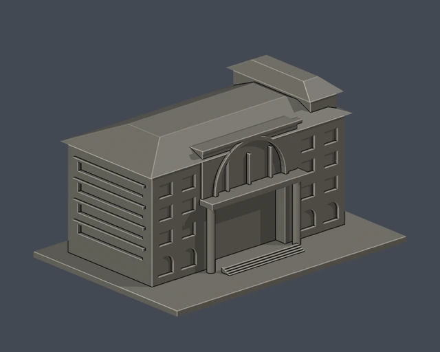
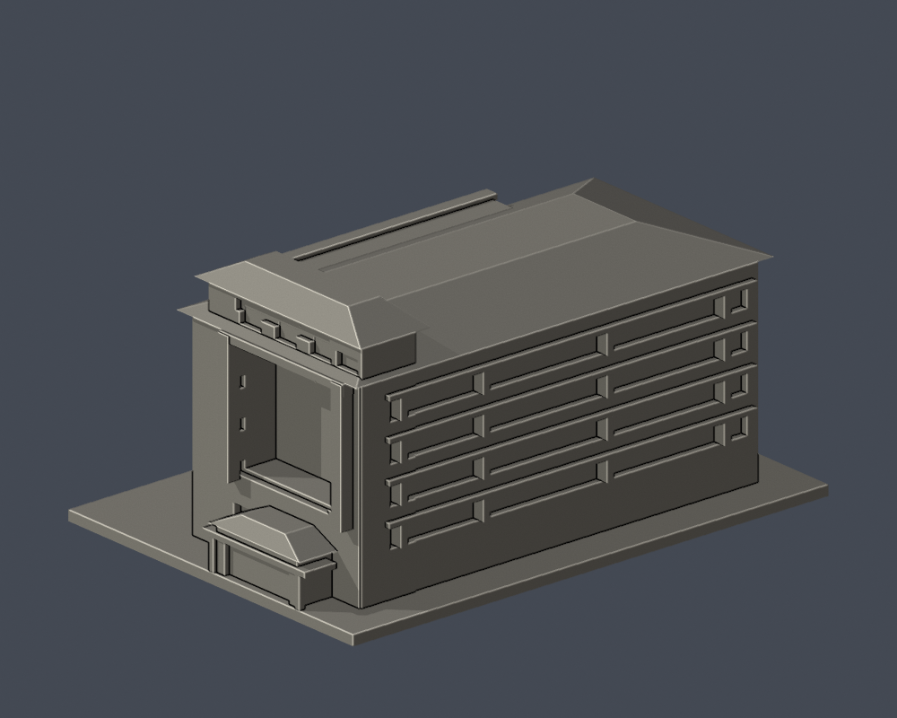

# 景文科技大學人文館（F）｜模型預覽

三張 WebP 來自現行模型的三個原有視角，完整版與舊 PNG 的 RGBA 像素一致。暖石單色是預覽代理，不代表實際外牆顏色。未經證實的背側細節保持簡化，未試印。

|  |  |  |
| :---: | :---: | :---: |
| 正面 | 模型背側 | 正立面 |

[模型與重建說明](../README.md) · [STL](../model.stl) · [可編輯 Blender](../scene.blend) · [現行工程清冊](../hash-manifest.json) · [原薄壁檢核結果](../thin-feature-check.json)

[展示校驗](SHA256SUMS) · [影像核對](RENDER-PROOF.json)
