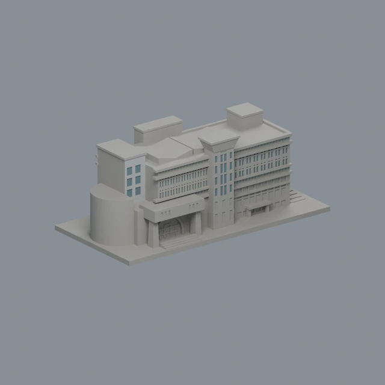

# 朝陽科技大學

本期僅一件波錠紀念圖書館外觀近似模型，非全校完成。展示圖由現行四材質模型重渲；原 v1／v2 的歷史驗證與限制仍保留。

| 建築模型 | 建築模型 | 建築模型 |
| :---: | :---: | :---: |
|  **[波錠紀念圖書館：正面](霧峰校本部/buildings/cyut-poding-library/README.md)** |  |  |

[模型、來源及完整驗證](霧峰校本部/buildings/cyut-poding-library/README.md)。背側細節與屋突高度仍有證據界限；兩門廊柱56跨層角損樣本有具體尺寸/根接評估，不宣稱零警告或全域最小壁厚。 · [現行側端局部補色](霧峰校本部/buildings/cyut-poding-library/side-setback-20261120/README.md)
