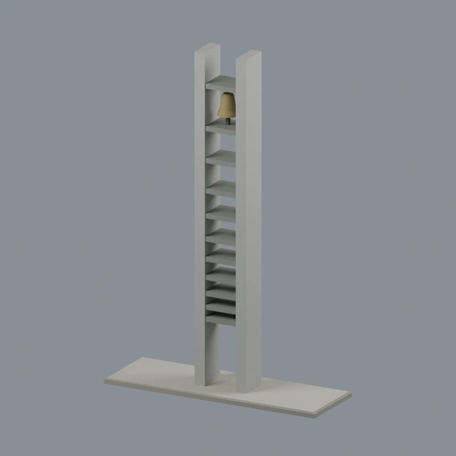
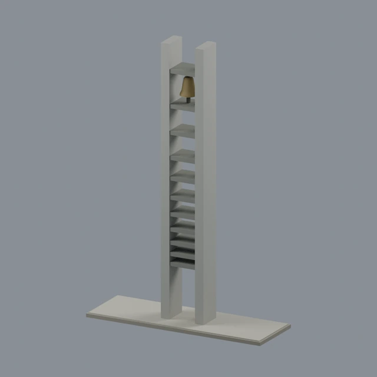
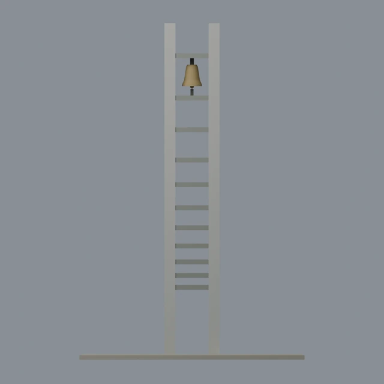
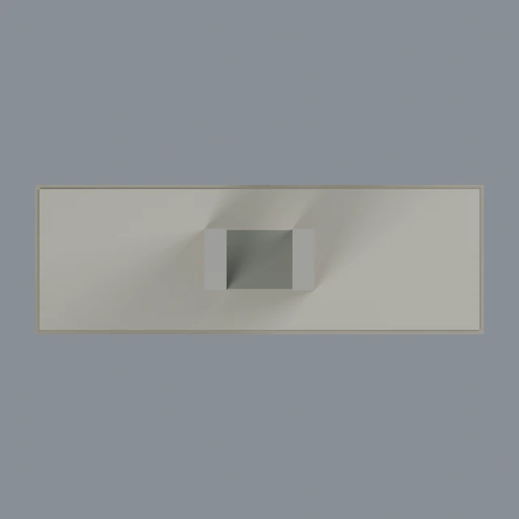
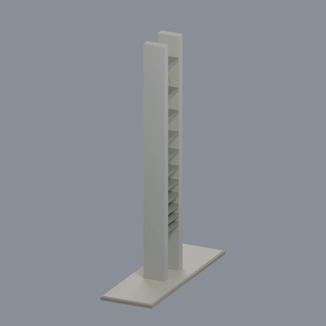

# 東海大學 文理大道校友鐘樓

## 模型預覽

| [](previews/front.webp) | [](previews/rear.webp) | [](previews/elevation.webp) |
| :---: | :---: | :---: |
| 校友鐘樓模型 | 背斜視 | 正立面 |
| [](previews/top.webp) | [](previews/left_oblique.webp) |  |
| 頂視 | 左斜視 |  |

**完整塔體外觀近似｜依2019官方相簿與2022攝影者照片近似；不是現場測繪，不宣稱2026現況。** 這是文理大道的校友鐘樓，並非教堂旁四牆式畢律斯鐘樓。

保留兩片深矩形牆、十一道深橫板、十個板間開口、下方高通道、往上漸增的間距、突出最高橫板的兩牆尖端、一口懸鐘和低矮矩形平台。上方鐘室包含固定加厚吊桿、喇叭鐘口、鐘舌及下板簡化小機構；非功能性可擺動鐘。

## 下載
- [可編輯 Blender 場景](scene.blend)：與 STL 同一三角網格，六種逐面可編輯顯示材質。
- [彩色 3MF](model.3mf)：顯示顏色，不是噴頭／AMS 指派。
- [STL](model.stl)：單一連通水密網格，格式本身無顏色。
- [生成器](build_model.py)、[來源](SOURCES.md)、[檢查報告](QA.md)。

設計尺寸 **102×34×152.5 mm**；塔身寬25、中央淨寬15、兩牆寬5／深14、橫板厚2.2、平台高2.5 mm。這些是照片比例與展示／加厚尺寸，**不是建築實測或精確比例尺**。兩牆上端細小裝置、線纜、精確接縫與洗石子顆粒省略；平台深度、鐘體內壁及機構簡化。僅含有界局部平台，不含整條大道或周邊草坪。

## 來源與界限
建模者逐張親看官方七張與獨立攝影者兩張，共九張完整照片。官方相簿標示2019-09-20不保證個別快門日期；攝影者文章記錄2022-01-09旅遊，圖片目錄2024/01為上傳／遷移線索，不當拍攝日期。官方影像僅303×480或640×480，無法推得細機械精度。比例取自多角度透視圖，不是正射測繪；不宣稱現今狀況不變。原始照片不隨檔再分發。

## 列印警告
水密不等於可直接列印。十一橫板下緣、懸鐘與鐘舌需要切片器支撐／方向評估；鐘壁局部低於0.8mm侵蝕門檻，詳見QA原樣保留的失敗。**無實體試印，不認證免支撐、最小法向厚度、強度或切片器相容性。**

<a name="五個實際交付網格視角"></a>

## 重建與驗證
Python依賴見requirements.txt；另需lib3mf官方SDK、Blender4.3.2。
```sh
python -m pip install -r requirements.txt Pillow==13.0.0
python verify_package.py
blender -b -t 4 --python-exit-code 1 --python verify_render.py
python rebuild.py --output ../clean-rebuild --blender blender --threads 4
```
獨立重建逐檔比對 STL、3MF、mesh、palette，並比對五張 WebP 的 RGBA 像素和檔案校驗碼。模型若有修改，不能沿用舊 QA，須重新驗證。

### 展示圖與校驗

五張展示圖使用 640 px WebP 縮圖，可點圖開啟全尺寸無失真 WebP。[縮圖校驗](previews/thumbnail-proof.json)。重建只在隔離目錄暫存 PNG；公開原始模型和既有 QA 不變。[現行 WebP 與像素校驗](qa/preview-webp.json) · [原始 PNG、歷史校驗與進階測試步驟](https://github.com/hplin50643/taiwan-buildings-3d/tree/336ce1843e6e4435f93ed1a5df7cc26434fb9596/%E5%A4%A7%E5%B0%88%E6%A0%A1%E9%99%A2/%E6%9D%B1%E6%B5%B7%E5%A4%A7%E5%AD%B8/%E6%A0%A1%E6%9C%AC%E9%83%A8/buildings/thu-alumni-bell-tower)。
