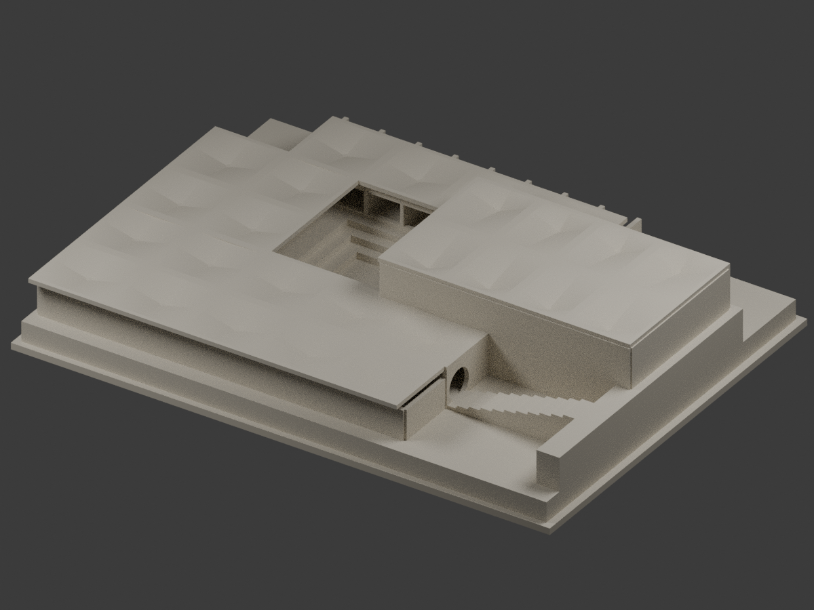
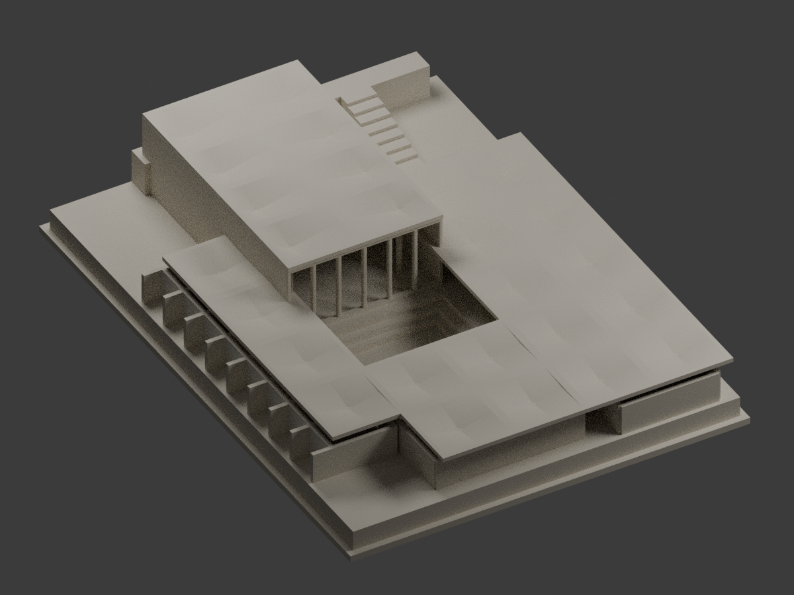
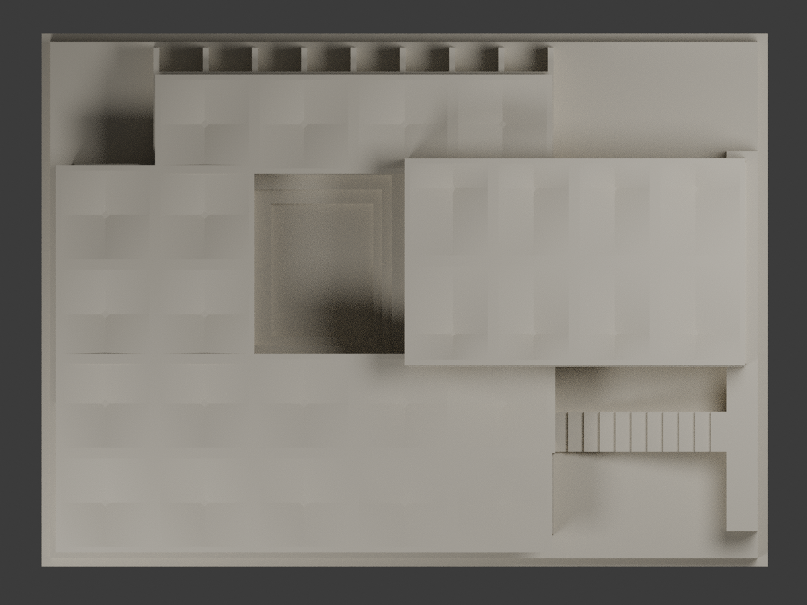

# 東海大學原藝術中心（1962–1964 年史料外觀研究版本）

| 入口側 | 庭院側 | 俯視 |
| :---: | :---: | :---: |
|  |  |  |

[下載目前 Blender 模型](model.blend) · [下載列印 STL（幾何未改）](../output/model.stl) · [顏色範圍](selection.json) · [檔案校驗](SHA256SUMS)

本版只在練習室後牆外側的 16 個既有三角面套用近似白粉色。文化資產資料記載紅磚牆外刷白粉，以及清水混凝土薄殼屋頂。此色為史料推定，不是 1960 年代實測色值；沒有針對其他後側區域推定材質或補色。屋頂、其餘表面與所有幾何均未修改。此為歷史外觀研究，不是現況復原或結構工程資料。

[國家文化資產網](https://nchdb.boch.gov.tw/city/Taoyuan/assets/overview/monument/20220516000001/) · [國家文化記憶庫](https://tcmb.culture.tw/zh-tw/detail?id=20220516000001&indexCode=BOCH_CountryCulture_11) · [原版建模、重建及驗證文件](../README.md)

原版列印驗證的限制及既有的 98 個柱頭過渡截面嚴格失敗仍然適用；本次是外觀補色，不是新的結構或實體試印驗證。
