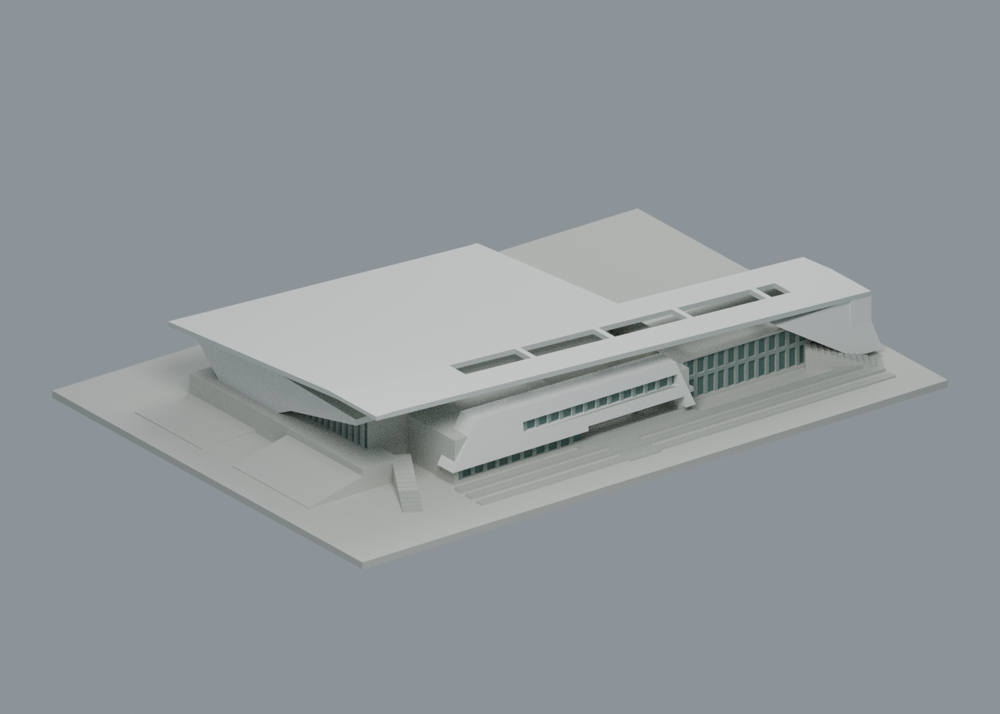
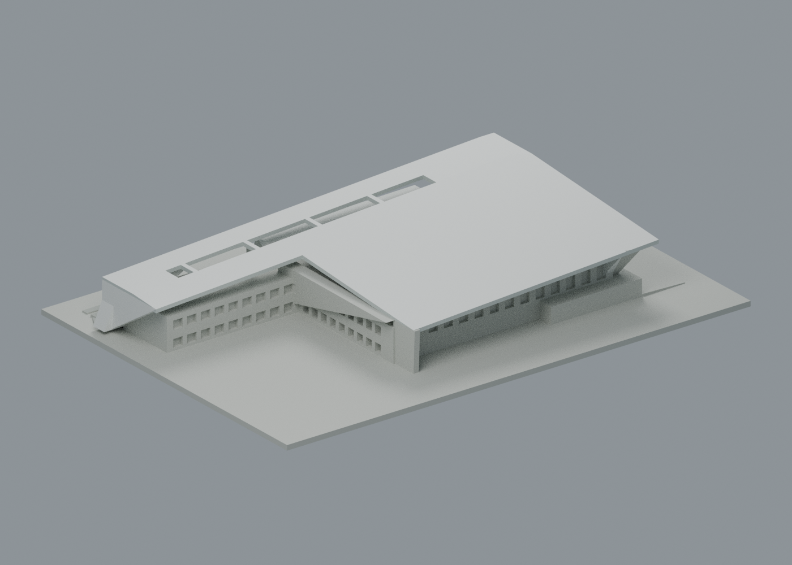

# 樹人醫專・2016 多功能活動中心

## 模型預覽

| 模型預覽 | 模型預覽 | 模型預覽 |
| :---: | :---: | :---: |
| 草坪／操場側六材質外觀  | 右折板斜返邊限域推論，其餘未見色區中性  |  |

## 本次右端白折板斜返邊有限延色

僅原 STL 面序 928、941 的完整剪斜平行四邊形，由中性槽 0 延用白折板槽 1。原 965 個已色面及其餘 3170 面全部保持，底面 916 不染、截止角不補造。六槽原名稱／名義色及 palette.json bytes 不變。新版各槽面數為 [2205,359,184,166,189,69]，不是全館配色完成。

原 3172 面／1562 點、STL bytes、全部座標、繞向及面序精確保留；不重跑舊面心 classifier、不重建幾何。原 804 共面域中有 21 個歷史混色域，本次逐面保留其清單及材料，零新增混色域，不能稱全模型共面均色。原來源逐角色統計及 unknown_backside 文字留作前版歷史，當前變更以 current_continuity_extension 及新版 QA 為準。

此有限域是原右折板外斜邊，由原平面紙座標 (3310,11.8m) 至 (3400,1m) 的邊界，紙 y=1980、剪斜 0.08、原厚 4.86mm。原另一回折體外界 x=(3250−2000)×(1.18/22.9)+5.20 截止於 x≈69.61048、z≈9.7304mm；下緣 z≈2.78mm。保留原 float32 點，不延伸至名義上尖角。兩面構成完整共面四角域，總原網格面積 35.94600158593647mm²，解析 35.94600179930104mm²。原四角、投影 union、無重疊、全域共面與有限界線皆核對；三條完整邊接既有白面 929、940、978，底邊接原中性底面 916，並未跨到底面。

親看建築師 MAYU 01／03／05 與 takuyatsai 公開空拍原照。MAYU 03 支持右端白折板身份與同板色族；01 是長翼身份旁證，05 是其他角的材料族參考，不冒充候選端面的近照。新增窄返邊採同一白色板件材料延續推論；樹蔭／底端遮蔽、原加厚剪斜及截短代理不當作照片精確測量或逐面證明。Flickr 的 2017-09-10 來自歷史頁題，未獨立驗證；建築師照日期未知，不證明 2026 現況。攝影權利依原來源登錄，所有原照僅私人審核，不入公開包。

底面、玻璃與窗框背板、外梯、槽 2 灰白屋緣、主屋頂、池側未驗證牆、地景及其他面全不變。不因陰影染黑或將玻璃鄰框染玻璃。原 46 個薄層警告及已記錄的有限例外、原壁厚與柱角損失限制、需支撐及未實體試印聲明原樣保留。本次 QA 不替代製造驗證。

彩色更新僅在 appearance；root STL、原單色 scene、歷史圖、原工程 QA、checksum、來源及原程式保留 bytes。新版新增 mesh-data.npz、固定 SHA baseline、有限域及 appearance/qa-continuous-rightreturn。原四相機保留，另加東西、前後立面、右返邊近景與高位後視，共十圖；近景刻意裁切，其他全景確認框入原模型。Blender 材質和單點改存重開、重渲染像素一致、strict3MF 材質往返及 ZIP 孤立精確重建均測試，非切片或實印保證。

重建執行 `python appearance/source/build_continuous_rightreturn.py`；交換檢查 `verify_continuous_exchange.py`；Blender 執行 `render_continuous_rightreturn.py` 與 `verify_continuous_scene.py`。`appearance/rebuild-continuous-source.zip` 含原 STL、固定逐面材料、色盤、有限域及完整重建程式。依賴 numpy、lib3mf 2.5.0、Blender 4.3.2；不需原照片。新版校驗為 `appearance/CONTINUATION-SHA256SUMS`。

本輪全部原物件屬性與完整材質定義皆保留，僅 2 個指定面的材質指派延伸；原 palette scope 保留歷史文字，現行範圍以本節為準。舊校驗表與 QA 保留歷史 bytes，根 PUBLIC-MODEL-SHA256SUMS 與 appearance/CONTINUATION-SHA256SUMS 為現行校驗。

## 前版說明與保留限制

樹人醫護管理專科學校，路竹校本部。MAYU 平面與多向照片支持的有界外觀近似；不是測繪模型，也不代表全校建物已完成。數位審核紀錄見隨附報告；是否正式發布以統一發布清單為準。

## 最新外觀與下載

[六材質可編輯通用 3MF](appearance/szmc-appearance.3mf) · [彩色 scene](appearance/scene.blend) · [配色說明、四視圖及限制](appearance/README.md)。依 2017 公開空拍的可見白折板、灰白邊及灰綠玻璃近似配色，不限制四色；背面未確認區保留中性，深穿廊以陰影呈現。原 STL、量體和製造證據未改；尚未 FFF／實體試印驗證。

## 模型重點
- L形大跨主屋面及長翼、不同高低的四角折板、長條設備／採光開口、半覆土地景、真正凹入的穿廊與兩道外梯。
- 球場屋頂完整，未把三道拼線當三棟或把深色設備帶誤挖成球場大洞。玻璃用連續淺凹帶與背牆根接細框表現，不做全棟通用方孔陣。
- 兩層3840px平面獨立校尺及位移配準，0–10m約229／228px；詳 plan-controls.json。NLSC屋頂投影只交叉校形，不當牆基；水印2024不等拍攝日。
- 2016依工程／建築師資料；官網2013–2016是案期。文獻總高18m只約束主高點，沒有把四角或全圈簷設成18m。

## 推估與列印簡化
- 最大含底座 150 × 106 × 22.604mm；建築約1.18mm/m，STL按毫米匯入，底座朝下。
- 原最高18m尖端截去0.20m形成有限平頂；其他折角高差、4.2m層板／8.6m長翼及草坡高度是照片有界選值，不是剖面實測。地形是相對高差示意，外梯踏步與根部加實，不作真實步階測量用途。
- 屋板約1.15mm；折板內側加實／回折連接至主量體，避免薄飄片。細框寬約0.824mm，退在玻璃凹槽內並與背牆融合，沒有自由懸浮小窗條。兩根穿廊柱約1.443×1.803mm，四個採光帶橫梁寬約1.34mm。
- 窗片細分、欄杆細絲、機電小設備、接縫與植栽省略。49條簡化豎框不是實物窗框總數。屋頂維持不等高主坡，細縫不全刻出；背部不可見細節不臆造。
- 不宜任意縮小後沿用QA。未做實體試印或切片器路徑驗證，不能保證無支撐；大出簷、穿廊與外梯請依材料／機台另行切片試印。

## 附件及重建
build_model.py 原創參數源；model.stl；由實際STL匯入的可編輯 scene.blend；7張歷史單色 actual STL QA PNG；另附 appearance 四張最新外觀圖與六材質 3MF／scene；來源、數值控制、各項原面檢查與SHA清單。原照片、PDF及來源對照只私人核對，不隨包散布。

使用 requirements.txt 的Python環境及 Blender 4.3.2：依序執行 build_model.py、blender -b -t 5 --python render_preview.py、run_all_checks.py。詳 QA.md。left/right是與來源相近低視角草坪面／操場面，不能誤當北箭頭測量；top為俯視，兩張detail為屋面及穿廊。

## 歷史製造／單色預覽

舊圖保留供原 QA 與重建證據核對，不是目前配色展示：正向（歷史檔案留存，不作本頁預覽）、反向（歷史檔案留存，不作本頁預覽）、低角度左（歷史檔案留存，不作本頁預覽）、低角度右（歷史檔案留存，不作本頁預覽）、頂視（歷史檔案留存，不作本頁預覽）、屋頂局部（歷史檔案留存，不作本頁預覽）、穿廊局部（歷史檔案留存，不作本頁預覽）。原 render_preview.py／scene.blend 是歷史單色版；新外觀用 appearance/source/render_appearance.py／appearance/scene.blend。

## 獨立薄損特定例外
113層217原Polygon皆保持單一侵蝕與opening核心，零消失／分裂。46個跨層警告樣本須分開判讀：44個穿廊矩形柱截面，實際X/Y原面寬1.4427947×1.8034935mm，最大損失5.30932005688%、保留94.6906799431%，損失在矩形四角0.41mm區域內；這不是44根柱。另兩個連續斜屋角截面z13.071／13.271mm，損失分別2.66272530443%／1.63327113624%。固定0.6mm轉角區外仍有最高0.2419528085mm²損失，不能概稱全是純小角。
屋角原轉角推導切點距離0.4*tan(轉角/2)，加0.2mm定位餘量得到最大1.5736454mm範圍，僅作損失位置解釋，不作任意放寬安全門檻。獨立36點原三角面法線證實連續斜屋板最小1.1446338mm，折返板原面寬1.7004376mm；y33／36指定下射先到z1.6mm基底頂，不冒稱都直達z0。從(21.3,36,10)沿−Y連續穿至y23.7030563mm，跨過y29有直達z0根的後台主體，證實側向實連，未見獨立細皮或細頸。以上座標皆模型毫米。
本件因此核可限定柱角與斜屋角例外，並非全域最小壁厚、全面支撐分析或實體列印保證。191項原面射線包括49豎框各三高度、五處折根及外梯踏面；7PNG重渲相符。屋簷、穿廊及薄板仍須評估支撐、移除風險，不得任意縮小，尚未試印。
