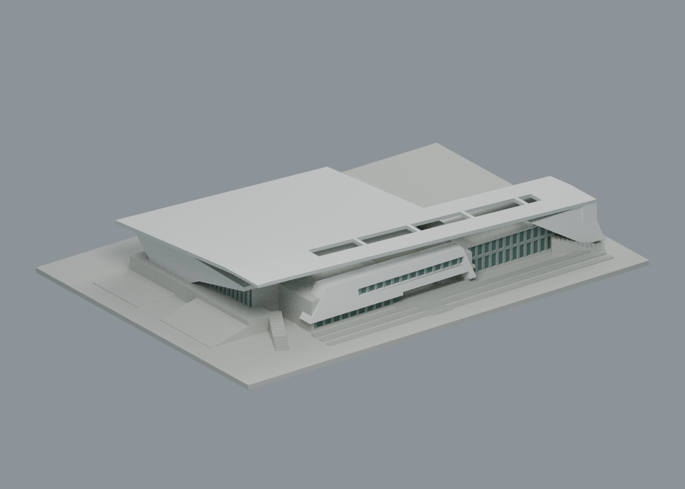
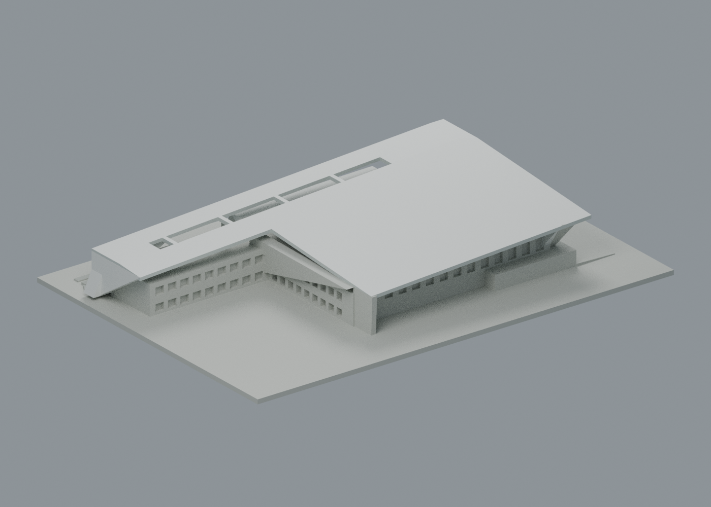
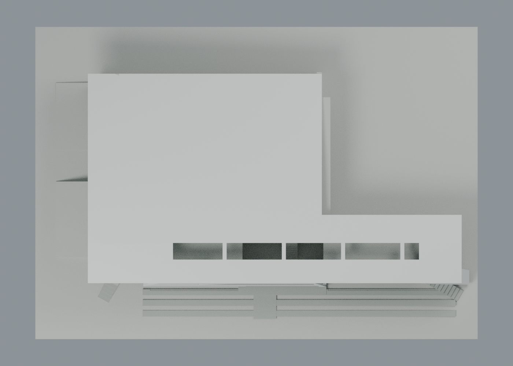
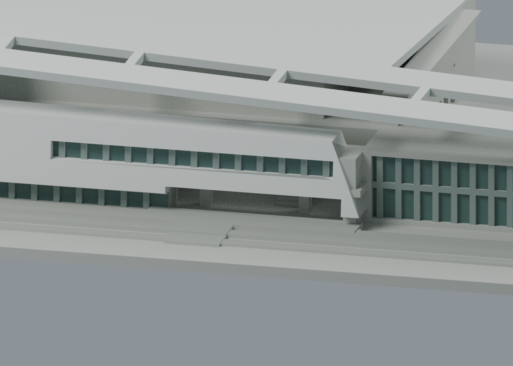

# 樹人醫專多功能活動中心：六材質外觀交換版

| 模型預覽 | 模型預覽 | 模型預覽 |
| :---: | :---: | :---: |
| 可見街側／草坪側外觀  | 背面幾何，顏色未確認區保留中性  |  |

## 本次右端白折板斜返邊有限延色

僅原 STL 面序 928、941 的完整剪斜平行四邊形，由中性槽 0 延用白折板槽 1。原 965 個已色面及其餘 3170 面全部保持，底面 916 不染、截止角不補造。六槽原名稱／名義色及 palette.json bytes 不變。新版各槽面數為 [2205,359,184,166,189,69]，不是全館配色完成。

原 3172 面／1562 點、STL bytes、全部座標、繞向及面序精確保留；不重跑舊面心 classifier、不重建幾何。原 804 共面域中有 21 個歷史混色域，本次逐面保留其清單及材料，零新增混色域，不能稱全模型共面均色。原來源逐角色統計及 unknown_backside 文字留作前版歷史，當前變更以 current_continuity_extension 及新版 QA 為準。

此有限域是原右折板外斜邊，由原平面紙座標 (3310,11.8m) 至 (3400,1m) 的邊界，紙 y=1980、剪斜 0.08、原厚 4.86mm。原另一回折體外界 x=(3250−2000)×(1.18/22.9)+5.20 截止於 x≈69.61048、z≈9.7304mm；下緣 z≈2.78mm。保留原 float32 點，不延伸至名義上尖角。兩面構成完整共面四角域，總原網格面積 35.94600158593647mm²，解析 35.94600179930104mm²。原四角、投影 union、無重疊、全域共面與有限界線皆核對；三條完整邊接既有白面 929、940、978，底邊接原中性底面 916，並未跨到底面。

親看建築師 MAYU 01／03／05 與 takuyatsai 公開空拍原照。MAYU 03 支持右端白折板身份與同板色族；01 是長翼身份旁證，05 是其他角的材料族參考，不冒充候選端面的近照。新增窄返邊採同一白色板件材料延續推論；樹蔭／底端遮蔽、原加厚剪斜及截短代理不當作照片精確測量或逐面證明。Flickr 的 2017-09-10 來自歷史頁題，未獨立驗證；建築師照日期未知，不證明 2026 現況。攝影權利依原來源登錄，所有原照僅私人審核，不入公開包。

底面、玻璃與窗框背板、外梯、槽 2 灰白屋緣、主屋頂、池側未驗證牆、地景及其他面全不變。不因陰影染黑或將玻璃鄰框染玻璃。原 46 個薄層警告及已記錄的有限例外、原壁厚與柱角損失限制、需支撐及未實體試印聲明原樣保留。本次 QA 不替代製造驗證。

彩色更新僅在 appearance；root STL、原單色 scene、歷史圖、原工程 QA、checksum、來源及原程式保留 bytes。新版新增 mesh-data.npz、固定 SHA baseline、有限域及 qa-continuous-rightreturn。原四相機保留，另加東西、前後立面、右返邊近景與高位後視，共十圖；近景刻意裁切，其他全景確認框入原模型。Blender 材質和單點改存重開、重渲染像素一致、strict3MF 材質往返及 ZIP 孤立精確重建均測試，非切片或實印保證。

重建執行 `python appearance/source/build_continuous_rightreturn.py`；交換檢查 `verify_continuous_exchange.py`；Blender 執行 `render_continuous_rightreturn.py` 與 `verify_continuous_scene.py`。`appearance/rebuild-continuous-source.zip` 含原 STL、固定逐面材料、色盤、有限域及完整重建程式。依賴 numpy、lib3mf 2.5.0、Blender 4.3.2；不需原照片。新版校驗為 `appearance/CONTINUATION-SHA256SUMS`。

本輪全部原物件屬性與完整材質定義皆保留，僅 2 個指定面的材質指派延伸；原 palette scope 保留歷史文字，現行範圍以本節為準。舊校驗表與 QA 保留歷史 bytes，根 PUBLIC-MODEL-SHA256SUMS 與 appearance/CONTINUATION-SHA256SUMS 為現行校驗。

## 前版說明與保留限制

保留既有 2016 建物模型的全部 3172 三角面，依 2017 年公開空拍可見部位補上近似色。**六個可編輯材質身份，不限制四色；未見背面保留中性灰，並非已確認其實際色。**

| 模型預覽 | 模型預覽 | 模型預覽 |
| :---: | :---: | :---: |
| 頂視  | 穿廊與既有玻璃凹面局部  |  |

## 下載與編輯
- [通用表面色 3MF](szmc-appearance.3mf)：1 個原網格、1562 頂點、3172 三角面；原 STL float32 座標與面序逐面相同。毫米單位，與原模型相同座標原點。
- [可編輯 Blender 外觀 scene](scene.blend)、[六材質調色表](palette.json)、[逐面材質與角色](face-materials.json)。
- [原單色 STL](../model.stl) 不變，SHA256 a763cee5febe34c80b4bbe36d19dca5fb1b2d9fd65d956aa310a06e5a993e902。

這是表面材質交換，**沒有把色區改造成封閉分色體、沒有噴頭映射、沒有機器設定或 G-code**。不同軟體可能只顯示色而不直接轉成多材料工具；未驗證 GUI 匯入。六個身份包含未確認中性面，不等於實物只有六色。玻璃用不透明灰綠表面表現，不聲稱光學透射或測得建材色。

## 來源與界線
[公開空拍頁](https://www.flickr.com/photos/115050927%40N06/36572949213)，攝影帳號 takuyatsai，既存頁面記錄標示 2017-09-10；日期未另行核實，不作 2026 現況證明。[圖片連結](https://live.staticflickr.com/4359/36572949213_da7e688a9e_b.jpg) 僅作參考，原照片不隨包散布。建築身份由既有官方校園資料及原模型來源對照；原幾何的 MAYU 平面／多向照片來源見[原 sources.json](../sources.json)。

- 白折板頂／街側折面、灰白屋板側邊、灰綠玻璃及灰色框／平台，均為可見顏色的近似選值；反射、天候、陰影與塗料無法從單張照片完全拆分。
- 深穿廊由既有凹入幾何與照明形成陰影，**沒有把陰影當黑色塗料**。本次沒有新翼、窗孔、屋頂設備或背面細部。
- 反向圖是原幾何的另一視角；未見背面不補假色區。未做測色、同日現場調查或精確材料辨識。
- 仍適用[原模型尺寸及簡化](../README.md)與[原製造 QA](../QA.md)的全部限制，包含 46 個跨層薄損樣本、兩個斜屋角及柱角特定例外。沒有以配色推翻或重跑歷史製造證據。
- 未做新的 FFF 切片、支撐分析或實體試印，屋簷／穿廊／外梯仍有待驗風險，不保證無支撐列印。

## 必要檢查與重建
[交換驗證](qa/exchange-validation.json)、[scene 驗證](qa/scene-validation.json)、[來源與外觀覆核](qa/source-appearance-review.json)、[預覽資訊](qa/render-manifest.json)。lib3mf 2.5.0 嚴格載入零警告；實際單一材質改色往返保留其餘材質與指派，SDK 預設六位小數寫出最大座標量化 0.0000076294 mm、零退化面。這份測試改色檔不交付，交付 3MF 本身與原 STL 座標完全相同。

標準 Python 執行 source/build_appearance.py 可由原 STL 與 palette.json 重建 3MF／面材質清單；Blender 4.3.2 執行 source/render_appearance.py 可生成四圖及 scene，再執行 source/verify_scene.py。source/verify_exchange.py 使用已安裝 numpy/lib3mf。原圖不需嵌入重建，沒有新增軟體或字型資產。
