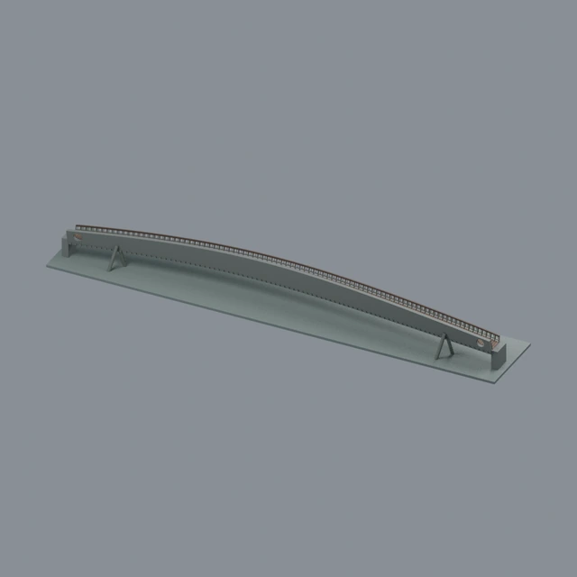
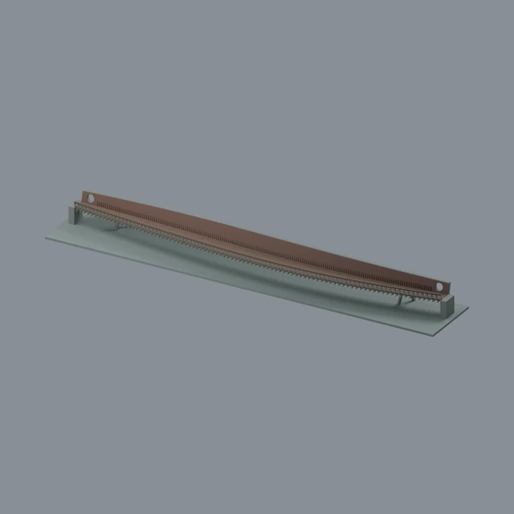
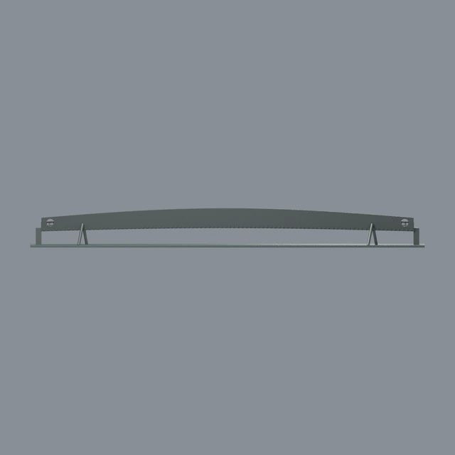
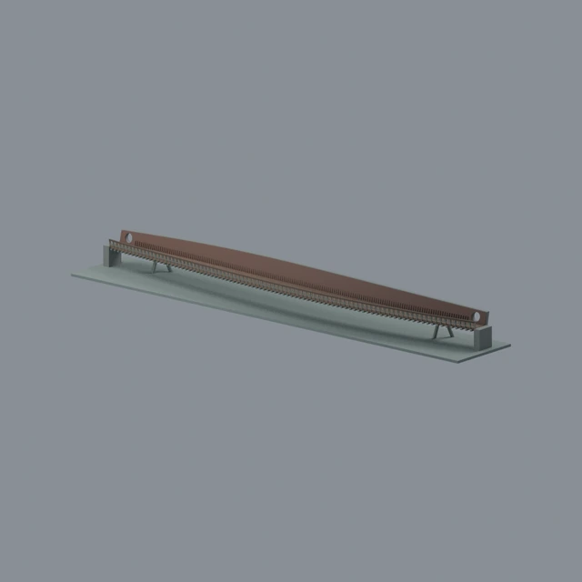
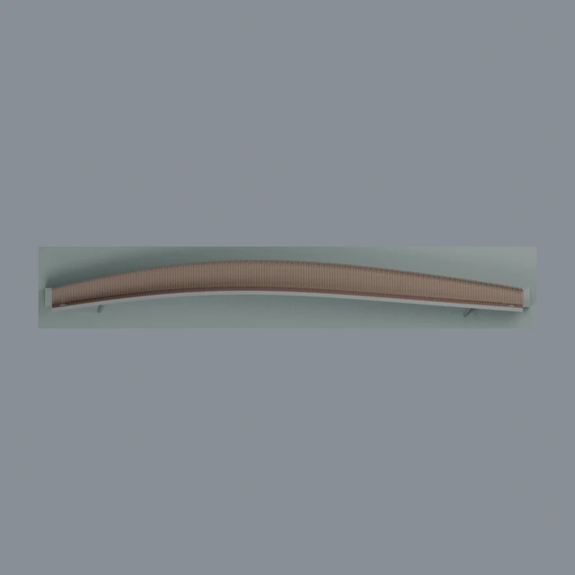

# 法鼓文理學院金山校本部大願橋

**整橋完整主要外觀近似方案；不是測繪或工程內構復原。整橋升級版（2026-10-22核准發布）。**

連續變寬彎曲木橋面、單側外傾高箱梁、兩端真圓通孔、低開放欄杆/木扶手、圓橫梁與橋底細支承、兩岸各一組非共頂雙斜管；中央無落水墩。展示底板和最小端接面非實際地形。

## 模型預覽

| [](previews/front.webp) | [](previews/rear.webp) | [](previews/elevation.webp) |
| :---: | :---: | :---: |
| 正面 | 背面 | 正立面 |
| [](previews/left_oblique.webp) | [](previews/top.webp) |  |
| 左斜視 | 俯視 |  |

## 可編輯檔案
- `scene.blend`：可編輯三角網格、7材質、燈光相機。
- `model.3mf`：毫米、逐面7材質，同一幾何；並非印表機耗材配置。
- `model.stl`：同一幾何，STL不保存顏色。
- 5張`previews/*.webp`均為交付mesh實渲染；generator/render/rebuild與QA腳本附上。

全展示約286 × 47 × 28.1mm；橋身270mm，依建築師108m取示意1:400。細杆名義直徑0.34mm、斜撐0.40mm，已低於常見0.8mm薄件篩檢，不適合直接承諾一般FFF實印。長跨、傾牆、圓梁及欄杆需支撐或拆件；未實印、不保證免支撐。實際切層/薄處與懸挑數值見QA。

## 歷史與單一計數
本方案替代歷史 `dila-great-vow-bridge-middle-span-segment`，不是另一套現行模型，套數不增加。歷史固定commit `4e9dfa531b4b065b9ed16f88ff28bbf2fe87a3d0`；舊STL SHA256 `ab8f4bab8b9e8bf708e9bc386dbfa6b012e06ca4912daaea881dd0839d64c913`。舊片段A/B為人為裁切、不是橋台。本版從17圖新建整體，不重複延長舊gen；舊0.8mm頂層失敗與支撐風險保留在歷史QA，新版獨立重驗。本次整橋替代沿用舊canonical目錄slug避免斷鏈；slug中的middle-span-segment僅為歷史路徑，不表示新版仍為裁切片段。

[歷史片段完整來源／QA／STL](https://github.com/hplin50643/taiwan-buildings-3d/tree/4e9dfa531b4b065b9ed16f88ff28bbf2fe87a3d0/法鼓文理學院/金山校本部/buildings/dila-great-vow-bridge-middle-span-segment)。

## 重建與檢查

用 Blender 4.3.2 與 `requirements.txt` 所列套件重建。輸出路徑須在模型目錄外且尚未存在，避免覆寫發布檔案。個別分析入口為 `qa_model.py`、`check_features.py`；`verify_scene.py` 和 `verify_exchange.py` 分別用於場景及交換格式核對。 跨 Blender／硬體版本不承諾位元組一致。來源審查與既有 QA 的限制不變；若修改幾何，須重跑 QA 及外觀審查。

```bash
python -m pip install -r requirements.txt Pillow==13.0.0
python verify_package.py
blender -b --threads 4 --python-exit-code 19 --python verify_render.py
python rebuild.py --output ../new-clean-rebuild --blender blender --threads 4
```

五張展示圖使用 640 px WebP 縮圖，可點圖開啟全尺寸無失真 WebP。[縮圖校驗](previews/thumbnail-proof.json)。重建只在暫存目錄產生 PNG 中間檔，核對解碼 RGBA 像素及尺寸後輸出並校驗 WebP。原模型和既有 QA 報告不變，原始 PNG 和當時的校驗記錄仍可在固定提交查閱。[現行 WebP 校驗](qa/preview-webp.json) · [原始 PNG 與歷史 QA](https://github.com/hplin50643/taiwan-buildings-3d/tree/336ce1843e6e4435f93ed1a5df7cc26434fb9596/%E5%A4%A7%E5%B0%88%E6%A0%A1%E9%99%A2/%E6%B3%95%E9%BC%93%E6%96%87%E7%90%86%E5%AD%B8%E9%99%A2/%E9%87%91%E5%B1%B1%E6%A0%A1%E6%9C%AC%E9%83%A8/buildings/dila-great-vow-bridge-middle-span-segment)。

來源日期、估計與省略詳 [SOURCES.md](SOURCES.md) · [歷史生成器原件](https://github.com/hplin50643/taiwan-buildings-3d/blob/336ce1843e6e4435f93ed1a5df7cc26434fb9596/%E5%A4%A7%E5%B0%88%E6%A0%A1%E9%99%A2/%E6%B3%95%E9%BC%93%E6%96%87%E7%90%86%E5%AD%B8%E9%99%A2/%E9%87%91%E5%B1%B1%E6%A0%A1%E6%9C%AC%E9%83%A8/buildings/dila-great-vow-bridge-middle-span-segment/render_model.py)。
