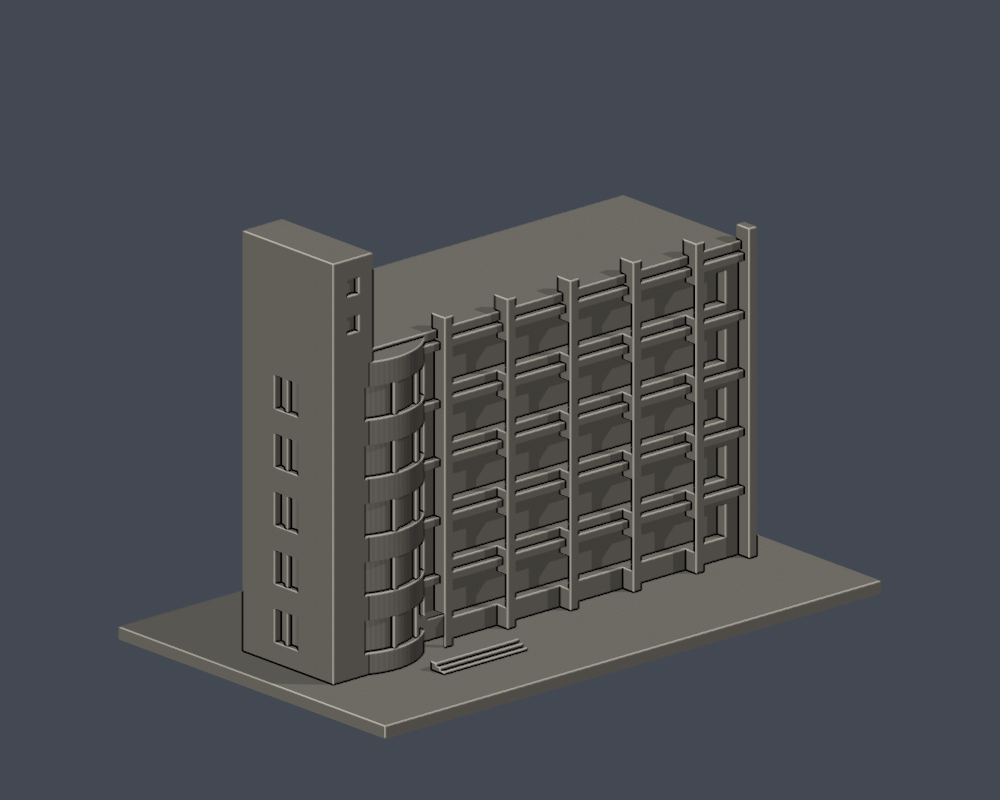
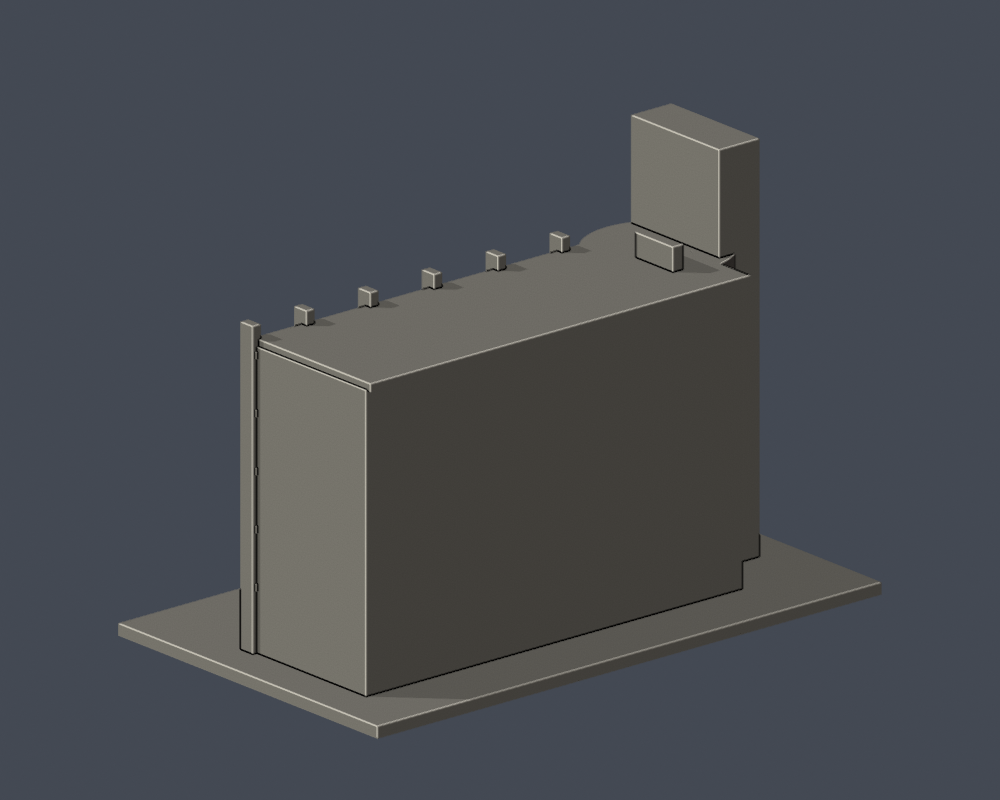
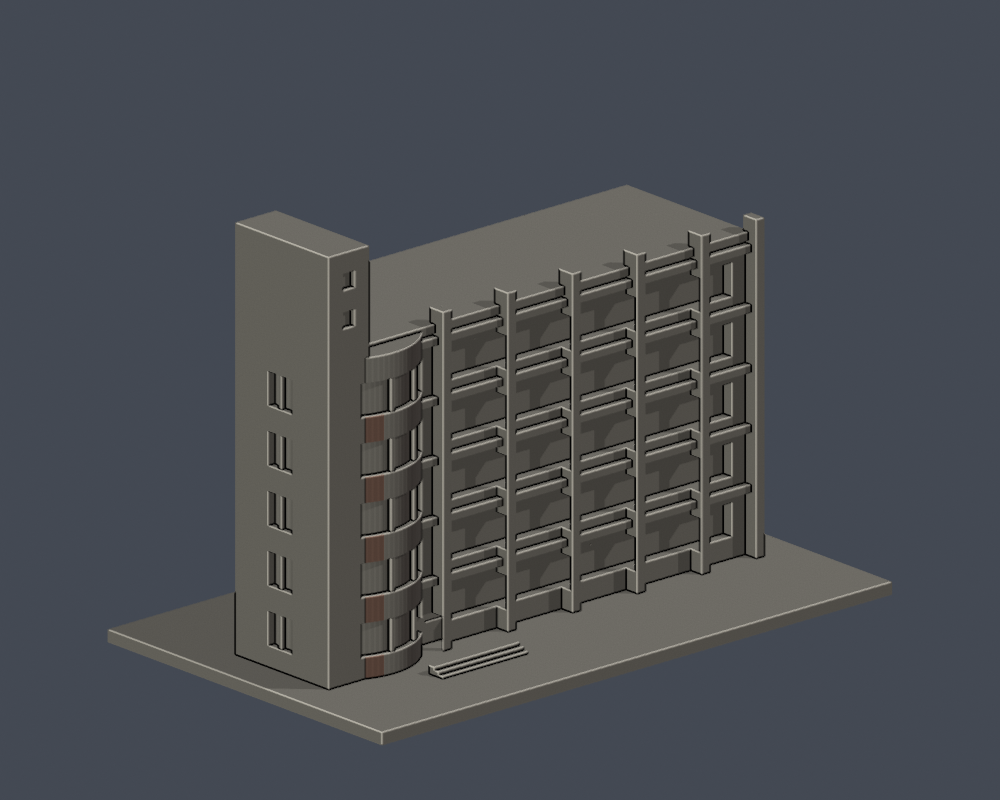
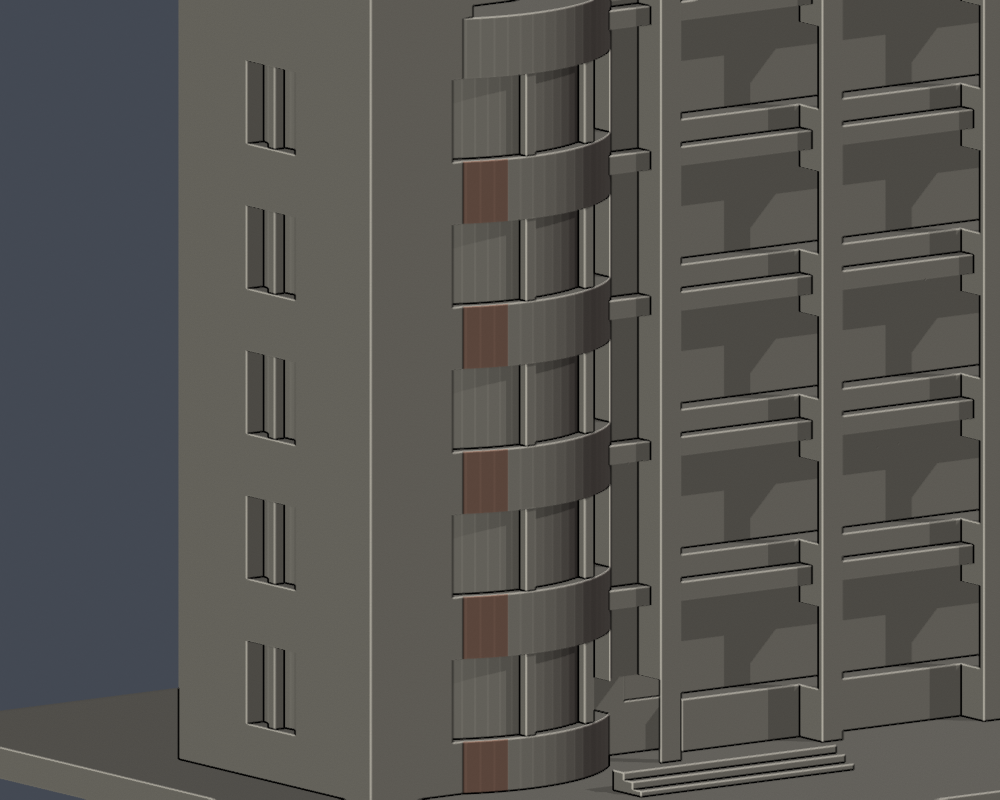

# 美和科技大學民生大樓（SB）

## 模型預覽

| 模型預覽 | 模型預覽 | 模型預覽 |
| :---: | :---: | :---: |
| 正面  | 背面（未見部分按詳頁明示簡化）  |  |

南校區。這是公开外觀照片推估的可列印建築微縮研究，非測繪級BIM。館名依總務處和招生中心核對；現行網頁不保證照片為2026年。

## 外觀依據
- 圓角窗帶樓梯塔與長向凹入廊道
- 層間厚橫帶、延伸到屋頂的直立柱

## 尺度與未知處
- 含底板 150.00 × 91.00 × 103.80 mm；各棟獨立縮放至最長150 mm，不能當同一比例校園拼圖。
- 無實測尺寸。整體深度、背面、隱蔽屋頂與被樹遮蔽位置為目測/簡化；背側不任意複製正面窗格。
- 官方照片很小，門窗数量、柱距、曲率及細部不是精密還原。省略空調、海報、文字和細欄杆；細框為列印加厚。
- 只重建本棟，不連同鄰棟、校園景物、中學或幼兒園。樓層表含屋頂層，與照片可見完整樓層不直接相等。

## 檔案與重建
安裝 requirements.txt 所列Python依賴，執行 build_model.py 產生 model.stl/model.obj。Blender執行 render_preview.py 從實際STL匯入，產生可編輯 scene.blend 及正面/背面/立面預覽。再執行 validate_model.py、check_layers.py、check_thin_features.py。

## 驗證及列印限制
- 原STL法向、流形邊/頂點、正體積、一個連通外表面、無分離內腔殼、原始重建SHA與blend/STL三角幾何：通過。
- 0.2 mm高度間距共 519 層截面閉合檢查：True。數值採非共面微偏移，非真正切片器路徑。
- 0.8 mm XY形態篩檢於1 mm間距抽樣，0 層超過1%形態開運算面積損失，最高 0.24%。小轉角也計入，不等於確定失敗或完整壁厚檢查。
- 挑空、水平屋簷、雨庇及窗洞頂緣可能需要支撐；請依材料、方向和切片器先檢查。未完成實體試印、支撐可移除性測試或完整切片驗證。

來源見 sources.json。第三方照片只供內部研究，本交付不包含原照片。

修訂V2：依來源保留圓弧玻璃塔左後側明顯較高的矩形核心/窄牆。照片最頂端截斷，模型平頂只記錄可見高差，不聲稱精確完整塔頂；不推造頂端機房。

## 薄篩數值修訂

本包直接採canonical-edge-v2：固定共邊方向插值，節點度數2、閉環及Polygon有效斷言通過後，才進行1 mm間距0.8 mm XY開運算。舊算法可能因獨立端點取整漏環；舊工具/結果已替換，不是僅增附錄。STL、Blender、重建來源及原0.2 mm閉環驗證不變。

## 2026-11-20 有限側弧補色

原scene只有「Warm stone preview only」中性展示材，沒有已核實的正面彩色。本次新增單一近似橙粉材 #C79984（Blender linear RGBA .57,.32,.23,1；3MF為8bit sRGB量化），只指定40個原側弧窗間牆面，合131.955083 mm²。其他3506面保持原展示色，不表示實景材質已確認。不是全棟或整個圓塔補色。

原1703頂點、3546面、全部幾何/面序、STL與三張指定previews圖片不變。只改scene的40材索引，加一材及必要face attribute，保留全部原物件與原材；原孤兒Material以fake-user旗標保存，不刪原節點。[重套指定色程式](source/apply_side_color.py)可對現行scene重複執行 `blender -b -P source/apply_side_color.py`：先核原3546面全部角點順序雜湊及原索引範圍，再使用同名材質，只作用指定40面，不新增重複材質。由原STL及原render_preview重建中性scene後也可套用；原build/render程式仍為歷史幾何與展示流程，不能當新版補色器。

[側色3MF](side-colored.3mf) · [可編輯scene](scene.blend) · [面域](side-color-domain.json) · [色表](side-color-palette.json) · [材面表](side-color-faces.json)。3MF無原版可比，本次新增而非聲稱更新既有3MF。

### 額外QA預覽，不替換原代表圖
|||
|---|---|
|完整入鏡的新QA全景|局部近圖，非整棟全景|

親看[校方校園導覽原圖](https://adm.meiho.edu.tw/var/file/26/1026/img/1339/875261653.jpg)中標示SB的民生大樓照片，僅將可見圓角窗間牆的橙粉色族有限映射到五組原面。原來源照片本身很小、受招牌及陰影影響，色值是未校準代理；不把青玻璃、招牌、高灰直塔、屋頂、其他牆及未知背面染色。拍攝日期未知，不代表2026現況。原曲率、尺寸及窗間牆厚度是粗化近似，本次補色不追認為測繪。照片未納入公開檔案或貼圖。

### 本次檢核及限制
[交換QA](side-color-exchange-QA.json)對全部原三角角點/順序、所有材質指派與色表核對，strict lib3mf零警告；實際修改單材後寫回再讀，量化誤差上限另記。 [場景QA](side-color-scene-QA.json)新開檔比對原完整RNA，除指定索引、必要face attribute、新材槽與原孤兒材保存旗標外全部受檢資料一致；相機、render設定、世界及原材節點保留。UV Sculpt與runtime/更新計數等不穩定資料明列排除，非Blender每個內部狀態都被檢核。[真實Blender材質編輯存讀](side-color-native-edit-QA.json)使用私人副本、不修改交付scene。[獨立全mesh/指定面對照](side-color-independent-QA.json)另核全部物件transform/visibility與幾何。

原519層與薄特徵限制維持歷史範圍，本次非重做實體列印或切片工具路徑，不能保證免支撐或全域壁厚。原代表圖保留的舊展示色不可用作本次色檢證據。本次hash-manifest列現行檔案，舊validation中的原scene/hash仍屬歷史版本，不宣稱新場景具相同bytes。
