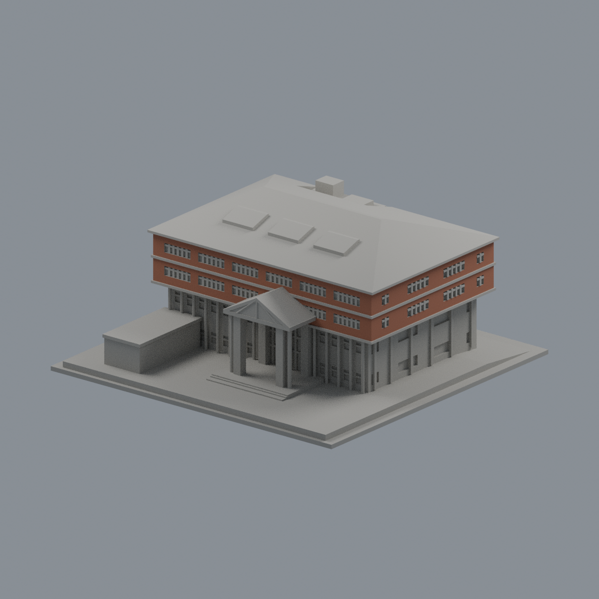
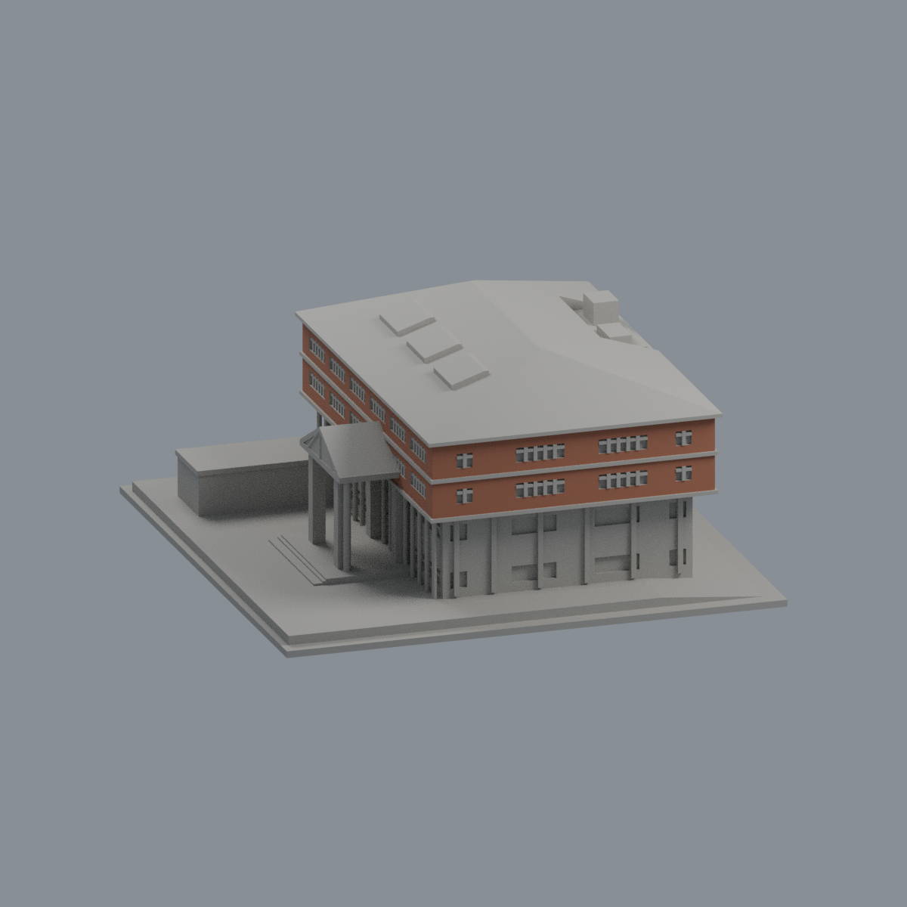
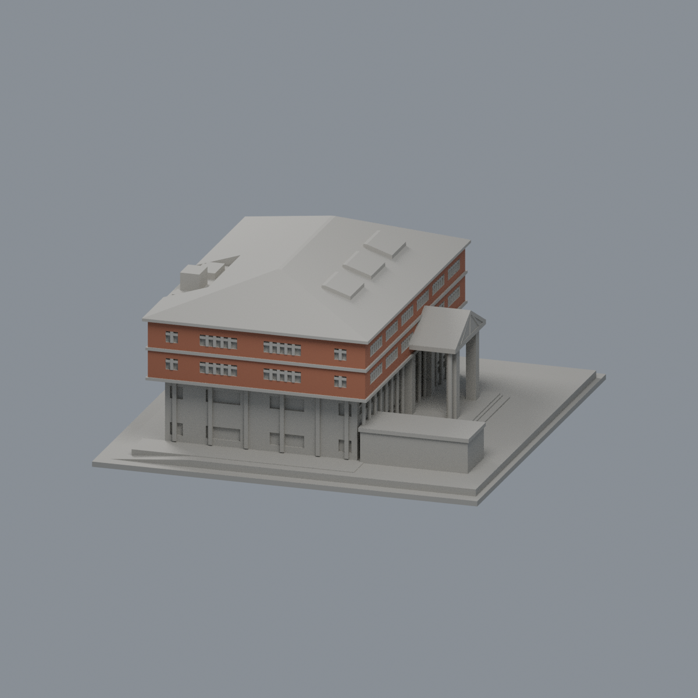
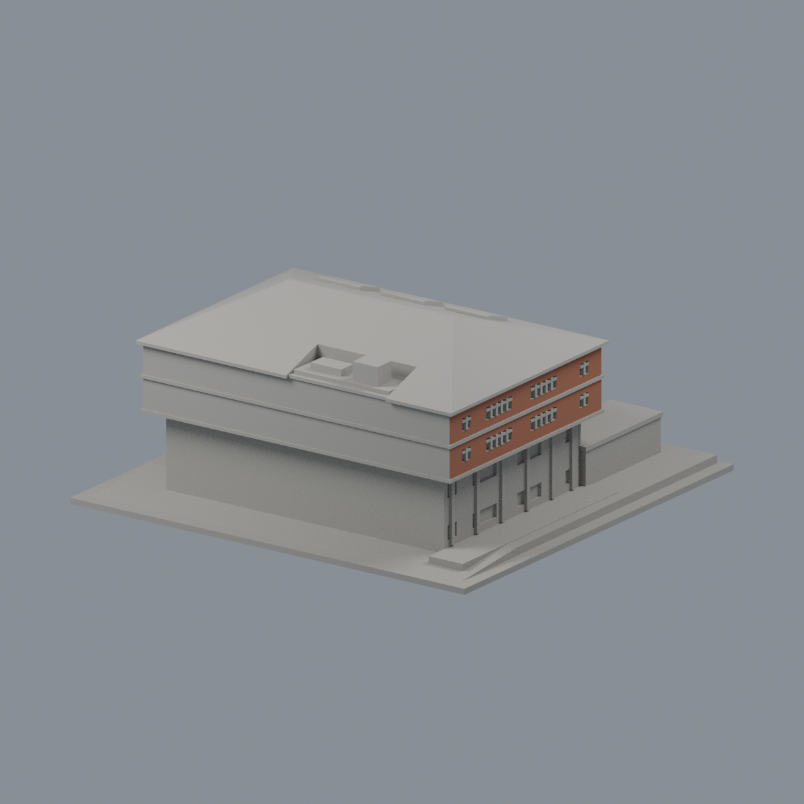
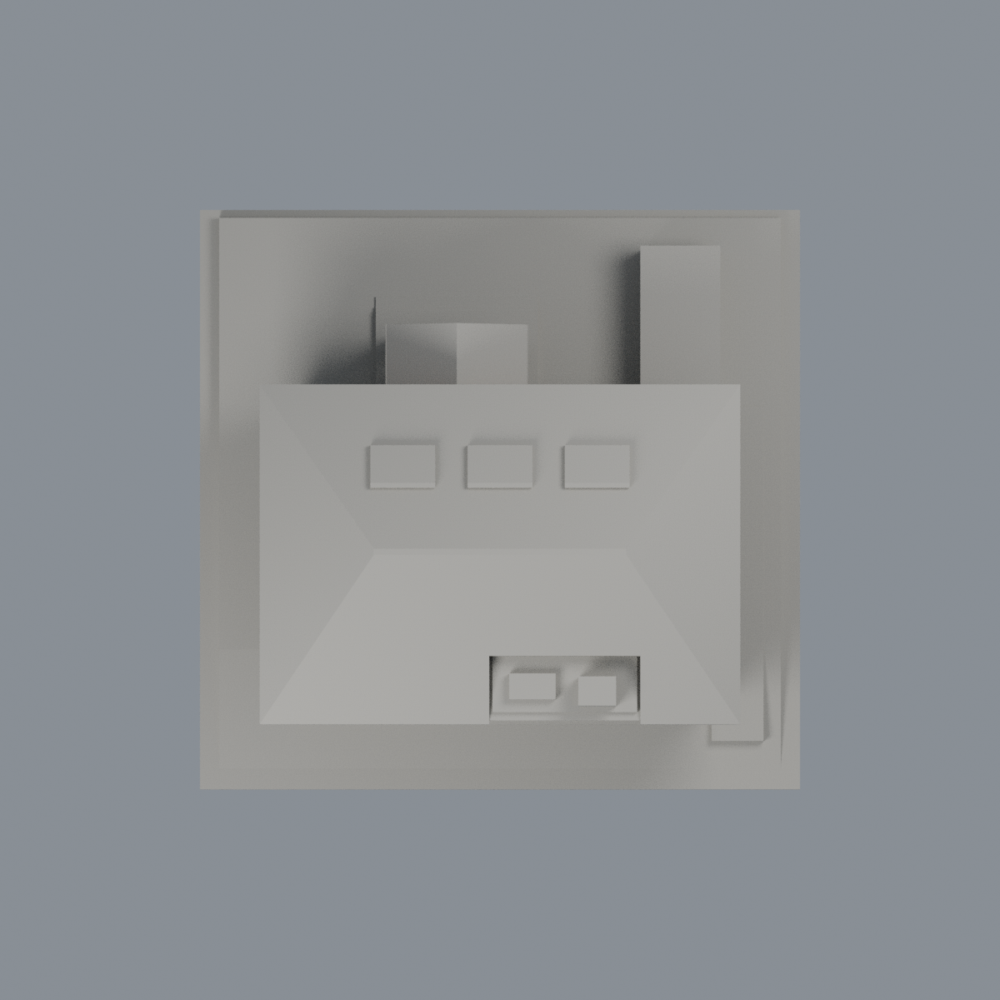

# 義守大學｜校本部｜學生活動中心

## 模型預覽

| 新版模型預覽 | 新版模型預覽 | 新版模型預覽 |
| :---: | :---: | :---: |
|  |  |  |
|  |  |  |

## 本次東池側上兩條磚帶同族延色

在原入口／花園側 238 個磚面之外，將東池側 +X 上兩條原磚帶共 164 個原中性三角（82＋82）延續低彩度不透明磚色材 1；既有 238 著色面與全部未變更理由保留。現在磚面共 402、中性 9,224，其餘 9,462 面不變；原 9,626 面／4,775 點、兩色表、STL bytes、座標與面序不變。

候選僅 x=58.32 mm 朝 +X 的有限原外牆，y=−40.905…40.905 mm；兩帶原三角實際 z 範圍為 30.215…40.475、41.555…51.66 mm，完整原面相加約 683.437445／670.756853 mm²，與已著色西側對應域面積相同。窗洞、窗框及回邊、白色水平帶、下牆柱、屋頂、入口山牆與門廊全部排除，不切面或增面。**南背面因原模型未建立可靠窗列，仍 HOLD，不把整片背牆染磚。**

本輪親看校史兩張官方 2022 caption 照，以及總務處官方場地照片 PPT 第 9 頁「戶外劇場(學校泳池旁)」嵌圖。後者在劇場左後方顯示東池側上部紅磚與白帶，但劇場遮住部分，攝影年代不明；完整兩帶仍含有界同磚族延伸推論，不宣稱每點皆有照片或精確校色。2022 為校方caption年，不是認證拍攝日，所有來源不作 2026 現況保證。原四坡／窗列／尺度及歷史來源限制不變；未實體試印，照片與PPT僅私人研究，不入公開包。

新版 QA 在 `appearance/qa-continuous-walls/`；歷史 QA、`source-manifest.json` 及 `SHA256SUMS.txt` 原樣保留作歷史記錄，舊檔案雜湊不代表本次產品。新版使用 `appearance/SHA256SUMS` 與根 `PUBLIC-MODEL-SHA256SUMS`。重建 `python appearance/source/build_continuous_walls.py`；交換驗證 `python appearance/source/verify_continuous_exchange.py`；渲染 `blender -b --python appearance/source/render_continuous_walls.py`；場景驗證 `blender -b --python appearance/source/verify_continuous_scene.py`。ZIP 含原 STL、建模程式、原選取域與新增東帶域，不含照片。原兩材質的中性並非實景灰材質，維持原權利聲明。

## 前版說明與保留限制

2022正面/西側照片與2024全屋頂為主要依據，2009池側及官方其他角度補證的完整主體有界近似；不是測繪、同年完整復原或全校完成。

頂圖（歷史檔案留存，不作本頁預覽） · 側東（歷史檔案留存，不作本頁預覽） · 側西（歷史檔案留存，不作本頁預覽） · 正立向（歷史檔案留存，不作本頁預覽） · 斜俯視（歷史檔案留存，不作本頁預覽）

## 檔案與尺度
- [model.stl](model.stl)：毫米，含底座150×145×66.550003mm，底座朝下。
- [scene.blend](scene.blend)：匯入同一STL的可編輯網格；[build_model.py](build_model.py)是原創參數來源。
- Python依賴見[requirements.txt](requirements.txt)，Blender 4.3.2；`python build_model.py`重建，再`blender -b -t 4 -P render_preview.py`重作實際STL預覽。
- 四坡屋面、南機房凹口、北三低斜片、四柱玻璃雙坡門廊、上2＋下2窗排、東北低附體與入口階梯均保留。泳池、劇場、體育館及停車場不併入。

## 近似及未知
- 屋簷44.5×31.5m源於2024正射像素比例，角點±5px約±0.69m，仍含屋簷和高物視差，不是牆基測值。照片只有薄簷，上牆採43.2×30.3m；OSM北牆40.4m只粗核，沒有硬套成每側2m巨挑簷。
- 檐17.8m、原型脊23m在照片配景候選界內，沒有高程測量或剖面。B1＋地上5F是官方資料，不能換成六等高窗層；模型依可見上2下2窗排。
- 南機房凹口僅截屋面，無證據挖穿牆。南背完整窗列未知，採保守牆面；南坡3細暗三角未證成獨立大盒，省略細節。
- 東北低附體名義4.5m、南地景差1m、平台和階梯是有界示意。全地下室未作全周高牆。官方面積2563/2569㎡、1988/1989時序口徑矛盾，未據此倒算尺度或斷言完工年。

## 列印化簡與限制
- 細窗框背接加粗：豎框約1.08mm，上氣窗橫框0.864mm；主立面線腳1.08mm。窗為淺凹面，並非玻璃真洞。
- 主脊局部截高0.25mm形成約1.52mm窄平頂；北三斜片上端截高0.4mm形成約1.21mm窄頂；主簷零厚邊改1.1mm垂直厚。這些是列印處理，不是真實建築細節。
- 門廊斜板豎厚1.6mm。三角玻璃屋蓋內填實，避免封閉隱藏腔；四柱下方仍有通空。厚梁向前補0.27mm接到原板前緣，消除微懸唇，外屋簷包絡不變。側柱背根完整接牆、細柱落地、四柱接入口平台。
- 未實體試印，亦未執行Cura/Prusa實際工具路徑。門廊、挑簷和凹處應檢查支撐；拆支撐保護細柱/框，勿任意縮小。數位篩檢與有限原面射線不是全模型所有方向最小壁厚或可印保證。

[來源](sources.md) · [完整QA](QA.md) · [驗證JSON](validation.json) · [逐構件](component-detail.json) · [原面射線](surface-chords.json)

## 原面有限磚材外觀層

[彩色3MF、可編輯Blend與五視角](appearance/README.md)：只染238個原+Y入口／−X花園上兩帶磚面，2900.7799204075227 mm²；其餘9388面中性。框窗／白帶／下牆／屋頂／東背全不染，不新增幾何。原9626面／4775頂點、STL bytes與原QA保留。官方2022為caption年非EXIF攝年，圖片來源秘書處、ARR保留，照片不附。歷史strict pass不是實印或全域厚度保證。

