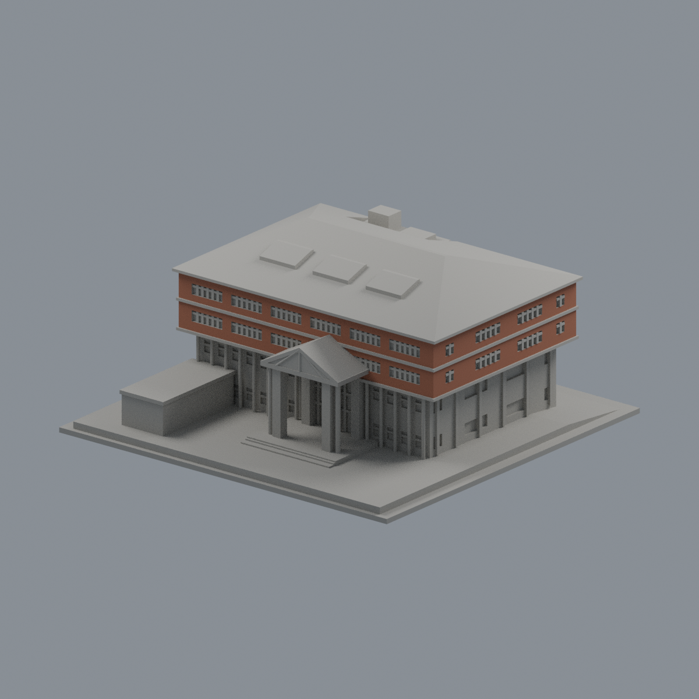
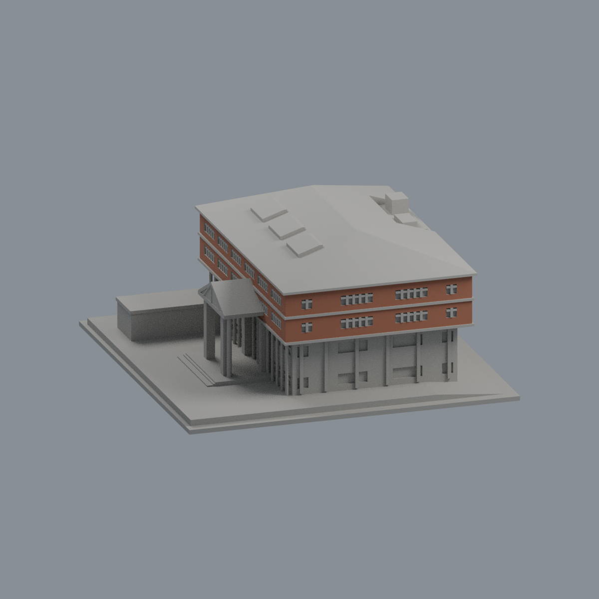
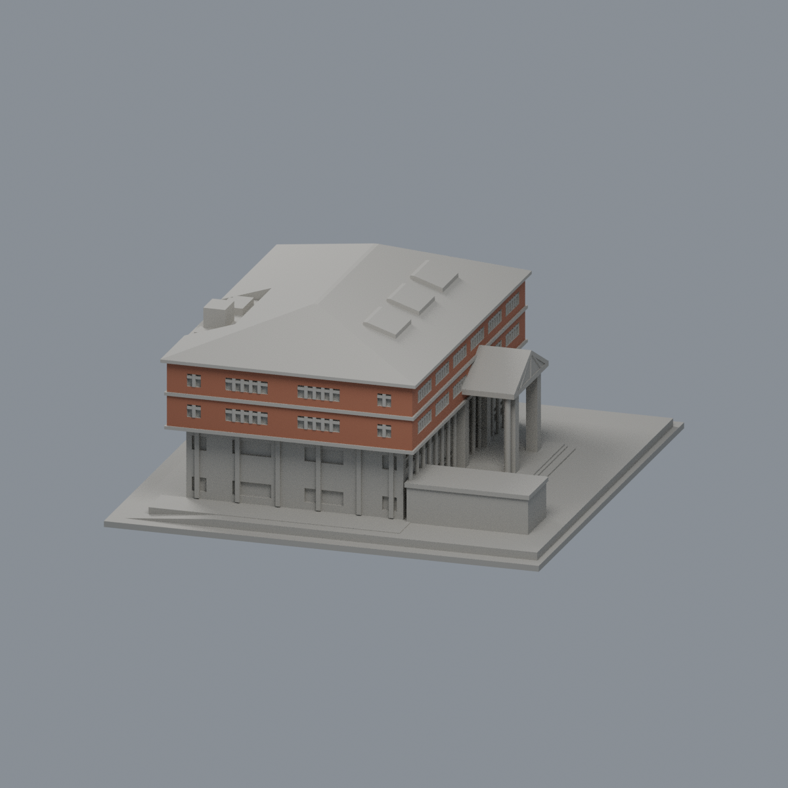
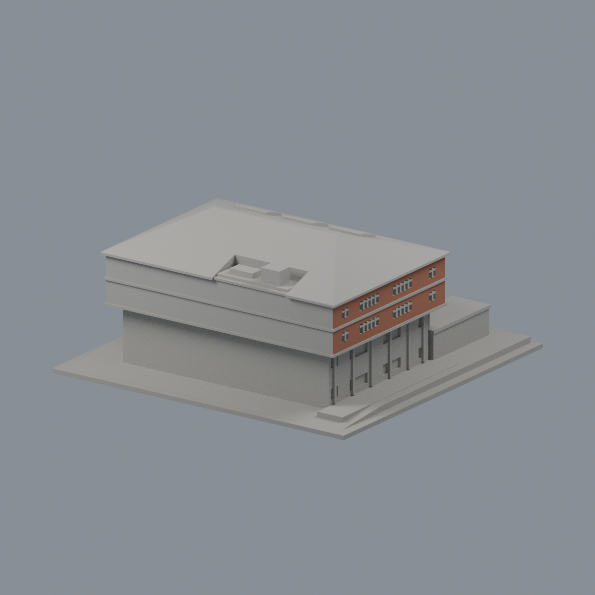
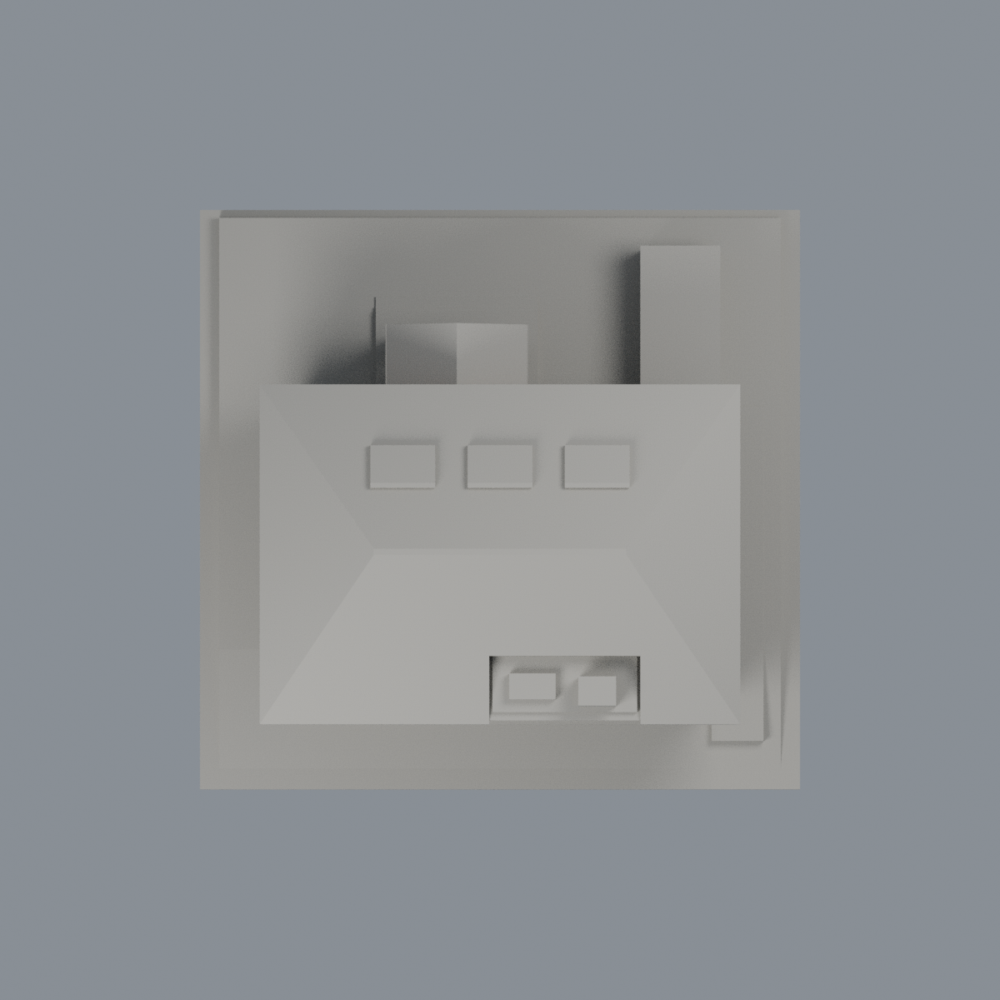

# 義守大學學生活動中心：原面有限磚材外觀層

| 模型預覽 | 模型預覽 | 模型預覽 |
| :---: | :---: | :---: |
| 入口正面  | 花園側  | 東側  |
| 背面  | 俯視  |  |

## 本次東池側上兩條磚帶同族延色

在原入口／花園側 238 個磚面之外，將東池側 +X 上兩條原磚帶共 164 個原中性三角（82＋82）延續低彩度不透明磚色材 1；既有 238 著色面與全部未變更理由保留。現在磚面共 402、中性 9,224，其餘 9,462 面不變；原 9,626 面／4,775 點、兩色表、STL bytes、座標與面序不變。

候選僅 x=58.32 mm 朝 +X 的有限原外牆，y=−40.905…40.905 mm；兩帶原三角實際 z 範圍為 30.215…40.475、41.555…51.66 mm，完整原面相加約 683.437445／670.756853 mm²，與已著色西側對應域面積相同。窗洞、窗框及回邊、白色水平帶、下牆柱、屋頂、入口山牆與門廊全部排除，不切面或增面。**南背面因原模型未建立可靠窗列，仍 HOLD，不把整片背牆染磚。**

本輪親看校史兩張官方 2022 caption 照，以及總務處官方場地照片 PPT 第 9 頁「戶外劇場(學校泳池旁)」嵌圖。後者在劇場左後方顯示東池側上部紅磚與白帶，但劇場遮住部分，攝影年代不明；完整兩帶仍含有界同磚族延伸推論，不宣稱每點皆有照片或精確校色。2022 為校方caption年，不是認證拍攝日，所有來源不作 2026 現況保證。原四坡／窗列／尺度及歷史來源限制不變；未實體試印，照片與PPT僅私人研究，不入公開包。

新版 QA 在 `qa-continuous-walls/`；歷史 QA、`source-manifest.json` 及 `SHA256SUMS.txt` 原樣保留作歷史記錄，舊檔案雜湊不代表本次產品。新版使用 `appearance/SHA256SUMS` 與根 `PUBLIC-MODEL-SHA256SUMS`。重建 `python appearance/source/build_continuous_walls.py`；交換驗證 `python appearance/source/verify_continuous_exchange.py`；渲染 `blender -b --python appearance/source/render_continuous_walls.py`；場景驗證 `blender -b --python appearance/source/verify_continuous_scene.py`。ZIP 含原 STL、建模程式、原選取域與新增東帶域，不含照片。原兩材質的中性並非實景灰材質，維持原權利聲明。

## 前版說明與保留限制

既有模型的有限外觀改善，不是新增建築或全棟實景精準復原。只將+Y入口與−X花園側上兩帶的238個完整原磚面染為低彩度暖紅褐不透明代理色，合計2900.7799204075227 mm²；其餘9388面保持中性。兩組入口33／41面、兩組花園82／82面。沒有量測實景RGB、反射或材質厚度。

- [彩色3MF](isu-student-activity-center-appearance.3mf)：單網格、全部原頂點、兩個可獨立改色材質。
- [Blender原生可編輯檔](scene.blend)：全部原面；材質與頂點實際修改／保存／重開驗證。
- [入口正面](previews/front.png)・[花園側](previews/left.png)・[東側](previews/right.png)・[背面](previews/rear.png)・[俯視](previews/top.png)
- [重建原始碼ZIP](rebuild-source.zip)：解壓後依序執行 appearance/source/build_appearance.py、verify_exchange.py，再用 Blender --background --python 執行 render_appearance.py、verify_scene.py。Python numpy、lib3mf 2.5.0、Blender 4.3.2。

## 嚴格範圍
四個有限外牆平面，原三角形三頂點與實際外法向全部落域才選取。框窗、白色橫帶、窗洞側壁、下牆與柱、入口山牆與門廊、屋頂、東側與背面、底座全不染。窗灰是未確認的原中性，不代表白色玻璃。不新增磚縫貼圖、切面或幾何。前／花園與東／背的配色分界是證據範圍，不宣稱真實建築材料接縫。

## 幾何、可編輯性與歷史QA
原STL bytes不變：9626三角面／4775頂點，150×145×66.55000305 mm。原面順序、三頂點、有向繞序、單位、底座與簡化保留；完整原34件另存私有完整備份，包括原QA／原預覽／原生檔。交付STL／3MF座標精確，SDK另存的隔離編輯測試副本有float32微量化（精確值見qa），不把它宣稱原位元完全不變。

原strict數位QA歷史pass：333層／2698多邊形，最大單元opening損失0.9668832297%、全層0.1092317211%；9626×4=38504有限表面樣本最短首段實心弦0.8099994659 mm，140屋頂樣本最小1.2053391 mm。4大入口柱、17細柱、2後支柱與12側壁柱根部連接。這些不是全表面任意方向最小厚度保證，本次不重跑歷史製造檢核，沒有實際切片路徑或實印保證；保留支撐評估，不建議任意縮小。

原README的2022正西／2024屋頂／2009泳池側混合年代、官方1988／1989和2563／2569 m²差異、南窗列未知、名目附屬／底座高度、照片推估高度與平面、四坡屋頂及凸板列印簡化等全部保留。本次只改善外觀，不解決既有幾何不確定性。

## 來源與權利
見 [SOURCES.md](SOURCES.md) 和 [LICENSE-NOTICE.md](LICENSE-NOTICE.md)。照片僅私下觀察，不附圖像、照片像素、貼圖或藝術品。2022是官方caption年而非EXIF攝年，不推論2026現況。技術完成不等於第三方權利清除或法律適用保證。
