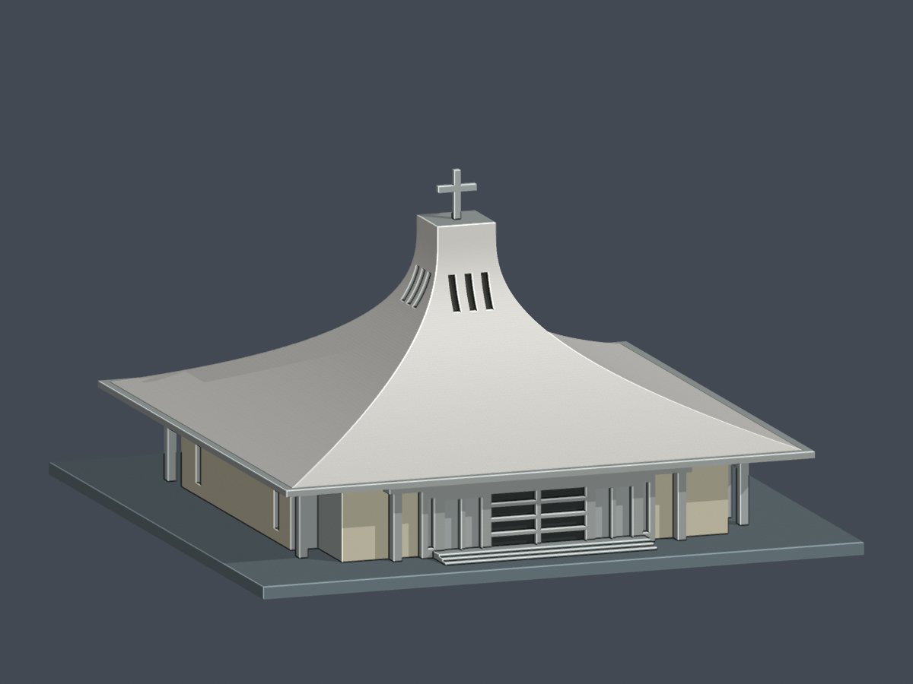
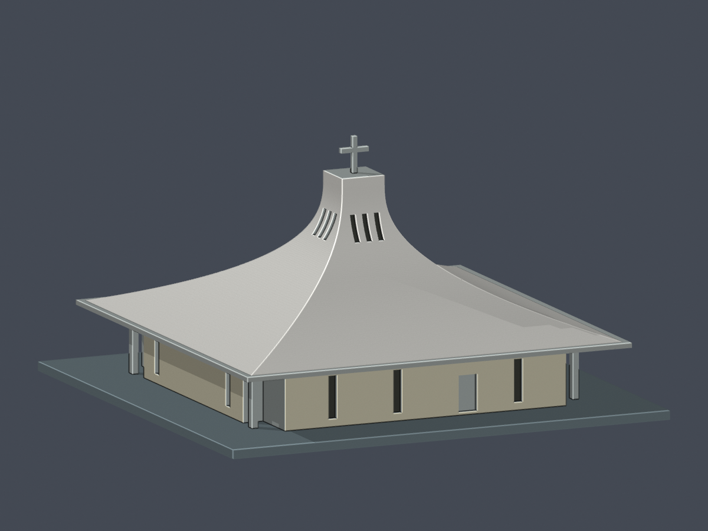

# 降臨堂｜約2014主堂外觀近似版

## 模型預覽

| 模型預覽 | 模型預覽 | 模型預覽 |
| :---: | :---: | :---: |
| 正面  | 背面  |  |

## 本次後向上窄槽白殼垂直側壁延色

僅將原模型後向 +Y 的三個上部窄槽，兩側共六個完整垂直側壁、294 個原三角（每域 49 面），從 unknown_neutral 延用既有 shell_offwhite（材質 2，#ECEBE5）。原 2,285 個非零材料面全保留，其中含 67 個抽象底座面及 2,218 個原已色建築面；原 720 個上槽暗背一面不改。八槽材料名稱、sRGB 名義色與證據狀態不變。新版各槽面數為 1393／67／1598／67／97／16／720／14；建築已色 2,512，未確認建築 1,393，抽象底座 67，不代表全棟配色完成。

原 STL bytes、3,972 面／1,980 點、首見頂點表、三角序、座標、繞向、150×150×83.080002 mm 尺寸全部不動。Blender 原面 ID 屬性與未改面的證據區標籤保留，新增側壁另有證據區，不切割或重建原面。

有限域在原設計 z=10.65…12.45、三槽中心 x=−0.9／0／0.9，各側 x=中心±0.2；朝開口法向分別±X，僅 +Y 後側。原換算為 mm=(4.55x,4.55y,3+4.55z)。外界是原曲殼每 0.1 分段折線，內界是原槽背每 0.06 分段折線扣 0.25；以兩組節點聯集形成完整有限條帶，而非用理想光滑曲面重新建模。每域原 49 面皆全頂點／整三角入域、無重疊，且與原白殼共邊；原共面連通域全部包含。單域解析 9.3211841738 mm²、網格 9.3211824796 mm²，總解析 55.9271050428 mm²、網格 55.9270948778 mm²，微差屬原 float32 座標，未修形。

只補垂直側壁，不塗槽頂、槽底、下向簷底、冠頂、十字架、後門，也不泛化到另外三個殼方向。原全域混材共面分量為零，本次仍為零。下部乳白牆轉角的實景另有灰框、磚、開口與設備，原整面會跨材界，故維持 HOLD，不因牆面大就一律塗成乳白。十字架白／棕來源衝突及後紅門未登錄問題原樣保留。

來源為作者 Catherine Lee 公開文章所列 S2／S3：
- https://catherinelee234.com/wp-content/uploads/2016/06/img_0557.jpg
- https://catherinelee234.com/wp-content/uploads/2016/06/img_1732.jpg
本輪親看兩張完整照片，後側曲殼、三窄槽的淺色垂直側壁與暗色背面可分，主降臨堂與前景另建教會中心不混計。原登錄 EXIF 分別為 2014-01-28、2014-02-21，時區與相機時鐘未獨立驗證；文章 2016-06-08／網址 2016/06 是出版／上傳資訊，不是拍攝日。陰影或對向窄側壁為同開口白殼材料的有界延續推論，不是每個像素都獨立驗證，也不是校色油漆規格或 2026 現況。私人原照及裁切不入公開包。

原曲線、槽形與比例均為既有近似，不新增測繪精度。原工程與試印限制全部保留，尤其 52 個高損層／436 個跨層高損 polygon 樣本未因本次補色消失；未做實體試印、切片路徑或新增全域最薄壁／支撐認證。

原 root STL、原生成器／場景／單色預覽及所有歷史 QA／source／SHA256SUMS 保持 bytes。原 appearance/material-manifest.json 也完整保留，描述舊版統計；新版統計另在 continuation-material-manifest.json，未改寫歷史原色。新版 face-materials.json、mesh-data.npz、sju-advent-church-materials.3mf、scene.blend 與十張預覽經新 QA 驗證。保留七個原 Workbench 視角，增加前立面、後立面及底視，十張完整框入原頂點；同一真實模型網格，無展示代理或照片貼圖。材料原粗糙度 .8 保留。

新 appearance/qa-continuous-rearjamb 含有限域、獨審及輸出補核、strict3MF 零警告、材料編輯存取往返、Blender 材質／單點改存重開、原場景重渲染與 ZIP 隔離精確重建。新雜湊在 CONTINUATION-SHA256SUMS。安裝 appearance/source/continuation-requirements.txt 後執行 build_continuous_rearjamb.py、verify_continuous_exchange.py、verify_continuous_regions.py、verify_continuous_boundaries.py；Blender 執行 render_continuous_rearjamb.py 與 verify_continuous_scene.py。rebuild-continuous-source.zip 含必要原 STL 與腳本，不含私人影像。本地準備完成不等於已上傳。

場景 evidence_region_keys 僅在 33 個原鍵及原順序之後追加 rear_upper_vertical_jambs_continuation；只有本次 294 個側壁面的 evidence_region_id 改指新鍵，其他面的標籤與全部 original_stl_face_id 精確保留。其餘原物件屬性、完整材質定義與幾何不變，不能稱全部 attributes 未變。原標籤與十字架、背門、下牆等未解限制完整保留；新鍵表示有界同白殼延續推論而非逐像素實測。原 material-manifest 的材料與限制原樣留存，新增範圍另列 continuation-material-manifest。舊校驗與 QA 是歷史版本，現行校驗以 PUBLIC-MODEL-SHA256SUMS 與 appearance/CONTINUATION-SHA256SUMS 為準。

## 前版說明與保留限制

[回淡水校區](../../README.md)

## 2026-10-24｜有限證據配色層

另附 [appearance/README.md](appearance/README.md)：在原 3,972 個三角面上增加可編修材質、真正含逐面材質的 3MF 與七向預覽，**原 STL、原 Blend、原預覽、尺度與既有幾何／薄件限制均不變**。2,218 面有有限來源依據；1,754 面明確維持未知／抽象底座中性色，包含有顏色衝突的十字架與未對上的背門。不是新增建物，不表示全表面已驗證，也未實體試印。

原始單色預覽仍保留：正面（歷史檔案留存，不作本頁預覽）、背面（歷史檔案留存，不作本頁預覽）；下方原幾何與 v1 限制不因配色而改變。

## 範圍與可信度

依校方較新正面、2014南側施工背斜照片、NLSC正射屋簷外包絡自建。完整主堂量體包含低層退縮牆體、四向曲殼、方頸、十字架與2003改造後門廳近似。不是測繪、不是1973竣工復原，也不是全校完成。鄰近鐘塔及南側關懷中心不在本件範圍。

- 屋簷邊長以約29m建模，正射合理區間28–30m；這是屋頂投影，不能當牆基足跡。
- 牆高4.4m（推估3.6–5.2m）；屋頂升高10m（8.5–12.5m）；短方頸0.6m（0.3–1.1m）；十架2.6m（2–3.4m）。採用總高17.6m，推估包絡14.4–22.2m。沒有可驗證權威總高。
- 牆至簷口退縮取2.4m（1.5–3.5m）；角落凹入取3.9m（2.8–5.2m）。後牆與正門不對稱，但完整牆線仍為照片近似。
- 四曲面用連續方形截面上收形成；曲率指數2.55（候選2.1–3.1）只是外觀擬合，不援引數學論文冒充實測。
- 上部每面三窄窗以淺凹表達。細窗格、彩繪、管線、空調與內部省略。十架與柱加粗並根連接；實心外觀模型不表達實際混凝土殼厚。
- 早期026-1照片沒有明確年代；只有026-3團照明確為1973-02-17。這版不套用舊門廳。

來源、日期、假設邊界與省略項目見 [sources.json](sources.json)。第三方原圖不在本包。

## 檔案與使用

- [model.stl](model.stl)：毫米；含底座150 × 150 × 83.08mm。比例約1:219.8，底座厚3mm。
- [scene.blend](scene.blend)：由實際STL匯入的可編修網格；[build_model.py](build_model.py)是參數重建來源。
- 頂視（歷史檔案留存，不作本頁預覽）、西側（歷史檔案留存，不作本頁預覽）、東側（歷史檔案留存，不作本頁預覽）、正面低視角（歷史檔案留存，不作本頁預覽）、背面低視角（歷史檔案留存，不作本頁預覽）。全部PNG取自交付STL。
- [requirements.txt](requirements.txt)、[render_preview.py](render_preview.py)、[run_all_checks.py](run_all_checks.py)、[validation.json](validation.json)、[qa-summary.json](qa-summary.json)、[SHA256SUMS](SHA256SUMS)。

底座朝下。外簷與門廊有懸挑，須依實際切片評估支撐；細十架須留意搬運。0.2mm逐層幾何與0.8mm形態篩檢不是Cura/Prusa工具路徑，也未實體試印，不保證免支撐。切片前確認STL單位與方向。

## 重建與數位QA

Python安裝requirements後執行build_model.py，再以Blender執行render_preview.py，最後執行run_all_checks.py。檢查原始STL單一水密表面、每邊二面、vertex-link單環、法向與繞序、正體積、重建SHA、Blend幾何、重繪PNG及所有0.2mm截面。原Polygon逐一erosion/opening須零消失零分裂；invalid直接失敗，沒有repair fallback。完整數值見QA檔；面積損失不得替代逐構件連通檢查。416層、800個原Polygon均無消失或分裂；52整層與436個跨層原Polygon樣本opening損失超過1%，包含四角柱與十字架。此警告不是零，也不能全歸為四角；詳下方補充與 [細件說明](thin-feature-review.json)。

**原 v1 凍結驗證紀錄（歷史狀態，非本配色層目前狀態）：** 外觀已於2026-10-14核准，作者數位QA通過並凍結v1；獨立硬性幾何與9張PNG重現檢查通過；薄損具體例外已核准，本說明補充仍待最終文件核對，尚未發布。

## v1文件補充：局部薄損例外

這次只補文件與可重跑驗證器，原STL、Blend、參數源及9張PNG完全不變；原始凍結文件不覆寫。本節取代原先「全部高損僅十架／純圓角」的不完整說明。

- 52整層opening損失>1%；436個跨層原Polygon樣本>1%，包含四角柱與十字架，不是436個實體構件。
- 最差z=83.071mm，原面積2.53605625mm²，損失0.1475368442830866mm²，損失5.81756986987519%，保留94.18243013012481%。排除0.41mm頂點鄰域後仍損失0.004540467122641696mm²（0.17903653054389848%），非零，不能稱全是四角。
- 436個高損截面核為完整矩形；原STL局部X/Y法向caliper最小1.5925mm，角柱約2.093002×2.73mm。這是指定截面的局部量測，並非全方向或全域最小壁厚掃描。
- 十架3根向下射線全部連至底座；4柱各向下連底、向上連屋面。所有800原Polygon erosion/opening均零消失零分裂。基於這些限定證據接受本尺度的具體薄損例外，並非放寬一般驗收閾值。
- 浮點、截面量化、GEOS版本與buffer圓弧離散可能令末位數值微變。保留完整原值，不修復invalid，不吞小構件或更改閾值。
- 不得任意縮小；縮放後需全QA重跑。屋簷、門廊及十架仍須實際切片評估支撐，未實體試印，無工具路徑或免支撐保證。

證據：[逐構件完整數據](detailed-component-check.json)、[局部caliper與根射線](local-caliper-root-check.json)。在模型同目錄依序執行 [check_detailed_components.py](check_detailed_components.py) 及 [check_local_calipers_roots.py](check_local_calipers_roots.py) 可重現，均自包含相對路徑，不依賴其他學校資料。原hardQA仍依run_all_checks.py執行；本補充只解釋非零形態警告，不替代硬性檢查。
