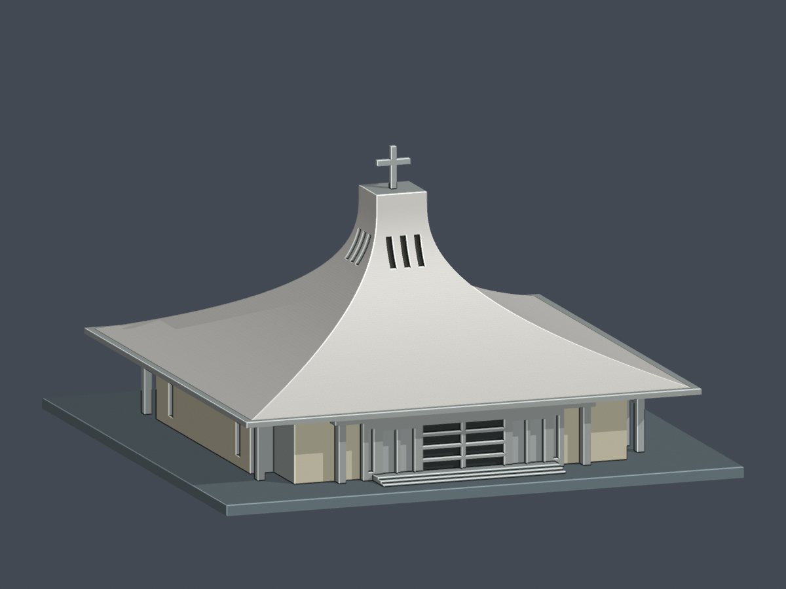
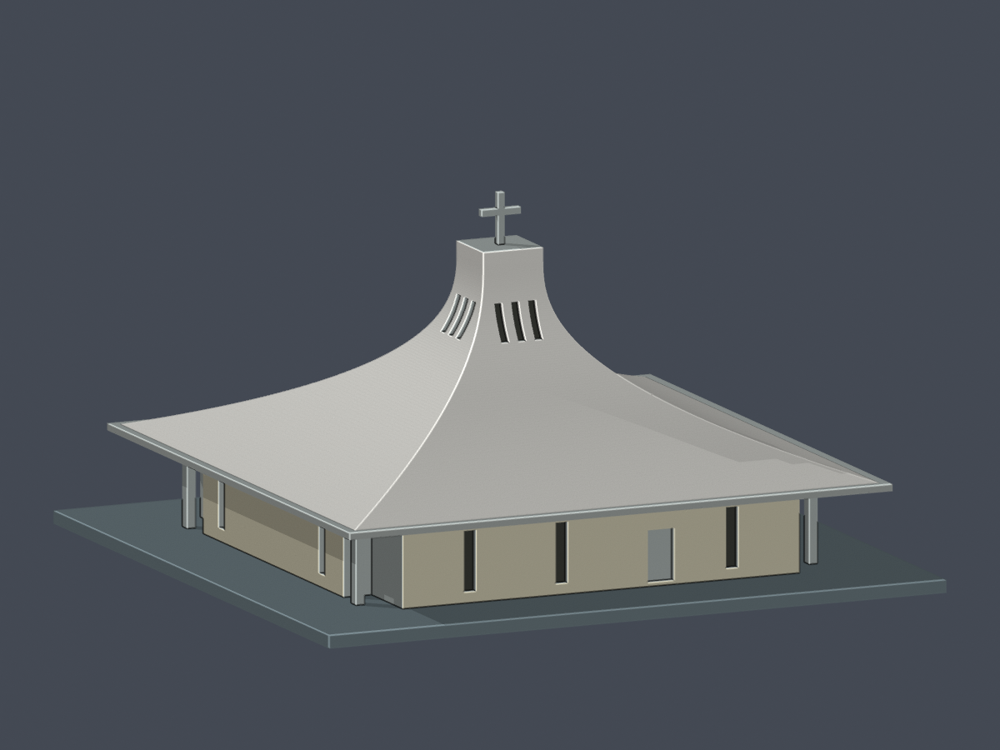
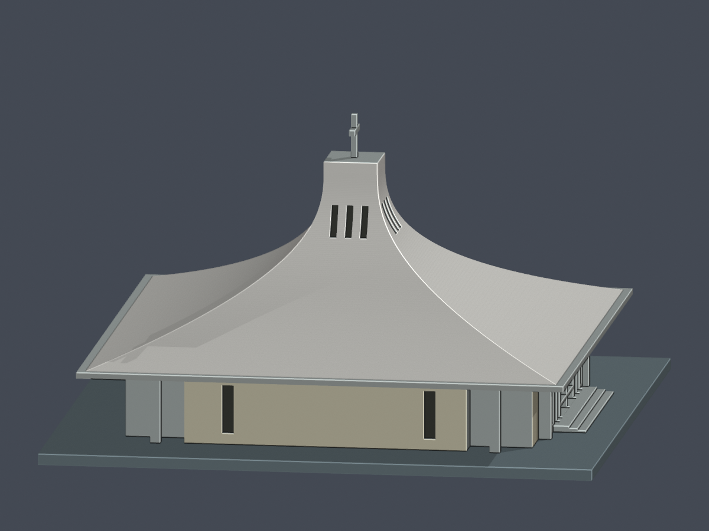
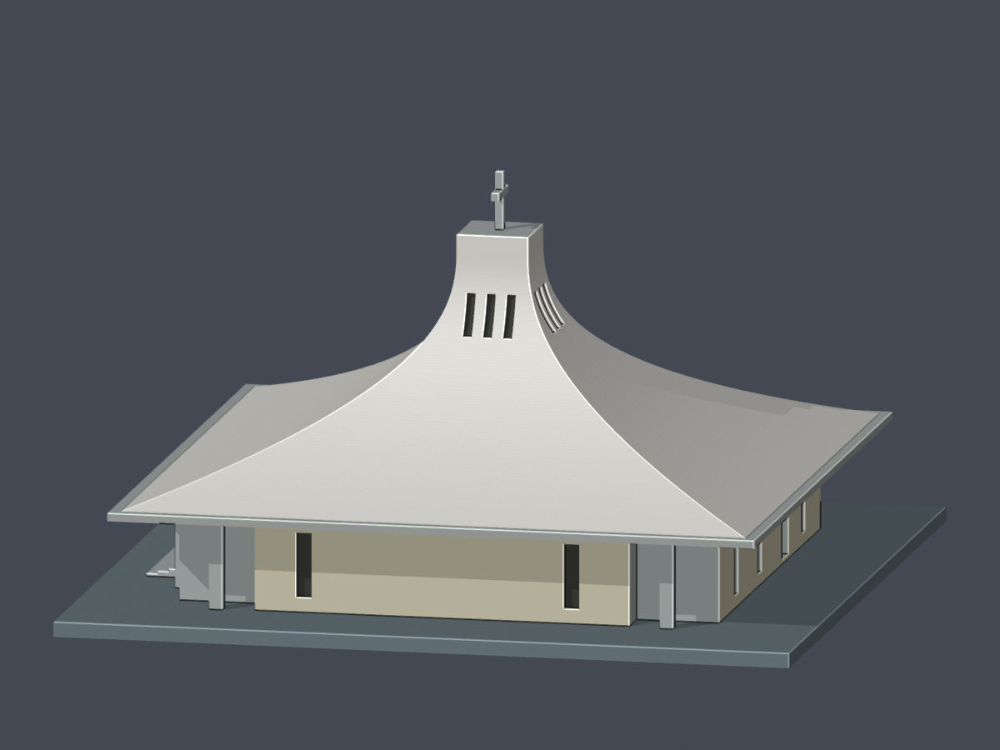
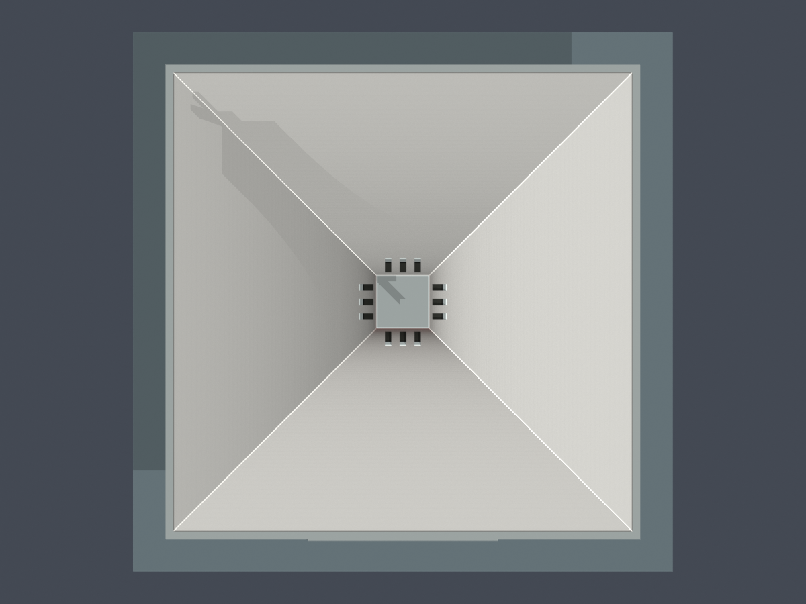
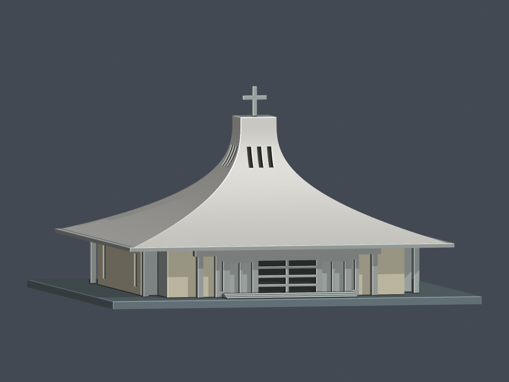
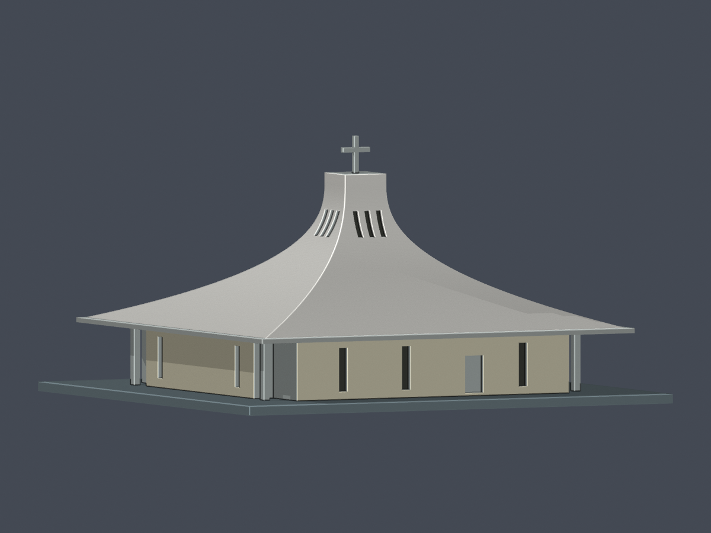

# 降臨堂｜有限證據配色層（約 2014 主堂）

| 模型預覽 | 模型預覽 | 模型預覽 |
| :---: | :---: | :---: |
| 正面<br> | 背面<br> |  |

## 本次後向上窄槽白殼垂直側壁延色

僅將原模型後向 +Y 的三個上部窄槽，兩側共六個完整垂直側壁、294 個原三角（每域 49 面），從 unknown_neutral 延用既有 shell_offwhite（材質 2，#ECEBE5）。原 2,285 個非零材料面全保留，其中含 67 個抽象底座面及 2,218 個原已色建築面；原 720 個上槽暗背一面不改。八槽材料名稱、sRGB 名義色與證據狀態不變。新版各槽面數為 1393／67／1598／67／97／16／720／14；建築已色 2,512，未確認建築 1,393，抽象底座 67，不代表全棟配色完成。

原 STL bytes、3,972 面／1,980 點、首見頂點表、三角序、座標、繞向、150×150×83.080002 mm 尺寸全部不動。Blender 原面 ID 屬性與未改面的證據區標籤保留，新增側壁另有證據區，不切割或重建原面。

有限域在原設計 z=10.65…12.45、三槽中心 x=−0.9／0／0.9，各側 x=中心±0.2；朝開口法向分別±X，僅 +Y 後側。原換算為 mm=(4.55x,4.55y,3+4.55z)。外界是原曲殼每 0.1 分段折線，內界是原槽背每 0.06 分段折線扣 0.25；以兩組節點聯集形成完整有限條帶，而非用理想光滑曲面重新建模。每域原 49 面皆全頂點／整三角入域、無重疊，且與原白殼共邊；原共面連通域全部包含。單域解析 9.3211841738 mm²、網格 9.3211824796 mm²，總解析 55.9271050428 mm²、網格 55.9270948778 mm²，微差屬原 float32 座標，未修形。

只補垂直側壁，不塗槽頂、槽底、下向簷底、冠頂、十字架、後門，也不泛化到另外三個殼方向。原全域混材共面分量為零，本次仍為零。下部乳白牆轉角的實景另有灰框、磚、開口與設備，原整面會跨材界，故維持 HOLD，不因牆面大就一律塗成乳白。十字架白／棕來源衝突及後紅門未登錄問題原樣保留。

來源為作者 Catherine Lee 公開文章所列 S2／S3：
- https://catherinelee234.com/wp-content/uploads/2016/06/img_0557.jpg
- https://catherinelee234.com/wp-content/uploads/2016/06/img_1732.jpg
本輪親看兩張完整照片，後側曲殼、三窄槽的淺色垂直側壁與暗色背面可分，主降臨堂與前景另建教會中心不混計。原登錄 EXIF 分別為 2014-01-28、2014-02-21，時區與相機時鐘未獨立驗證；文章 2016-06-08／網址 2016/06 是出版／上傳資訊，不是拍攝日。陰影或對向窄側壁為同開口白殼材料的有界延續推論，不是每個像素都獨立驗證，也不是校色油漆規格或 2026 現況。私人原照及裁切不入公開包。

原曲線、槽形與比例均為既有近似，不新增測繪精度。原工程與試印限制全部保留，尤其 52 個高損層／436 個跨層高損 polygon 樣本未因本次補色消失；未做實體試印、切片路徑或新增全域最薄壁／支撐認證。

原 root STL、原生成器／場景／單色預覽及所有歷史 QA／source／SHA256SUMS 保持 bytes。原 appearance/material-manifest.json 也完整保留，描述舊版統計；新版統計另在 continuation-material-manifest.json，未改寫歷史原色。新版 face-materials.json、mesh-data.npz、sju-advent-church-materials.3mf、scene.blend 與十張預覽經新 QA 驗證。保留七個原 Workbench 視角，增加前立面、後立面及底視，十張完整框入原頂點；同一真實模型網格，無展示代理或照片貼圖。材料原粗糙度 .8 保留。

新 qa-continuous-rearjamb 含有限域、獨審及輸出補核、strict3MF 零警告、材料編輯存取往返、Blender 材質／單點改存重開、原場景重渲染與 ZIP 隔離精確重建。新雜湊在 CONTINUATION-SHA256SUMS。安裝 appearance/source/continuation-requirements.txt 後執行 build_continuous_rearjamb.py、verify_continuous_exchange.py、verify_continuous_regions.py、verify_continuous_boundaries.py；Blender 執行 render_continuous_rearjamb.py 與 verify_continuous_scene.py。rebuild-continuous-source.zip 含必要原 STL 與腳本，不含私人影像。本地準備完成不等於已上傳。

場景 evidence_region_keys 僅在 33 個原鍵及原順序之後追加 rear_upper_vertical_jambs_continuation；只有本次 294 個側壁面的 evidence_region_id 改指新鍵，其他面的標籤與全部 original_stl_face_id 精確保留。其餘原物件屬性、完整材質定義與幾何不變，不能稱全部 attributes 未變。原標籤與十字架、背門、下牆等未解限制完整保留；新鍵表示有界同白殼延續推論而非逐像素實測。原 material-manifest 的材料與限制原樣留存，新增範圍另列 continuation-material-manifest。舊校驗與 QA 是歷史版本，現行校驗以 PUBLIC-MODEL-SHA256SUMS 與 appearance/CONTINUATION-SHA256SUMS 為準。

## 前版說明與保留限制

[回原模型](../README.md)


此層只為原有 **3,972 個三角面**指定材質；未切面、未重建、未縮放、未改動原 `model.stl`、原 Blend 或原預覽。不是新增建物，也不表示全校或整棟外觀均獲驗證。

## 交付

- [scene.blend](scene.blend)：可編修單一網格，8 個命名材質；每面保留 `original_stl_face_id` 與 `evidence_region_id`。
- [sju-advent-church-materials.3mf](sju-advent-church-materials.3mf)：真正的 3MF Core `basematerials` 與逐三角面材質屬性，毫米；不是改副檔名的 STL，也不是只在 Blender 顯色。未提供特定切片器的噴頭/耗材分派；軟體可能忽略顯示色，使用者仍須自行確認。
- [左側](previews/side-minus-x.png)、[右側](previews/side-plus-x.png)、[頂視](previews/top.png)、[正面低視角](previews/front-low.png)、[背面低視角](previews/rear-low.png)。左右為模型 ±X；正面為 −Y，不是已測定的東西南北。
- [逐面對照](face-materials.json)、[材質與證據區域](material-manifest.json)、[公開來源與限制](sources.json)。所有照片僅供私下研究，**未附原圖、裁圖或照片貼圖**。

| 模型預覽 | 模型預覽 | 模型預覽 |
| :---: | :---: | :---: |
| 左側<br> | 右側<br> | 頂視<br> |
| 正面低視角<br> | 背面低視角<br> |  |

## 配色依據與未知部分

2012 校方正面及 2014 第一手背／側照片支援：外露曲殼和方頸側面為白／暖白、可辨識低牆面為淡奶油色、外露門廳與簷緣為淺灰、已對上的凹窗背面為暗灰。2018／2019 教堂照片只作較晚時期的補充核對。RGB 是顯示近似，不是校色測量、油漆規格或 2026 現況宣稱。

| 材質 | 面數 |
|---|---:|
| 外露曲殼／方頸側面暖白 | 1,304 |
| 可辨識低牆面淡奶油 | 67 |
| 已對上的門廳／簷緣淺灰 | 97 |
| 正門中央玻璃凹槽背面暗灰 | 16 |
| 上部窄窗背面暗灰 | 720 |
| 下部窄窗背面暗灰 | 14 |
| 未知中性灰 | 1,687 |
| 抽象底座中性對比色 | 67 |
| **合計** | **3,972** |

**2,218 面有限證據配色；1,754 面明確標為未知／抽象底座。** 未知包括十字架 42 面、未見方頸頂面 8 面、向下表面 126 面、未能逐一對上的背門 2 面，以及其他凹槽側壁、遮蔽轉折和未辨識表面 1,509 面；底座另 67 面。十字架在不同照片有白與棕的衝突，未猜為金／銅／白。背照雖有紅門，未把紅色套上未確證的原面。

每個規則要求**三個頂點均在指定原表面／範圍內**，並檢查朝外法向；不用單純高度分帶或三角形中心點塗滿整棟。沒有為了配色切割原三角形，也沒有虛構磁磚紋理或補建原模型省略的線腳。凹窗只塗背面，側壁不整片塗黑。

## 重跑

原模型的 `model.stl` 必須留在上一層，SHA256 必須是：

`899833cab3d36540de1455757b2b1119f5d4563a8f0bede4f16286f036f04652`

Python 3.12 + `lib3mf==2.5.0`；Blender 4.3.2。原幾何參數重建另外依上一層 `requirements.txt`，本配色程式不需要 trimesh/manifold，也不覆寫 STL。

```sh
python appearance/source/build_appearance.py
blender -b -t 4 --python-exit-code 1 -P appearance/source/render_appearance.py
python appearance/source/verify_appearance.py
blender -b -t 4 --python-exit-code 1 -P appearance/source/verify_scene.py
```

請從建物目錄執行以上命令。程式以自身位置解析檔案；不依賴其他學校或私有研究路徑。3MF 先經 lib3mf 寫出，再把 XML 頂點數值寫回原 STL float32 的精確十進位表示，避免格式化捨入；不改座標、拓樸或材質。重新以 lib3mf 嚴格讀入驗證。

## 數位驗證與列印限制

- [配色／3MF 檢查](appearance-verification.json)：原座標和三角形順序完全一致；單連通正體積、所有邊雙面反向、所有頂點連結單環；零重複面／退化面。3MF 8 材質、全部逐面語義對應、嚴格讀入零警告。
- [Blend 重開驗證](blend-verification.json)：單一網格、無 modifier、逐面 ID 和材質相同，重開後正面 PNG 完全重現。
- [重建驗證](rebuild-verification.json)：原參數程式重建 STL 位元組一致；配色索引、材質表、3MF 和 7 張 PNG 均可重現。Blend 只保證幾何／材質語義，未宣稱整個二進位檔固定雜湊。
- [渲染記錄](render-manifest.json)、[視覺核對](visual-review.json)、[檔案雜湊](SHA256SUMS)。

**本次沒有重新實體試印或執行切片器工具路徑。** 原尺寸 150 × 150 × 83.08 mm、底座 3 mm、約 1:219.8 不變。原模型 52 整層及 436 跨層原 Polygon 樣本 opening 損失 >1% 的既有限定例外仍存在；不能宣稱零薄損、全域最小壁厚已通過或免支撐。外簷／門廊懸挑與細十架仍要實際切片確認，不可任意縮小。本層的幾何相等證據不取代原 QA，也不提高原幾何可信度。
