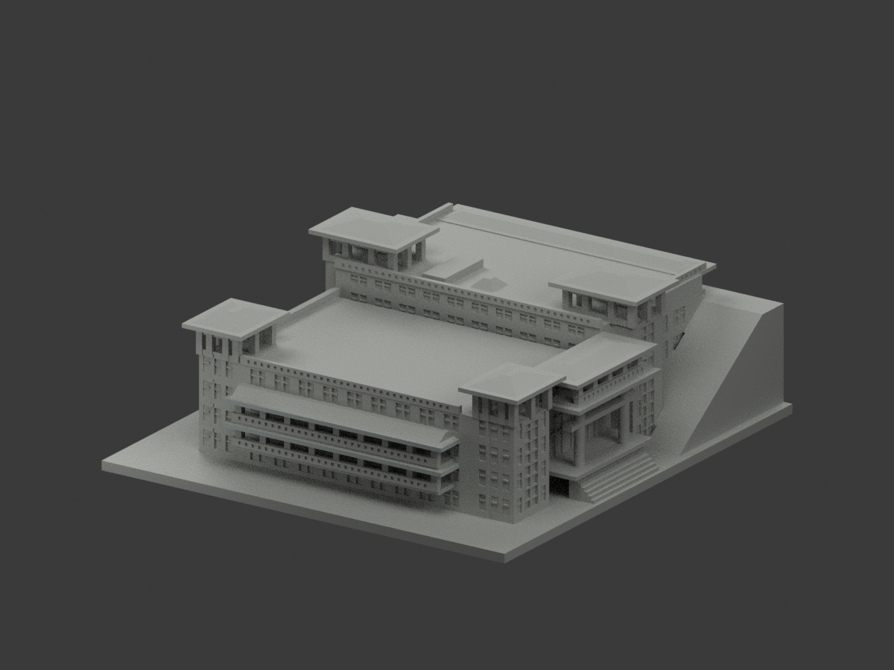
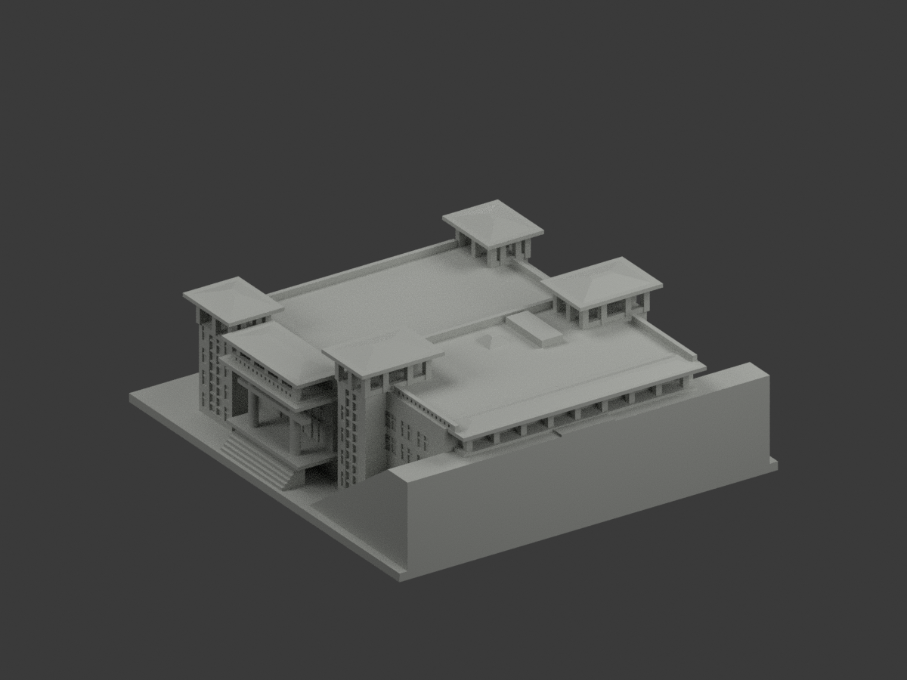
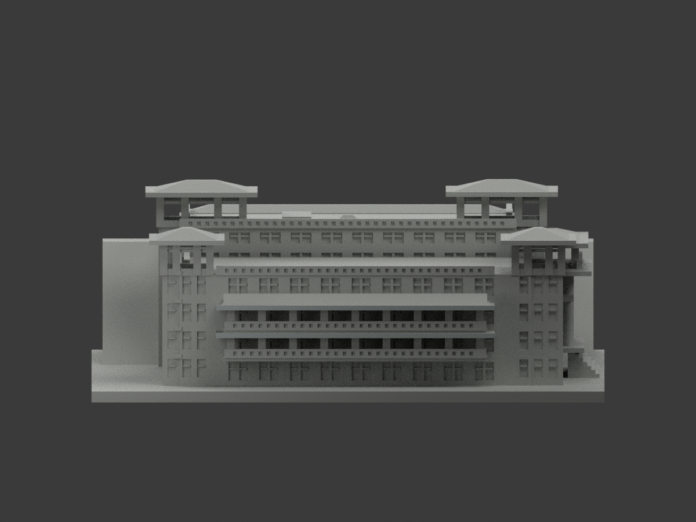
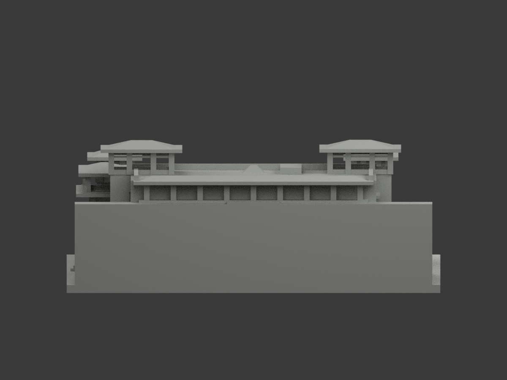
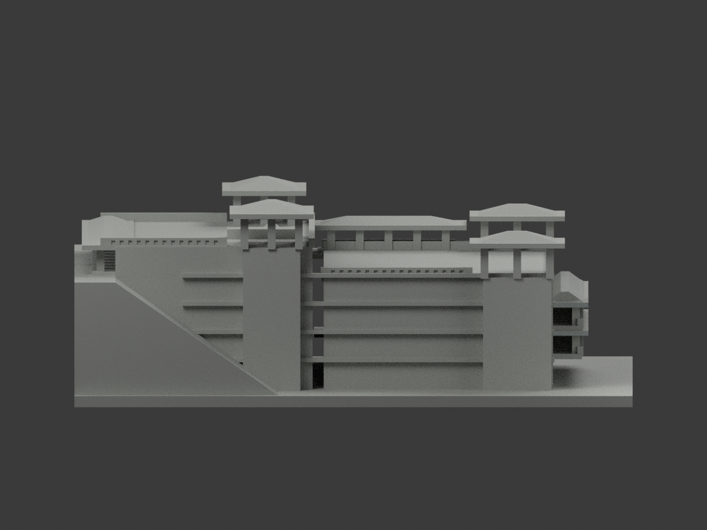
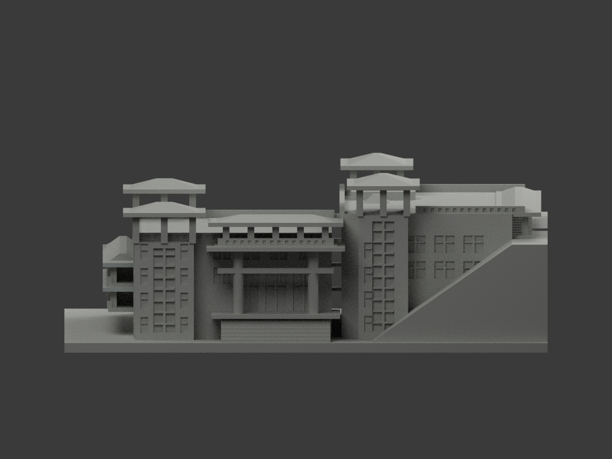
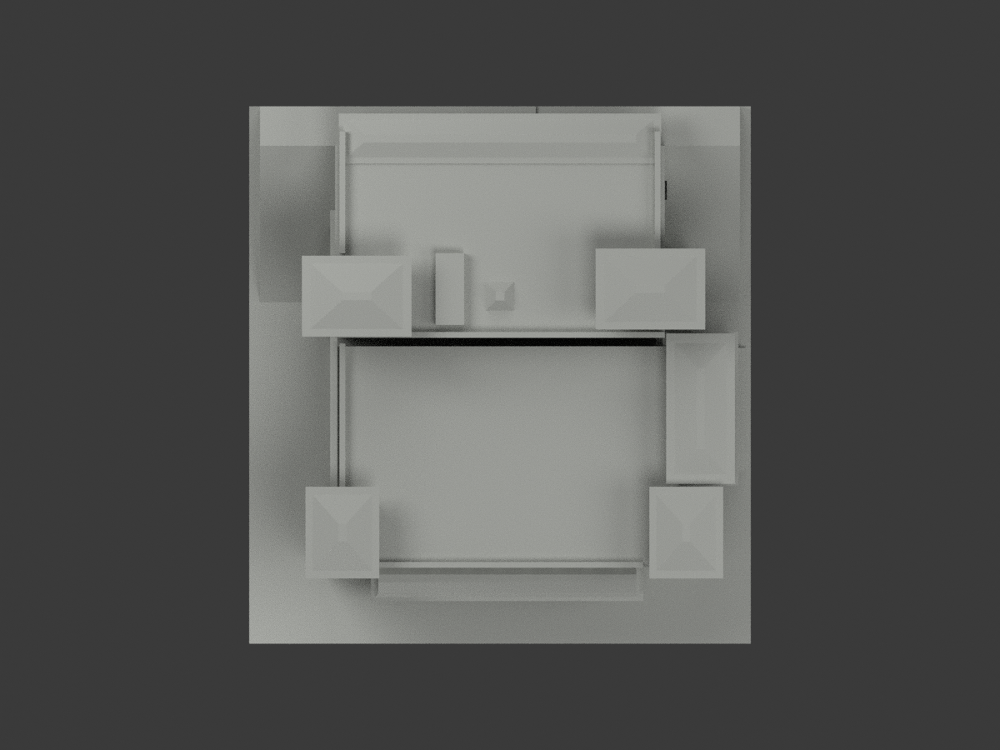
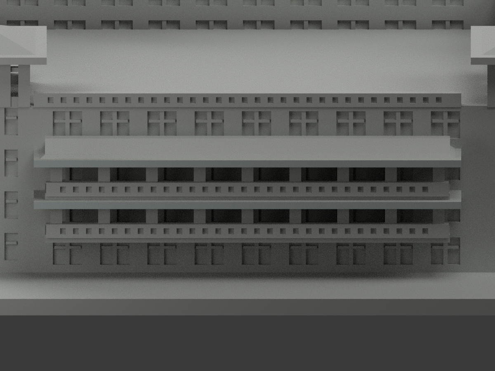
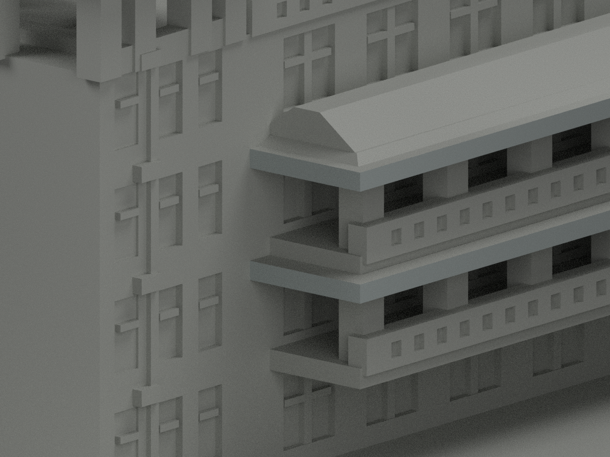
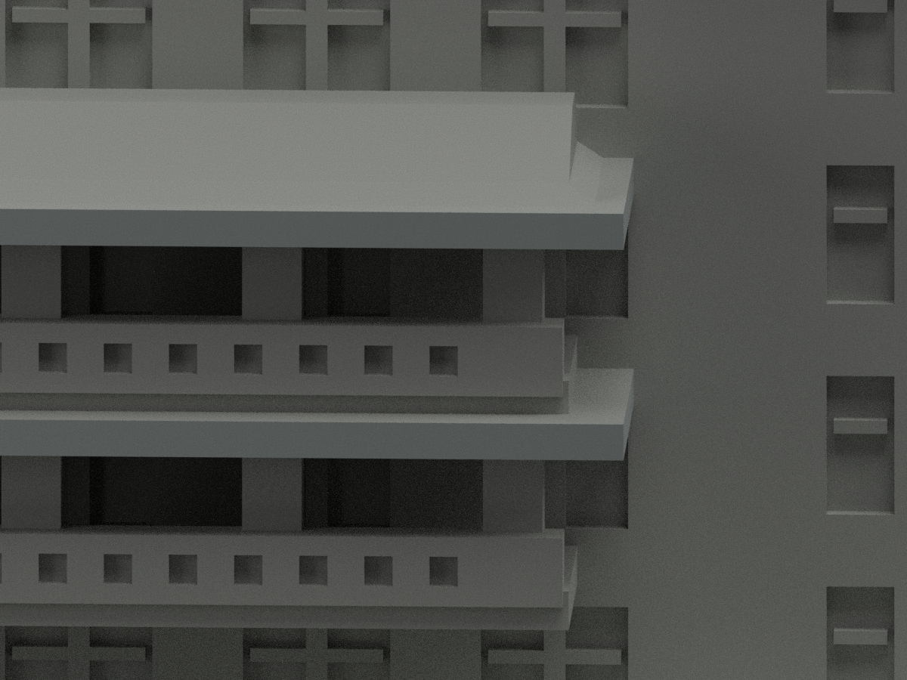

# 華梵圖書資訊大樓2009｜兩長簷左端同材質延續

## 模型預覽

| 前斜視 | 後斜視 | 正面 |
|---|---|---|
|  |  |  |
|  |  |  |
|  |  |  |
|  | | |

## 本次華梵圖資｜兩長簷左側薄簷端有限延灰

局部補色未完成。固定目前 8 灰面（南兩長簷前緣 4 面及右返 4 面），只新增左端 4 個原三角 [7862,7863,8682,8683]，由未知中性 index 1 延續同簷既有名義灰 index 0（#B4BCBB）。新面數 [12,15090]；原 15102 三角、7343 點及其順序、原 STL、palette bytes 與其他 15098 面材色完全不變。不切分、不補面、不改幾何或尺寸。

兩完整矩形與完整共面域皆在 x=−36，y=[−63.1,−53.6]，高度分別 z=[16.7,18] 與 [24.3,25.6]；各 9.5×1.3=12.35 mm²，合計 24.7 mm²。原四角與整個 1.3 mm 前緣均核對到既有灰前簷，背端止於原主牆 CSG 交界。原 float32 差異每域容差 0.00003 mm²，不 round 原點；全部 3821 共面連通域維持單材，不造成局部碎色。

本次重新取回並親看同一校方 3072px 南面原照，SHA256 與原登記 0fcea1342d8b693f09516157ccd74f64811fea9b6f186dc0ecc6268de50cba67 一致。兩灰色垂直薄簷位於紅瓦下，白斜飾屬較高屋坡的另一構件；本次不染白斜飾、紅瓦坡、簷底腹、頂面、後面、亭屋、窗、欄及混材牆。左端 9.5 mm 全深並非照片直接可見，是與灰前簷相連的同一薄簷端面之有限材料延續推論，不能宣稱現場測量或已校準 HEX。

原 EAVE-RETURN-SOURCE-QA 說明當輪不得延至未見左返，是右返那一輪的來源範圍限制，不是左側已證不同材質。本次另做有限域與材料構件重審，保留該舊限制及 SOURCE_SCOPE_SUPPORTED_PENDING_FINAL_MODEL_REVIEW 狀態原檔不動，不以新報告覆寫歷史或冒稱新照片。第二獨審確認原簷板垂直側端和較高白斜飾在原幾何上可分；左返仍只以同簷推論，不擴到其他亭與屋面。

南照原 EXIF 2008:05:18 11:18:44 早於 2009-10-30 啟用記錄；相機時鐘與時區未獨立驗證，不視為已證竣工後照或 2026 現況。四亭與廣欽紀念圖書館仍是同棟 count_delta=0。原 77 方柱段、2 圓柱與 2053 跨層 loss 記錄不混淆；原 268 抽層、2804 多邊形、25 全層>1%、全層最大3.157475829520%、分量最大3.251605705027986%、角外非零殘差及有限厚度 probe 等原例外完整保留於下方原說明與舊 QA。本次不重簽全域列印/工程/強度合格，未實體試印、未重新做 FFF 切片，不可任意縮小。

本次 QA 另存 qa-continuous-fascia，含兩道獨立域審核、新輸出複核、STL/NPZ/3MF 精確交換、lib3mf strict 與隔離改材往返、Blender 改材/改一點另存重開及交付場景重渲染 PNG 比對、ZIP 隔離重建和十視角檢查。模型重建由固定 SHA 公開 baseline NPZ、原 STL 與 palette 執行 build_continuous_fascia.py，不依賴私人圖片。原照片與來源 PDF 不打包、不貼圖或假定有再散布授權。

以下舊版數量與「不得延左」均保留為歷史範圍，新增左端的範圍與推論限制以本段及本次 QA 為準。

---

場景僅同步更新 source_mesh_sha256 以對應本次含 4 面材質指派變更的 color-mesh.npz；原 scope 與全部其他原屬性、完整材質定義及幾何不變。固定原 8 灰面全部保留，新增左端僅同一薄簷材料延續推論，不是全深逐面照片確證。原左返未見的前輪限制與來源 pending 原檔不改，EXIF 早於啟用記錄的時序疑義、目估與所有原工程例外及未試印限制完整保留。兩槽 palette.json 原 bytes 不變。

本頁為現行說明；根 README.zh-TW.md 保留原文與原 bytes，僅作歷史記錄。

## 前版說明與保留限制（完整歷史文字）

# 華梵圖書資訊大樓2009｜南兩長簷右返面局部補灰

局部補色未完成。原4前簷灰面完全保留，新增右側4原三角，共8配色、15094未知中性、15102原三角。沿用原名義灰#B4BCBB及原中性色票，不改任何幾何。兩完整共面域：x40、y[-63.1,-53.6]、z16.7..18及24.3..25.6。不得把左右、頂底或全屋一起推色。

本次是既有官方3072px南照原像素再審，非新照片。照片可辨兩條灰簷緣在右角轉向鄰塔；不取紅瓦、白斜脊飾或陰影底腹。接塔端與模型厚度/深度仍屬簡化近似，只支持同構件灰族，非校準HEX。塔近照僅情境旁證。原南照EXIF2008早於2009啟用的日期限制完整保留，不宣稱現況或竣工後驗證。

原四亭與廣欽圖書館仍同棟，67原件完整私存；原展示aliases、PREVIEW-TRANSITION、previews及所有原工程檢核JSON不變。歷史色化QA保存於qa/eave-return-previous；EAVE-RETURN-SOURCE-QA固定來源階段pending快照，最終模型獨審另檔，不回寫。本次COLOR-ASSIGNMENT、COLOR-FORMAT-GEOMETRY、SCENE、EAVE-RETURN-SCENE-QA對應本次材色；舊凍結及舊獨審不代表本次。尚未發布、無實體試印或工程再認證。

## 原版本說明與所有限制（歷史原文，以下4面/15098等統計只指前版）

# 華梵圖書資訊大樓｜南面兩長簷前緣局部灰

**局部補色未完成：僅南面兩長簷完整4原三角名義灰，其餘面尚未分色。原有限 QA 例外保留，色審不追認全域列印安全或全幾何 QA。** partial_color_incomplete=true、fully_colored_exterior=false；同項 hfu-library-2009/count_delta=0。身份 HFU Library 2009 partial color。四亭與廣欽紀念圖書館屬同建築，不拆套；原厚化/地形近似不變。

## 唯一材色域與原件

先枚舉whole y−63.1無限平面全部4面，exact shared-edge BFS為兩完整2三角矩形，再核x−36..40/z16.7..18及24.3..25.6原界。4名義灰#B4BCBB，其餘15098未知中性#B8BAB5；3821共面域一致。STL已含scale2/z+3，不再變換，不裁面/補面。資料覆蓋邊界不是真材色接縫，中性不是現場灰。

只紅瓦下真正前垂直簷緣；不擴紅瓦坡/端白飾、亭屋、牆灰暖磚混面、玻璃反光實板、厚實欄代理、背/右裁切/坡地/頂底側。原外觀/材質精度不由本次補色追認。

33 immutable原件無OBJ，全原包私存；原scene、renderer、README另以ORIGINAL-PREVIEW別名保留，原previews/全部QA不變。舊Warm stone、Recess contrast、Base contrast三種展示材並非實景色源結果；本次source-gap有界變體不是把已有彩色包冒稱單色。PREVIEW-TRANSITION.md保版本說明。

## 日期與原 QA 例外

南照原EXIF2008:05:18 11:18:44、塔照2009:11:10 14:33:10，無時區/獨立時鐘驗證。前者早於2009-10-30啟用紀錄，不宣已證竣工後照、不當2026現況。2017/2024正射與其他年份資料不拼作同日測繪。

原268抽層2804多邊形；2053跨層loss紀錄=1936矩形+117非矩形，**不是2053根柱**。實體77方柱段=南18+北9+東上10+四亭40，另2圓柱。25全層>1%，全層最大3.157475829520%；原分量最大3.251605705027986%、保留96.74839429497201%，非矩形最大2.2491238349787%，原WKT結果不以理想矩形取代。

原0.41mm vertex遮罩之外最大0.0030853459156mm²；真角外0.00319574819093mm²/0.07246599662%，在原0.005mm邊允差內，非零。非矩形6.9944162e−17為數值殘差，不宣絕對零。77柱法向最低2.0999984mm、3634非矩形probe最低1.0999985mm、5凹背最低1.1599998mm、3716指定起點inside，只有限指定probe，不是全mesh全方向壁厚證明。無實際切片/試印、無support-free/強度認證，不任縮比例。

原build+color精確隔離重建、byte/triangle identity、3MF、reopen、共面及10圖格式核與上述原printability有限例外分開。STL無色，2材未試多料列印。來源原照私存不公開。

HFU Library 2009 partial color. Only four original triangles on two complete south vertical eave fascias receive nominal gray;15098remain unknownneutral. Whole y=-63.1plane exactly equals two connected original rectangles. Original15102triangles and all33assets retained,noOBJ. Originalthreepresentationmaterials preserved in aliases/privatehistory; this is a source-gap variant,count0,not a newlymonochromebuilding.

Original77squarepostsegments plus2roundcolumns are not the2053cross-layerlossrecords. Originalnonzerooutside-corner residuals,lossfractions andfiniteprobe limitations remain. Samegeometry identity and colorformat PASS do not certify globalprintability,physicalprint,strength or unrestrictedscale. Southphoto rawEXIF2008 predates2009opening; metadata unverified/nozone,not current2026. Fouropenpavilions remain oneboundedbuilding; roofs/glass/railproxies/mixedwalls/unknownback neutral. Sources private.
